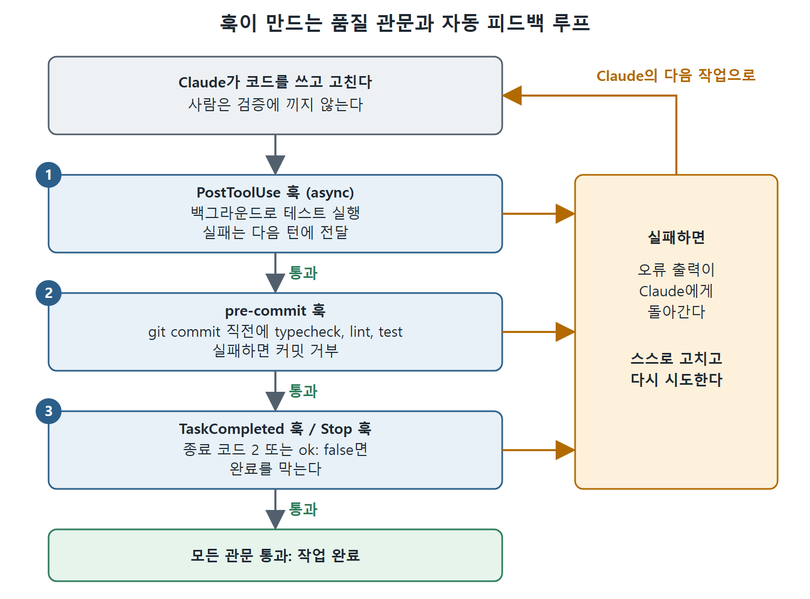

# 훅으로 만드는 품질 관문

훅(hook)은 특정 시점에 자동으로 실행되는 콜백으로, 2장에서 다룬 수명 주기 기능이다. 사람이 곁에 있을 때는 편의 기능이지만, Claude Code가 CI에서 무인으로 돌 때는 핵심 인프라가 된다. 이 문서는 자동화 워크플로에서 특히 가치가 큰 훅 패턴들을 소개한다. 비동기 테스트 러너, 작업 완료를 막는 관문, 서브에이전트가 판단하는 Stop 훅, 환경 변수 유지, 프리커밋 훅이 그것이다. 마지막에 커밋과 PR에 붙는 표기(attribution) 설정도 다룬다.

공통된 원리는 "Claude가 실패를 바로 보고 스스로 고치게 한다"는 것이다. 사람이 품질 관리의 병목이 되지 않도록 검증을 자동화된 피드백으로 바꾼다.




그림은 Claude가 쓴 코드가 훅 관문을 차례로 지나는 흐름을 보여 준다. 어느 관문에서든 실패하면 오류 출력이 Claude에게 돌아가 스스로 고치고, 모두 통과해야 작업이 끝난다.

---

## 1. 비동기 훅: 백그라운드 테스트 러너

`"async": true`를 지정한 `PostToolUse` 훅은 Claude의 실행을 막지 않고 백그라운드에서 돈다. Claude가 코드를 쓴 뒤 테스트 스위트를 돌리는 용도로 만들어진 기능이다. 테스트가 병렬로 도는 동안 Claude는 다음 파일 작업을 계속한다. 테스트가 끝나면 결과는 다음 대화 턴에서 Claude에게 전달된다.

```json
{
  "hooks": {
    "PostToolUse": [{
      "matcher": "Write|Edit",
      "hooks": [{
        "type": "command",
        "command": "$CLAUDE_PROJECT_DIR/.claude/hooks/run-tests-async.sh",
        "async": true,
        "timeout": 300
      }]
    }]
  }
}
```

테스트 러너 스크립트는 stdin으로 도구 입력을 읽고, 수정된 소스 파일에 대응하는 테스트 파일을 찾아 테스트를 돌린 다음, 결과를 담은 `systemMessage` 필드가 있는 JSON을 출력한다.

```bash
INPUT=$(cat)
FILE=$(echo "$INPUT" | jq -r '.tool_input.file_path // empty')
if [[ -z "$FILE" ]] || [[ ! "$FILE" =~ \.(ts|js)$ ]]; then
  exit 0
fi
TEST_FILE="${FILE%.ts}.test.ts"
if [[ ! -f "$TEST_FILE" ]]; then
  exit 0
fi
RESULT=$(npx jest "$TEST_FILE" --no-coverage 2>&1)
EXIT_CODE=$?
if [[ $EXIT_CODE -ne 0 ]]; then
  echo "{\"systemMessage\": \"Tests failed for $TEST_FILE:\\n$RESULT\"}"
fi
exit 0
```

스크립트는 `.ts`나 `.js` 파일이 아니거나 대응하는 테스트 파일이 없으면 조용히 종료한다. 테스트가 실패했을 때만 메시지를 낸다. Claude는 다음 턴에 "Tests failed for..."를 보고 스스로 고친다. 사람이 개입할 필요가 없다. 테스트가 곧 피드백 루프다.

---

## 2. TaskCompleted 훅: 실패하면 완료를 막기

`TaskCompleted` 훅은 Claude가 작업을 완료로 표시할 때 발동한다. 종료 코드 2를 반환하면 완료를 막고 피드백을 보낸다. 자동 문지기 역할을 하는 셈이다.

```bash
#!/bin/bash
INPUT=$(cat)
SUBJECT=$(echo "$INPUT" | jq -r '.task.subject // empty')
npm test 2>&1
if [ $? -ne 0 ]; then
  echo '{"reason": "Tests are failing. Please fix before marking complete."}'
  exit 2
fi
exit 0
```

테스트가 통과하기 전에는 Claude가 작업을 끝낼 수 없다. 실패 출력을 받아 문제를 고치고 다시 시도한다. 서브에이전트가 작업을 자율적으로 완료하는 멀티 에이전트 워크플로에서 특히 강력하다. 검증을 통과하기 전에는 어떤 작업도 "완료"로 표시되지 않도록 훅이 보장하기 때문이다.

---

## 3. 에이전트 기반 Stop 훅: 똑똑한 검증

훅 중 가장 강력한 변형은 `type: "agent"`다. bash 스크립트를 실행하는 대신, Claude Code가 전체 도구 접근 권한(Read, Grep, Glob)을 가진 서브에이전트를 띄워서 Claude가 멈춰도 되는지 평가하게 한다. 서브에이전트는 코드베이스를 조사하고, 테스트를 돌리고, 근거를 갖춘 판단을 내릴 수 있다.

```json
{
  "hooks": {
    "Stop": [{
      "hooks": [{
        "type": "agent",
        "prompt": "Check if all tests pass by running the test suite. If any tests fail, respond with ok: false and explain which tests failed.",
        "timeout": 120
      }]
    }]
  }
}
```

서브에이전트는 테스트 스위트를 돌리고 결과를 확인한 다음 `{"ok": true}` 또는 `{"ok": false, "reason": "..."}`를 반환한다. false가 오면 Claude는 멈추지 않고 실패 이유를 읽은 뒤 작업을 계속한다.

이것은 기계적인 검증(종료 코드가 0인가)에 그치지 않고 맥락까지 보는 검증이다. 테스트가 통과했는지, 그리고 그 결과가 말이 되는지를 함께 따진다.

---

## 4. CLAUDE_ENV_FILE: 환경 변수 유지

SessionStart 훅은 `CLAUDE_ENV_FILE` 환경 변수를 쓸 수 있다. 이것은 파일 경로인데, 여기에 `export` 문을 써 두면 세션에서 이후 실행되는 모든 Bash 명령 앞에서 그 내용이 적용된다. CI에서 계속 문제가 되던 부분, 즉 Claude Code의 Bash 명령이 올바른 환경에서 실행되도록 하는 일을 해결해 준다.

```bash
#!/bin/bash
if [ -n "$CLAUDE_ENV_FILE" ]; then
  echo 'export NODE_ENV=production' >> "$CLAUDE_ENV_FILE"
  echo 'export DEBUG_LOG=true' >> "$CLAUDE_ENV_FILE"
  echo 'export PATH="$PATH:./node_modules/.bin"' >> "$CLAUDE_ENV_FILE"
fi
exit 0
```

언어 버전 관리자, 가상 환경, 그리고 보통은 설정 스크립트를 source해야 하는 CI 전용 구성에 특히 유용하다. 환경은 세션 내내 유지되고, Claude Code는 설정 과정을 몰라도 된다.

---

## 5. 프리커밋 훅: 실패를 곧바로 되돌려 주는 백프레셔

프리커밋 훅(git commit이 확정되기 전에 실행되는 검사)은 자율 Claude Code에게 아주 촘촘한 품질 관문이 된다. 타입 검사기, 린터, 테스트 스위트를 돌리는 훅을 설정해 두자.

```bash
# .husky/pre-commit
pnpm typecheck && pnpm lint && pnpm test-run
```

Claude Code(또는 서브에이전트)가 `git commit`을 실행하면 이 훅이 즉시 발동한다. 타입 검사기가 오류를 찾거나, 린터가 위반을 지적하거나, 테스트가 실패하면 커밋이 거부된다. Claude는 오류 출력을 보고 스스로 고친다. 커밋이라는 결정적인 경계에서 나오는 자동 피드백이어서, 여러 커밋에 걸쳐 버그가 쌓이는 대신 근원에서 문제를 잡는다.

CI 관점에서 이 의미는 크다. 별도의 검증 시스템을 만들 필요가 없다. 이미 쓰고 있는 프리커밋 훅이 자율 운영의 품질 관문이 된다. Claude가 만드는 모든 커밋이 사람이 만드는 커밋과 같은 검사를 거친다. 품질 관리에서 사람이 더 이상 병목이 되지 않는다.

---

## 6. 표기(attribution) 설정

Claude Code는 기본적으로 git 커밋과 PR에 자신이 작성에 관여했음을 표기한다. CI 워크플로에서는 이를 바꾸거나 끄고 싶을 수 있다. `attribution` 설정이 이를 제어한다.

```json
{
  "attribution": {
    "commit": "Generated with AI\n\nCo-Authored-By: AI <ai@example.com>",
    "pr": ""
  }
}
```

`commit`은 커밋 메시지에 붙는 트레일러를 바꾼다. `pr`은 PR 설명에 덧붙는 문구를 정한다. 빈 문자열이면 해당 위치의 표기가 꺼진다. 모든 커밋이 AI가 만든 자동화 워크플로라면 기본 형식 대신 간결한 표기를 쓰고 싶을 수도 있고, PR 설명을 깔끔하게 유지하려고 PR 표기를 완전히 끌 수도 있다.

<br>
<br>
<br>

[Claude Code The Definitive Guide to Agentic Development-2](../)
