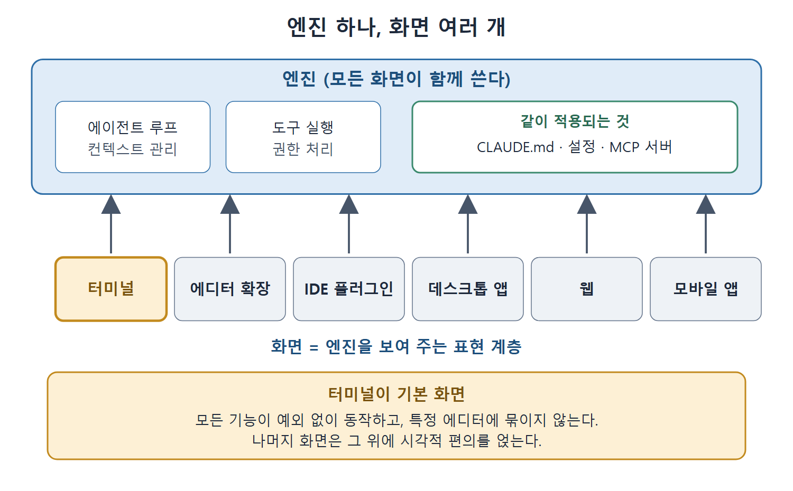

# 엔진 하나 화면 여러 개

Claude Code는 터미널에서만 쓰는 도구가 아니다. 코드 에디터 확장, 데스크톱 앱, 웹, 모바일 앱에서도 돌아간다. 어느 화면에서 쓰든 안쪽 엔진은 같고, 그래서 CLAUDE.md, 설정, MCP 서버도 똑같이 적용된다. 달라지는 것은 사용자가 만나는 화면(surface)과 그 화면이 잘 받쳐 주는 작업 방식뿐이다.

이 문서는 엔진과 화면이 어떻게 나뉘어 있는지, 그리고 그중 가장 기본인 터미널 화면이 왜 여전히 중심인지 설명한다. 이어지는 문서들에서 각 화면의 특징과 화면 사이를 오가는 방법을 하나씩 다룬다.

---

## 1. 엔진과 화면을 나눈 구조

Claude Code는 설계 단계에서 엔진과 인터페이스를 분리했다. 엔진은 에이전트 루프(agentic loop), 컨텍스트 관리, 도구 실행, 권한 처리처럼 앞선 장들에서 설명한 모든 기계장치를 맡는다. 터미널, 에디터 확장, 데스크톱 앱은 그 엔진을 보여 주는 표현 계층(presentation layer)일 뿐이다.

그림처럼 에이전트 루프와 도구 실행 같은 기계장치는 엔진 하나가 맡고, 터미널부터 모바일 앱까지 모든 화면이 그 엔진을 함께 쓴다. 그래서 CLAUDE.md, 설정, MCP 서버가 어느 화면에서나 똑같이 적용된다.

이 구조 덕분에 화면을 바꾼다고 도구를 바꾸는 것이 아니다. 실제로 이어지는 것은 다음과 같다.

- CLAUDE.md 파일은 어느 화면에서 열든 똑같이 읽힌다.
- 권한 설정은 모든 화면에 그대로 적용된다.
- MCP 서버는 MCP를 지원하는 모든 화면에 연결된다.
- 터미널에서 만든 작업 방식은 에디터 확장에서도 약간만 손보면 그대로 쓸 수 있다.

## 2. 지금 쓸 수 있는 화면

| 화면 | 한 줄 설명 |
|---|---|
| 터미널 | 가장 먼저 나왔고 기능이 가장 많은 화면 |
| 코드 에디터 확장 | 인기 있는 코드 에디터 위에 얹는 확장 |
| IDE 플러그인 | 주요 IDE 계열에 설치하는 플러그인 |
| 데스크톱 앱 | IDE와 터미널 밖에서 따로 도는 독립 앱 |
| 웹 | 브라우저에서 클라우드로 돌리는 화면 |
| 모바일 앱 | 클라우드 세션을 감시하고 지시하는 화면 |

화면마다 잘하는 상호작용이 다르지만, 어느 것도 Claude Code가 근본적으로 하는 일을 바꾸지는 않는다. 책은 에디터 제품 이름을 직접 밝히지 않고 "인기 있는 코드 에디터", "주요 IDE 계열"이라고만 적는다. 이 노트도 같은 방식으로 쓴다.

## 3. 터미널 화면: 모든 기능이 있는 기본 화면

터미널은 Claude Code가 시작된 곳이고 지금도 가장 강력하다. 책은 이 책에서 설명한 기능이 터미널에서는 예외 없이 모두 동작한다고 강조한다.

터미널 화면이 주는 것은 다음과 같다.

- 모든 플래그를 쓸 수 있는 전체 CLI
- 파이프(pipe)처럼 유닉스 도구와 조합하는 방식을 바로 쓸 수 있는 것(6장에서 다룬 내용)
- 프롬프트를 입력할 때 쓰는 모달 편집
- 백그라운드로 bash 명령을 실행하는 기능
- 터미널 창이나 분할 영역마다 인스턴스를 여러 개 띄우는 것

세션 관리, 출력 형식, 자동화 연동을 완전히 통제할 수 있는 화면은 터미널뿐이다. 다른 화면은 이 중 일부만 보여 준다.

### 숙련자가 터미널을 먼저 쓰는 이유

경험 많은 사용자가 터미널 중심으로 일하는 이유는 실용적이다. 터미널은 사용자와 Claude 사이에 끼어드는 그래픽 계층이 없다. 프롬프트를 치면 Claude가 돌고, 결과가 보인다. 이 피드백 루프가 짧다.

Claude가 고친 파일을 확인하고 싶으면 평소 쓰는 에디터에서 열면 된다. 테스트를 돌리고 싶으면 다른 터미널 창에서 돌리면 된다. 터미널은 IDE가 되려는 도구가 아니라, 사용자가 선호하는 어떤 IDE 옆에서도 같이 쓸 수 있는 명령 화면이다.

### IDE에 묶이지 않는다는 장점

이 방식은 잘 드러나지 않지만 큰 장점이 하나 더 있다. 특정 에디터에 의존하지 않는다는 점이다. 팀원마다 쓰는 에디터가 다를 수 있다. 누구는 코드 에디터, 누구는 다른 IDE 계열, 누구는 아주 단순한 텍스트 에디터를 쓴다. 그래도 에디터를 통일할 필요 없이 Claude Code 작업 방식만 표준화하면 된다. CLAUDE.md, 에이전트 정의, MCP 설정, 훅 시스템이 옆 창에 어떤 에디터가 열려 있든 똑같이 동작하기 때문이다.

## 4. 터미널 우선이라는 설계 철학

터미널 우선은 단순한 취향이 아니라 Claude Code가 발전해 가는 방향을 정하는 설계 철학이다. 터미널은 어디에나 있다. 모든 운영체제에 있고, 모든 IDE 안에 내장되어 있고, 모든 원격 서버에 접속할 때도 결국 터미널을 쓴다. 그래서 기능을 터미널부터 만들면 어디서나 동작이 보장된다. 확장 프로그램부터 만들면 터미널 사용자가 뒤처진다. 터미널 우선 방식에서는 모두가 전체 기능을 쓰고, 확장은 그 위에 시각적 편의를 얹는다.

이 철학은 학습 시간을 어디에 쓸지에도 영향을 준다.

- 터미널 작업 방식을 익히면 그 기술이 모든 화면에서 통한다.
- 확장 프로그램 작업 방식을 익히면 그 확장에서만 쓸 수 있다.
- 시간이 부족하다면 터미널부터 익히고, 확장 쪽 작업 방식은 나중에 다듬기 용도로 더하는 편이 낫다.

이 철학은 Claude Code가 IDE를 대체하려 하지 않는 이유도 설명해 준다. IDE가 잘 못 하는 에이전트 작업은 Claude Code가 맡고, 편집, 디버깅, 코드 탐색처럼 IDE가 전용으로 잘 만들어진 일은 IDE에 남겨 둔다. 둘은 경쟁하지 않고 협력한다.

 
 
 

[Claude Code The Definitive Guide to Agentic Development-2](../)
