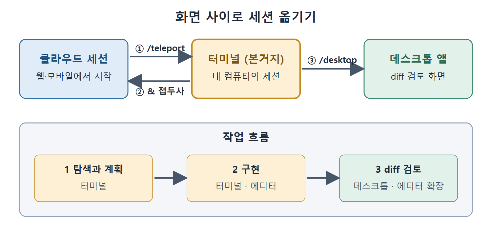

# 화면 사이 작업 옮기기

Claude Code의 화면들은 서로 막혀 있지 않다. 세션을 한 화면에서 다른 화면으로 옮길 수 있고, 책은 이것을 이 분야 도구 중에서 Claude Code만 가진 특징으로 꼽는다. 이 문서는 클라우드에서 터미널로 가져오는 /teleport, 터미널에서 클라우드로 보내는 & 접두사, 데스크톱으로 넘기는 /desktop을 설명한다. 이어서 PR 상태 표시, 컨텍스트 전환 비용이 사라지는 효과, 터미널이 중심이 되는 작업 흐름을 다룬다.

---

## 1. /teleport: 클라우드 세션을 터미널로 가져오기

/teleport 명령(줄여서 /tp)은 클라우드 세션을 내 터미널로 끌어온다. 웹이나 휴대폰에서 오래 걸리는 작업을 시작해 놓고 자리를 비웠다가, 검토하고 이어갈 준비가 되면 로컬 머신으로 가져오는 식이다.

```
/teleport
```

실행하면 클라우드 세션 목록이 대화형 선택기로 나온다. 하나를 고르면 Claude Code가 다음을 순서대로 처리한다.

1. 지금 올바른 저장소에 있는지 확인한다.
2. 원격 세션의 브랜치를 가져와서 체크아웃한다.
3. 전체 대화 기록을 터미널로 불러온다.

커밋하지 않은 로컬 변경이 있으면 먼저 stash하라고 안내한다. 명령줄에서는 --teleport 플래그로 같은 일을 한다.

```
claude --teleport
claude --teleport <session-id>
```

## 2. & 접두사: 클라우드로 작업 보내기

반대 방향, 즉 터미널에서 클라우드로 보낼 때는 & 접두사를 쓴다. 대화형 세션 안에서 메시지를 &로 시작하면 된다.

```
& Fix the authentication bug in src/auth/login.ts
```

이렇게 하면 현재 대화의 컨텍스트를 가진 새 클라우드 세션이 만들어진다. 작업은 Anthropic의 인프라에서 돌고, 사용자는 로컬에서 하던 일을 계속한다. 백그라운드 세션 전체의 상태는 /tasks로 확인한다. 목록에서 t를 누르면 해당 세션으로 teleport된다.

여기서 나오는 작업 패턴이 "로컬에서 계획하고 원격에서 실행하기"다. 플랜 모드로 Claude를 시작해 접근 방식을 함께 정한 다음, 그 계획을 클라우드로 보내 자율적으로 실행시킨다.

```
& Execute the migration plan we discussed
```

## 3. /desktop: 데스크톱 앱으로 넘기기

/desktop 명령은 터미널 세션을 데스크톱 앱에 넘긴다. 전체 대화 컨텍스트가 그래픽 화면으로 옮겨 가고, 거기서 시각적 diff 검토, 인라인 코멘트, 변경 일부만 수락하기를 쓸 수 있다. 작업이 탐색 단계에서 검토 단계로 넘어갔을 때 쓰기 좋은 방법이다.

| 방향 | 방법 |
|---|---|
| 클라우드에서 터미널로 | /teleport, /tp, --teleport |
| 터미널에서 클라우드로 | 메시지 앞에 & |
| 터미널에서 데스크톱으로 | /desktop |

## 4. 화면을 오가는 작업 흐름

이 기능들이 모이면 다음과 같은 흐름이 나온다. 터미널에서 탐색하고 계획한다. 터미널이나 에디터에서 구현한다. 데스크톱 앱이나 에디터 확장에서 diff를 검토한다. 터미널이 본거지이고, 시각적인 화면은 검토가 도움이 될 때 꺼내 쓰는 전문 도구다.



그림 위쪽은 클라우드, 터미널, 데스크톱 앱 사이에서 세션을 옮기는 세 가지 방법이고, 아래쪽은 터미널에서 탐색과 구현을 한 뒤 검토 화면으로 넘어가는 순서다.

이것은 대부분의 IDE 연동 방식과 반대다. 보통 도구는 IDE 안에 들어가서 나오지 않는다. Claude Code는 이 관계를 뒤집어서 터미널이 주 화면이고 IDE가 보조 화면이다. 이 뒤집힘을 이해하면, 터미널 수준의 기능을 억지로 에디터 확장에서 끌어내려다 겪는 답답함을 피할 수 있다.

## 5. 푸터의 PR 상태 표시

열린 PR이 있는 브랜치에서 작업하면 터미널 푸터에 클릭할 수 있는 PR 링크가 표시된다(예: "PR #446"). 링크 밑줄 색이 리뷰 상태를 알려 준다.

| 밑줄 색 | 상태 |
|---|---|
| 초록 | 승인됨 |
| 노랑 | 리뷰 대기 |
| 빨강 | 변경 요청됨 |
| 회색 | 드래프트 |
| 보라 | 머지됨 |

상태는 60초마다 자동으로 갱신된다. Mac에서는 Cmd+클릭, Windows와 Linux에서는 Ctrl+클릭으로 브라우저에서 PR을 연다. 터미널을 떠나지 않고 PR 상태를 확인하게 해 주니 작지만 매번 생기던 컨텍스트 전환이 없어진다. 단, 버전 관리 플랫폼의 CLI가 설치되어 있고 인증되어 있어야 동작한다.

## 6. 컨텍스트 전환이 사라지는 효과

실무자들이 일관되게 말하는 효과가 하나 있다. 터미널의 Claude Code가 클라우드 AI 채팅 화면과 코드베이스 사이를 오가던 수고를 없애 준다는 것이다.

Claude Code 없이 일하면 보통 이렇다. 코드 조각을 복사해서 채팅 화면에 붙여 넣고, 문제를 설명하고, 답을 읽고, 제안된 수정안을 복사해서 에디터에 붙여 넣고, 테스트하고, 다시 반복한다. 한 번 오갈 때마다 애플리케이션 경계를 넘고 맥락을 잃는다.

Claude Code에서는 대화 전체가 프로젝트 안에서 일어난다. 파일을 직접 읽고, 변경을 직접 쓰고, 테스트를 직접 돌린다. 컨텍스트가 "코드베이스에 대한 설명"이 아니라 코드베이스 그 자체다. 책은 이 차이가 작지 않다고 말한다. 두 환경 사이에서 말을 옮기는 정신적 부담과 복사 붙여넣기의 기계적 부담이 함께 사라지기 때문이다.

<br>
<br>
<br>

[Claude Code The Definitive Guide to Agentic Development-2](../)
