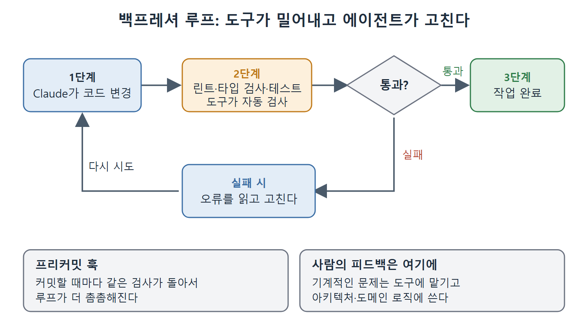

# 백프레셔와 계획 먼저 세우기

프롬프트에 글로 적는 것만이 프롬프트가 아니다. 프로젝트에 깔아 둔 린트 설정, 타입 검사, 테스트가 Claude의 행동을 바꾸는 사실상의 프롬프트 역할을 한다. 이 문서는 이 패턴인 백프레셔(backpressure)와, 그 극단적인 형태인 테스트 주도 개발(TDD), 그리고 구현 전에 계획부터 세우는 습관을 다룬다.

실무자들이 발견한 가장 가치 있는 패턴 중 하나이고, 프로젝트 도구에 대한 생각을 통째로 바꿔 놓는다.

---

## 1. 린트 설정도 프롬프트다

비유가 아니라 말 그대로다. 엄격한 린트, 포괄적인 타입 검사, 탄탄한 테스트가 갖춰진 프로젝트에서 Claude Code를 돌리면 변경할 때마다 자동으로 피드백을 받는다. 린터가 스타일 위반을 알려 주고, 타입 검사기가 타입 오류를 잡고, 테스트가 실패한다. Claude는 오류를 읽고 고친 뒤 다시 시도한다.

이것이 백프레셔다. 도구가 잘못된 출력을 밀어내고, 에이전트가 스스로 고친다. 도구가 촘촘할수록 결과가 좋아진다. 엄격한 린트 규칙, 엄격한 타입 검사 설정, 높은 테스트 커버리지를 가진 프로젝트는 같은 조건에서 이런 제약이 없는 프로젝트보다 더 좋은 Claude Code 결과물을 낸다. Claude에게 그 규칙을 따로 알려 주지 않았는데도 그렇다.


그림은 변경, 도구 검사, 통과 여부 판정, 실패 시 수정으로 이어지는 백프레셔 루프를 보여 준다. 사람이 끼어들지 않아도 이 루프가 잘못된 출력을 걸러 낸다.

### 투자 대비 이중의 효과

엄격한 린트, 충실한 타입, 탄탄한 테스트에 투자하면 이중으로 이득을 본다. 사람의 실수도 잡고 AI의 실수도 잡는다. 여기서 잡히는 AI 실수는 원래 내가 손으로 찾아야 했을 것들이다.

### 피드백 예산

내가 줄 수 있는 피드백에는 한도가 있다. "들여쓰기 고쳐", "세미콜론 써", "그 변수는 `const`여야 해"처럼 기계적인 문제를 직접 말할 때마다 피드백 예산을 도구가 알아서 잡아야 할 일에 쓰는 셈이다. 피드백 예산은 아키텍처, 설계 결정, 도메인 로직처럼 린터가 검사할 수 없는 부분에 써야 한다. 타입 검사기와 린터가 할 수 있는 일은 전부 맡긴다.

### 프리커밋 훅(pre-commit hook)

커밋 전에 테스트와 린터를 돌리는 프리커밋 훅은 특히 촘촘한 백프레셔 루프를 만든다. Claude가 커밋하면 훅이 돌고, 실패가 보고되고, Claude가 고쳐서 다시 시도한다. 사람이 모든 변경을 검토하지 않아도 도구가 검토한다.

이 관점은 도구에 대한 투자를 다시 보게 한다. 린트 설정은 코드 품질 도구일 뿐 아니라, 그 프로젝트에서 Claude가 만드는 모든 코드를 빚어내는 프롬프트의 한 구성 요소다. 그만큼 투자할 가치가 있다.

---

## 2. TDD는 백프레셔의 완성형

테스트 주도 개발은 백프레셔의 가장 완성된 형태다. 한 엔지니어링 팀은 예전 방식을 "설계 문서, 엉성한 코드, 리팩터링, 테스트는 포기"로 묘사했다. Claude Code를 쓰면서 이 패턴이 뒤집혔다. 먼저 Claude에게 의사코드(pseudocode)를 요청하고, 테스트 주도 개발로 이끌고, 막힐 때 가끔 확인하며 방향을 잡아 준다. 테스트는 구현보다 먼저 쓰이고, 구현은 테스트를 만족해야 통과한다. Claude는 통과할 때까지 반복한다.

철학적인 이유로 TDD를 하는 것이 아니라 실용적인 이유 때문이다. 에이전트가 테스트와 구현을 모두 쓸 때, 테스트가 피드백 루프를 만들어서 구현이 엉뚱한 곳으로 흘러가지 않게 막아 준다. 에이전트가 테스트를 쓰고, 통과시킬 코드를 쓰고, 테스트를 돌려서 실패를 확인하고, 고쳐서 다시 시도한다. 사람은 가끔 들여다보면서 테스트 자체가 올바른 것을 검사하는지 확인한다.

---

## 3. 실행 전에 계획부터

구현하기 전에 계획을 세우게 하는 것은 비싼 실수를 막는 값싼 보험이다.

```text
변경하기 전에 관련 파일을 읽고 계획을 만들어라.
수정할 파일, 새로 만들 파일, 동작이 바뀌는 부분을 모두 나열해라.
진행하기 전에 내 승인을 기다려라.
```

계획을 만드는 데는 대략 10,000 토큰이 든다. 방향이 틀어진 구현은 500,000 토큰과 컨텍스트 리셋을 치르게 한다. 계산은 분명하다.

계획을 검토하면 오해를 코드가 되기 전에 잡을 수 있다. 계획에 손대면 안 되는 파일의 수정이 들어 있으면 계획 단계에서 막는다. 분명히 바꿔야 할 파일이 계획에서 빠져 있으면 구현 전에 추가한다.

### Ctrl+G로 계획 직접 편집하기

`Ctrl+G`를 누르면 Claude의 계획이 기본 텍스트 편집기에서 열린다. 계획을 직접 고쳐서 단계를 추가하고, 빼고, 우선순위를 바꾸고, 제약을 덧붙인 다음 저장하고 편집기를 닫으면 Claude가 내가 수정한 계획으로 진행한다. 대화로 수정 사항을 설명하는 것보다 빠르고, 이미 나온 계획을 후속 프롬프트로 조금씩 바꾸는 것보다 정확하다.

### 서브에이전트와 함께 쓰기

계획 먼저 세우기는 서브에이전트 위임과 잘 어울린다. 메인 컨텍스트에서 싸게 계획을 세우고, 계획의 각 항목을 서브에이전트에게 넘겨 병렬로 실행한다. 이것이 가장 비용 효율적인 멀티 에이전트 전략이며, 4장에서 다룬 내용이기도 하다.

### 계획을 체크리스트로 줄이기

Claude가 자세한 계획을 내놓은 뒤에는 계획을 다시 훑어보며 체크하기 쉬운 더 짧은 체크리스트로 바꿔 달라고 요청할 수 있다. 체크리스트는 구현하는 동안 실제로 곁에 두는 작업 문서가 된다. 눈에 계속 띄도록 간결하면서도 모든 단계를 담을 만큼은 자세하다.

---

## 4. 정리

- 린트, 타입 검사, 테스트는 Claude가 따로 지시받지 않아도 결과물을 바로잡는 백프레셔 역할을 한다. 도구가 엄격할수록 결과가 좋아진다.
- 사람의 피드백은 아키텍처와 도메인 로직에 쓰고, 기계적으로 잡을 수 있는 문제는 도구에 맡긴다.
- 프리커밋 훅은 커밋마다 검증이 돌게 해서 루프를 더 촘촘하게 만든다.
- TDD는 에이전트가 테스트와 구현을 모두 쓰는 환경에서 구현이 엉뚱한 방향으로 흘러가지 않게 하는 실용적인 방법이다.
- 계획은 약 10,000 토큰, 잘못된 구현은 약 500,000 토큰과 컨텍스트 리셋이 든다. `Ctrl+G`로 계획을 직접 고치고, 체크리스트로 줄여서 쓴다.

<br>
<br>
<br>

[Claude Code The Definitive Guide to Agentic Development-2](../)
