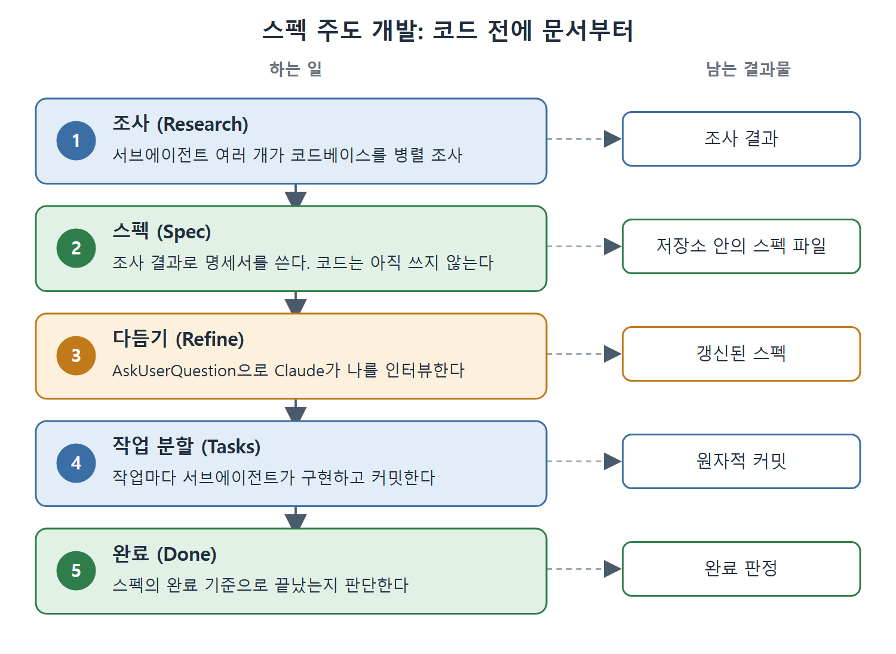

# 스펙 주도 개발

코드를 쓰게 하기 전에 문서부터 쓰게 한다. 이것은 단순한 프롬프트 요령이 아니라 스펙 주도 개발(Spec-Driven Development)이라는 이름이 붙은 작업 패턴이다. AI 코딩에서 흔한 "프롬프트, 코드, 디버그, 반복" 방식과 대비된다.

기존 방식에서는 프롬프트를 쓰고, Claude가 코드를 만들고, 버그를 찾고, 디버깅하고, 다시 프롬프트를 쓰고, 코드를 또 만들고, 버그를 또 찾는 일이 이어진다. 컨텍스트에는 실패한 시도가 쌓이고, 믿을 만한 기준 문서가 없고, 어디서 멈출지도 분명하지 않다. 매번 어수선한 컨텍스트에서 처음부터 다시 시작하는 셈이다. 이 문서는 스펙 주도 개발의 다섯 단계와 프롬프트 패턴, 실제 사례를 정리한다.

---

## 1. 다섯 단계 흐름

스펙 주도 개발은 조사(Research), 스펙(Spec), 다듬기(Refine), 작업 분할(Tasks), 완료(Done) 순서로 진행한다.

1. **조사.** 서브에이전트 여러 개를 띄워서 관련된 코드베이스 영역을 병렬로 조사하게 한다. 서브에이전트마다 기존 아키텍처, API 표면, 테스트 패턴, 의존성처럼 서로 다른 측면을 맡는다. 조사 결과는 메인 컨텍스트로 돌아온다.
2. **스펙.** 조사 결과를 바탕으로 포괄적인 명세서를 쓰게 한다. 예를 들어 "목표는 보고서를 쓰는 것이다. 아키텍처, 데이터 모델, 에러 처리, 롤백 전략을 다루는 마이그레이션 기술 스펙을 만들되 아직 코드는 쓰지 마라"는 식이다. 스펙은 저장소 안의 파일이 되어서 컨텍스트 압축(compaction)과 세션 재시작을 넘어 살아남는 기록물이 된다.
3. **다듬기.** 구현 전에 Claude가 스펙에 대해 나를 인터뷰하게 한다. `AskUserQuestion` 도구를 쓰도록 하고, 구현 전에 스펙에 대해 궁금한 점이 있는지 묻게 한다. Claude는 모호한 부분, 설계 결정, 예외 상황에 대해 확인 질문을 하고, 내가 답하면 스펙이 갱신된다. 버그가 되었을 오해를 미리 잡아 준다.
4. **작업 분할.** 스펙을 더 쪼갤 수 없는 작업 단위로 나누고, 각 작업을 새 컨텍스트의 서브에이전트가 구현하게 한다. 지시는 "task 도구를 써라. 각 작업은 서브에이전트만 수행한다. 작업이 끝날 때마다 커밋해라"에 해당한다. 서브에이전트는 스펙을 읽고, 한 조각을 구현하고, 커밋하고, 돌아온다. 메인 컨텍스트는 직접 구현하지 않고 조율만 하므로 가볍게 유지된다.
5. **완료.** 스펙에 정의한 명확한 완료 기준으로 작업이 끝났는지 판단한다.

그림은 다섯 단계를 위에서 아래로 따라가며, 단계마다 어떤 결과물이 남는지 오른쪽에 함께 보여 준다. 조사와 작업 분할은 서브에이전트가 맡고, 다듬기는 사람과 Claude의 질문과 답으로 이루어진다.

---

## 2. 다섯 가지 프롬프트 패턴

이 흐름은 올바른 동작을 끌어내는 다섯 가지 프롬프트 패턴에 의존한다.

| 번호 | 프롬프트 방향 | 효과 |
|---|---|---|
| 1 | 조사 작업에 서브에이전트를 여러 개 띄우라고 한다 | 병렬 조사가 일어난다. 다섯 서브에이전트가 코드베이스의 다섯 측면을 동시에 연구한다 |
| 2 | 목표가 보고서나 문서를 쓰는 것이라고 말한다 | 코드보다 먼저 글로 된 산출물이 나온다. 이것이 기준 문서가 된다 |
| 3 | 구현 전에 `ask_user_question` 도구를 쓰라고 한다 | 모호한 점과 설계 결정이 버그가 되기 전에 드러난다 |
| 4 | task 도구를 쓰고, 작업마다 서브에이전트가 하며, 끝날 때마다 커밋하라고 한다 | 독립적으로 검증할 수 있고 커밋 경계가 있는 원자적 작업 단위가 만들어진다 |
| 5 | 너는 메인 에이전트이고 서브에이전트가 개발자라고 말한다 | 조율자 역할이 작동해서 메인 컨텍스트가 가볍고 위임 중심으로 유지된다 |

---

## 3. 사례: 스토리지 계층 마이그레이션

한 실무자는 스펙 주도 개발로 동기화 엔진(sync engine)의 스토리지 계층을 한 브라우저 데이터베이스 기술에서 다른 기술로 옮겼다. 손으로 했다면 이틀에서 사흘이 걸렸을 작업이다.

**1단계, 조사.** 서브에이전트 다섯 개가 대상 프레임워크를 병렬로 조사했다. 맡은 측면은 데이터 모델, 동기화 프로토콜, 충돌 해결 전략, 인덱싱 방식, 탭 간 조율 메커니즘이었다. 병렬 조사는 몇 분 만에 끝났고, 문서를 읽었다면 몇 시간이 걸렸을 결과가 나왔다.

**2단계, 스펙 작성.** 조사 결과를 바탕으로 Claude가 마이그레이션 전략, 어댑터 인터페이스, 데이터 변환 로직, 테스트 계획을 담은 스펙을 만들었다. 스펙은 저장소 안의 파일로 들어갔다.

**3단계, 다듬기.** Claude가 대화형 질문 도구로 물었다. 이전 저장 형식과 새 저장 형식 사이의 충돌은 어떻게 처리할지, 이전 형식으로 되돌리는 롤백을 지원할지, 마이그레이션 중에 사용자가 탭을 여러 개 열어 두면 어떻게 동작해야 하는지 같은 질문이었다. 답이 나올 때마다 스펙이 더 정확해졌다.

**4단계, 작업 위임.** 스펙은 14개 작업으로 쪼개져 서브에이전트에게 배정됐다. 각 서브에이전트는 스펙을 읽고, 맡은 작업을 구현하고, 관련 테스트를 돌리고, 커밋했다. git 로그에는 마이그레이션의 한 조각씩을 분명한 경계로 구현한 원자적 커밋 14개가 남았다.

전체 흐름은 약 45분이 걸렸다. 결과 코드는 손으로 구현한 것보다 나았는데, 조사 단계에서 개발자가 혼자서는 찾지 못했을 대상 프레임워크의 패턴이 드러났기 때문이다.

---

## 4. AskUserQuestion 도구

다듬기 단계는 따로 짚어 볼 만하다. "구현 전에 `ask_user_question` 도구를 써라"라고 말하면 Claude는 인터뷰 모드로 들어간다. 스펙을 읽고 불확실한 모든 것에 대해 객관식이나 열린 질문을 한다. 자유 대화에서 "질문을 철저하게 해 줘"라고 하는 것과는 다르다. `AskUserQuestion` 도구는 구조화되고 초점이 분명한 질문을 하기 때문에 답하기 쉽고, 실제로 행동에 옮길 수 있는 확인 결과가 나온다.

이 인터뷰 패턴은 스펙 다듬기 밖에서도 쓸 수 있다. 복잡한 작업을 시작할 때 이렇게 말해 볼 수 있다. "아무것도 만들기 전에 `ask_user_question` 도구로 내 요구 사항을 인터뷰해라. 모든 질문을 마치기 전에는 진행하지 마라." 구조화된 형식은 자유 대화에서 놓치는 가정들을 드러낸다.

---

## 5. 스펙이 남는 기록물이 되는 이유

스펙 파일은 계획 문서에 그치지 않고 전체 작업 흐름의 복구 지점이 된다. 서브에이전트가 실패해도 스펙은 그대로 있으므로 같은 작업에 새 서브에이전트를 시작하면 된다. 컨텍스트가 압축돼도 스펙은 디스크의 파일로 남는다. 다음 날 작업을 이어갈 때도 스펙이 새 세션에 필요한 모든 것을 알려 준다.

한 엔지니어링 팀은 이를 한 걸음 더 밀고 나갔다. 스펙을 코드베이스의 마크다운 파일로 저장하고, Claude가 쓰고, 사람이 검토하고, 다시 Claude가 실행하게 한다. 스펙도 다른 산출물처럼 코드 리뷰를 거친다. 구현이 끝난 뒤에도 스펙은 설계 결정의 기록으로 남는다. 이것이 코드로서의 스펙(specification-as-code)이다. 스펙은 쓰고 버리는 계획 문서가 아니라 버전 관리되고, 검토되고, 실행되는 산출물이다.

---

## 6. 정리

- 코드를 쓰기 전에 조사, 스펙, 다듬기, 작업 분할, 완료 기준 순서로 간다.
- 서브에이전트 병렬 조사와 서브에이전트별 원자적 커밋이 컨텍스트를 가볍게 유지한다.
- `AskUserQuestion` 도구는 구조화된 질문으로 모호함을 구현 전에 드러낸다.
- 스펙 파일은 컨텍스트 압축과 세션 재시작, 서브에이전트 실패에서 돌아올 수 있는 복구 지점이다.

 
 
 

[Claude Code The Definitive Guide to Agentic Development-2](../)
