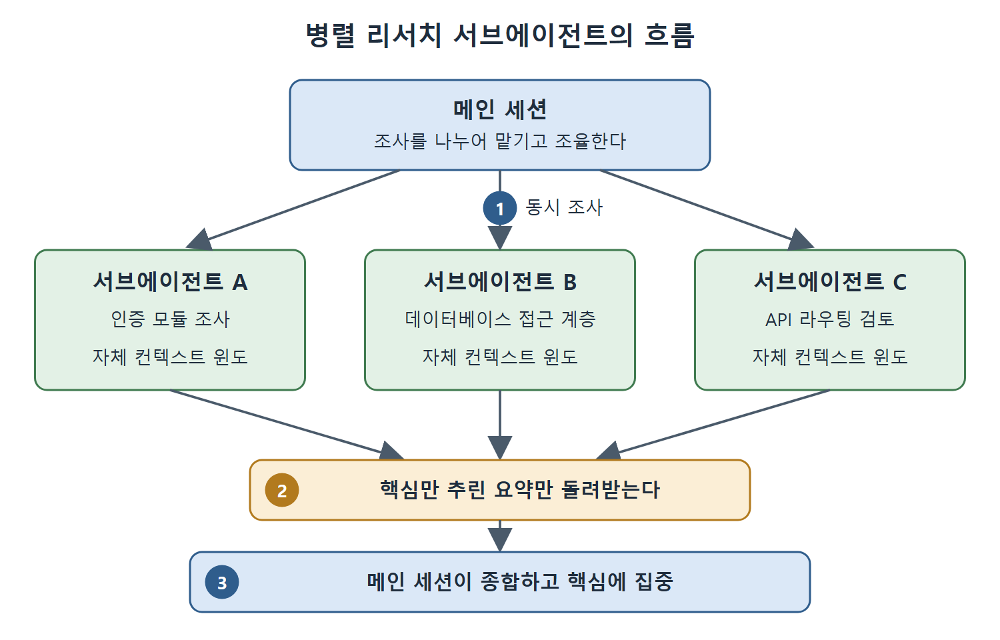

# Explore와 병렬 리서치 서브에이전트

어디를 봐야 할지 모르는 코드베이스에서는 직접 파일을 하나씩 여는 것보다, 탐색만 전담하는 서브에이전트에게 맡기는 편이 낫다. 이 문서는 읽기 전용 탐색용 서브에이전트인 Explore와, 여러 서브에이전트를 동시에 풀어 시스템을 조사하는 병렬 리서치 방식을 설명한다.

핵심은 컨텍스트 윈도를 아끼는 것이다. 탐색 과정에서 읽는 수십 개 파일은 서브에이전트의 컨텍스트에서 소화하고, 메인 세션은 결과 요약만 받는다.

---

## 1. Explore 서브에이전트

어디를 봐야 할지 모를 때를 위해 만들어진 서브에이전트가 Explore다. 구조는 4장에서 다루었다. Explore는 읽기 전용이고 비용이 낮다. 파일을 수정하거나 상태를 바꾸는 명령은 실행하지 못한다. 읽고, 검색하고, 결과를 보고하는 일만 한다. 그래서 아직 지형을 파악하는 중인 코드베이스에서도 빠르고, 싸고, 안전하게 투입할 수 있다.

### 자체 컨텍스트 윈도

Explore는 자기만의 컨텍스트 윈도에서 돌아간다. 조사하는 동안 파일을 수십 개 읽어도 메인 대화의 컨텍스트는 줄지 않는다. 메인 세션은 요약만 돌려받는다. 답은 얻고 과정에 드는 비용은 치르지 않는 셈이다.

### 조사 깊이 조절

Explore는 철저함의 정도(thoroughness)를 설정할 수 있다.

| 질문의 성격 | 동작 |
|---|---|
| 함수가 어디에 정의되어 있는지 같은 간단한 질문 | 좁게 검색하고 빠르게 돌아온다 |
| 모듈이 어떻게 동작하는지 전체를 알고 싶은 질문 | 넓게 검색하고 상호 참조를 따라가며 상세한 분석을 만든다 |

이 파라미터로 속도와 깊이를 맞바꿀 수 있다.

### 아낌없이 쓰라는 이유

대규모 코드베이스에서는 Explore를 넉넉하게 쓰는 것이 좋다. 이유는 두 가지다. 쓸 수 있는 가장 저렴한 모델로 돌아가 비용이 낮고, 결과가 격리된 컨텍스트에서 나오기 때문이다. 대안은 메인 세션이 파일을 하나씩 읽는 것인데, 그러면 위임할 수 있었던 탐색 내용이 컨텍스트 윈도를 채운다.

---

## 2. 병렬 리서치 서브에이전트

Explore는 조사원 한 명이다. 큰 시스템을 이해하려면 조사팀이 필요하다.

서브에이전트 여러 개를 병렬로 띄워 각자 코드베이스의 다른 면을 조사하게 할 수 있다.

- 하나는 인증 모듈을 읽는다.
- 하나는 데이터베이스 접근 계층을 살핀다.
- 하나는 API 라우팅을 검토한다.

각자 핵심만 추린 요약을 돌려주고, 메인 대화는 여러 에이전트를 나누어 맡기고 조율하는 일(오케스트레이션)을 맡아 결과를 종합한다.

그림은 메인 세션이 조사를 나누어 맡기면 서브에이전트들이 각자의 컨텍스트 윈도에서 동시에 조사하고, 메인 세션은 핵심 요약만 받아 종합하는 순서를 보여 준다.

### 온보딩에 특히 효과적이다

낯선 시스템에 합류할 때 코드를 몇 시간 동안 순서대로 읽는 대신, 조사원을 병렬로 보내 몇 분 만에 여러 관점의 이해를 얻는다. 서브에이전트를 여러 개 돌리므로 Explore 한 번보다 비용은 더 든다. 하지만 시간이 크게 절약되고, 컨텍스트가 격리되어 메인 윈도가 깨끗하게 유지된다. 이 점은 4장에서 다룬 내용과 같다.

### 변경 전 영향 분석에도 쓴다

같은 방식을 수정 전 영향 분석에도 쓸 수 있다. 공용 유틸리티 함수를 고치기 전에, 그 함수를 import하는 모듈마다 서브에이전트를 하나씩 보낸다. 각 서브에이전트는 자기 영역에서 그 함수가 어떻게 쓰이는지 보고한다. 의존성을 손으로 추적하지 않고도 포괄적인 영향 평가를 얻는다.

### 거대한 코드베이스에서는 필수다

규모가 아주 큰 코드베이스에서 이것은 선택이 아니다. 수백만 줄짜리 코드베이스를 머릿속에 담을 수 있는 사람은 없다. 병렬 서브에이전트로 넓은 영역을 빠르게 훑고, 그다음 메인 세션을 정말 중요한 영역에 집중시키면 된다.

---

## 3. 정리

- Explore는 읽기 전용, 저비용, 격리된 컨텍스트로 동작하는 탐색 전용 서브에이전트다.
- 조사 깊이는 질문의 크기에 맞춰 조절한다.
- 시스템 전체를 이해하거나 영향 범위를 파악할 때는 서브에이전트 여러 개를 병렬로 돌리고 메인 세션이 종합한다.
- 병렬로 돌리면 비용은 늘지만 시간이 절약되고 메인 컨텍스트가 깨끗하게 유지된다.

 
 
 

[Claude Code The Definitive Guide to Agentic Development-2](../)
