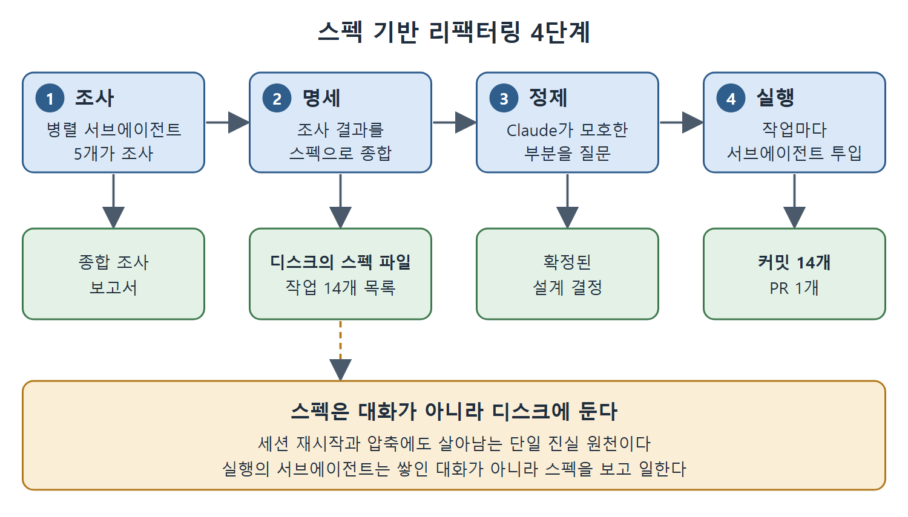

# 스펙 기반 리팩터링 사례

레거시 재작성과 대규모 리팩터링은 같은 실패 방식을 공유한다. 목표를 충분히 이해하지 못한 채 바로 코드부터 쓰는 것이다. 스펙 기반(spec-driven) 접근은 이 순서를 뒤집어, 조사와 명세를 나중에 덧붙이는 일이 아니라 첫 단계로 만든다. 이 문서는 한 실무자가 문서화한 스토리지 계층 마이그레이션 사례를 네 단계로 나누어 설명한다.

---

## 1. 사례 개요

대상은 동기화 엔진용 스토리지 계층의 교체였다. 브라우저용으로 컴파일된 데이터베이스를 브라우저 네이티브 데이터베이스로 바꾸는 작업이다. 기존 방식은 동작은 했지만 문제가 있었다.

- 바이너리 의존성이 크다.
- 초기 로딩 성능이 나쁘다.
- 프레임워크에 내장된 동기화 기능과 맞물리는 부분이 복잡하다.

마이그레이션은 파일 15개 이상을 건드렸고, 낯선 프레임워크의 스토리지 패턴을 이해해야 했다.

## 2. 4단계 진행

### 단계 1. 조사

대상 프레임워크를 조사하라는 프롬프트 하나가 병렬 리서치 서브에이전트 다섯 개를 띄웠다. 각각 다른 면을 맡았다.

1. 프레임워크의 데이터 모델
2. 동기화 프로토콜
3. 스토리지 계층
4. 충돌 해결 패턴
5. API 표면

각 서브에이전트가 핵심을 추린 요약을 돌려줬고, 이를 합쳐 종합 조사 보고서가 되었다. 개발자가 문서를 읽으며 모으려면 며칠이 걸렸을 분량이다.

### 단계 2. 명세

Claude는 조사 결과를 상세한 마이그레이션 스펙으로 종합했다. 스펙에는 다음이 들어갔다.

- 아키텍처 결정
- 단계별 구현 계획
- 14개 항목의 작업 체크리스트
- 위험 완화 전략
- 성공 기준

스펙은 대화 컨텍스트에 두지 않고 디스크의 파일로 썼다. 이것이 결정적이다. 디스크의 스펙은 컨텍스트 저하, 세션 재시작, 압축(compaction)을 견딘다. 지속되는 단일 진실 원천이다.

### 단계 3. 정제

구현에 들어가기 전에 Claude가 마이그레이션 전략의 모호한 부분을 물어봤다. 충돌 해결 방식, 전환 기간의 동기화 동작, 대체(fallback) 처리가 그 대상이었다. 이 질문들은 구현 중에 발견했다면 버그가 되었을 설계 결정을 계획 단계에서 드러냈다.

### 단계 4. 실행

작업 14개를 각각 서브에이전트에게 위임했고, 각 작업은 원자적(atomic) 커밋 하나씩을 만들었다. 서브에이전트는 쌓인 대화 컨텍스트가 아니라 스펙을 보고 일했다. 자기 작업을 끝내고, 결과를 커밋하고, 돌아왔다. 결과는 커밋 14개, 변경 파일 15개 이상, 리뷰 대기 중인 풀 리퀘스트 하나였다.

| 단계 | 산출물 | 핵심 |
|---|---|---|
| 조사 | 종합 조사 보고서 | 서브에이전트 5개를 병렬로 돌렸다 |
| 명세 | 디스크 위의 스펙 파일 | 작업 14개 체크리스트 포함 |
| 정제 | 확정된 설계 결정 | 구현 전에 모호함을 해소했다 |
| 실행 | 커밋 14개, PR 1개 | 서브에이전트마다 작업 하나, 커밋 하나 |

그림은 조사, 명세, 정제, 실행 네 단계와 단계별 산출물을 보여 준다. 스펙을 디스크 파일로 두어 실행 단계의 서브에이전트가 이 스펙을 기준으로 일한다는 점도 함께 나타냈다.

## 3. 결과

마이그레이션 전체가 한나절에 끝났다. 실무자는 수작업이라면 이틀에서 사흘 걸렸을 것으로 추정했다. 그런데 시간 절약은 부차적이다. 더 큰 것은 품질 향상이다. 조사 단계에서 개발자 혼자서는 찾지 못했을 프레임워크 패턴이 드러났고, 그래서 직접 코딩했을 때보다 그 프레임워크의 관용에 더 맞는 구현이 나왔다.

## 4. 오케스트레이터는 가볍게

서브에이전트 14개를 조율했는데도 메인 세션의 컨텍스트는 한계 안에 충분히 머물렀다. 오케스트레이터는 작업 목록과 서브에이전트 요약만 들고 있었다. 실제 파일 읽기와 코드 생성은 격리된 서브에이전트 컨텍스트에서 이루어졌다.

대규모 리팩터링의 모델은 이것이다. 넓게 조사하고, 정확하게 명세하고, 병렬로 실행하고, 오케스트레이터는 가볍게 유지한다.

## 5. 정리

- 코드부터 쓰지 않고 조사와 명세를 첫 단계로 둔다.
- 스펙은 디스크에 파일로 남겨 세션 재시작과 압축에도 살아남게 한다.
- 구현 전에 Claude가 던지는 질문으로 설계상 모호함을 먼저 해소한다.
- 작업마다 서브에이전트와 원자적 커밋을 쓰고, 서브에이전트는 스펙을 기준으로 일한다.

 
 
 

[Claude Code The Definitive Guide to Agentic Development-2](../)
