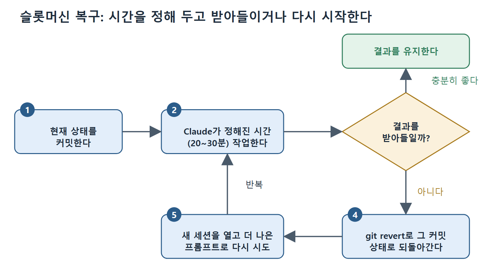

# 슬롯머신 복구와 앞으로의 방향

일이 틀어질 때의 본능은 방향을 바로잡는 것이다. 하지만 수정 자체가 컨텍스트를 소모하고 처음의 오해를 더 키울 수 있다. 이 문서는 대안인 슬롯머신 복구 방식, 이 방식이 왜 효과가 있는지, 그리고 실패 유형 대부분의 뿌리인 "자기가 모르는 것을 모르는 에이전트"가 어떻게 바뀌어 가는지를 다룬다.

---

## 1. 슬롯머신 복구

문제가 생겼을 때 보통은 이렇게 한다. 문제를 설명하고, Claude에게 실수를 고치라고 하고, 맥락을 더 준다. 이 방법은 가끔 통하고 가끔 상황을 악화시킨다. 수정 자체가 컨텍스트를 쓰고, 원래의 오해를 더 키울 수 있기 때문이다.

슬롯머신 방식(slot machine approach)은 다르게 접근한다.

1. 현재 상태를 커밋한다.
2. Claude가 정해진 시간(20~30분) 동안 작업하게 둔다.
3. 이진 결정을 한다. 받아들이거나 다시 시작한다.

결과가 충분히 좋으면 유지한다. 그렇지 않으면 `git revert`로 그 커밋으로 돌아가고, 새 세션을 열어 더 나은 프롬프트로 다시 시도한다. 살려 보려는 시도도, 수정의 악순환도 없다. 검증된 상태에서 깨끗하게 다시 시작할 뿐이다.

그림은 커밋하고 정해진 시간 동안 작업시킨 뒤, 결과를 유지하거나 되돌려 새 세션에서 다시 시도하는 순환을 보여 준다. 되돌린 뒤에는 더 나은 프롬프트로 같은 흐름을 다시 돈다.

낭비처럼 들리지만 그렇지 않다. 문제를 설명하고, Claude가 땜질하고, 땜질이 새 문제를 만들고, 새 문제를 설명하고, 또 땜질하는 수정의 악순환은 새 시도 두 번보다 시간과 토큰을 더 쓸 수 있다. 슬롯머신 방식은 낭비에 상한을 둔다. 시간을 제한한 시도 한 번이다. 수렴하지 않으면 나쁜 컨텍스트에 좋은 컨텍스트를 계속 붓지 말고 다시 시작한다.

### 실제 팀의 사례

한 대형 AI 회사의 데이터 사이언스·머신러닝 팀이 이것을 표준 워크플로로 만들었다. 머지 충돌이나 어느 정도 복잡한 리팩터링처럼 에디터 매크로로 하기에는 복잡하지만 본격적인 개발 노력을 쓸 만큼 크지는 않은 작업에서, 상태를 커밋하고 Claude가 30분 동안 자율적으로 작업하게 둔 뒤 결과를 받아들일지 새로 시작할지 이진 결정을 한다.

반복된 경험에서 얻은 핵심 통찰은 이렇다. 처음부터 다시 시작하는 쪽이 작업 도중에 Claude의 실수를 고치려는 것보다 성공률이 높은 경우가 많다. 수정 시도 자체가 컨텍스트 품질을 떨어뜨려서 이후 시도의 성공 가능성을 낮추기 때문이다. 무엇이 잘못됐는지를 반영한 더 나은 프롬프트로 연 새 세션이, 혼란이 쌓인 망가진 세션보다 낫다.

### 30분이라는 시간 제한의 이유

30분은 임의로 정한 수치가 아니다. 범위가 정해진 작업에서 Claude가 의미 있는 진전을 내기에 충분히 길고, 실패했을 때 비용을 감당할 수 있을 만큼 짧다. Claude가 고전하는 모습을 두 시간 동안 지켜보고 있다면, 새로 30분씩 두 번 시도하는 비용보다 이미 더 많은 시간을 쓴 것이다.

### 되돌리는 일의 어려움은 감정에 있다

되돌리는 데 필요한 규율은 기술이 아니라 감정의 문제다. 되돌리면 그동안 한 작업이 헛수고가 되는 것 같아 아깝게 느껴진다. 하지만 작업은 실패한 시점에 이미 헛수고가 되었다. 되돌리는 것은 그 사실을 인정하고, 힘을 성공할 가능성이 있는 길로 돌리는 일일 뿐이다. 되돌린 코드는 사라지지만 왜 실패했는지에 대한 이해는 남는다. 그 이해가 다음 프롬프트에 들어가므로 다음 시도는 더 똑똑하게 시작한다.

### 전제 조건

전제는 자주 커밋하는 것이다. Claude를 돌리기 전에 커밋하지 않았다면 되돌아갈 깨끗한 상태가 없다. 슬롯머신 방식은 체크포인트 규율이 있어야만 작동한다.

---

## 2. 가까운 미래의 해법: 모르는 것을 아는 에이전트

이 장의 실패 유형 대부분은 같은 뿌리를 공유한다. 에이전트가 자기 능력 밖에 있다는 것을 모른다는 점이다. 완수할 수 없는 작업을 시도하고, 확신에 차서 틀린 출력을 만들고, 도움이 필요하다는 것을 알아채지 못한 채 실패하는 길을 계속 간다. 에이전트는 모든 작업을 똑같이 자기 능력 안에 있는 것으로 취급한다.

이것은 바뀌고 있다. 가까운 시일에 가장 가치 있는 능력 향상은 더 나은 코드 생성이나 더 빠른 실행이 아니다. 에이전트가 언제 도움을 요청해야 하는지 배우는 것이다. 사람의 판단이 필요한 상황을 알아보고, 모든 작업을 무작정 시도하는 대신 불확실한 영역을 표시하는 능력이다. "이 보안 설정에는 확신이 없고 잘못됐을 때 결과가 크니 검토해 달라"고 말하는 에이전트가, 그럴듯하지만 틀린 보안 설정을 말없이 만들어 내는 에이전트보다 유용하다.

### 실패 관리에 주는 의미

불확실성을 위로 올려 보내는 에이전트가 이 장의 실패 유형을 없애 주지는 않는다. 하지만 복구 모델을 바꾼다. 나쁜 코드가 배포되고, 잘못된 거래가 실행되고, 컨텍스트가 소진된 뒤에야 실패를 발견하는 대신, 정말 결정이 필요한 곳으로 사람의 주의를 돌려 주는 조기 경고를 받는다. 사람의 감독이 모든 것을 검토하는 일(에이전트 속도에서는 불가능하다)에서 중요한 것을 검토하는 일(지속 가능하다)로 옮겨 간다.

그 능력이 성숙하기 전까지는 방어 전략이 같다. 검증 인프라, 자주 커밋하기, 시간을 제한한 시도, 고치기보다 되돌리는 규율이다.

---

## 3. 이 장의 복구 전략 한눈에 보기

| 실패 유형 | 핵심 복구·예방 |
|---|---|
| 컨텍스트 고갈·오염 | CLAUDE.md, /compact, 서브에이전트, 새 세션 |
| bash 환경 비유지 | 같은 줄에서 설정, settings.json 환경 변수 |
| MCP 연결 끊김 | /mcp 확인 후 재연결 또는 세션 재시작 |
| 체크포인트의 구멍 | 위험한 세션 전에 커밋, git checkout |
| 환각·바이브 코딩 | 검증, 이해하고 배포, 위험에 맞춘 검토 깊이 |
| 수정의 악순환 | 두 번 실패하면 되돌리고 새 프롬프트, 슬롯머신 방식 |
| 과한 복잡성 | 단순함 지시, 참고 코드 지정 |

모든 유형의 최종 복구는 같다. 검증된 상태로 되돌리고 다시 시도하는 것이다.

 
 
 

[Claude Code The Definitive Guide to Agentic Development-2](../)
