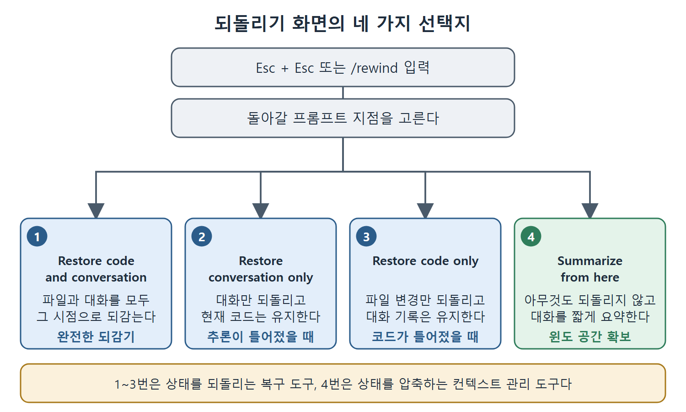

# 체크포인트와 롤백

Claude Code에는 파일 수정을 자동으로 기록하고 이전 상태로 되돌리는 체크포인트(checkpoint) 기능이 있다. 잘못된 길로 들어섰을 때 가장 유용한 안전망 중 하나다. 하지만 체크포인트가 기록하는 범위에는 구멍이 있고, 그 구멍을 모르고 쓰면 크게 낭패를 본다.

이 문서는 체크포인트가 무엇을 추적하고 무엇을 놓치는지, 되돌리기 화면의 네 가지 선택지는 무엇인지, 그리고 결국 모든 복구의 바탕이 되는 git 기반 롤백 절차를 설명한다.

---

## 1. 체크포인트 시스템이 추적하는 것

Claude Code는 작업하는 동안 모든 파일 수정을 자동으로 추적하고, 이전 상태로 돌아갈 수 있는 체크포인트를 만든다. 사용자가 프롬프트(prompt)를 입력할 때마다 새 체크포인트가 생긴다. 체크포인트는 세션을 넘어 유지되므로 재개한 대화에서도 접근할 수 있다.

되돌리기(rewind) 화면은 Esc를 두 번 누르거나(Esc + Esc) `/rewind`를 입력해서 연다. 이 화면에는 세션 동안 입력한 프롬프트가 스크롤 가능한 목록으로 나온다. 돌아가고 싶은 지점을 고르면 네 가지 선택지가 나온다.

| 선택지 | 하는 일 | 언제 쓰나 |
|---|---|---|
| Restore code and conversation | 파일과 대화 기록을 모두 그 시점으로 되돌린다. 완전한 되감기다. | 체크포인트 이후의 일을 Claude가 기억하지 못해도 되고, 코드도 그때 상태가 필요할 때 |
| Restore conversation only | 대화만 그 메시지 시점으로 되돌리고 현재 코드는 유지한다. | Claude의 추론이 잘못된 길로 갔지만 코드 변경은 괜찮을 때 |
| Restore code only | 파일 변경만 되돌리고 전체 대화 기록은 유지한다. | 코드는 틀어졌지만 대화에 남기고 싶은 가치 있는 맥락이 있을 때 |
| Summarize from here | 아무것도 되돌리지 않고, 선택한 지점부터의 대화를 짧은 요약으로 압축한다. | 컨텍스트 윈도 공간을 비우면서 핵심 정보는 남기고 싶을 때 |



그림은 `/rewind`로 화면을 열고 지점을 고른 뒤 네 가지 선택지로 갈라지는 흐름을 보여 준다. 앞의 세 개는 상태를 되돌리는 복구 도구이고, 마지막 하나는 대화를 압축하는 컨텍스트 관리 도구다.

네 번째 선택지는 앞의 셋과 성격이 다르다. 이것은 복구 도구가 아니라 컨텍스트 관리 도구다. 앞의 세 개는 상태를 되돌리고, Summarize는 상태를 압축한다. 어떤 복구 경로를 택할지 정할 때 이 구분이 중요하다.

---

## 2. 체크포인트가 놓치는 것

체크포인트에는 한 번 크게 데이게 되는 구멍이 있다.

체크포인트는 Claude가 Write, Edit, NotebookEdit 도구로 직접 수정한 파일만 추적한다. bash 명령으로 일어난 파일 변경은 추적하지 않는다. Claude가 bash 도구로 다음과 같은 명령을 실행하면, 그 변경은 체크포인트 시스템에 보이지 않는다.

```bash
rm important_file.py
mv src/old.py src/new.py
sed -i 's/foo/bar/g' *.py
```

따라서 이런 명령을 실행하기 전의 체크포인트로 되돌려도 그 변경은 취소되지 않는다.

또한 동시에 돌아가는 다른 세션, 외부 프로세스, 그 밖에 Claude Code의 도구 호출 바깥에서 일어난 변경도 추적하지 않는다. 다른 Claude Code 인스턴스가 파일을 수정했다면, 그 수정은 내 세션의 체크포인트 이력에 없다.

---

## 3. git이 믿을 수 있는 체크포인트다

신뢰할 수 있는 복구 수단은 git이다. 1장에서 다룬 자주 커밋하기 패턴을 따랐다면, 파일 수정뿐 아니라 bash로 한 변경, 이름 변경, 삭제까지 모두 담은 git 커밋이 있을 것이다. `git checkout`은 Claude의 도구가 추적한 수정만이 아니라 무엇이든 되돌리는 보편적인 되감기다.

체크포인트는 "로컬 실행 취소"이고 git은 "영구 이력"이라고 생각하면 된다. 둘은 서로를 보완하지만 대체하지는 못한다.

운영 규칙은 간단하다. 파일 삭제, 이름 변경, 일괄 치환처럼 파괴적인 bash 명령이 나올 수 있는 세션을 시작하기 전에는 현재 상태를 커밋한다. 먼저 커밋해 뒀다면 Claude가 bash로 일을 망쳐도 `git checkout .` 한 번으로 모든 것이 돌아온다. 체크포인트에만 의존했다면, 불완전한 정보만 가지고 복구해야 한다.

---

## 4. 체크포인트-롤백 워크플로

이 장에서 다룬 모든 실패 유형의 궁극적인 복구 방법은 같다. 검증된 상태로 되돌리고 다시 시도하는 것이다. 그래서 1장의 자주 커밋하기 패턴은 선택 사항이 아니라 모든 복구 전략의 토대다. 자주 커밋하지 않으면 기억에 의존해서 복구해야 하고, 자주 커밋하면 체크포인트에서 복구할 수 있다.

절차는 다음과 같다.

1. 어떤 작업이든 시작하기 전에 커밋한다.
2. Claude가 작업하게 두고, 실패 유형의 증상이 나타나는지 지켜본다.
3. 증상이 보이면 판단한다. 고치는 것이 빠른가, 다시 시작하는 것이 빠른가.
4. 다시 시작하기로 했다면 `git checkout .`으로 그 커밋 상태로 되돌린다. 새 세션을 열고, 실패 원인을 반영한 더 나은 프롬프트를 쓴다.
5. 고치기로 했다면 구체적인 안내를 준다. 다만 머릿속에 한도를 둔다. 두 번 시도해도 수렴하지 않으면 되돌리고 다시 시작한다.

<br>
<br>
<br>

[Claude Code The Definitive Guide to Agentic Development-2](../)
