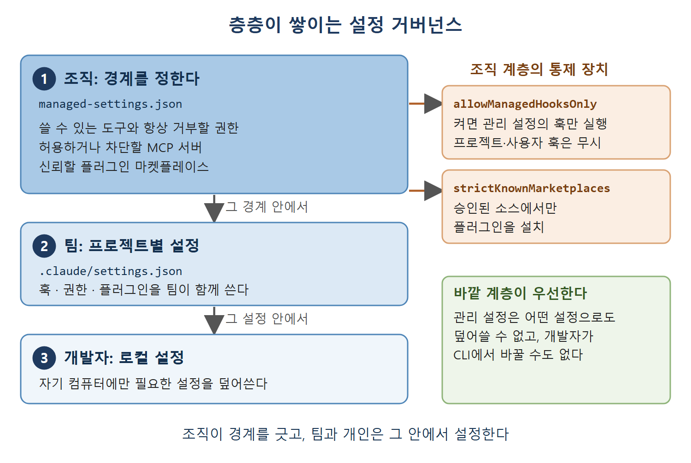

# 관리 설정과 플러그인 통제

기업 환경에서는 정책을 강제할 수단이 있어야 한다. Claude Code는 다른 어떤 범위의 설정으로도 덮어쓸 수 없는 관리 설정(managed settings) 계층으로 이를 해결한다(2장에서 자세히 다룬 내용).

이 문서는 관리 설정이 무엇을 통제하는지, 왜 개발자에게 보이지 않게 설계했는지, 플러그인 마켓플레이스를 어떻게 제한하는지, 그리고 조직, 프로젝트, 개인으로 이어지는 층층의 거버넌스가 어떻게 맞물리는지를 설명한다.

---

## 1. managed-settings.json이 정하는 것

IT 부서가 시스템 디렉터리에 배포하는 `managed-settings.json` 파일이 조직 정책을 강제한다. 정할 수 있는 항목은 다음과 같다.

- Claude Code가 쓸 수 있는 도구
- 항상 거부할 권한
- 허용하거나 차단할 MCP 서버
- 관리 범위 밖에서 훅을 정의할 수 있는지 여부
- 신뢰할 플러그인 마켓플레이스

이 설정은 개발자가 Claude Code CLI에서 들여다보거나 바꿀 수 없다는 의미에서 "보이지 않는다". 어떤 기능이 안 될 때 개발자는 그것이 설정 문제인지 관리 정책 때문인지 바로 알기 어렵다. 이는 의도된 설계다. 보안 정책은 개발자 도구에서 협상할 수 있는 대상이 아니어야 하기 때문이다.

### 설정 격차 문제

"내 개인 컴퓨터에서는 되는데 회사에서는 안 된다"는 격차는 거의 항상 관리 설정에서 나온다. 기업 환경에서 팀의 도입을 돕고 있다면 관리 설정을 가장 먼저 확인해야 한다. 프로젝트 설정을 아무리 잘 만들어도 관리 계층이 덮어쓰면 소용이 없다.

---

## 2. 플러그인과 마켓플레이스

플러그인은 스킬, 에이전트, 훅, MCP 서버, LSP 설정을 하나로 묶어 배포할 수 있게 만든 꾸러미다. 팀에게는 마켓플레이스 시스템이 통제된 배포 수단이 된다.

### 사내 전용 마켓플레이스

조직은 내부 인프라에 사내 전용 플러그인 마켓플레이스를 운영할 수 있다. 소스로 쓸 수 있는 것은 주요 버전 관리 플랫폼의 비공개 저장소, git URL, 내부 패키지 레지스트리, 파일 경로, 호스트 패턴이다. 이렇게 하면 커스텀 플러그인을 외부에 공개하지 않고 팀에 배포할 수 있다.

팀은 사내 MCP 서버, 프로젝트 전용 스킬, 코딩 표준 훅, LSP 설정을 한 플러그인에 묶을 수 있다. 신규 팀원은 플러그인 하나만 켜면 개발 환경 전체가 설정된다.

### 마켓플레이스 제한

관리 설정의 `strictKnownMarketplaces` 항목은 플러그인 설치를 승인된 마켓플레이스 소스로만 제한한다. 개발자가 임의의 URL이나 저장소에서 플러그인을 설치하지 못하게 하는 장치이며, 플러그인 시스템을 통한 공급망 공격을 막는 보안 조치다.

이 엄격한 모드가 켜져 있으면 Claude Code는 네트워크 요청이나 파일 시스템 작업을 하기 전에 플러그인 소스를 허용 목록과 대조한다. 승인되지 않은 소스는 단순히 막히는 데 그치지 않고, 아예 접속을 시도하지도 않는다.

---

## 3. 층층이 쌓이는 거버넌스

조직 수준의 관리 정책은 프로젝트 수준 설정과 합쳐져 층이 있는 거버넌스 구조를 만든다.

1. 조직이 경계를 정한다. 어떤 도구를 쓸 수 있는지, 어떤 MCP 서버가 승인되었는지, 어떤 권한을 강제하는지가 여기에 들어간다.
2. 그 경계 안에서 각 팀이 프로젝트별 설정을 한다.
3. 그 설정 안에서 각 개발자가 자기 컴퓨터에만 필요한 로컬 설정을 덮어쓴다.

그림은 조직의 관리 설정이 가장 바깥에서 경계를 긋고, 그 안에서 팀의 프로젝트 설정과 개발자의 로컬 설정이 차례로 놓이는 구조를 보여 준다. 오른쪽 상자의 두 항목은 조직 계층이 쓰는 대표적인 통제 장치다.

### allowManagedHooksOnly

특히 눈여겨볼 기업용 통제 항목이 `allowManagedHooksOnly`다. 이 설정을 켜면 관리 설정에 정의된 훅만 실행되고, 프로젝트 수준과 사용자 수준 훅은 무시된다. 훅은 임의의 명령을 실행하는 기능이기 때문에(2장에서 설명), 침해된 저장소가 사용자 권한으로 실행되는 훅을 심어 두는 상황을 막아 준다. 의미 있는 보안 통제다.

---

## 4. 도입 시 확인할 점

| 상황 | 확인할 것 |
| --- | --- |
| 집에서는 되는데 회사에서는 안 되는 기능 | 관리 설정이 막고 있지 않은지 |
| 플러그인이 설치되지 않음 | `strictKnownMarketplaces` 허용 목록에 소스가 있는지 |
| 저장소의 훅이 실행되지 않음 | `allowManagedHooksOnly`가 켜져 있는지 |
| 개발자가 정책을 바꾸려 함 | 관리 설정은 CLI에서 수정할 수 없다는 점 |

 
 
 

[Claude Code The Definitive Guide to Agentic Development-2](../)
