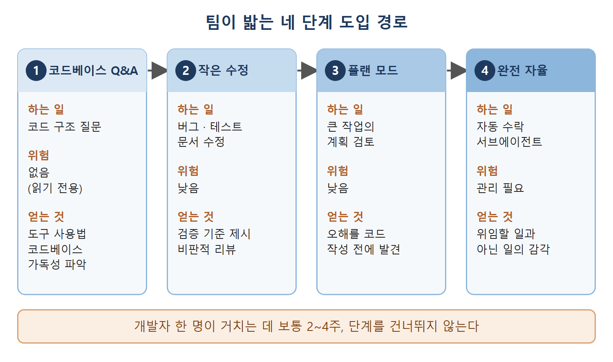

# 단계별 도입 경로

Claude Code를 혼자 쓰는 일은 개인 실험이다. 팀 전체가 쓰기 시작하면 조직이 일하는 방식이 바뀐다. 혼자 쓸 때는 프롬프트 요령을 익히고 손에 익히면 되지만, 팀에서는 공유 설정, 규정 준수, 지식의 누적이 함께 따라온다.

"설치해 줄 테니 알아서 써 봐"라는 식으로 도입한 팀은 결과가 들쭉날쭉하다. 어떤 엔지니어는 하루 종일 쓰고, 어떤 엔지니어는 한 번 써 보고 접는다. 도구는 반쯤 설정된 채로 방치되고, 무엇이 잘 통하는지에 대한 공통 지식도 없다. 반대로 제약이 큰 단계에서 시작해 점점 넓혀 가고, 배운 것을 공유 산출물에 남기는 팀은 몇 달에 걸쳐 효과가 복리로 쌓인다. 이 문서는 그 단계적 경로와, 도입 후 몇 달 동안 팀의 사용 패턴이 어떻게 달라지는지를 정리한다.

---

## 1. 성공하는 팀이 밟는 네 단계

성공한 팀들은 거의 같은 순서를 밟는다. 순서에는 이유가 있다. 각 단계에서 쌓인 자신감과 팀의 지식이 다음 단계를 생산적으로 만들어 준다.

### 1단계: 코드베이스 Q&A

처음에는 Claude Code를 우리 코드베이스 전용 검색 엔진처럼 쓴다. 인증 시스템이 어떻게 동작하는지, 데이터베이스 연결은 어디서 설정하는지, 배포 파이프라인이 무슨 일을 하는지 물어보는 식이다.

이 단계는 위험이 전혀 없다. Claude가 읽기만 하고 코드를 쓰지는 않기 때문이다. 그래도 얻는 것이 두 가지 있다. 개발자가 에이전트형 도구와 대화하는 법을 익히고, 우리 코드베이스가 Claude가 읽기 좋게 되어 있는지도 알게 된다. Claude가 코드베이스를 제대로 탐색하지 못한다면, 그것은 Claude의 문제가 아니라 코드베이스가 던지는 신호다.

### 2단계: 작은 수정

다음에는 범위가 분명한 작은 변경으로 넘어간다. 재현 방법이 명확한 버그 수정, 테스트가 없는 함수에 테스트 추가, 문서 갱신, 서식 정리 같은 작업이다.

이런 일에는 중요한 공통점이 있다. 결과를 확인하기 쉽다는 점이다. 버그가 고쳐졌는지, 테스트가 통과하는지, 문서가 맞는지 바로 알 수 있다. 피드백 고리가 짧기 때문에 개발자는 검증 기준을 Claude에게 알려 주는 법(8장에서 다룬 내용)과 AI가 만든 코드를 비판적으로 리뷰하는 법을 배운다.

### 3단계: 플랜 모드

더 큰 작업에는 플랜 모드를 쓴다. 플랜 모드에서 Claude는 코드를 건드리지 않고 조사한 뒤 접근 방법을 제안한다. 개발자가 계획을 검토하고 피드백을 주며, 코드가 한 줄도 작성되기 전에 계획을 다듬는다.

플랜 모드는 완전 자율 실행으로 가기 전의 보조 바퀴다. "Claude가 작업을 이해했는가"와 "Claude가 작업을 구현할 수 있는가"를 따로 떼어 확인하게 해 준다. 구현 실패의 대부분은 오해에서 시작하는데, 플랜 모드는 그 오해가 코드로 굳어지기 전에 잡아낸다.

### 4단계: 완전 자율

앞의 세 단계를 거치면 개발자의 기대치가 현실에 맞게 조정된다. 어떤 작업은 Claude가 잘 하고, 어떤 작업은 가까이서 지켜봐야 하며, 어떤 작업은 직접 하는 편이 낫다는 것을 안다. 이 시점에서는 알맞은 작업에 자동 수락(auto-accept) 모드를 쓰고, 여러 파일에 걸친 변경을 맡기고, 백그라운드 서브에이전트로 병렬 작업을 돌린다.

| 단계 | 하는 일 | 위험 | 얻는 것 |
| --- | --- | --- | --- |
| 1. 코드베이스 Q&A | 코드 구조 질문 | 없음(읽기 전용) | 도구 사용법, 코드베이스의 가독성 파악 |
| 2. 작은 수정 | 버그, 테스트, 문서 | 낮음 | 검증 기준 제시, 비판적 리뷰 |
| 3. 플랜 모드 | 큰 작업의 계획 검토 | 낮음 | 오해를 코드 전에 발견 |
| 4. 완전 자율 | 자동 수락, 서브에이전트 | 관리 필요 | 위임할 일과 아닌 일의 감각 |

개발자 한 명이 이 과정을 거치는 데 보통 2~4주가 걸린다. 설치하자마자 완전 자율로 뛰어넘으려 하면 팀이 포기하게 만드는 들쭉날쭉한 결과가 나온다.

그림은 코드베이스 Q&A에서 시작해 작은 수정, 플랜 모드를 거쳐 완전 자율에 이르는 순서를 보여 준다. 단계마다 하는 일과 위험, 얻는 것이 다르며, 앞 단계에서 쌓은 자신감이 다음 단계의 바탕이 된다.

---

## 2. /init으로 1단계 가속하기

`/init` 명령은 1단계를 빠르게 해 준다. 저장소에서 실행하면 빌드 시스템, 테스트 프레임워크, 코드 패턴을 분석해서 시작용 CLAUDE.md 파일을 만들어 준다.

여러 개발자가 동시에 합류하는 팀이라면 `/init`이 일관된 출발점이 된다. 아무도 초기 문서를 손으로 쓰지 않아도 코드베이스의 핵심 구조가 담긴 문서가 생긴다. 다만 이것이 팀이 쌓아 온 지식을 대신하지는 못한다. 그런 지식은 위의 단계를 거치며 쌓인다. `/init`이 해결하는 것은 첫날의 "빈 페이지 문제", 즉 무엇부터 써야 할지 막막한 상태다.

---

## 3. 도입 후 몇 달간의 사용 패턴 변화

팀 도입은 한 번에 끝나는 사건이 아니다. 팀이 도구에 익숙해지면 사용 패턴이 바뀐다. 이 단계들을 알아 두면 너무 일찍 최적화하거나 너무 일찍 포기하는 일을 막을 수 있다.

### 1~3개월: MVP 유지보수

이 시기에는 Claude Code가 버그 수정, 작은 기능, 최적화를 맡는다. CLAUDE.md가 코드베이스 결정의 기준 문서가 된다. 풀 리퀘스트(PR) 흐름도 리듬을 찾는다. 버그 리포트가 들어오면 Claude가 수정안을 만들고, 개발자가 리뷰해서 PR을 올리고, 머지된다. 팀은 무엇이 통하고 무엇이 안 통하는지 배우는 중이다.

### 3~6개월: 기능 확장

Claude Code가 새로운 종류의 기능, 분석 대시보드, 업무 자동화를 만들어 낸다. 스킬이 표준화되는 시기이기도 하다. 테스트를 먼저 쓰는 방식, 코드 리뷰 체크리스트, 배포 절차가 슬래시 명령과 스킬로 정리된다. 여러 세션에 걸친 작업이 몇 주 전의 맥락을 이어 쓰기 시작한다. CLAUDE.md도 충분히 성숙해서 새 기능이 그동안 쌓인 지식의 도움을 받는다.

### 6개월 이후: 확장과 단단하게 다지기

이제 Claude Code가 리팩터링을 맡는다. 공통 로직 추출, 성능 최적화, 기술 부채 해소 같은 일이다. 일상 개발 속도를 올리려고 인라인 자동완성 도구를 보조로 추가하는 팀도 있다. Claude Code를 다른 도구로 바꾸는 경우는 요구 사항을 만족시킬 수 없는 부분, 예컨대 초저지연이 필요한 경로뿐이다. 이 시점이면 팀의 기대치가 조정되어 있고, 워크플로가 표준화되어 있으며, CLAUDE.md와 스킬에 지식이 충분히 쌓여 있다. 신규 팀원이 생산성을 내기까지 몇 주가 아니라 며칠이면 된다.

| 시기 | 이름 | Claude Code가 맡는 일 | 팀 상태 |
| --- | --- | --- | --- |
| 1~3개월 | MVP 유지보수 | 버그 수정, 작은 기능, 최적화 | CLAUDE.md가 기준 문서가 됨 |
| 3~6개월 | 기능 확장 | 새 기능, 대시보드, 자동화 | 스킬과 슬래시 명령 표준화 |
| 6개월 이후 | 확장과 다지기 | 리팩터링, 성능, 기술 부채 | 신규 팀원이 며칠 만에 생산성 확보 |

---

## 4. 서지 인력 운용(dynamic surge staffing)

성숙한 도입에서 나타나는 조직 차원의 능력이 하나 있다. 급한 곳에 사람을 잠깐 몰아넣는 서지(surge) 인력 운용이다. Claude Code가 낯선 코드베이스에 적응하는 시간을 몇 주에서 몇 시간으로 줄여 주기 때문에, 조직은 엔지니어를 코드베이스에 익숙하지 않은 업무에 빠르게 투입할 수 있다.

전문 인력이 프로젝트 사이를 오가도 보통 따라오는 생산성 저하가 없다. 한 대기업에서는 기술 리더가 넉 달에서 여덟 달은 걸린다고 어림한 프로젝트를, 코드베이스를 처음 보는 엔지니어들이 Claude Code로 적응 속도를 높여 2주 만에 끝냈다.

이 변화는 회사가 인재를 배치하고 일정을 짜는 방식을 바꾼다. 이제 따져 볼 질문은 "이 코드를 아는 사람이 누구인가"가 아니다. "일을 이끌 설계 판단력과 도메인 전문성을 가진 사람이 누구인가"가 된다.

 
 
 

[Claude Code The Definitive Guide to Agentic Development-2](../)
