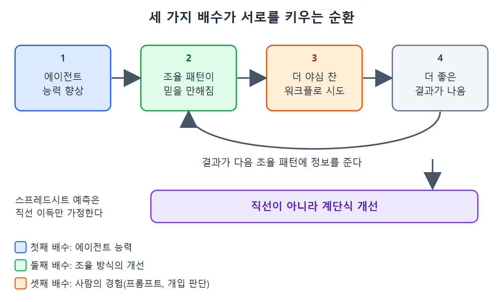

# 세 가지 배수 효과

일정 단축은 하나의 원인에서 나오지 않는다. 서로 곱해지는 세 가지 배수(multiplier)가 함께 작동하기 때문에 성과가 직선이 아니라 계단식으로 뛴다. 이 문서는 세 배수가 각각 무엇인지, 왜 서로 영향을 주는지, 그래서 엑셀로 한 예측이 왜 틀리는지를 설명한다.

---

## 1. 첫 번째 배수: 에이전트 능력

모델이 세대마다 좋아지면 Claude Code는 복잡한 코드베이스를 이해하고, 올바른 구현을 만들고, 오류에서 회복하는 능력이 더 좋아진다. 가장 눈에 잘 띄는 배수이고 뉴스 헤드라인이 되는 것도 이쪽이다. 하지만 원문은 실제로는 이것이 가장 큰 배수가 아니라고 말한다.

## 2. 두 번째 배수: 조율 방식의 개선

멀티 에이전트 협업, 작업 분해 패턴, 스킬 생태계, MCP 연동은 모델의 원래 능력 위에 지렛대를 더한다. 프로젝트를 병렬로 처리할 수 있는 서브에이전트 작업으로 쪼개는 법을 익힌 엔지니어는 선형적인 속도 향상을 얻지 않는다. 모델 능력에 조율 효율이 곱해진 결과를 얻는데, 둘 중 하나만으로는 낼 수 없는 결과다.

## 3. 세 번째 배수: 쌓이는 사람의 경험

개발자는 Claude가 어떤 작업을 잘하는지, 한 번에 좋은 결과가 나오도록 프롬프트를 어떻게 구성하는지, 언제 개입하고 언제 Claude가 스스로 반복하게 둘지를 배운다. 그만큼 세션당 생산성이 올라간다. 이 복리 효과는 벤치마크 데이터에는 보이지 않지만 현장에서는 분명하다. Claude Code를 쓴 지 100시간째의 개발자는 첫 시간의 개발자보다 크게 생산적이다.

## 4. 세 배수가 서로 영향을 준다

세 배수는 따로 작동하지 않고 순환한다.

1. 에이전트 능력이 좋아지면 조율 패턴이 더 믿을 만해진다.
2. 조율 패턴이 믿을 만해지면 사람이 더 야심 찬 워크플로를 시도한다.
3. 야심 찬 워크플로가 더 좋은 결과를 내고, 그 결과가 다음 조율 패턴에 정보를 준다.

그림은 에이전트 능력, 조율 방식, 사람의 경험이 한 방향으로 쌓이지 않고 고리를 이루며 서로를 끌어올리는 모습을 보여 준다. 결과가 다시 조율 패턴에 정보를 주므로 개선이 계단처럼 이어진다.

그 결과는 직선적 이득이 아니라 계단식 개선이다. 스프레드시트로 하는 프로젝션은 직선적 이득을 예측하기 때문에 실제를 과소평가한다.

| 배수 | 무엇이 좋아지나 | 눈에 보이는 정도 |
|---|---|---|
| 에이전트 능력 | 이해, 구현 정확도, 오류 복구 | 가장 잘 보임. 실제 효과가 가장 크지는 않음 |
| 조율 개선 | 서브에이전트 분해, 스킬, MCP | 모델 능력과 곱해짐 |
| 사람의 경험 | 프롬프트 구성, 개입 시점 판단 | 벤치마크에 안 보임, 현장에서 뚜렷함 |

## 5. 실무에서 얻는 교훈

이 구조에서 읽을 수 있는 실용적인 시사점(원문이 직접 한 말이 아니라 이 노트의 해석)은 도구 능력이 오르기만 기다리지 말라는 것이다. 모델 성능은 이미 가장 눈에 띄는 배수여서 모두가 지켜본다. 개인과 팀이 직접 키울 수 있는 것은 조율 방식과 경험이다. 서브에이전트 분해 연습, 스킬과 CLAUDE.md의 축적, 어떤 작업을 맡기고 어떤 작업에 개입할지에 대한 감각이 쌓일수록 같은 모델에서도 결과가 계속 좋아진다.

 
 
 

[Claude Code The Definitive Guide to Agentic Development-2](../)
