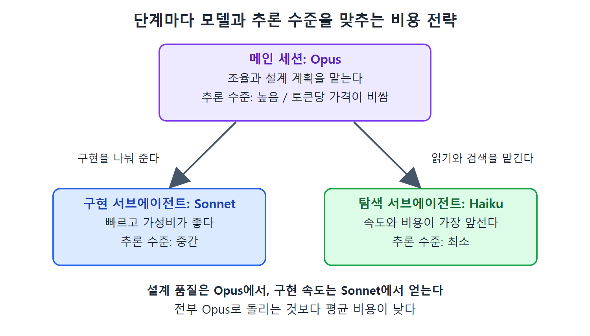

# 토큰 비용과 모델 선택

Claude Code를 쓰는 비용은 결국 토큰(token, AI가 읽고 쓰는 글자 단위)에서 나온다. 이 문서는 토큰 비용이 어떻게 생기는지, 그리고 캐싱·모델 선택·추론 설정·과금 방식으로 비용을 어떻게 다룰 수 있는지 정리한다.

핵심은 "좋은 사용 습관이 곧 비용 절감"이라는 점이다. 컨텍스트를 잘 관리하고, 일에 맞는 모델을 고르고, 추론에 쓰는 힘을 조절하면 품질을 지키면서 비용을 낮출 수 있다.

---

## 1. 프롬프트 캐싱의 경제성

Claude Code는 요청을 보낼 때마다 컨텍스트를 함께 보낸다. CLAUDE.md, MCP 도구 정의, 시스템 프롬프트, 지금까지의 대화 내용이 모두 여기에 들어간다. 캐싱이 없다면 매 턴마다 이 컨텍스트 전체를 정가로 내야 한다.

프롬프트 캐싱(prompt caching, 앞부분이 같은 요청을 저장해 두었다가 재사용하는 기능)은 Claude Code에서 기본으로 켜져 있어서 따로 설정할 것이 없다. 요청의 앞부분, 즉 시스템 프롬프트와 CLAUDE.md 내용과 도구 정의가 지난 턴과 같으면 자동으로 캐시를 쓴다. 캐시된 부분은 원래 입력 가격의 일부만 받는다.

이 구조가 주는 경제적 의미는 두 가지다.

- **좋은 설정이 오히려 싸다.** 풍부한 CLAUDE.md, 자세한 MCP 도구 스키마, 충실한 시스템 프롬프트처럼 Claude Code를 잘 쓰게 만드는 요소가 캐싱의 혜택을 가장 많이 본다. 400줄짜리 CLAUDE.md를 매 요청에 싣는다고 하면 비싸 보이지만, 같은 세션 안에서는 처음 한 번만 정가를 내고 이후 턴은 할인된 가격만 낸다.
- **세션이 길수록 유리하다.** 세션의 첫 턴은 컨텍스트 비용을 전부 낸다. 그 뒤의 턴은 모두 캐시 혜택을 본다. 길게 이어 갈수록 초기 비용이 더 많은 턴으로 나뉜다. 그래서 8장에서 다룬 "중간에 끼어들어 방향을 잡아 주는" 방식(interrupt-and-steer)은 결과가 더 좋을 뿐 아니라 새 세션을 계속 여는 것보다 돈도 덜 든다.

## 2. 모델 선택의 득실

Claude Code는 여러 모델을 지원하고, 어떤 모델을 쓰느냐가 품질과 비용을 모두 좌우한다. 원문이 소개한 모델 위계는 다음과 같다.

| 모델 | 성격 | 잘 맞는 일 |
|---|---|---|
| Sonnet | 빠르고 가성비가 좋으며, 범위가 분명한 작업에서 믿을 만한 코드를 낸다 | 코딩 작업 대부분. 세션의 기본값으로 권장 |
| Opus | 더 깊이 추론한다. 토큰당 가격이 훨씬 비싸다 | 설계 판단, 복잡한 리팩터링, 미묘한 판단이 필요한 일, 모호하거나 중요한 작업 |
| Haiku | 속도와 비용에서 가장 앞선다 | 코드 읽기, 파일 검색, 요약 같은 탐색 작업. Explore 서브에이전트가 Haiku로 돈다 |

여기서 나오는 비용 최적화 패턴은 단순하다. 조율과 계획에는 비싼 모델을 쓰고, 실행에는 싼 모델을 쓴다. 오케스트레이션(여러 에이전트를 나누어 맡기고 조율하는 일)을 Opus 세션이 맡아 계획을 세우고, 구현은 Sonnet 서브에이전트에게 나눠 주면 설계 품질은 Opus에서, 구현 속도는 Sonnet에서 얻는다. 전부 Opus로 돌리는 것보다 평균 비용이 낮다.

이 패턴이 현실적인 이유는 서브에이전트마다 자기 모델을 따로 지정할 수 있기 때문이다. 메인 세션은 Opus, 구현 서브에이전트는 Sonnet, 탐색 서브에이전트는 Haiku로 두면 단계마다 비용 대비 품질이 맞춰진다.



그림은 메인 세션은 Opus가 조율과 계획을 맡고, 구현은 Sonnet 서브에이전트가, 탐색은 Haiku 서브에이전트가 맡는 분담을 보여 준다. 단계마다 모델과 추론 수준을 맞추면 전부 Opus로 돌릴 때보다 평균 비용이 낮아진다.

## 3. 토큰 사용 최적화

모델을 고르는 것 외에도, 3장에서 다룬 컨텍스트 비용 모델이 곧바로 돈과 이어진다. 토큰을 줄이는 구조적인 방법은 다음과 같다.

- 출력이 길게 쏟아지는 작업은 서브에이전트에 격리한다.
- CLAUDE.md에 항상 실어 두지 않고, 필요할 때만 불러오는 스킬(skill)로 옮긴다.
- CLAUDE.md는 간결하게 유지한다.
- 실행 전에 먼저 계획을 세운다.

이것들은 엔지니어링 모범 사례이면서 동시에 비용 절감 수단이다. 500줄짜리 CLAUDE.md를 100턴 동안 처리하면 실제로 돈이 나간다. 참고 자료를 필요할 때만 로드되는 스킬로 옮기면, 그 스킬이 필요 없는 모든 턴에서 토큰이 절약된다. 그리고 실행 전에 계획을 세우면 50만 토큰짜리 잘못된 구현을 막을 수 있다.

## 4. 배포 과금 방식

Claude Code는 몇 가지 과금 구조로 쓸 수 있고, 어느 쪽을 고르느냐에 따라 비용 관리와 조직의 유연성이 달라진다.

- **좌석당 구독(Teams, Enterprise 플랜)**: 개발자 한 명당 월 고정 비용을 낸다. 예산을 세우기 쉽고, 사용량이 꾸준하고 예측 가능한 팀에 맞는다. 한 달에 세션을 열 번 돌리든 백 번 돌리든 비용이 같다.
- **종량제(API와 콘솔 접근)**: 실제 토큰 사용량만큼 낸다. 사용량이 들쭉날쭉한 경우, 실험, 그리고 배포 때 사용량이 몰렸다가 한가할 때는 0으로 떨어지는 CI/CD 파이프라인에 더 맞는다.

원문은 "어느 쪽이 더 싼가"가 핵심 질문이 아니라고 말한다. 어느 쪽이 싼지는 사용 패턴에 달려 있다. 정말 물어야 할 것은 조직이 어떤 방식으로 규모를 키우고 싶은가이다. 좌석당 과금은 개발자 한 명이 최대한 많이 쓰도록 유도하고, 종량제는 토큰 효율을 높이도록 유도한다. 둘 다 좋은 행동을 낳지만 낳는 행동이 서로 다르다.

처음 도입하는 팀에는 종량제를 권한다. 실제 비용과 사용 패턴이 투명하게 보이기 때문이다. 사용량이 안정되면 꾸준히 쓰는 사용자에게는 보통 좌석당 구독이 더 경제적이다.

## 5. 추론 비용 제어

모든 토큰이 같은 값어치를 갖는 것은 아니다. Claude Code가 결과를 내기 전에 하는 사고(thinking, 추론)에도 별도의 비용 구조가 있고, 이를 조절하는 것이 실용적인 비용 레버다.

인터리브드 씽킹(interleaved thinking)은 도구 호출 사이사이에 Claude가 추론하는 방식이다. 판단은 더 좋아지지만 토큰을 더 쓴다. 씽킹 모드와 effort 수준 설정으로 이 득실을 조절한다.

- effort를 높이면 더 철저하게 추론한다. 복잡한 설계 판단에 쓴다.
- effort를 낮추면 더 빠르고 싼 응답이 나온다. 단순한 구현 작업에 알맞다.

Opus 4.6은 적응형 할당(adaptive allocation)을 쓴다. 고정된 씽킹 토큰 예산 대신, 사용자가 고른 effort 수준(low, medium, high)에 따라 모델이 알아서 추론량을 정한다. 설정 방법은 다음과 같다.

```bash
# /model 명령에서 방향키로 effort 조절 (즉시 적용)
/model

# 전역으로 effort 지정
export CLAUDE_CODE_EFFORT_LEVEL=...

# 다른 모델: 씽킹 토큰 상한. 0이면 씽킹 끔
export MAX_THINKING_TOKENS=...
```

`MAX_THINKING_TOKENS`는 0으로 두면 어떤 모델에서든 씽킹이 완전히 꺼진다. `CLAUDE_CODE_EFFORT_LEVEL`에 넣을 값은 원문에 구체적으로 나오지 않으며, low, medium, high 세 수준이 있다는 설명만 있다.

직관과 어긋나는 점도 있다. 프롬프트에 "think harder"나 "ultrathink"라고 써도 그것은 보통 지시로 해석될 뿐이다. 추가 씽킹 토큰이 할당되지 않는다. 씽킹 예산은 위의 설정 방법으로만 조절되고, 대화로 부탁한다고 바뀌지 않는다.

경제적인 결론은 추론에 쓰는 투자를 작업에 맞추라는 것이다. 단순한 파일 이름 변경에 깊은 추론 비용을 쓰지 말고, 보안이 중요한 리팩터링에서는 추론을 아끼지 않는다. 이는 모델 선택 전략과 이어진다.

| 용도 | 모델 | 추론 수준 |
|---|---|---|
| 설계 계획 | Opus | 높음 |
| 구현 | Sonnet | 중간 |
| 탐색 | Haiku | 최소 |

각 조합은 비용 곡선 위에서 서로 다른 가격 대비 성능 지점이다.

<br>
<br>
<br>

[Claude Code The Definitive Guide to Agentic Development-2](../)
