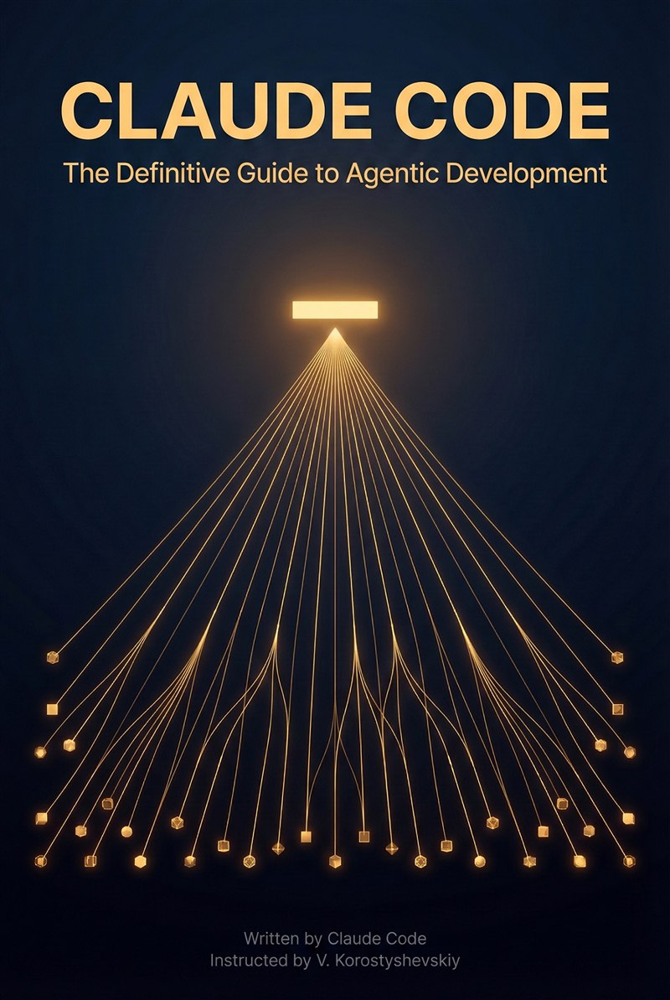
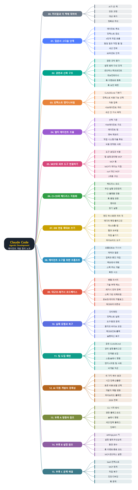

# **Claude Code The Definitive Guide to Agentic Development-2**
(Claude Code: 에이전트 개발을 위한 결정판 가이드, 장별 정리 노트)
 

 
 

이 문서는 Claude Code가 직접 썼다고 밝힌 책 『Claude Code: The Definitive Guide to Agentic Development』(Vladimir Korostyshevskiy 지시, 2026년 2월)를 장별로 정리한 한국어 학습 노트입니다. 원문을 그대로 번역한 것이 아니라 내용을 풀어서 다시 설명했고, 처음 쓰는 용어는 쉬운 말로 풀이를 붙였습니다. 책은 Claude Code를 몇 달 써 본 개발자를 대상으로 합니다. 에이전트 루프와 컨텍스트 윈도 관리 같은 기본 사고방식에서 시작해, 권한과 샌드박스, 훅, CLAUDE.md와 스킬, 서브에이전트와 에이전트 팀, MCP 연결, CI/CD 자동화, IDE 연동을 차례로 다룹니다. 이어서 프롬프트 작성법, 대규모·레거시 코드베이스 다루기, 실패 유형과 복구, 팀 도입 패턴, 비용과 전략을 살펴봅니다. 마지막 부록에는 명령어, 설정, 문제 해결 참조가 있습니다. 장마다 핵심 흐름을 보여 주는 그림 한두 개를 새로 그려 넣었습니다.
 
 
 

---

- [00. 머리말과 이 책에 대하여](00.%20%EB%A8%B8%EB%A6%AC%EB%A7%90%EA%B3%BC%20%EC%9D%B4%20%EC%B1%85%EC%97%90%20%EB%8C%80%ED%95%98%EC%97%AC/Readme.md)
- [01. 입문서 그다음 단계](01.%20%EC%9E%85%EB%AC%B8%EC%84%9C%20%EA%B7%B8%EB%8B%A4%EC%9D%8C%20%EB%8B%A8%EA%B3%84/Readme.md)
  - [에이전트 루프와 컨텍스트 윈도](01.%20%EC%9E%85%EB%AC%B8%EC%84%9C%20%EA%B7%B8%EB%8B%A4%EC%9D%8C%20%EB%8B%A8%EA%B3%84/%EC%97%90%EC%9D%B4%EC%A0%84%ED%8A%B8%20%EB%A3%A8%ED%94%84%EC%99%80%20%EC%BB%A8%ED%85%8D%EC%8A%A4%ED%8A%B8%20%EC%9C%88%EB%8F%84.md)
  - [4단계 작업 흐름](01.%20%EC%9E%85%EB%AC%B8%EC%84%9C%20%EA%B7%B8%EB%8B%A4%EC%9D%8C%20%EB%8B%A8%EA%B3%84/4%EB%8B%A8%EA%B3%84%20%EC%9E%91%EC%97%85%20%ED%9D%90%EB%A6%84.md)
  - [자율 실행과 80퍼센트 인계](01.%20%EC%9E%85%EB%AC%B8%EC%84%9C%20%EA%B7%B8%EB%8B%A4%EC%9D%8C%20%EB%8B%A8%EA%B3%84/%EC%9E%90%EC%9C%A8%20%EC%8B%A4%ED%96%89%EA%B3%BC%2080%ED%8D%BC%EC%84%BC%ED%8A%B8%20%EC%9D%B8%EA%B3%84.md)
  - [맡길 일과 직접 할 일 구분](01.%20%EC%9E%85%EB%AC%B8%EC%84%9C%20%EA%B7%B8%EB%8B%A4%EC%9D%8C%20%EB%8B%A8%EA%B3%84/%EB%A7%A1%EA%B8%B8%20%EC%9D%BC%EA%B3%BC%20%EC%A7%81%EC%A0%91%20%ED%95%A0%20%EC%9D%BC%20%EA%B5%AC%EB%B6%84.md)
  - [세션 전략과 반복 개선](01.%20%EC%9E%85%EB%AC%B8%EC%84%9C%20%EA%B7%B8%EB%8B%A4%EC%9D%8C%20%EB%8B%A8%EA%B3%84/%EC%84%B8%EC%85%98%20%EC%A0%84%EB%9E%B5%EA%B3%BC%20%EB%B0%98%EB%B3%B5%20%EA%B0%9C%EC%84%A0.md)
  - [프롬프트 제안과 단순함의 원칙](01.%20%EC%9E%85%EB%AC%B8%EC%84%9C%20%EA%B7%B8%EB%8B%A4%EC%9D%8C%20%EB%8B%A8%EA%B3%84/%ED%94%84%EB%A1%AC%ED%94%84%ED%8A%B8%20%EC%A0%9C%EC%95%88%EA%B3%BC%20%EB%8B%A8%EC%88%9C%ED%95%A8%EC%9D%98%20%EC%9B%90%EC%B9%99.md)
  - [핵심 정리](01.%20%EC%9E%85%EB%AC%B8%EC%84%9C%20%EA%B7%B8%EB%8B%A4%EC%9D%8C%20%EB%8B%A8%EA%B3%84/%ED%95%B5%EC%8B%AC%20%EC%A0%95%EB%A6%AC.md)
- [02. 권한과 신뢰 구조](02.%20%EA%B6%8C%ED%95%9C%EA%B3%BC%20%EC%8B%A0%EB%A2%B0%20%EA%B5%AC%EC%A1%B0/Readme.md)
  - [설정 범위 다섯 단계](02.%20%EA%B6%8C%ED%95%9C%EA%B3%BC%20%EC%8B%A0%EB%A2%B0%20%EA%B5%AC%EC%A1%B0/%EC%84%A4%EC%A0%95%20%EB%B2%94%EC%9C%84%20%EB%8B%A4%EC%84%AF%20%EB%8B%A8%EA%B3%84.md)
  - [권한 규칙 평가와 민감 파일](02.%20%EA%B6%8C%ED%95%9C%EA%B3%BC%20%EC%8B%A0%EB%A2%B0%20%EA%B5%AC%EC%A1%B0/%EA%B6%8C%ED%95%9C%20%EA%B7%9C%EC%B9%99%20%ED%8F%89%EA%B0%80%EC%99%80%20%EB%AF%BC%EA%B0%90%20%ED%8C%8C%EC%9D%BC.md)
  - [샌드박스와 체크포인트](02.%20%EA%B6%8C%ED%95%9C%EA%B3%BC%20%EC%8B%A0%EB%A2%B0%20%EA%B5%AC%EC%A1%B0/%EC%83%8C%EB%93%9C%EB%B0%95%EC%8A%A4%EC%99%80%20%EC%B2%B4%ED%81%AC%ED%8F%AC%EC%9D%B8%ED%8A%B8.md)
  - [데브컨테이너와 유출 위험](02.%20%EA%B6%8C%ED%95%9C%EA%B3%BC%20%EC%8B%A0%EB%A2%B0%20%EA%B5%AC%EC%A1%B0/%EB%8D%B0%EB%B8%8C%EC%BB%A8%ED%85%8C%EC%9D%B4%EB%84%88%EC%99%80%20%EC%9C%A0%EC%B6%9C%20%EC%9C%84%ED%97%98.md)
  - [훅 이벤트 목록](02.%20%EA%B6%8C%ED%95%9C%EA%B3%BC%20%EC%8B%A0%EB%A2%B0%20%EA%B5%AC%EC%A1%B0/%ED%9B%85%20%EC%9D%B4%EB%B2%A4%ED%8A%B8%20%EB%AA%A9%EB%A1%9D.md)
  - [훅 종류와 입출력](02.%20%EA%B6%8C%ED%95%9C%EA%B3%BC%20%EC%8B%A0%EB%A2%B0%20%EA%B5%AC%EC%A1%B0/%ED%9B%85%20%EC%A2%85%EB%A5%98%EC%99%80%20%EC%9E%85%EC%B6%9C%EB%A0%A5.md)
  - [훅 보안과 활용 패턴](02.%20%EA%B6%8C%ED%95%9C%EA%B3%BC%20%EC%8B%A0%EB%A2%B0%20%EA%B5%AC%EC%A1%B0/%ED%9B%85%20%EB%B3%B4%EC%95%88%EA%B3%BC%20%ED%99%9C%EC%9A%A9%20%ED%8C%A8%ED%84%B4.md)
  - [MCP와 에이전트 시대의 보안](02.%20%EA%B6%8C%ED%95%9C%EA%B3%BC%20%EC%8B%A0%EB%A2%B0%20%EA%B5%AC%EC%A1%B0/MCP%EC%99%80%20%EC%97%90%EC%9D%B4%EC%A0%84%ED%8A%B8%20%EC%8B%9C%EB%8C%80%EC%9D%98%20%EB%B3%B4%EC%95%88.md)
  - [핵심 정리](02.%20%EA%B6%8C%ED%95%9C%EA%B3%BC%20%EC%8B%A0%EB%A2%B0%20%EA%B5%AC%EC%A1%B0/%ED%95%B5%EC%8B%AC%20%EC%A0%95%EB%A6%AC.md)
- [03. 컨텍스트 엔지니어링](03.%20%EC%BB%A8%ED%85%8D%EC%8A%A4%ED%8A%B8%20%EC%97%94%EC%A7%80%EB%8B%88%EC%96%B4%EB%A7%81/Readme.md)
  - [CLAUDE.md 기본기](03.%20%EC%BB%A8%ED%85%8D%EC%8A%A4%ED%8A%B8%20%EC%97%94%EC%A7%80%EB%8B%88%EC%96%B4%EB%A7%81/CLAUDE.md%20%EA%B8%B0%EB%B3%B8%EA%B8%B0.md)
  - [컨텍스트 비용과 기능 선택](03.%20%EC%BB%A8%ED%85%8D%EC%8A%A4%ED%8A%B8%20%EC%97%94%EC%A7%80%EB%8B%88%EC%96%B4%EB%A7%81/%EC%BB%A8%ED%85%8D%EC%8A%A4%ED%8A%B8%20%EB%B9%84%EC%9A%A9%EA%B3%BC%20%EA%B8%B0%EB%8A%A5%20%EC%84%A0%ED%83%9D.md)
  - [자동 압축과 컨텍스트 관리](03.%20%EC%BB%A8%ED%85%8D%EC%8A%A4%ED%8A%B8%20%EC%97%94%EC%A7%80%EB%8B%88%EC%96%B4%EB%A7%81/%EC%9E%90%EB%8F%99%20%EC%95%95%EC%B6%95%EA%B3%BC%20%EC%BB%A8%ED%85%8D%EC%8A%A4%ED%8A%B8%20%EA%B4%80%EB%A6%AC.md)
  - [세션을 넘어 쌓이는 지식](03.%20%EC%BB%A8%ED%85%8D%EC%8A%A4%ED%8A%B8%20%EC%97%94%EC%A7%80%EB%8B%88%EC%96%B4%EB%A7%81/%EC%84%B8%EC%85%98%EC%9D%84%20%EB%84%98%EC%96%B4%20%EC%8C%93%EC%9D%B4%EB%8A%94%20%EC%A7%80%EC%8B%9D.md)
  - [AGENTS.md와 서브에이전트 격리](03.%20%EC%BB%A8%ED%85%8D%EC%8A%A4%ED%8A%B8%20%EC%97%94%EC%A7%80%EB%8B%88%EC%96%B4%EB%A7%81/AGENTS.md%EC%99%80%20%EC%84%9C%EB%B8%8C%EC%97%90%EC%9D%B4%EC%A0%84%ED%8A%B8%20%EA%B2%A9%EB%A6%AC.md)
  - [컨텍스트 엔지니어링 종합](03.%20%EC%BB%A8%ED%85%8D%EC%8A%A4%ED%8A%B8%20%EC%97%94%EC%A7%80%EB%8B%88%EC%96%B4%EB%A7%81/%EC%BB%A8%ED%85%8D%EC%8A%A4%ED%8A%B8%20%EC%97%94%EC%A7%80%EB%8B%88%EC%96%B4%EB%A7%81%20%EC%A2%85%ED%95%A9.md)
  - [핵심 정리](03.%20%EC%BB%A8%ED%85%8D%EC%8A%A4%ED%8A%B8%20%EC%97%94%EC%A7%80%EB%8B%88%EC%96%B4%EB%A7%81/%ED%95%B5%EC%8B%AC%20%EC%A0%95%EB%A6%AC.md)
- [04. 멀티 에이전트 조율](04.%20%EB%A9%80%ED%8B%B0%20%EC%97%90%EC%9D%B4%EC%A0%84%ED%8A%B8%20%EC%A1%B0%EC%9C%A8/Readme.md)
  - [서브에이전트의 구조와 종류](04.%20%EB%A9%80%ED%8B%B0%20%EC%97%90%EC%9D%B4%EC%A0%84%ED%8A%B8%20%EC%A1%B0%EC%9C%A8/%EC%84%9C%EB%B8%8C%EC%97%90%EC%9D%B4%EC%A0%84%ED%8A%B8%EC%9D%98%20%EA%B5%AC%EC%A1%B0%EC%99%80%20%EC%A2%85%EB%A5%98.md)
  - [서브에이전트 운영 방법](04.%20%EB%A9%80%ED%8B%B0%20%EC%97%90%EC%9D%B4%EC%A0%84%ED%8A%B8%20%EC%A1%B0%EC%9C%A8/%EC%84%9C%EB%B8%8C%EC%97%90%EC%9D%B4%EC%A0%84%ED%8A%B8%20%EC%9A%B4%EC%98%81%20%EB%B0%A9%EB%B2%95.md)
  - [에이전트 팀](04.%20%EB%A9%80%ED%8B%B0%20%EC%97%90%EC%9D%B4%EC%A0%84%ED%8A%B8%20%EC%A1%B0%EC%9C%A8/%EC%97%90%EC%9D%B4%EC%A0%84%ED%8A%B8%20%ED%8C%80.md)
  - [무엇을 쓸지 고르는 기준](04.%20%EB%A9%80%ED%8B%B0%20%EC%97%90%EC%9D%B4%EC%A0%84%ED%8A%B8%20%EC%A1%B0%EC%9C%A8/%EB%AC%B4%EC%97%87%EC%9D%84%20%EC%93%B8%EC%A7%80%20%EA%B3%A0%EB%A5%B4%EB%8A%94%20%EA%B8%B0%EC%A4%80.md)
  - [팀 사례와 비용 최적화](04.%20%EB%A9%80%ED%8B%B0%20%EC%97%90%EC%9D%B4%EC%A0%84%ED%8A%B8%20%EC%A1%B0%EC%9C%A8/%ED%8C%80%20%EC%82%AC%EB%A1%80%EC%99%80%20%EB%B9%84%EC%9A%A9%20%EC%B5%9C%EC%A0%81%ED%99%94.md)
  - [트레이딩 거버넌스 사례](04.%20%EB%A9%80%ED%8B%B0%20%EC%97%90%EC%9D%B4%EC%A0%84%ED%8A%B8%20%EC%A1%B0%EC%9C%A8/%ED%8A%B8%EB%A0%88%EC%9D%B4%EB%94%A9%20%EA%B1%B0%EB%B2%84%EB%84%8C%EC%8A%A4%20%EC%82%AC%EB%A1%80.md)
  - [영속 메모리](04.%20%EB%A9%80%ED%8B%B0%20%EC%97%90%EC%9D%B4%EC%A0%84%ED%8A%B8%20%EC%A1%B0%EC%9C%A8/%EC%98%81%EC%86%8D%20%EB%A9%94%EB%AA%A8%EB%A6%AC.md)
  - [작업 시스템과 자율 루프](04.%20%EB%A9%80%ED%8B%B0%20%EC%97%90%EC%9D%B4%EC%A0%84%ED%8A%B8%20%EC%A1%B0%EC%9C%A8/%EC%9E%91%EC%97%85%20%EC%8B%9C%EC%8A%A4%ED%85%9C%EA%B3%BC%20%EC%9E%90%EC%9C%A8%20%EB%A3%A8%ED%94%84.md)
  - [비개발 업무와 대규모 조율 사례](04.%20%EB%A9%80%ED%8B%B0%20%EC%97%90%EC%9D%B4%EC%A0%84%ED%8A%B8%20%EC%A1%B0%EC%9C%A8/%EB%B9%84%EA%B0%9C%EB%B0%9C%20%EC%97%85%EB%AC%B4%EC%99%80%20%EB%8C%80%EA%B7%9C%EB%AA%A8%20%EC%A1%B0%EC%9C%A8%20%EC%82%AC%EB%A1%80.md)
  - [핵심 정리](04.%20%EB%A9%80%ED%8B%B0%20%EC%97%90%EC%9D%B4%EC%A0%84%ED%8A%B8%20%EC%A1%B0%EC%9C%A8/%ED%95%B5%EC%8B%AC%20%EC%A0%95%EB%A6%AC.md)
- [05. MCP로 외부 도구 연결하기](05.%20MCP%EB%A1%9C%20%EC%99%B8%EB%B6%80%20%EB%8F%84%EA%B5%AC%20%EC%97%B0%EA%B2%B0%ED%95%98%EA%B8%B0/Readme.md)
  - [도구 로딩과 컨텍스트 비용](05.%20MCP%EB%A1%9C%20%EC%99%B8%EB%B6%80%20%EB%8F%84%EA%B5%AC%20%EC%97%B0%EA%B2%B0%ED%95%98%EA%B8%B0/%EB%8F%84%EA%B5%AC%20%EB%A1%9C%EB%94%A9%EA%B3%BC%20%EC%BB%A8%ED%85%8D%EC%8A%A4%ED%8A%B8%20%EB%B9%84%EC%9A%A9.md)
  - [팀 설정과 관리형 MCP](05.%20MCP%EB%A1%9C%20%EC%99%B8%EB%B6%80%20%EB%8F%84%EA%B5%AC%20%EC%97%B0%EA%B2%B0%ED%95%98%EA%B8%B0/%ED%8C%80%20%EC%84%A4%EC%A0%95%EA%B3%BC%20%EA%B4%80%EB%A6%AC%ED%98%95%20MCP.md)
  - [MCP가 깨지는 지점](05.%20MCP%EB%A1%9C%20%EC%99%B8%EB%B6%80%20%EB%8F%84%EA%B5%AC%20%EC%97%B0%EA%B2%B0%ED%95%98%EA%B8%B0/MCP%EA%B0%80%20%EA%B9%A8%EC%A7%80%EB%8A%94%20%EC%A7%80%EC%A0%90.md)
  - [MCP 도구 훅 활용](05.%20MCP%EB%A1%9C%20%EC%99%B8%EB%B6%80%20%EB%8F%84%EA%B5%AC%20%EC%97%B0%EA%B2%B0%ED%95%98%EA%B8%B0/MCP%20%EB%8F%84%EA%B5%AC%20%ED%9B%85%20%ED%99%9C%EC%9A%A9.md)
  - [금융 분야 커넥터 사례](05.%20MCP%EB%A1%9C%20%EC%99%B8%EB%B6%80%20%EB%8F%84%EA%B5%AC%20%EC%97%B0%EA%B2%B0%ED%95%98%EA%B8%B0/%EA%B8%88%EC%9C%B5%20%EB%B6%84%EC%95%BC%20%EC%BB%A4%EB%84%A5%ED%84%B0%20%EC%82%AC%EB%A1%80.md)
  - [프롬프트 라우터와 3계층 구조](05.%20MCP%EB%A1%9C%20%EC%99%B8%EB%B6%80%20%EB%8F%84%EA%B5%AC%20%EC%97%B0%EA%B2%B0%ED%95%98%EA%B8%B0/%ED%94%84%EB%A1%AC%ED%94%84%ED%8A%B8%20%EB%9D%BC%EC%9A%B0%ED%84%B0%EC%99%80%203%EA%B3%84%EC%B8%B5%20%EA%B5%AC%EC%A1%B0.md)
  - [대규모 MCP 구성과 아키텍처 패턴](05.%20MCP%EB%A1%9C%20%EC%99%B8%EB%B6%80%20%EB%8F%84%EA%B5%AC%20%EC%97%B0%EA%B2%B0%ED%95%98%EA%B8%B0/%EB%8C%80%EA%B7%9C%EB%AA%A8%20MCP%20%EA%B5%AC%EC%84%B1%EA%B3%BC%20%EC%95%84%ED%82%A4%ED%85%8D%EC%B2%98%20%ED%8C%A8%ED%84%B4.md)
  - [curl 대신 MCP를 쓰는 보안상 이유](05.%20MCP%EB%A1%9C%20%EC%99%B8%EB%B6%80%20%EB%8F%84%EA%B5%AC%20%EC%97%B0%EA%B2%B0%ED%95%98%EA%B8%B0/curl%20%EB%8C%80%EC%8B%A0%20MCP%EB%A5%BC%20%EC%93%B0%EB%8A%94%20%EB%B3%B4%EC%95%88%EC%83%81%20%EC%9D%B4%EC%9C%A0.md)
  - [핵심 정리](05.%20MCP%EB%A1%9C%20%EC%99%B8%EB%B6%80%20%EB%8F%84%EA%B5%AC%20%EC%97%B0%EA%B2%B0%ED%95%98%EA%B8%B0/%ED%95%B5%EC%8B%AC%20%EC%A0%95%EB%A6%AC.md)
- [06. CI-CD와 헤드리스 자동화](06.%20CI-CD%EC%99%80%20%ED%97%A4%EB%93%9C%EB%A6%AC%EC%8A%A4%20%EC%9E%90%EB%8F%99%ED%99%94/Readme.md)
  - [헤드리스 모드 기본](06.%20CI-CD%EC%99%80%20%ED%97%A4%EB%93%9C%EB%A6%AC%EC%8A%A4%20%EC%9E%90%EB%8F%99%ED%99%94/%ED%97%A4%EB%93%9C%EB%A6%AC%EC%8A%A4%20%EB%AA%A8%EB%93%9C%20%EA%B8%B0%EB%B3%B8.md)
  - [무인 실행의 안전장치](06.%20CI-CD%EC%99%80%20%ED%97%A4%EB%93%9C%EB%A6%AC%EC%8A%A4%20%EC%9E%90%EB%8F%99%ED%99%94/%EB%AC%B4%EC%9D%B8%20%EC%8B%A4%ED%96%89%EC%9D%98%20%EC%95%88%EC%A0%84%EC%9E%A5%EC%B9%98.md)
  - [CI 플랫폼 연동 패턴](06.%20CI-CD%EC%99%80%20%ED%97%A4%EB%93%9C%EB%A6%AC%EC%8A%A4%20%EC%9E%90%EB%8F%99%ED%99%94/CI%20%ED%94%8C%EB%9E%AB%ED%8F%BC%20%EC%97%B0%EB%8F%99%20%ED%8C%A8%ED%84%B4.md)
  - [팬아웃과 CI 파이프라인 생성](06.%20CI-CD%EC%99%80%20%ED%97%A4%EB%93%9C%EB%A6%AC%EC%8A%A4%20%EC%9E%90%EB%8F%99%ED%99%94/%ED%8C%AC%EC%95%84%EC%9B%83%EA%B3%BC%20CI%20%ED%8C%8C%EC%9D%B4%ED%94%84%EB%9D%BC%EC%9D%B8%20%EC%83%9D%EC%84%B1.md)
  - [훅으로 만드는 품질 관문](06.%20CI-CD%EC%99%80%20%ED%97%A4%EB%93%9C%EB%A6%AC%EC%8A%A4%20%EC%9E%90%EB%8F%99%ED%99%94/%ED%9B%85%EC%9C%BC%EB%A1%9C%20%EB%A7%8C%EB%93%9C%EB%8A%94%20%ED%92%88%EC%A7%88%20%EA%B4%80%EB%AC%B8.md)
  - [아직 안 되는 것과 장기 실행](06.%20CI-CD%EC%99%80%20%ED%97%A4%EB%93%9C%EB%A6%AC%EC%8A%A4%20%EC%9E%90%EB%8F%99%ED%99%94/%EC%95%84%EC%A7%81%20%EC%95%88%20%EB%90%98%EB%8A%94%20%EA%B2%83%EA%B3%BC%20%EC%9E%A5%EA%B8%B0%20%EC%8B%A4%ED%96%89.md)
  - [핵심 정리](06.%20CI-CD%EC%99%80%20%ED%97%A4%EB%93%9C%EB%A6%AC%EC%8A%A4%20%EC%9E%90%EB%8F%99%ED%99%94/%ED%95%B5%EC%8B%AC%20%EC%A0%95%EB%A6%AC.md)
- [07. IDE 연동 제대로 쓰기](07.%20IDE%20%EC%97%B0%EB%8F%99%20%EC%A0%9C%EB%8C%80%EB%A1%9C%20%EC%93%B0%EA%B8%B0/Readme.md)
  - [엔진 하나 화면 여러 개](07.%20IDE%20%EC%97%B0%EB%8F%99%20%EC%A0%9C%EB%8C%80%EB%A1%9C%20%EC%93%B0%EA%B8%B0/%EC%97%94%EC%A7%84%20%ED%95%98%EB%82%98%20%ED%99%94%EB%A9%B4%20%EC%97%AC%EB%9F%AC%20%EA%B0%9C.md)
  - [에디터 확장과 IDE 플러그인](07.%20IDE%20%EC%97%B0%EB%8F%99%20%EC%A0%9C%EB%8C%80%EB%A1%9C%20%EC%93%B0%EA%B8%B0/%EC%97%90%EB%94%94%ED%84%B0%20%ED%99%95%EC%9E%A5%EA%B3%BC%20IDE%20%ED%94%8C%EB%9F%AC%EA%B7%B8%EC%9D%B8.md)
  - [데스크톱 앱](07.%20IDE%20%EC%97%B0%EB%8F%99%20%EC%A0%9C%EB%8C%80%EB%A1%9C%20%EC%93%B0%EA%B8%B0/%EB%8D%B0%EC%8A%A4%ED%81%AC%ED%86%B1%20%EC%95%B1.md)
  - [웹과 모바일의 클라우드 세션](07.%20IDE%20%EC%97%B0%EB%8F%99%20%EC%A0%9C%EB%8C%80%EB%A1%9C%20%EC%93%B0%EA%B8%B0/%EC%9B%B9%EA%B3%BC%20%EB%AA%A8%EB%B0%94%EC%9D%BC%EC%9D%98%20%ED%81%B4%EB%9D%BC%EC%9A%B0%EB%93%9C%20%EC%84%B8%EC%85%98.md)
  - [화면 사이 작업 옮기기](07.%20IDE%20%EC%97%B0%EB%8F%99%20%EC%A0%9C%EB%8C%80%EB%A1%9C%20%EC%93%B0%EA%B8%B0/%ED%99%94%EB%A9%B4%20%EC%82%AC%EC%9D%B4%20%EC%9E%91%EC%97%85%20%EC%98%AE%EA%B8%B0%EA%B8%B0.md)
  - [자동완성 공백과 하이브리드 도구](07.%20IDE%20%EC%97%B0%EB%8F%99%20%EC%A0%9C%EB%8C%80%EB%A1%9C%20%EC%93%B0%EA%B8%B0/%EC%9E%90%EB%8F%99%EC%99%84%EC%84%B1%20%EA%B3%B5%EB%B0%B1%EA%B3%BC%20%ED%95%98%EC%9D%B4%EB%B8%8C%EB%A6%AC%EB%93%9C%20%EB%8F%84%EA%B5%AC.md)
  - [핵심 정리](07.%20IDE%20%EC%97%B0%EB%8F%99%20%EC%A0%9C%EB%8C%80%EB%A1%9C%20%EC%93%B0%EA%B8%B0/%ED%95%B5%EC%8B%AC%20%EC%A0%95%EB%A6%AC.md)
- [08. 에이전트 도구를 위한 프롬프트 작성법](08.%20%EC%97%90%EC%9D%B4%EC%A0%84%ED%8A%B8%20%EB%8F%84%EA%B5%AC%EB%A5%BC%20%EC%9C%84%ED%95%9C%20%ED%94%84%EB%A1%AC%ED%94%84%ED%8A%B8%20%EC%9E%91%EC%84%B1%EB%B2%95/Readme.md)
  - [프롬프트는 작업 지시서다](08.%20%EC%97%90%EC%9D%B4%EC%A0%84%ED%8A%B8%20%EB%8F%84%EA%B5%AC%EB%A5%BC%20%EC%9C%84%ED%95%9C%20%ED%94%84%EB%A1%AC%ED%94%84%ED%8A%B8%20%EC%9E%91%EC%84%B1%EB%B2%95/%ED%94%84%EB%A1%AC%ED%94%84%ED%8A%B8%EB%8A%94%20%EC%9E%91%EC%97%85%20%EC%A7%80%EC%8B%9C%EC%84%9C%EB%8B%A4.md)
  - [입력 방식과 중간 개입](08.%20%EC%97%90%EC%9D%B4%EC%A0%84%ED%8A%B8%20%EB%8F%84%EA%B5%AC%EB%A5%BC%20%EC%9C%84%ED%95%9C%20%ED%94%84%EB%A1%AC%ED%94%84%ED%8A%B8%20%EC%9E%91%EC%84%B1%EB%B2%95/%EC%9E%85%EB%A0%A5%20%EB%B0%A9%EC%8B%9D%EA%B3%BC%20%EC%A4%91%EA%B0%84%20%EA%B0%9C%EC%9E%85.md)
  - [스펙 주도 개발](08.%20%EC%97%90%EC%9D%B4%EC%A0%84%ED%8A%B8%20%EB%8F%84%EA%B5%AC%EB%A5%BC%20%EC%9C%84%ED%95%9C%20%ED%94%84%EB%A1%AC%ED%94%84%ED%8A%B8%20%EC%9E%91%EC%84%B1%EB%B2%95/%EC%8A%A4%ED%8E%99%20%EC%A3%BC%EB%8F%84%20%EA%B0%9C%EB%B0%9C.md)
  - [백프레셔와 계획 먼저 세우기](08.%20%EC%97%90%EC%9D%B4%EC%A0%84%ED%8A%B8%20%EB%8F%84%EA%B5%AC%EB%A5%BC%20%EC%9C%84%ED%95%9C%20%ED%94%84%EB%A1%AC%ED%94%84%ED%8A%B8%20%EC%9E%91%EC%84%B1%EB%B2%95/%EB%B0%B1%ED%94%84%EB%A0%88%EC%85%94%EC%99%80%20%EA%B3%84%ED%9A%8D%20%EB%A8%BC%EC%A0%80%20%EC%84%B8%EC%9A%B0%EA%B8%B0.md)
  - [제약과 질문으로 정확도 높이기](08.%20%EC%97%90%EC%9D%B4%EC%A0%84%ED%8A%B8%20%EB%8F%84%EA%B5%AC%EB%A5%BC%20%EC%9C%84%ED%95%9C%20%ED%94%84%EB%A1%AC%ED%94%84%ED%8A%B8%20%EC%9E%91%EC%84%B1%EB%B2%95/%EC%A0%9C%EC%95%BD%EA%B3%BC%20%EC%A7%88%EB%AC%B8%EC%9C%BC%EB%A1%9C%20%EC%A0%95%ED%99%95%EB%8F%84%20%EB%86%92%EC%9D%B4%EA%B8%B0.md)
  - [확장 사고 설정](08.%20%EC%97%90%EC%9D%B4%EC%A0%84%ED%8A%B8%20%EB%8F%84%EA%B5%AC%EB%A5%BC%20%EC%9C%84%ED%95%9C%20%ED%94%84%EB%A1%AC%ED%94%84%ED%8A%B8%20%EC%9E%91%EC%84%B1%EB%B2%95/%ED%99%95%EC%9E%A5%20%EC%82%AC%EA%B3%A0%20%EC%84%A4%EC%A0%95.md)
  - [분석 업무 프롬프트와 스킬 활용](08.%20%EC%97%90%EC%9D%B4%EC%A0%84%ED%8A%B8%20%EB%8F%84%EA%B5%AC%EB%A5%BC%20%EC%9C%84%ED%95%9C%20%ED%94%84%EB%A1%AC%ED%94%84%ED%8A%B8%20%EC%9E%91%EC%84%B1%EB%B2%95/%EB%B6%84%EC%84%9D%20%EC%97%85%EB%AC%B4%20%ED%94%84%EB%A1%AC%ED%94%84%ED%8A%B8%EC%99%80%20%EC%8A%A4%ED%82%AC%20%ED%99%9C%EC%9A%A9.md)
  - [핵심 정리](08.%20%EC%97%90%EC%9D%B4%EC%A0%84%ED%8A%B8%20%EB%8F%84%EA%B5%AC%EB%A5%BC%20%EC%9C%84%ED%95%9C%20%ED%94%84%EB%A1%AC%ED%94%84%ED%8A%B8%20%EC%9E%91%EC%84%B1%EB%B2%95/%ED%95%B5%EC%8B%AC%20%EC%A0%95%EB%A6%AC.md)
- [09. 대규모·레거시 코드베이스 다루기](09.%20%EB%8C%80%EA%B7%9C%EB%AA%A8%C2%B7%EB%A0%88%EA%B1%B0%EC%8B%9C%20%EC%BD%94%EB%93%9C%EB%B2%A0%EC%9D%B4%EC%8A%A4%20%EB%8B%A4%EB%A3%A8%EA%B8%B0/Readme.md)
  - [워크트리와 파일 제안 설정](09.%20%EB%8C%80%EA%B7%9C%EB%AA%A8%C2%B7%EB%A0%88%EA%B1%B0%EC%8B%9C%20%EC%BD%94%EB%93%9C%EB%B2%A0%EC%9D%B4%EC%8A%A4%20%EB%8B%A4%EB%A3%A8%EA%B8%B0/%EC%9B%8C%ED%81%AC%ED%8A%B8%EB%A6%AC%EC%99%80%20%ED%8C%8C%EC%9D%BC%20%EC%A0%9C%EC%95%88%20%EC%84%A4%EC%A0%95.md)
  - [Explore와 병렬 리서치 서브에이전트](09.%20%EB%8C%80%EA%B7%9C%EB%AA%A8%C2%B7%EB%A0%88%EA%B1%B0%EC%8B%9C%20%EC%BD%94%EB%93%9C%EB%B2%A0%EC%9D%B4%EC%8A%A4%20%EB%8B%A4%EB%A3%A8%EA%B8%B0/Explore%EC%99%80%20%EB%B3%91%EB%A0%AC%20%EB%A6%AC%EC%84%9C%EC%B9%98%20%EC%84%9C%EB%B8%8C%EC%97%90%EC%9D%B4%EC%A0%84%ED%8A%B8.md)
  - [작업 의존성 관리](09.%20%EB%8C%80%EA%B7%9C%EB%AA%A8%C2%B7%EB%A0%88%EA%B1%B0%EC%8B%9C%20%EC%BD%94%EB%93%9C%EB%B2%A0%EC%9D%B4%EC%8A%A4%20%EB%8B%A4%EB%A3%A8%EA%B8%B0/%EC%9E%91%EC%97%85%20%EC%9D%98%EC%A1%B4%EC%84%B1%20%EA%B4%80%EB%A6%AC.md)
  - [파일시스템 기반 분석과 3입력 워크스페이스](09.%20%EB%8C%80%EA%B7%9C%EB%AA%A8%C2%B7%EB%A0%88%EA%B1%B0%EC%8B%9C%20%EC%BD%94%EB%93%9C%EB%B2%A0%EC%9D%B4%EC%8A%A4%20%EB%8B%A4%EB%A3%A8%EA%B8%B0/%ED%8C%8C%EC%9D%BC%EC%8B%9C%EC%8A%A4%ED%85%9C%20%EA%B8%B0%EB%B0%98%20%EB%B6%84%EC%84%9D%EA%B3%BC%203%EC%9E%85%EB%A0%A5%20%EC%9B%8C%ED%81%AC%EC%8A%A4%ED%8E%98%EC%9D%B4%EC%8A%A4.md)
  - [레거시 언어 장벽과 재작성](09.%20%EB%8C%80%EA%B7%9C%EB%AA%A8%C2%B7%EB%A0%88%EA%B1%B0%EC%8B%9C%20%EC%BD%94%EB%93%9C%EB%B2%A0%EC%9D%B4%EC%8A%A4%20%EB%8B%A4%EB%A3%A8%EA%B8%B0/%EB%A0%88%EA%B1%B0%EC%8B%9C%20%EC%96%B8%EC%96%B4%20%EC%9E%A5%EB%B2%BD%EA%B3%BC%20%EC%9E%AC%EC%9E%91%EC%84%B1.md)
  - [온보딩과 CLAUDE.md 데이터 카탈로그](09.%20%EB%8C%80%EA%B7%9C%EB%AA%A8%C2%B7%EB%A0%88%EA%B1%B0%EC%8B%9C%20%EC%BD%94%EB%93%9C%EB%B2%A0%EC%9D%B4%EC%8A%A4%20%EB%8B%A4%EB%A3%A8%EA%B8%B0/%EC%98%A8%EB%B3%B4%EB%94%A9%EA%B3%BC%20CLAUDE.md%20%EB%8D%B0%EC%9D%B4%ED%84%B0%20%EC%B9%B4%ED%83%88%EB%A1%9C%EA%B7%B8.md)
  - [스펙 기반 리팩터링 사례](09.%20%EB%8C%80%EA%B7%9C%EB%AA%A8%C2%B7%EB%A0%88%EA%B1%B0%EC%8B%9C%20%EC%BD%94%EB%93%9C%EB%B2%A0%EC%9D%B4%EC%8A%A4%20%EB%8B%A4%EB%A3%A8%EA%B8%B0/%EC%8A%A4%ED%8E%99%20%EA%B8%B0%EB%B0%98%20%EB%A6%AC%ED%8C%A9%ED%84%B0%EB%A7%81%20%EC%82%AC%EB%A1%80.md)
  - [대규모 기술 부채 해소](09.%20%EB%8C%80%EA%B7%9C%EB%AA%A8%C2%B7%EB%A0%88%EA%B1%B0%EC%8B%9C%20%EC%BD%94%EB%93%9C%EB%B2%A0%EC%9D%B4%EC%8A%A4%20%EB%8B%A4%EB%A3%A8%EA%B8%B0/%EB%8C%80%EA%B7%9C%EB%AA%A8%20%EA%B8%B0%EC%88%A0%20%EB%B6%80%EC%B1%84%20%ED%95%B4%EC%86%8C.md)
  - [핵심 정리](09.%20%EB%8C%80%EA%B7%9C%EB%AA%A8%C2%B7%EB%A0%88%EA%B1%B0%EC%8B%9C%20%EC%BD%94%EB%93%9C%EB%B2%A0%EC%9D%B4%EC%8A%A4%20%EB%8B%A4%EB%A3%A8%EA%B8%B0/%ED%95%B5%EC%8B%AC%20%EC%A0%95%EB%A6%AC.md)
- [10. 실패 유형과 복구](10.%20%EC%8B%A4%ED%8C%A8%20%EC%9C%A0%ED%98%95%EA%B3%BC%20%EB%B3%B5%EA%B5%AC/Readme.md)
  - [컨텍스트 관련 실패](10.%20%EC%8B%A4%ED%8C%A8%20%EC%9C%A0%ED%98%95%EA%B3%BC%20%EB%B3%B5%EA%B5%AC/%EC%BB%A8%ED%85%8D%EC%8A%A4%ED%8A%B8%20%EA%B4%80%EB%A0%A8%20%EC%8B%A4%ED%8C%A8.md)
  - [도구와 환경 문제](10.%20%EC%8B%A4%ED%8C%A8%20%EC%9C%A0%ED%98%95%EA%B3%BC%20%EB%B3%B5%EA%B5%AC/%EB%8F%84%EA%B5%AC%EC%99%80%20%ED%99%98%EA%B2%BD%20%EB%AC%B8%EC%A0%9C.md)
  - [체크포인트와 롤백](10.%20%EC%8B%A4%ED%8C%A8%20%EC%9C%A0%ED%98%95%EA%B3%BC%20%EB%B3%B5%EA%B5%AC/%EC%B2%B4%ED%81%AC%ED%8F%AC%EC%9D%B8%ED%8A%B8%EC%99%80%20%EB%A1%A4%EB%B0%B1.md)
  - [이름 붙은 안티패턴](10.%20%EC%8B%A4%ED%8C%A8%20%EC%9C%A0%ED%98%95%EA%B3%BC%20%EB%B3%B5%EA%B5%AC/%EC%9D%B4%EB%A6%84%20%EB%B6%99%EC%9D%80%20%EC%95%88%ED%8B%B0%ED%8C%A8%ED%84%B4.md)
  - [환각과 바이브 코딩](10.%20%EC%8B%A4%ED%8C%A8%20%EC%9C%A0%ED%98%95%EA%B3%BC%20%EB%B3%B5%EA%B5%AC/%ED%99%98%EA%B0%81%EA%B3%BC%20%EB%B0%94%EC%9D%B4%EB%B8%8C%20%EC%BD%94%EB%94%A9.md)
  - [33일 자율 트레이딩 실험](10.%20%EC%8B%A4%ED%8C%A8%20%EC%9C%A0%ED%98%95%EA%B3%BC%20%EB%B3%B5%EA%B5%AC/33%EC%9D%BC%20%EC%9E%90%EC%9C%A8%20%ED%8A%B8%EB%A0%88%EC%9D%B4%EB%94%A9%20%EC%8B%A4%ED%97%98.md)
  - [슬롯머신 복구와 앞으로의 방향](10.%20%EC%8B%A4%ED%8C%A8%20%EC%9C%A0%ED%98%95%EA%B3%BC%20%EB%B3%B5%EA%B5%AC/%EC%8A%AC%EB%A1%AF%EB%A8%B8%EC%8B%A0%20%EB%B3%B5%EA%B5%AC%EC%99%80%20%EC%95%9E%EC%9C%BC%EB%A1%9C%EC%9D%98%20%EB%B0%A9%ED%96%A5.md)
  - [핵심 정리](10.%20%EC%8B%A4%ED%8C%A8%20%EC%9C%A0%ED%98%95%EA%B3%BC%20%EB%B3%B5%EA%B5%AC/%ED%95%B5%EC%8B%AC%20%EC%A0%95%EB%A6%AC.md)
- [11. 팀 도입 패턴](11.%20%ED%8C%80%20%EB%8F%84%EC%9E%85%20%ED%8C%A8%ED%84%B4/Readme.md)
  - [단계별 도입 경로](11.%20%ED%8C%80%20%EB%8F%84%EC%9E%85%20%ED%8C%A8%ED%84%B4/%EB%8B%A8%EA%B3%84%EB%B3%84%20%EB%8F%84%EC%9E%85%20%EA%B2%BD%EB%A1%9C.md)
  - [공유 CLAUDE.md와 프로젝트 설정](11.%20%ED%8C%80%20%EB%8F%84%EC%9E%85%20%ED%8C%A8%ED%84%B4/%EA%B3%B5%EC%9C%A0%20CLAUDE.md%EC%99%80%20%ED%94%84%EB%A1%9C%EC%A0%9D%ED%8A%B8%20%EC%84%A4%EC%A0%95.md)
  - [관리 설정과 플러그인 통제](11.%20%ED%8C%80%20%EB%8F%84%EC%9E%85%20%ED%8C%A8%ED%84%B4/%EA%B4%80%EB%A6%AC%20%EC%84%A4%EC%A0%95%EA%B3%BC%20%ED%94%8C%EB%9F%AC%EA%B7%B8%EC%9D%B8%20%ED%86%B5%EC%A0%9C.md)
  - [스킬과 슬래시 명령으로 만드는 팀 표준](11.%20%ED%8C%80%20%EB%8F%84%EC%9E%85%20%ED%8C%A8%ED%84%B4/%EC%8A%A4%ED%82%AC%EA%B3%BC%20%EC%8A%AC%EB%9E%98%EC%8B%9C%20%EB%AA%85%EB%A0%B9%EC%9C%BC%EB%A1%9C%20%EB%A7%8C%EB%93%9C%EB%8A%94%20%ED%8C%80%20%ED%91%9C%EC%A4%80.md)
  - [역할별 활용과 비개발 직군](11.%20%ED%8C%80%20%EB%8F%84%EC%9E%85%20%ED%8C%A8%ED%84%B4/%EC%97%AD%ED%95%A0%EB%B3%84%20%ED%99%9C%EC%9A%A9%EA%B3%BC%20%EB%B9%84%EA%B0%9C%EB%B0%9C%20%EC%A7%81%EA%B5%B0.md)
  - [엔지니어링 팀 일곱 곳의 사용 사례](11.%20%ED%8C%80%20%EB%8F%84%EC%9E%85%20%ED%8C%A8%ED%84%B4/%EC%97%94%EC%A7%80%EB%8B%88%EC%96%B4%EB%A7%81%20%ED%8C%80%20%EC%9D%BC%EA%B3%B1%20%EA%B3%B3%EC%9D%98%20%EC%82%AC%EC%9A%A9%20%EC%82%AC%EB%A1%80.md)
  - [비개발 팀 세 곳의 사용 사례](11.%20%ED%8C%80%20%EB%8F%84%EC%9E%85%20%ED%8C%A8%ED%84%B4/%EB%B9%84%EA%B0%9C%EB%B0%9C%20%ED%8C%80%20%EC%84%B8%20%EA%B3%B3%EC%9D%98%20%EC%82%AC%EC%9A%A9%20%EC%82%AC%EB%A1%80.md)
  - [대규모 도입과 배포 인프라](11.%20%ED%8C%80%20%EB%8F%84%EC%9E%85%20%ED%8C%A8%ED%84%B4/%EB%8C%80%EA%B7%9C%EB%AA%A8%20%EB%8F%84%EC%9E%85%EA%B3%BC%20%EB%B0%B0%ED%8F%AC%20%EC%9D%B8%ED%94%84%EB%9D%BC.md)
  - [핵심 정리](11.%20%ED%8C%80%20%EB%8F%84%EC%9E%85%20%ED%8C%A8%ED%84%B4/%ED%95%B5%EC%8B%AC%20%EC%A0%95%EB%A6%AC.md)
- [12. AI 지원 개발의 경제성과 전략](12.%20AI%20%EC%A7%80%EC%9B%90%20%EA%B0%9C%EB%B0%9C%EC%9D%98%20%EA%B2%BD%EC%A0%9C%EC%84%B1%EA%B3%BC%20%EC%A0%84%EB%9E%B5/Readme.md)
  - [토큰 비용과 모델 선택](12.%20AI%20%EC%A7%80%EC%9B%90%20%EA%B0%9C%EB%B0%9C%EC%9D%98%20%EA%B2%BD%EC%A0%9C%EC%84%B1%EA%B3%BC%20%EC%A0%84%EB%9E%B5/%ED%86%A0%ED%81%B0%20%EB%B9%84%EC%9A%A9%EA%B3%BC%20%EB%AA%A8%EB%8D%B8%20%EC%84%A0%ED%83%9D.md)
  - [개발자 역할의 변화](12.%20AI%20%EC%A7%80%EC%9B%90%20%EA%B0%9C%EB%B0%9C%EC%9D%98%20%EA%B2%BD%EC%A0%9C%EC%84%B1%EA%B3%BC%20%EC%A0%84%EB%9E%B5/%EA%B0%9C%EB%B0%9C%EC%9E%90%20%EC%97%AD%ED%95%A0%EC%9D%98%20%EB%B3%80%ED%99%94.md)
  - [시간 단축과 산출량 증가](12.%20AI%20%EC%A7%80%EC%9B%90%20%EA%B0%9C%EB%B0%9C%EC%9D%98%20%EA%B2%BD%EC%A0%9C%EC%84%B1%EA%B3%BC%20%EC%A0%84%EB%9E%B5/%EC%8B%9C%EA%B0%84%20%EB%8B%A8%EC%B6%95%EA%B3%BC%20%EC%82%B0%EC%B6%9C%EB%9F%89%20%EC%A6%9D%EA%B0%80.md)
  - [전문성의 대중화와 일인 개발](12.%20AI%20%EC%A7%80%EC%9B%90%20%EA%B0%9C%EB%B0%9C%EC%9D%98%20%EA%B2%BD%EC%A0%9C%EC%84%B1%EA%B3%BC%20%EC%A0%84%EB%9E%B5/%EC%A0%84%EB%AC%B8%EC%84%B1%EC%9D%98%20%EB%8C%80%EC%A4%91%ED%99%94%EC%99%80%20%EC%9D%BC%EC%9D%B8%20%EA%B0%9C%EB%B0%9C.md)
  - [세 가지 배수 효과](12.%20AI%20%EC%A7%80%EC%9B%90%20%EA%B0%9C%EB%B0%9C%EC%9D%98%20%EA%B2%BD%EC%A0%9C%EC%84%B1%EA%B3%BC%20%EC%A0%84%EB%9E%B5/%EC%84%B8%20%EA%B0%80%EC%A7%80%20%EB%B0%B0%EC%88%98%20%ED%9A%A8%EA%B3%BC.md)
  - [실제 사례로 보는 경제성](12.%20AI%20%EC%A7%80%EC%9B%90%20%EA%B0%9C%EB%B0%9C%EC%9D%98%20%EA%B2%BD%EC%A0%9C%EC%84%B1%EA%B3%BC%20%EC%A0%84%EB%9E%B5/%EC%8B%A4%EC%A0%9C%20%EC%82%AC%EB%A1%80%EB%A1%9C%20%EB%B3%B4%EB%8A%94%20%EA%B2%BD%EC%A0%9C%EC%84%B1.md)
  - [경쟁 도구와 하이브리드 툴체인](12.%20AI%20%EC%A7%80%EC%9B%90%20%EA%B0%9C%EB%B0%9C%EC%9D%98%20%EA%B2%BD%EC%A0%9C%EC%84%B1%EA%B3%BC%20%EC%A0%84%EB%9E%B5/%EA%B2%BD%EC%9F%81%20%EB%8F%84%EA%B5%AC%EC%99%80%20%ED%95%98%EC%9D%B4%EB%B8%8C%EB%A6%AC%EB%93%9C%20%ED%88%B4%EC%B2%B4%EC%9D%B8.md)
  - [2026년 전략 우선순위와 전망](12.%20AI%20%EC%A7%80%EC%9B%90%20%EA%B0%9C%EB%B0%9C%EC%9D%98%20%EA%B2%BD%EC%A0%9C%EC%84%B1%EA%B3%BC%20%EC%A0%84%EB%9E%B5/2026%EB%85%84%20%EC%A0%84%EB%9E%B5%20%EC%9A%B0%EC%84%A0%EC%88%9C%EC%9C%84%EC%99%80%20%EC%A0%84%EB%A7%9D.md)
  - [핵심 정리](12.%20AI%20%EC%A7%80%EC%9B%90%20%EA%B0%9C%EB%B0%9C%EC%9D%98%20%EA%B2%BD%EC%A0%9C%EC%84%B1%EA%B3%BC%20%EC%A0%84%EB%9E%B5/%ED%95%B5%EC%8B%AC%20%EC%A0%95%EB%A6%AC.md)
  - [장 마무리와 앞으로의 개선](12.%20AI%20%EC%A7%80%EC%9B%90%20%EA%B0%9C%EB%B0%9C%EC%9D%98%20%EA%B2%BD%EC%A0%9C%EC%84%B1%EA%B3%BC%20%EC%A0%84%EB%9E%B5/%EC%9E%A5%20%EB%A7%88%EB%AC%B4%EB%A6%AC%EC%99%80%20%EC%95%9E%EC%9C%BC%EB%A1%9C%EC%9D%98%20%EA%B0%9C%EC%84%A0.md)
- [13. 부록 A 명령어 참조](13.%20%EB%B6%80%EB%A1%9D%20A%20%EB%AA%85%EB%A0%B9%EC%96%B4%20%EC%B0%B8%EC%A1%B0/Readme.md)
  - [CLI 명령어와 시작 방식](13.%20%EB%B6%80%EB%A1%9D%20A%20%EB%AA%85%EB%A0%B9%EC%96%B4%20%EC%B0%B8%EC%A1%B0/CLI%20%EB%AA%85%EB%A0%B9%EC%96%B4%EC%99%80%20%EC%8B%9C%EC%9E%91%20%EB%B0%A9%EC%8B%9D.md)
  - [세션과 입력 플래그](13.%20%EB%B6%80%EB%A1%9D%20A%20%EB%AA%85%EB%A0%B9%EC%96%B4%20%EC%B0%B8%EC%A1%B0/%EC%84%B8%EC%85%98%EA%B3%BC%20%EC%9E%85%EB%A0%A5%20%ED%94%8C%EB%9E%98%EA%B7%B8.md)
  - [시스템 프롬프트와 출력 제어 플래그](13.%20%EB%B6%80%EB%A1%9D%20A%20%EB%AA%85%EB%A0%B9%EC%96%B4%20%EC%B0%B8%EC%A1%B0/%EC%8B%9C%EC%8A%A4%ED%85%9C%20%ED%94%84%EB%A1%AC%ED%94%84%ED%8A%B8%EC%99%80%20%EC%B6%9C%EB%A0%A5%20%EC%A0%9C%EC%96%B4%20%ED%94%8C%EB%9E%98%EA%B7%B8.md)
  - [권한 플래그와 권한 모드](13.%20%EB%B6%80%EB%A1%9D%20A%20%EB%AA%85%EB%A0%B9%EC%96%B4%20%EC%B0%B8%EC%A1%B0/%EA%B6%8C%ED%95%9C%20%ED%94%8C%EB%9E%98%EA%B7%B8%EC%99%80%20%EA%B6%8C%ED%95%9C%20%EB%AA%A8%EB%93%9C.md)
  - [슬래시 명령 모음](13.%20%EB%B6%80%EB%A1%9D%20A%20%EB%AA%85%EB%A0%B9%EC%96%B4%20%EC%B0%B8%EC%A1%B0/%EC%8A%AC%EB%9E%98%EC%8B%9C%20%EB%AA%85%EB%A0%B9%20%EB%AA%A8%EC%9D%8C.md)
  - [키보드 단축키와 여러 줄 입력](13.%20%EB%B6%80%EB%A1%9D%20A%20%EB%AA%85%EB%A0%B9%EC%96%B4%20%EC%B0%B8%EC%A1%B0/%ED%82%A4%EB%B3%B4%EB%93%9C%20%EB%8B%A8%EC%B6%95%ED%82%A4%EC%99%80%20%EC%97%AC%EB%9F%AC%20%EC%A4%84%20%EC%9E%85%EB%A0%A5.md)
  - [배시 모드와 백그라운드 작업](13.%20%EB%B6%80%EB%A1%9D%20A%20%EB%AA%85%EB%A0%B9%EC%96%B4%20%EC%B0%B8%EC%A1%B0/%EB%B0%B0%EC%8B%9C%20%EB%AA%A8%EB%93%9C%EC%99%80%20%EB%B0%B1%EA%B7%B8%EB%9D%BC%EC%9A%B4%EB%93%9C%20%EC%9E%91%EC%97%85.md)
  - [세션 선택기와 Vim 모드](13.%20%EB%B6%80%EB%A1%9D%20A%20%EB%AA%85%EB%A0%B9%EC%96%B4%20%EC%B0%B8%EC%A1%B0/%EC%84%B8%EC%85%98%20%EC%84%A0%ED%83%9D%EA%B8%B0%EC%99%80%20Vim%20%EB%AA%A8%EB%93%9C.md)
- [14. 부록 B 설정 참조](14.%20%EB%B6%80%EB%A1%9D%20B%20%EC%84%A4%EC%A0%95%20%EC%B0%B8%EC%A1%B0/Readme.md)
  - [settings.json 키 참조](14.%20%EB%B6%80%EB%A1%9D%20B%20%EC%84%A4%EC%A0%95%20%EC%B0%B8%EC%A1%B0/settings.json%20%ED%82%A4%20%EC%B0%B8%EC%A1%B0.md)
  - [샌드박스와 어트리뷰션 설정](14.%20%EB%B6%80%EB%A1%9D%20B%20%EC%84%A4%EC%A0%95%20%EC%B0%B8%EC%A1%B0/%EC%83%8C%EB%93%9C%EB%B0%95%EC%8A%A4%EC%99%80%20%EC%96%B4%ED%8A%B8%EB%A6%AC%EB%B7%B0%EC%85%98%20%EC%84%A4%EC%A0%95.md)
  - [플러그인과 MCP 승인 설정](14.%20%EB%B6%80%EB%A1%9D%20B%20%EC%84%A4%EC%A0%95%20%EC%B0%B8%EC%A1%B0/%ED%94%8C%EB%9F%AC%EA%B7%B8%EC%9D%B8%EA%B3%BC%20MCP%20%EC%8A%B9%EC%9D%B8%20%EC%84%A4%EC%A0%95.md)
  - [설정 범위와 우선순위](14.%20%EB%B6%80%EB%A1%9D%20B%20%EC%84%A4%EC%A0%95%20%EC%B0%B8%EC%A1%B0/%EC%84%A4%EC%A0%95%20%EB%B2%94%EC%9C%84%EC%99%80%20%EC%9A%B0%EC%84%A0%EC%88%9C%EC%9C%84.md)
  - [환경 변수 참조](14.%20%EB%B6%80%EB%A1%9D%20B%20%EC%84%A4%EC%A0%95%20%EC%B0%B8%EC%A1%B0/%ED%99%98%EA%B2%BD%20%EB%B3%80%EC%88%98%20%EC%B0%B8%EC%A1%B0.md)
  - [도구 목록](14.%20%EB%B6%80%EB%A1%9D%20B%20%EC%84%A4%EC%A0%95%20%EC%B0%B8%EC%A1%B0/%EB%8F%84%EA%B5%AC%20%EB%AA%A9%EB%A1%9D.md)
  - [훅 이벤트와 핸들러](14.%20%EB%B6%80%EB%A1%9D%20B%20%EC%84%A4%EC%A0%95%20%EC%B0%B8%EC%A1%B0/%ED%9B%85%20%EC%9D%B4%EB%B2%A4%ED%8A%B8%EC%99%80%20%ED%95%B8%EB%93%A4%EB%9F%AC.md)
  - [훅 종료 코드와 결정 제어](14.%20%EB%B6%80%EB%A1%9D%20B%20%EC%84%A4%EC%A0%95%20%EC%B0%B8%EC%A1%B0/%ED%9B%85%20%EC%A2%85%EB%A3%8C%20%EC%BD%94%EB%93%9C%EC%99%80%20%EA%B2%B0%EC%A0%95%20%EC%A0%9C%EC%96%B4.md)
  - [MCP 설정과 전체 예시](14.%20%EB%B6%80%EB%A1%9D%20B%20%EC%84%A4%EC%A0%95%20%EC%B0%B8%EC%A1%B0/MCP%20%EC%84%A4%EC%A0%95%EA%B3%BC%20%EC%A0%84%EC%B2%B4%20%EC%98%88%EC%8B%9C.md)
- [15. 부록 C 문제 해결](15.%20%EB%B6%80%EB%A1%9D%20C%20%EB%AC%B8%EC%A0%9C%20%ED%95%B4%EA%B2%B0/Readme.md)
  - [bash 환경과 컨텍스트 문제](15.%20%EB%B6%80%EB%A1%9D%20C%20%EB%AC%B8%EC%A0%9C%20%ED%95%B4%EA%B2%B0/bash%20%ED%99%98%EA%B2%BD%EA%B3%BC%20%EC%BB%A8%ED%85%8D%EC%8A%A4%ED%8A%B8%20%EB%AC%B8%EC%A0%9C.md)
  - [진단과 디버깅 도구](15.%20%EB%B6%80%EB%A1%9D%20C%20%EB%AC%B8%EC%A0%9C%20%ED%95%B4%EA%B2%B0/%EC%A7%84%EB%8B%A8%EA%B3%BC%20%EB%94%94%EB%B2%84%EA%B9%85%20%EB%8F%84%EA%B5%AC.md)
  - [훅 문제 해결](15.%20%EB%B6%80%EB%A1%9D%20C%20%EB%AC%B8%EC%A0%9C%20%ED%95%B4%EA%B2%B0/%ED%9B%85%20%EB%AC%B8%EC%A0%9C%20%ED%95%B4%EA%B2%B0.md)
  - [실수 반복과 작업 복구](15.%20%EB%B6%80%EB%A1%9D%20C%20%EB%AC%B8%EC%A0%9C%20%ED%95%B4%EA%B2%B0/%EC%8B%A4%EC%88%98%20%EB%B0%98%EB%B3%B5%EA%B3%BC%20%EC%9E%91%EC%97%85%20%EB%B3%B5%EA%B5%AC.md)
  - [MCP와 실시간 시스템 한계](15.%20%EB%B6%80%EB%A1%9D%20C%20%EB%AC%B8%EC%A0%9C%20%ED%95%B4%EA%B2%B0/MCP%EC%99%80%20%EC%8B%A4%EC%8B%9C%EA%B0%84%20%EC%8B%9C%EC%8A%A4%ED%85%9C%20%ED%95%9C%EA%B3%84.md)
