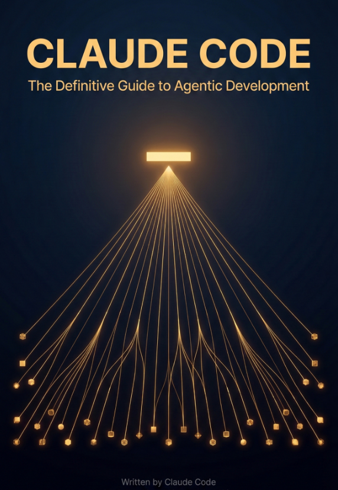
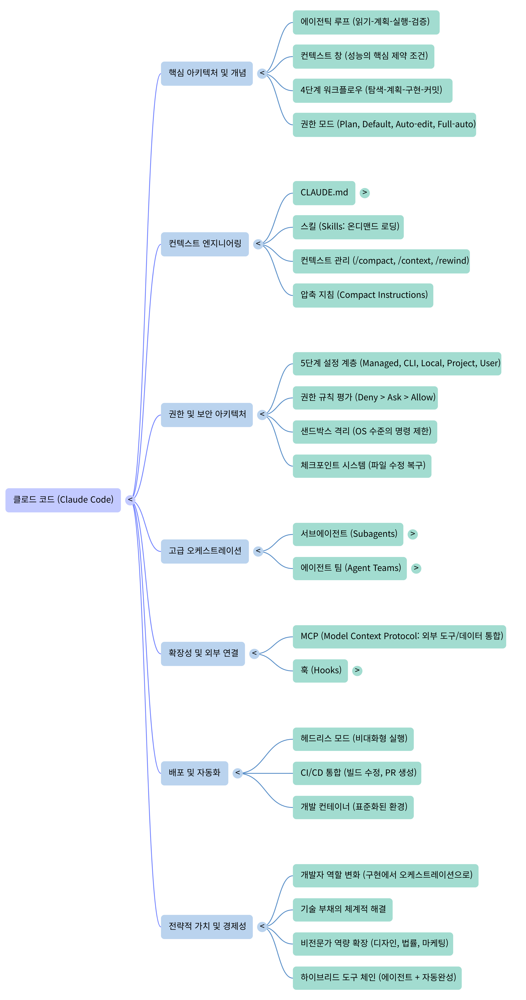

# **Claude Code The Definitive Guide to Agentic Development**
(Claude Code: 에이전트형 개발을 위한 결정적 가이드)
 

 
 

제공된 자료는 앤트로픽의 에이전트 기반 코딩 도구인 Claude Code를 활용한 효율적 개발 및 운영 전략을 다룬 종합 가이드입니다. 본문은 시스템의 핵심인 에이전트 루프와 토큰 한계를 극복하기 위한 컨텍스트 관리 기법을 상세히 설명하며, 항상 활성화되는 CLAUDE.md 파일과 온디맨드 스킬의 차이를 강조합니다. 또한, 보안 유지를 위한 권한 아키텍처, 훅(Hook) 시스템, 샌드박스 격리 기능을 다루어 안전한 자동화 환경 구축 방법을 제시합니다. 나아가 단일 세션의 한계를 넘어서기 위한 서브에이전트와 에이전트 팀 구조의 협업 패턴 및 비용 최적화 전략을 안내합니다. 궁극적으로 이 가이드는 개발자가 단순한 질의응답 방식을 넘어 반복적 파트너십과 체계적인 워크플로를 통해 생산성을 극대화하는 방법을 제시합니다.
 
 
 

