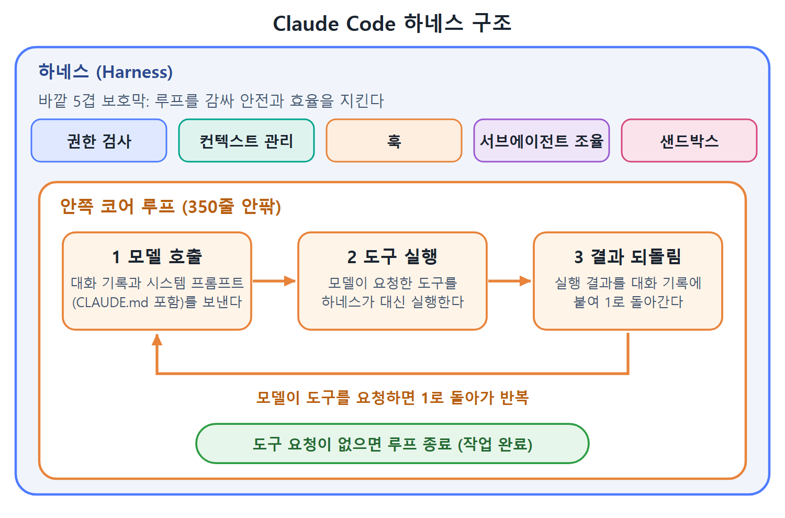

# Claude Code 에이전틱 아키텍처 및 하네스(Harness) 실행 가이드

> 출처: 『Claude Code: The Definitive Guide to Agentic Development』

Claude Code는 한 번 답하고 끝나는 코드 생성 챗봇이 아닙니다. 코드베이스(프로젝트 소스 전체)를 읽고, 계획을 세우고, 도구를 실행하고, 결과를 검증하는 일을 스스로 되풀이하는 에이전틱 루프(Agentic Loop) 기반의 개발 시스템입니다.

이 가이드는 Claude Code를 움직이는 하네스(Harness)의 내부 구조를 먼저 설명합니다. 이어서 효율적인 4단계 작업 순서와 서브에이전트 조율을 다루고, 가장 부족한 자원인 컨텍스트 윈도우(모델이 한 번에 볼 수 있는 내용의 범위)를 아껴 쓰는 컨텍스트 엔지니어링을 설명합니다.

---

## 1. 하네스(Harness)의 코어 구조와 에이전틱 루프

Claude Code의 핵심 실행 엔진인 하네스(Harness)는 에이전트가 사용자의 지침을 받아 자율적으로 도구를 사용하고 결과를 검증할 수 있도록 대화 이력과 시스템 실행 환경을 연결하는 프레임워크입니다.

### 용어 정리: 에이전트, 에이전틱, 에이전틱 루프, 프레임워크

| 용어 | 뜻 | 예 |
| :--- | :--- | :--- |
| **에이전트 (Agent)** | 일을 맡아 실제로 수행하는 주체(명사) | Claude Code, 서브에이전트 |
| **에이전틱 (Agentic)** | 스스로 판단하고 도구를 써서 목표까지 나아가는 방식(형용사) | 계획, 실행, 검증을 되풀이하는 작업 방식 |
| **에이전틱 루프 (Agentic Loop)** | 에이전틱한 동작을 만드는 반복 고리 | 코드베이스 읽기 → 계획 수립 → 도구 실행 → 결과 검증 |
| **프레임워크 (Framework)** | 일의 뼈대와 규칙을 미리 갖춰 두고, 사용자는 그 안에서 필요한 부분만 채워 쓰게 하는 틀 | 하네스: 루프, 권한 검사, 훅이 이미 갖춰져 있고 사용자는 지시와 설정만 채움 |

- 에이전트라고 불러도 질문에 한 번 답하고 끝난다면 에이전틱하다고 볼 수 없습니다.
- 에이전틱 루프는 모델이 더 이상 도구 호출을 요청하지 않으면 끝납니다. 아래 코어 코드가 이 과정을 보여 줍니다.
- 프레임워크는 라이브러리와 다릅니다. 라이브러리는 내가 필요할 때 꺼내 쓰는 부품 모음이고, 프레임워크는 틀이 먼저 정해져 있어 내 코드가 그 흐름 안에서 불려 쓰입니다. 하네스를 프레임워크라고 부르는 것도 이 때문입니다. 에이전트가 할 일을 정하더라도 실행 순서와 안전장치는 하네스가 정해 둔 틀을 따릅니다.
- 이 소절은 가이드 본문이 이 용어들의 정의를 직접 다루지 않아, 일반적인 쓰임을 바탕으로 덧붙여 정리한 것입니다.

### 하네스 구조 한눈에 보기

하네스 아키텍처는 **안쪽의 반복 루프 하나**와 **그 바깥을 감싸는 5겹 보호막**으로 이루어집니다.



그림은 하네스의 안쪽에 코어 루프(모델 호출, 도구 실행, 결과 되돌림)가 있고, 그 바깥을 권한 검사, 컨텍스트 관리, 훅, 서브에이전트 조율, 샌드박스가 감싸는 구조를 보여 줍니다.

- **안쪽 (코어 루프)**: 대화 기록과 시스템 프롬프트로 모델을 부르고, 모델이 요청한 도구를 실행하고, 결과를 기록에 붙여 다시 모델을 부릅니다. 모델은 "무엇을 할지"를 정하고, 실제 실행은 하네스가 맡습니다.
- **바깥 (5겹 보호막)**: 권한 검사, 컨텍스트 관리, 훅, 서브에이전트 조율, 샌드박스가 루프를 감싸 안전과 효율을 지킵니다. 각 층의 역할은 아래 "프로덕션 하네스의 5대 다층 레이어"에서 설명합니다.
- **구조에 들어가지 않는 것**: 2절의 4단계 워크플로우는 사람이 하네스를 쓰는 작업 순서이고, 4절의 `CLAUDE.md`는 하네스가 시스템 프롬프트로 넣어 주는 입력입니다. 둘 다 하네스의 구성 요소는 아닙니다.

### 350줄 코어 아키텍처
에이전틱 루프를 구동하는 최소한의 교육용 하네스 프로토타입은 불과 350여 줄의 코드로 작성될 수 있을 만큼 아키텍처적 본질이 매우 명확합니다. 이 코어 패턴은 모델 호출, 도구 결과 처리, 루프 재개의 3가지 핵심 기능으로 작동합니다.

```pseudo
// 에이전틱 루프의 코어 실행 메커니즘
response = callApi(messages, systemPrompt)
toolResults = processToolCalls(response.content)

if toolResults.length == 0:
    return // 도구 호출이 없으면 작업 완료

messages.append(response, toolResults)
// 다음 루프 실행 (callApi 재호출)
```

1. **모델 호출 (`callApi`)**: 쌓인 메시지 이력과 시스템 프롬프트(CLAUDE.md 및 환경 설정 포함)를 파싱하여 언어 모델에 전달합니다.
2. **도구 디스패치 및 실행 (`processToolCalls`)**: 모델 응답에서 도구 호출 요청을 추출한 뒤, 등록된 도구 맵(Tool Map: 파일 읽기, 쓰기, 명령어 실행 등)의 해당 핸들러로 전달하여 실제 작업을 실행합니다.
3. **결과 피드백 및 순환**: 도구 실행 결과를 메시지 이력에 다시 추가(append)한 후, 모델이 추가 도구 호출을 요청하지 않을 때까지 루프를 연속하여 순환합니다.

### 프로덕션 하네스의 5대 다층 레이어
350줄은 원리를 보여 주는 교육용 프로토타입의 크기입니다. 실제 제품의 Claude Code 하네스는 같은 원리의 코어 루프 바깥에 다음과 같은 다층 제어 및 보안 래퍼(Wrapper)를 더한 구조입니다.

> **프로덕션 하네스 래퍼 레이어**
> - **권한 검사 (Permissions Checks)**: Deny > Ask > Allow 규칙에 따라 파일 수정이나 쉘 명령어 실행 시 보안 위협을 평가합니다.
> - **컨텍스트 관리 (Context Management)**: 컨텍스트 창이 얼마나 찼는지 계속 지켜보다가 약 95%에 이르면 대화 내용을 자동으로 줄입니다(Compaction).
> - **훅 평가 (Hook Evaluations)**: `PreToolUse`, `PostToolUse` 등 라이프사이클 이벤트 발생 시 프로그래밍 방식의 외부 검증 스크립트를 실행합니다.
> - **서브에이전트 오케스트레이션 (Subagent Orchestration)**: 메인 세션과 분리된 독립 컨텍스트 윈도우를 가진 하위 에이전트를 생성(spawn)하여 대규모 조사를 격리합니다.
> - **OS 레벨 샌드박싱 (Sandboxing)**: 허용된 도메인 및 포트로 네트워크 접근을 제한하여 안전한 실행 환경을 제공합니다.

### 하네스의 두 가지 뜻: 좁은 뜻과 넓은 뜻

"하네스"라는 말은 글에 따라 가리키는 범위가 다릅니다. 이 문서는 좁은 뜻으로 씁니다.

| 구분 | 좁은 뜻 (이 문서) | 넓은 뜻 (하네스 엔지니어링) |
| :--- | :--- | :--- |
| 범위 | 제품 안에서 돌아가는 실행 틀 | 에이전트가 일하는 환경 전체 |
| 구성 | 코어 루프와 5겹 보호막 | 규칙 md 파일, 폴더 구조, 테스트, CI 검증, 승인 정책, 샌드박스, 훅 등 |
| 만드는 사람 | 제품 개발사 | 제품을 쓰는 팀 |

- 저장소의 폴더 구조와 규칙, 정책을 md 파일로 정리해 둔 결과물은 좁은 뜻의 하네스에는 들어가지 않고, 하네스가 읽는 입력입니다. 반면 넓은 뜻에서는 사용자가 직접 만드는 하네스의 부품입니다.
- 넓은 뜻의 하네스를 설계하고 개선하는 일을 하네스 엔지니어링이라고 부릅니다. 이 내용은 같은 저장소의 『Agentic Coding with OpenAI Codex CLI』 정리 노트(27장)에서 다룹니다.
- 이 소절도 이 가이드 본문이 아니라 위 노트를 바탕으로 덧붙여 정리한 것입니다.

### 생각 파트너(Thought Partner)로의 패러다임 전환
하네스 아키텍처를 이해하면 AI 도구를 바라보는 관점이 근본적으로 변화합니다. 사용자는 질문을 던지고 답변을 받는 '자판기' 접근법에서 벗어나, 코드베이스, 터미널, 테스트 수트 전체에 대한 자율 접근 권한을 가진 동료 엔지니어에게 업무 지시(Briefing)를 내리는 방식을 갖게 됩니다. 가이드가 인용한 연구에 따르면 개발자가 완전히 맡길 수 있는 작업은 전체의 0~20%에 불과합니다. 그래서 가이드는 모든 것을 맡기기보다 에이전트의 자율 실행과 사람의 판단을 함께 쓰는 협업 모델을 권합니다. (수치는 가이드의 인용이며, 이 문서가 따로 검증한 것은 아닙니다.)

---

## 2. 비용을 아끼는 4단계 작업 순서 (Explore - Plan - Implement - Commit)

에이전틱 개발에서 탐색과 계획 단계의 오답 수정 비용은 거의 제로(0)에 가깝지만, 잘못된 구현 후 오류를 수습하고 소모된 컨텍스트 윈도우를 복구하는 비용은 매우 큽니다. 따라서 4단계 워크플로우는 저렴한 작업을 앞쪽에 배치(Front-loading)하는 비용 절약 원리에 기반합니다.

| 워크플로우 단계 | 권한 모드 (Permission Mode) | 작업 특성 및 비용 구조 | 핵심 목표 |
| :--- | :--- | :--- | :--- |
| **1. 탐색 (Explore)** | Plan Mode (읽기 전용) | 저렴함 (읽기 전용 조사, 최소 컨텍스트 소모) | 기존 코드 패턴, 아키텍처, 디렉터리 구조 파악 |
| **2. 계획 (Plan)** | Plan Mode (읽기 전용) | 저렴함 (구현 방향 합의 및 오해 사전 차단) | 구체적 구현 수순 수립 및 사용자 검토 |
| **3. 구현 (Implement)** | Normal / Auto-accept Mode | 비쌈 (대량 파일 수정, 디버깅, 컨텍스트 소모) | 사전 검토된 계획에 기반한 고품질 코드 작성 |
| **4. 커밋 (Commit)** | Default / CLI Mode | 저렴함 (안전한 롤백 지점 확보) | 변경 사항 검토 및 소규모 단위 잦은 커밋 |

### 1단계: 탐색 (Explore)
Plan Mode로 시작하여 코드베이스를 분석합니다. 읽기 전용 모드이므로 코드 수정의 위험 없이 기존 파일 구조와 패턴을 파악합니다. 탐색 단계를 건너뛰는 것은 에이전트가 잘못된 문제를 자신 있게 해결하도록 만드는 가장 흔한 오류 원인입니다.

### 2단계: 계획 (Plan)
여전히 Plan Mode를 유지하며 구현 접근 방식의 개요를 요청합니다. 제시된 계획을 검토하고 의도와 다른 부분을 수정합니다. 계획 단계에서의 피드백은 컨텍스트 점유 비용을 획기적으로 줄여줍니다.

### 3단계: 구현 (Implement)
Normal Mode 또는 Auto-accept Mode로 전환합니다. 탐색에서 얻은 맥락과 사용자 승인을 마친 계획을 바탕으로 작업을 실행하므로 추측에 의존할 때보다 구현 실패율이 현격히 낮아집니다.

### 4단계: 커밋 (Commit)
구현 완료 후 `git diff`를 검토하고 자주 커밋을 수행합니다. 잦은 소규모 커밋은 에이전트가 잘못된 방향으로 빠졌을 때 안전하게 복구할 수 있는 되돌릴 지점(Checkpoint) 역할을 합니다.

---

## 3. 내장 서브에이전트(Subagents) 및 도구(Tools) 체계

Claude Code는 메인 대화 세션의 컨텍스트 윈도우가 대량의 조사 자료로 어지러워지는 것을 막기 위해 독립된 실행 환경을 가진 서브에이전트 체계를 제공합니다.

### 6가지 내장 서브에이전트 명세
서브에이전트는 엄격한 2단계 계층구조(오케스트레이터와 워커)를 가지며, 하위 서브에이전트가 또 다른 서브에이전트를 계속 만들어 내는 것(재귀 생성)은 차단됩니다. 아래 6가지는 가이드 기준의 목록이며, 제품 버전에 따라 달라질 수 있습니다.

1. **Explore (탐색)**: 코드베이스 구조 파악 및 파일 검색을 담당합니다. 경량화된 속도의 읽기 전용 모델을 사용하여 메인 맥락을 더럽히지 않고 빠르게 조사를 수행합니다.
2. **Plan (계획)**: 복잡한 작업의 구조적 조사 및 계획 수립을 전담합니다. 읽기 전용이지만 메인 세션과 동일한 고성능 모델의 추론 능력을 유지합니다.
3. **General-purpose (다목적)**: 파일 읽기, 쓰기, 명령어 실행 등 모든 도구 접근 권한을 가지고 다단계 구현 작업을 수행하는 주력 서브에이전트입니다.
4. **Bash (명령어 실행)**: 쉘 명령어 연속 실행을 전담합니다. 장황한 터미널 출력이 메인 세션의 컨텍스트 윈도우를 어지럽히는 것을 방지합니다.
5. **Claude Code Guide (가이드)**: Claude Code 자체의 기능, 설정 방법, 모범 사례에 대한 질의응답 시 공식 문서를 참조하여 답변합니다.
6. **Statusline-setup (상태줄 설정)**: 터미널 상태줄 통합 설정 시 발생하는 복잡한 출력을 격리된 환경에서 처리하기 위해 존재합니다.

### 서브에이전트(Subagent)와 도구(Tool)의 구분
에이전틱 개발을 정밀하게 통제하기 위해서는 자율적 판단 주체인 서브에이전트와 실행 기능 단위인 도구를 명확히 구분해야 합니다.

> **서브에이전트 vs 도구 개념 구분**
> - **서브에이전트 (Subagent)**: 독립된 컨텍스트 윈도우, 전용 시스템 프롬프트, 모델 설정, 제한된 도구 권한을 가지고 자율적으로 목표를 달성하는 실행 주체입니다 (예: Explore, Plan).
> - **도구 (Tool)**: 서브에이전트나 메인 에이전트가 작업을 수행하는 과정에서 호출하는 개별 기능 단위입니다. 정규식 기반 파일 검색인 `Grep`, 파일 내용을 읽는 `Read`, 파일에 기록하는 `Write`, 경로 패턴을 찾는 `Glob` 등이 도구에 해당합니다.

#### 화면에 보이는 Bash, Grep이 곧 도구 실행입니다

Claude Code를 쓰는 중 화면에 `Bash`, `Grep`, `Read`, `Edit`처럼 이름이 표시되는 것이 모두 도구입니다. 하나가 표시될 때마다 아래 일이 한 번 일어난 것입니다.

1. 모델이 "이 도구를 이 값으로 실행해 달라"고 요청합니다.
2. 하네스가 권한을 확인한 뒤 실제로 실행합니다(코어 루프의 `processToolCalls` 단계).
3. 실행 결과를 모델에게 돌려주고, 모델은 다음 행동을 정합니다.

모델은 요청만 하고 실행은 하네스가 맡습니다. 서브에이전트를 부르는 것도 도구 호출의 하나(화면에는 `Agent` 등으로 표시)이며, 그렇게 불린 서브에이전트는 자기 몫의 도구를 따로 사용합니다.


### 멀티 에이전트를 쓰는 방법과 관련 명령어

여러 에이전트가 나눠서 일하게 하는 실행(워크플로)을 시작하고 다루는 방법을 정리합니다. 이 소절은 가이드 본문이 아니라 Claude Code 공식 문서와 설치된 실행 파일을 확인해 덧붙인 것입니다(확인 날짜 2026-11-08, 버전 2.1.319 기준).

#### 시작하는 방법

| 방법 | 구체적인 예시 | 참고 |
| :--- | :--- | :--- |
| 말로 요청 | "워크플로우로 실행해줘", "여러 에이전트로 나눠서 정리해줘" | 사용자가 직접 요청해야 시작합니다. 환경에 따라 실행 전에 승인 화면이 뜰 수 있습니다. |
| 프롬프트에 `ultracode` 넣기 | "ultracode 이 책을 장별로 나눠 정리하고 검증까지 해줘" | 그 요청 한 번만 적용됩니다. |
| Ultracode 스위치 | 입력창 아래 스위치를 켜거나 `/effort ultracode`를 입력합니다. 끄려면 `/effort ultracode off`입니다. | 켜 두면 실질적인 작업마다 워크플로를 자동으로 계획합니다. 토큰과 시간이 늘고 구독 한도에 더 빨리 닿습니다. |
| `/deep-research` | `/deep-research 주제` | 공식 문서에서 워크플로를 실행하는 명령으로 소개됩니다. 정확한 용도는 확인하지 못했습니다. |
| 서브에이전트 호출 | "이 폴더를 조사하는 서브에이전트를 띄워줘" | 에이전트 한 개를 따로 띄우는 가벼운 방식입니다. |

#### 실행 중에 쓰는 명령

| 명령 | 구체적인 예시 | 참고 |
| :--- | :--- | :--- |
| `/workflows` | 책 정리를 시작한 뒤 입력하면 에이전트별 진행 상태가 보입니다. | 시작 명령이 아니라 보기 전용입니다. VS Code 확장에서는 "이 환경에서는 사용할 수 없다"고 나오며 지원되지 않습니다(2026-11-08 직접 확인). |
| 승인 화면에서 `s` | 워크플로를 시작하기 전에 "이 계획대로 실행할까요?"라는 승인 화면이 뜹니다. 여기서 키보드 `s`를 누르면 그 작업 계획(스크립트)이 저장되고 `/이름` 명령이 생깁니다. 예를 들어 `book-notes`로 저장했다면 다음에는 `/book-notes`만 입력해도 같은 작업을 시작합니다. | 같은 작업을 반복할 때 길게 다시 요청하지 않아도 됩니다. VS Code 확장에서는 승인 화면이 뜨지 않아 쓸 수 없었습니다(2026-11-08 직접 확인). 이름을 입력하는 방식은 확인하지 못했습니다. |
| `/workflow-authoring` | 입력한 뒤 "저장해 둔 워크플로의 검증 단계를 3명으로 늘려 줘"라고 요청합니다. | 스크립트를 쓰거나 고칠 때 보는 참고 스킬이며 실행은 하지 않습니다. |
| `/goal` | `/goal all tests pass` | 멀티 에이전트가 아니라 조건이 충족될 때까지 턴을 자동으로 반복하는 기능입니다. 상태는 `/goal`, 해제는 `/goal clear`입니다. 워크플로와 함께 쓸 수 있습니다. |
| 입력창 아래 "0 agents" | 에이전트가 돌아가면 숫자가 올라가는 것으로 보입니다. | 정확한 의미는 확인하지 못했습니다. |

#### 요청 예시: 책 정리를 워크플로로 시키기

대화창에 말로 요청하면 됩니다. 요청에 "워크플로우로 실행해줘"나 `ultracode`를 넣으면 시작합니다.

- **요청 예시:** "ultracode 'L:\...\책이름.pdf'를 'tech/ai/agent' 폴더 밑에 장별로 정리해 줘. 이해하기 쉬운 용어를 쓰고 그림과 표도 넣어 줘. 작성, 검증, 그림 단계로 나눠 멀티 에이전트로 실행해 줘."
- **요청에 넣으면 좋은 것:** PDF 경로, 저장할 폴더, 문체와 용어 수준, 그림과 표 포함 여부입니다.
- **시작 후:** 승인 화면이 뜨는 환경에서는 승인하면 시작하고 `s`를 누르면 저장합니다. VS Code 확장에서는 승인 화면 없이 바로 실행되고, 진행 상황은 백그라운드로 돌다가 끝나면 결과가 알려집니다.
- **저장하는 방법:** 실행한 워크플로 스크립트는 세션 폴더(`C:\Users\<사용자>\.claude\projects\...\workflows\scripts`)에 파일로 자동 저장됩니다. 이 파일 경로를 다시 지정해 실행을 요청하면 재사용할 수 있습니다. 승인 화면의 `s`는 쓸 수 없는 환경이므로 이 방법을 씁니다.

#### 멀티 에이전트가 맞는 경우와 아닌 경우

| 경우 | 판단 | 이유 |
| :--- | :--- | :--- |
| 저장소를 영역별로 나눠 확인 | 맞음 | 영역이 서로 독립적이라 동시에 읽을 수 있고, 각 에이전트가 자기 영역만 읽어 메인 대화가 조사 자료로 어지러워지지 않습니다. 예: 책 폴더 20개를 에이전트 20개가 나눠 검사하고 요약만 받습니다. |
| 영역이 3~4개 이하 | 아닐 수 있음 | 직접 읽는 편이 빠르고 토큰도 적게 듭니다. |
| 영역끼리 얽혀 같이 봐야 함 | 아닐 수 있음 | 나눠 읽으면 연결 관계를 놓칠 수 있습니다. |

#### 직접 쓰지 않는 명령과 없는 명령

| 명령 | 구체적인 예시 | 참고 |
| :--- | :--- | :--- |
| `/workflow-launch-exec` | 직접 입력하면 "넘겨받은 요청이 없어 아무것도 실행하지 않았다"는 안내만 나옵니다. | 서버가 시작한 원격 세션이 쓰는 내부 명령입니다. 숨김 명령이며 모델이 스스로 부르는 것도 막혀 있습니다. |
| `/__remote-workflow` | 직접 쓸 일이 없습니다. | 원격 세션에 전달된 스크립트를 실행하는 내부 명령입니다. 숨김 명령입니다. |
| `/work`, `/workflow` | 입력해도 이 이름의 명령은 실행되지 않습니다. | 공식 문서에 없는 이름입니다. 입력창에서 `/workflow`까지만 치면 이름이 비슷한 항목이 목록으로 나올 뿐입니다. |

- 두 내부 명령이 "원격 세션이 쓰는 명령"이라는 해석은 실행 파일 안의 명령 정의에서 읽어낸 것이고, 공식 문서로 확인한 내용은 아닙니다. 나머지 명령(`/goal`, `/workflows`, `/workflow-authoring`, Ultracode)은 공식 문서로 확인했습니다.
- 멀티 에이전트를 쓰는 데 꼭 필요한 것은 말로 요청하거나 Ultracode를 켜는 것입니다. 나머지 명령은 진행 확인과 보조용입니다.

---

## 4. 컨텍스트 엔지니어링 및 영구 지침 저장소 (CLAUDE.md)

컨텍스트 윈도우는 Claude Code의 CPU, RAM, 하드드라이브 역할을 겸하는 유일하고 가장 결정적인 제약 자원입니다. 파일 내용, CLI 실행 출력, 도구 호출 기록이 쌓여서 공간이 차면 에이전트가 지침을 따르는 정도가 갑자기 크게 떨어지는 '성능 절벽(Performance Cliff)'이 나타납니다.

### CLAUDE.md의 상시 로드(Always-On) 구조와 500줄 가이드라인
`CLAUDE.md`는 단순한 프로젝트 README 파일이 아니라, 매 대화 요청(turn)마다 시스템 프롬프트로 자동 주입되는 상시 로드 지침(Always-On File)입니다.

* **500줄 가이드라인 (The 500-Line Guideline)**: `CLAUDE.md`가 500줄을 초과하면 지침끼리 모델의 주의(Attention)를 서로 빼앗아 에이전트가 핵심 규칙을 놓치게 됩니다. 따라서 정기적으로 불필요한 줄을 덜어내는 가지치기(Pruning)가 필요합니다.
* **포함/제외 필터링 기준**: *"Claude가 코드를 스스로 읽고 추론할 수 없는 정보인가?"*를 기준으로 작성합니다.
  * **포함**: 추측이 불가능한 특정 빌드/테스트 명령, 기본 표준과 다른 코딩 스타일 예외, 브랜치/PR 규칙, 프로젝트 아키텍처 결정 배경, 개발 환경 특이점(예: 포트 번호), 알려진 데이터 버그 이력.
  * **제외**: 코드 파싱 및 `package.json`으로 알 수 있는 사실, 표준 언어 컨벤션, 장황한 외부 라이브러리 문서.

### 지침 저장소의 계층 구조
영구 지침 저장소는 적용 범위에 따라 여러 층으로 구성되며, 아래 층이 위 층을 대체하지 않고 모두 겹쳐서(Additive) 불러옵니다.

1. **조직 관리 (Managed Scope)**: 시스템 경로에 위치하며(macOS는 `/Library/Application Support/ClaudeCode/CLAUDE.md`, 다른 운영체제는 경로가 다릅니다) 조직 차원의 보안 정책을 강제합니다.
2. **사용자 수준 (User Scope)**: `~/.claude/CLAUDE.md`에 위치하며 전역 개인 코딩 선호도를 유지합니다.
3. **프로젝트 수준 (Project Root Scope)**: 프로젝트 루트의 `CLAUDE.md`로 버전 관리(Git)에 커밋되어 팀 전체가 공유합니다.
4. **하위 디렉터리 수준 (Subdirectory Scope)**: 특정 모듈 디렉터리 내의 국소 지침을 제공합니다.

### 온디맨드 로딩 (Skills) 및 수동 전용 최적화
매 turn마다 상시 비용을 발생하는 `CLAUDE.md`와 달리, 스킬(Skills)은 세션 시작 시 짧은 요약 설명(Description)만 로드되고 실제 호출 시에만 전체 본문이 로드되어 컨텍스트 예산을 절약합니다.

스킬 파일 맨 위의 설정부(프런트매터)에 `disable-model-invocation: true`를 지정하면 세션 시작 시 설명 로드조차 차단되어 수동 호출 전까지 **상시 컨텍스트 비용이 제로(0)**가 됩니다.

### 맥락을 정밀하게 다루는 도구와 자동 축소 보호

- **`/context`**: 현재 맥락 사용량을 색상 그리드로 시각화하여 불필요한 MCP 서버나 쓸데없이 쌓인 대화 이력을 찾아냅니다.
- **`/compact`**: `/compact Focus on API changes`처럼 보존할 핵심 주제를 직접 지정하여 미리 축소합니다. 보통 컨텍스트가 80% 정도 찼을 때 직접 실행하는 것이 좋습니다.
- **`/rewind`**: Esc를 두 번 눌러 쓰며, 코드는 유지한 채 대화 맥락만 되돌리거나, `Summarize from here`를 통해 불필요한 시행착오 이력만 잘라내어 요약합니다.
- **`Compact Instructions`**: `CLAUDE.md` 내에 작성되는 특별 섹션으로, 약 95% 컨텍스트 도달 시 트리거되는 손실적 자동 축소(Auto-compaction) 프로세스에서도 최우선 제약 조건과 핵심 결정 사항이 원형 그대로 보존되도록 보호합니다.
