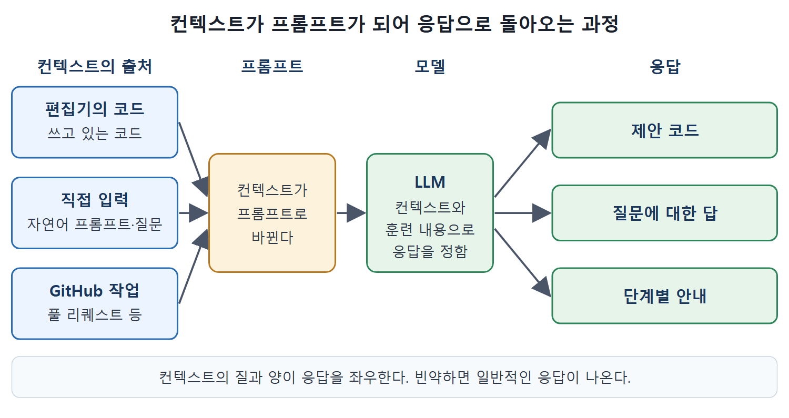

# LLM과 코드 생성형 AI

Copilot 같은 AI 도구는 대규모 언어 모델(LLM)에서 답의 재료를 얻는다. 이 문서는 LLM이 무엇이고 기존 프로그램과 무엇이 다른지, Copilot이 어떤 모델을 쓰는지, 코드라는 영역이 생성형 AI에 어떤 의미인지, 채팅 기능이 왜 필요한지를 정리한다.

한 가지 짚어 둔다. 원문도 밝히듯 AI 모델에는 작은 언어 모델이나 추론 모델 같은 변종이 있고 Copilot은 여러 모델을 계속 지원하도록 갱신된다. 다만 설명을 단순하게 하려고 책 전체에서 'LLM'이라는 말로 통일한다.

---

## 1. LLM이란

LLM은 방대한 기존 데이터로 훈련되어, 입력(프롬프트)이 주어졌을 때 그 뒤에 어울리는 다음 단어나 다른 형태의 내용(토큰)을 예측하는 AI 모델이다.

계산기처럼 정해진 형식의 데이터를 처리하거나 수학 문제에 답하는 전통적 컴퓨터 모델과 달리, LLM은 문맥, 구문, 구조를 이해하도록 훈련된다. 수많은 매개변수를 고려해 다음에 어떤 단어나 토큰이 가장 자연스러운지 알아내는 알고리즘 덕분이다. 그래서 입력 내용만이 아니라 입력이 제시된 방식까지 반영해 통계적으로 답을 만든다.

훈련 과정에서 모델은 한 분야 안에서 정보 조각들이 서로 어떻게 연결되는지를 학습한다. 기술적으로 말하면 토큰 열을 질의로 받았을 때 입력의 구문과 구조를 평가하고, 훈련 데이터를 바탕으로 맥락을 추론한 뒤, 뒤에 이어질 가능성이 높은 토큰 열을 예측한다. 쉽게 말해 지금까지 소화한 데이터로 보아 말이 되는 이어 말하기를 해내는 것이다.

### 언어 학습 비유

외국어를 배우는 경우를 떠올리면 이해하기 쉽다. 단어와 표현을 외우는 것만으로는 그 언어를 모국어로 쓰는 사람과 제대로 대화하기 어렵다. 상대 말의 맥락을 파악해야 알맞은 표현을 고를 수 있고, 내 답도 상대가 이해할 맥락 안에 담아야 한다. 언어에는 구문과 구조가 있지만 그것이 뜻이 통하게 하는 것은 대화의 맥락이다. LLM은 입력에서 맥락을 읽고 출력에 관련 맥락을 담을 수 있다.

| 비교 | 전통적 컴퓨터 모델 | LLM |
|---|---|---|
| 잘하는 일 | 정해진 형식의 데이터 처리, 수학 문제 풀이 | 문맥, 구문, 구조를 이해해 이어질 내용 예측 |
| 답을 정하는 방식 | 입력 값 자체 | 입력 값과 입력이 제시된 방식 |
| 학습 | 규칙을 사람이 정함 | 방대한 기존 콘텐츠로 훈련하며 분야 내 관계를 학습 |

## 2. Copilot이 쓰는 모델

Copilot은 기본적으로 ChatGPT를 만든 OpenAI가 개발하고 관리하는 LLM을 쓴다. GitHub는 OpenAI와 함께 여러 해에 걸쳐 Copilot을 개발했다. 최근에는 Anthropic의 Claude 계열, Google Gemini 같은 다른 모델 계열도 선택할 수 있게 됐다. 모델이 달라도 공통점은 소프트웨어 제작에 초점을 둔다는 것이고, Copilot이 쓰는 대화의 언어는 코드다.

## 3. 코드가 생성형 AI에 주는 의미

프로그래밍 언어는 언어마다 요구되는 구문과 의미가 정해져 있다. Python으로 짜는지 Go로 짜는지에 따라 쓰는 토큰과 구조가 달라진다. 하지만 그 토큰과 구조에는 규칙이 있고, 잘 정의된 닫힌 집합을 이룬다. Copilot의 능력은 이런 구문과 구조에 맞는 코딩 제안과 관련 정보를 주는 데 맞춰져 있다.

진짜 부가가치는 코드를 쓰는 사람이 만들거나 묻는 내용에 알맞은 응답을 주는 것이다. Copilot에 들어가는 컨텍스트는 다음 세 곳에서 온다.

| 컨텍스트의 출처 | 설명 |
|---|---|
| 편집기의 코드 | 개발 환경의 편집기에서 쓰고 있는 코드 |
| 직접 입력 | 자연어 프롬프트나 질문으로 모델과 직접 주고받는 상호작용(채팅 모델) |
| GitHub 작업 | 풀 리퀘스트 같은 GitHub 안의 일반적 개발 활동 |

어떤 인터페이스를 쓰든 컨텍스트(코드, 지시와 입력, 작업 중인 GitHub 요소)는 프롬프트로 바뀐다. 프롬프트는 AI가 응답해 주길 기대하며 건네는 내 쪽 대화다. 이 프롬프트를 처리해 컨텍스트와 모델의 훈련 및 능력을 바탕으로 응답을 정하는 부분이 Copilot의 생성형 AI다운 기능이다. 응답은 제안 코드, 질문에 대한 답, 단계별 안내가 될 수 있고, AI가 보기에 코드를 완성하거나 프롬프트를 충족하거나 질문에 답하는 내용이다.

그림은 세 곳의 컨텍스트가 하나의 프롬프트로 바뀌어 LLM에 들어가고, LLM이 제안 코드, 질문에 대한 답, 단계별 안내 중 알맞은 응답을 만들어 내는 과정을 보여 준다.

## 4. 채팅이 필요한 이유

프로그래밍은 터미널 앞에서 IDE에 코드를 치는 일로 떠올리기 쉽지만, 코드를 입력하기 전에 알아봐야 할 것이 있는 경우가 많다. 새 언어를 배우는 중이라면 자료구조나 제어 흐름을 어떻게 구현하는지, 파일을 열고 DB에 읽고 쓰는 법을 알아야 한다. 서드파티 플랫폼 버전 간 차이나 특정 기능이 deprecated(사용 중단 예정)인지도 궁금할 수 있다. 예전에는 동료에게 묻거나 Stack Overflow를 검색했을 질문이다. AI를 쓴다면 질문이나 지시를 AI에 전달할 수 있어야 한다. 즉 AI와 채팅할 수 있어야 한다.

ChatGPT 같은 대중용 생성형 AI 서비스가 폭넓게 인기를 얻은 것은 사람과 대화하듯 자연스럽게 답하기 때문이다. Copilot은 Copilot Chat으로 이 능력을 더한다. 채팅으로 단위 테스트 생성을 지시하거나, Kubernetes의 현재 버전을 묻거나, 이 코드가 뭘 하는지 물을 수 있다. 지시나 질문에 답을 만들어 내는 것도 생성형 AI의 생성 기능이다.

### 의사와 정비사 비유

이 과정은 의사에게 화상 통화로 증상을 설명해 진단을 받거나, 정비사에게 전화로 차 상태를 말해 해결책을 듣는 것과 같다. 내가 주는 정보와 전문가의 훈련이 결과를 가른다. 대화에서는 문제에 맞는 제안(그중 일부는 안 맞을 수도 있다)이 나오기도 하고, 전문가가 정보나 이해가 부족해 도울 수 없다는 결론이 나오기도 한다. 생성형 AI도 똑같이 움직인다.

## 5. 컨텍스트가 만드는 편향

코딩 중에 Copilot이 제안을 줄 때는 코딩 환경의 요소들이 AI 모델용 프롬프트의 컨텍스트가 된다. 그래서 작업 중인 프로젝트 파일에 쓰인 코딩 스타일을 따르는 제안이 나올 수 있다. 이것은 장점이면서 단점이다.

| 경우 | 결과 |
|---|---|
| 장점 | 기존 코드가 모범 사례를 따른다면 제안도 그 스타일을 닮아 쓸모 있다 |
| 단점 | 기존 코드가 나쁜 관행에 치우쳐 있으면 제안도 그쪽으로 쏠려 제한적이고 비효율적인 방식을 굳힐 수 있다 |
| 부수 효과 | 맞는 제안을 찾으려고 더 많은 제안을 뒤져야 할 수 있다 |

Copilot이 환경과 자체 훈련에서 끌어올 수 있는 예제의 질과 양이 응답에 영향을 준다. 그러므로 제안은 Copilot이 가진 컨텍스트와 훈련에 의해 편향된다고 생각해야 한다. 이 편향을 역이용해서 원하는 스타일의 예를 더 많이 주면 그 스타일의 제안이 나오게 할 수 있다. 반대로 컨텍스트가 빈약하면 불리하게 작용한다. 좋은 결과를 이끄는 방법은 책 전체에서 이어서 다룬다.

 
 
 

[Learning GitHub Copilot](../)
