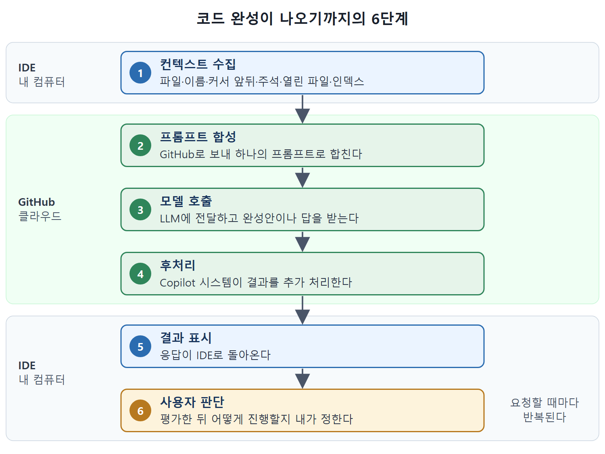

# 동작 흐름과 컨텍스트 수집

Copilot이 코드 완성을 내놓기까지는 컨텍스트 수집, 프롬프트 합성, 모델 호출, 후처리, 결과 표시의 흐름을 거친다. 이 문서는 그 흐름을 IDE 관점에서 따라가며, 어떤 정보가 자동으로 모이는지와 인덱싱이 무엇인지를 정리한다.

이 흐름을 알면 왜 파일 이름이나 주석 같은 사소한 것이 제안 품질을 좌우하는지 이해된다. 이후 장의 프롬프트 요령 대부분이 이 컨텍스트 수집을 어떻게 돕느냐에 관한 이야기다.

---

## 1. 지원되는 환경

원문 기준으로 Copilot이 지원하는 IDE는 Visual Studio, VS Code, NeoVim, JetBrains 계열 IDE 등이다. GitHub Codespaces 같은 일부 다른 환경에서도 동작한다. GitHub는 Copilot Language Server SDK도 내놓았는데, 이것으로 어떤 편집기나 IDE에도 Copilot을 붙일 수 있다. 앞으로 Copilot과 통합된 애플리케이션이 더 늘어날 전망이다.

GitHub Codespaces는 클라우드의 가상 머신(VM)에서 도는 개발 환경이다. 모든 기능을 갖추고 사용자가 맞춤 설정할 수 있으며, 화면은 VS Code와 비슷하다. 브라우저에서 VS Code와 같은 확장으로 꾸밀 수 있고 여러 IDE에 연결할 수도 있다. GitHub가 선택 서비스로 제공한다.

## 2. 자동으로 모이는 컨텍스트

편집기에서 코드를 쓰며 Copilot으로 코드 완성을 받을 때는 작업 내용을 파악하려고 여러 정보가 자동으로 스캔된다.

| 컨텍스트 출처 | 무엇을 읽나 | Copilot이 얻는 단서 |
|---|---|---|
| 현재 파일 | 사용자가 지금 편집 중인 파일 | 가장 핵심적인 컨텍스트 |
| 활성 파일 이름 | 파일 이름 자체 | 이름을 설명적으로 지으면 코드의 의도를 짐작할 수 있다. 예로 TestConfig.go |
| 커서 앞뒤 내용 | 커서 바로 앞뒤의 코드와 주석 | 무엇을 채울지, 코드의 빈틈이 어디인지 판단 |
| 주석 | 코드가 하는 일과 아직 안 쓴 코드의 의도 | 주석이 정확하고 자세할수록 제안이 관련성 높아진다 |
| 열려 있는 다른 파일 | 편집기에 열린 파일의 코드 | 현재 작업 정보를 보강하고 모델의 지식을 보충 |
| 로컬 인덱스 | VS Code 같은 IDE에서 연 프로젝트의 대부분 파일을 분석해 만든 색인 | 프로젝트 전체 구조를 반영 |

사람 페어 프로그래머나 리뷰어처럼 Copilot도 주석을 읽고 코드의 의도를 이해한다. 주석은 컨텍스트를 주는 주된 수단 가운데 하나다.

### 열린 파일로 낡은 지식 보정하기

열린 파일의 활용법으로 원문이 드는 전략이 있다. LLM 속에 남아 있는 deprecated 기능을 다룰 때, 그 기능의 대체 방식이 담긴 파일을 편집기에 열어 두는 것이다. Copilot은 이 예시를 보고 훈련 때 배운 낡은 방식 대신 선호되는 대안을 쓰는 쪽으로 코딩할 수 있다.

## 3. 인덱싱

인덱싱은 코드베이스를 훑고 정리해 빠르고 정확히 검색할 수 있는 구조를 만드는 과정이다. 인덱스가 있으면 없을 때보다 더 정확하고 컨텍스트를 잘 반영한 제안과 응답이 가능하다.

| 구분 | 로컬 인덱스 | 원격 인덱스 |
|---|---|---|
| 위치 | 사용자 컴퓨터에 저장 | GitHub에서 저장소와 짝으로 생성 |
| 갱신 | 변경이 생길 때 자동으로 만들고 갱신 | 9장에서 GitHub에서 쓸 때 다룸 |
| 쓰이는 곳 | IDE에서 프로젝트 작업 | GitHub에서 Copilot 사용 |

채팅 인터페이스는 가장 최근에 하던 작업에 따라 파일, 선택 영역, 터미널 명령 중 하나로 컨텍스트가 미리 채워지는 것이 보통이다. 프롬프트를 보내기 전에 사용자가 이를 직접 바꿀 수 있다. 자세한 방법은 3장에서 다룬다.

## 4. 프롬프트 합성에서 응답까지

설치와 활성화가 끝난 인터페이스에서 코드를 입력하면 Copilot이 위 출처들에서 컨텍스트를 모은다. 모은 컨텍스트는 처리되어 GitHub로 보내지고 하나의 프롬프트로 합성된다. 프롬프트는 GitHub를 거쳐 LLM에 전달되고, 가능한 코드 완성이나 답이 돌아온다. LLM의 결과가 나오면 GitHub의 Copilot 시스템이 추가 처리를 한다. 이 후처리는 개인정보와 보안 문서에서 따로 설명한다. 그다음 응답이 IDE로 돌아오고, 사용자는 평가한 뒤 어떻게 진행할지 정한다.

| 단계 | 일어나는 일 | 어디서 |
|---|---|---|
| 1. 수집 | 현재 파일, 이름, 커서 앞뒤, 주석, 열린 파일, 로컬 인덱스에서 컨텍스트 수집 | IDE |
| 2. 합성 | 컨텍스트를 프롬프트로 만듦 | GitHub로 전송 후 합성 |
| 3. 호출 | 프롬프트를 LLM에 전달, 가능한 완성이나 답을 받음 | GitHub를 거쳐 LLM |
| 4. 후처리 | Copilot 시스템이 결과를 추가 처리 | GitHub |
| 5. 표시 | 응답을 IDE로 돌려보냄 | IDE |
| 6. 판단 | 사용자가 평가하고 진행 방법 결정 | IDE |

그림은 같은 6단계를 IDE(내 컴퓨터)와 GitHub 클라우드 중 어디에서 일어나는지로 나누어 보여 준다. 수집은 IDE에서, 합성·호출·후처리는 GitHub 쪽에서 일어나고, 결과 표시와 사용자 판단은 다시 IDE에서 끝난다.

이 흐름은 상호작용마다 반복된다. 그래서 Copilot은 상용구 코드 작성, 정교한 알고리즘 탐색, 데이터나 쿼리 생성, 단위 테스트 작성, 새 프로그래밍 언어 학습 같은 어떤 용도에서도 작업을 돕는 조수로 움직인다.

표를 읽을 때 핵심은 마지막 6번이다. 흐름의 끝에서 판단하는 주체는 항상 사용자다.

 
 
 

[Learning GitHub Copilot](../)
