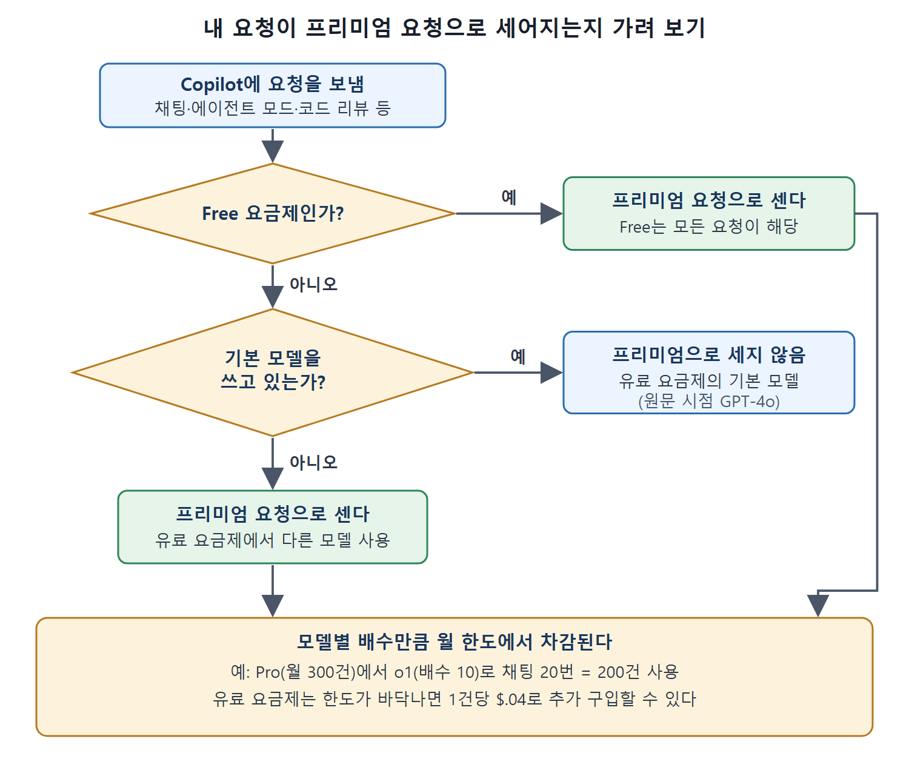
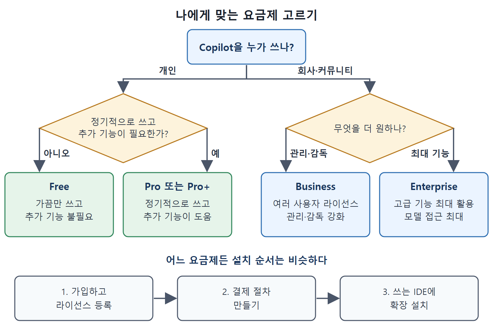

# 요금제와 설치

Copilot은 하나의 애플리케이션처럼 말하지만 실제로는 다섯 가지 구성(요금제)이 있다. 이 문서는 요금제를 이해하는 데 필요한 용어, 프리미엄 요청의 계산법, 요금제 비교, 선택 기준, 가입과 설치 순서, 지원 IDE를 정리한다. 수치는 원문의 서술 시점 기준이다.

---

## 1. 요금제를 읽기 위한 용어

원문 시점에 Copilot은 Free, Pro, Pro+, Business, Enterprise 다섯 요금제로 나온다. 차이를 이해하려면 먼저 공통 용어를 알아야 한다.

| 용어 | 뜻 |
|---|---|
| 코드 완성(Code completions) | IDE에서 작업 중인 코드를 완성하도록 AI가 제안하는 코드 |
| 채팅 요청(Chat request) | 채팅 인터페이스로 Copilot에 보내는 프롬프트. 지시일 수도 질문일 수도 있다 |
| 에이전트 모드(Agent mode) | Copilot이 프롬프트에 대해 스스로 계획하고 실행하고 파일을 넘나들며 반복해서, 과제 달성에 필요한 변경을 제안하게 하는 옵션 |
| 에이전트 모드 요청 | 에이전트 모드에서 작업을 이루려고 Copilot에 보내는 요청 |
| 모델 접근 | Copilot이 함께 일하는 전체 LLM 중에서 접근이 허용된 모델. 현재 쓸 수 있는 목록은 Copilot 문서에 있다 |
| 프리미엄 요청 | Copilot Chat, 에이전트 모드, 코드 리뷰, 확장 같은 작업에서 고급 AI 모델을 쓰는 상호작용. 컴퓨팅 자원을 더 쓰고 일반 코드 완성과 따로 센다 |

## 2. 프리미엄 요청 계산법

고급 모델을 쓰면 일부 Copilot 기능은 더 큰 처리 능력이 필요하고, 이것이 프리미엄 요청이다. 요금제와 모델에 따라 거의 모든 종류의 모델 상호작용이 프리미엄 요청이 될 수 있다.

| 상황 | 프리미엄 요청으로 세나 |
|---|---|
| Free 요금제 | 모든 요청이 프리미엄으로 센다 |
| 유료 요금제에서 기본 모델(원문 시점에 GPT-4o) 사용 | 프리미엄으로 세지 않는다 |
| 유료 요금제에서 다른 모델 사용 | 프리미엄으로 센다 |

요청 하나가 프리미엄 요청 하나로 딱 떨어지지 않는 경우도 있다. 어떤 모델에 보낸 요청 한 건이 프리미엄 요청 1건보다 적게 또는 많게 계산되기도 한다. 현재의 모델별 배수는 Copilot 문서에 있다.

예를 들어 원문 시점에 Pro 요금제에서 o1 모델을 고르고 채팅을 20번 하면, 한 달에 할당된 프리미엄 요청 300건 중 200건(20 × 10)을 쓴 것이 된다. 요금제별 프리미엄 요청 수는 아래 비교표에 있다. 유료 요금제에서 프리미엄 요청이 바닥나 더 필요하면 프리미엄 요청 하나당 $.04에 추가로 살 수 있다.

위 예에서 o1의 배수는 10이므로 채팅 한 번이 프리미엄 요청 10건이다. 배수를 모르면 한 달 한도가 생각보다 빨리 줄어든다는 점이 핵심이다.

그림은 요청 하나가 프리미엄 요청으로 세어지는지를 요금제와 모델 순서로 가려 보고, 세어지는 경우 모델별 배수만큼 월 한도에서 차감되는 흐름을 보여 준다.

## 3. 요금제 비교

| 항목 | Free | Pro |
|---|---|---|
| 대상 | Copilot을 살펴보려는 개인 개발자 | Copilot을 무제한으로 쓰고 싶지만 모든 모델은 필요 없는 개인 개발자 |
| 채팅 요청, 에이전트 모드 요청 | 월 50건(프리미엄으로 계산) | 무제한 |
| 코드 완성 요청 | 월 2,000건 | 무제한 |
| 모델 접근 | 일부 모델만 | 더 많은 모델 |
| 프리미엄 요청 | 월 50건 | 월 300건 |
| 추가 기능 | VS Code에서 선택 영역에 대한 제한적 코드 리뷰 | 코드 리뷰, 풀 리퀘스트 요약 |
| 관리 | 개인 | 개인 |
| 비용 | 무료 | 월 $10 또는 연 $100(30일 무료 체험 가능) |

Pro+, Business, Enterprise 요금제의 금액과 한도는 이 노트에 옮기지 못했다. 원서 비교표의 오른쪽 열이 PDF 텍스트에서 중간에 잘려 읽히지 않았기 때문이다. 읽히는 부분으로 알 수 있는 것은 Pro+가 Pro보다 모델 접근이 더 유연한 개인용이라는 점, Business와 Enterprise는 조직 단위로 관리하는 요금제라는 점 정도다. 정확한 최신 금액과 한도는 원서가 안내하듯 Copilot 기능 페이지에서 확인해야 한다. 표의 정보는 원문 시점 기준이다.

## 4. 어떤 요금제를 고를까

비용은 중요한 요소다. 아래는 원문이 말하는 선택 기준이다.

| 상황 | 알맞은 요금제 |
|---|---|
| 개인이고 IDE에서 가끔만 쓰며 추가 기능이 필요 없다 | Free |
| 개인이고 정기적으로 쓰며 추가 기능이 도움이 된다 | Pro 또는 Pro+ |
| 회사나 커뮤니티에서 여러 사용자의 라이선스를 쉽게 할당하고 관리하고, 관리 감독을 더 받고 싶다 | Business |
| 회사나 커뮤니티에서 고급 기능을 최대한 활용하고 모델 접근을 최대로 하고 싶다 | Enterprise |

그림은 개인인지 조직인지부터 시작해 질문 한두 개로 Free, Pro 또는 Pro+, Business, Enterprise 중 하나를 고르는 과정과, 어느 요금제든 같은 가입·결제·설치 순서를 보여 준다.

엔터프라이즈 안에서 조직 수준으로 요금제 유형을 섞어 쓸 수도 있다. 방법은 문서에 있다.

## 5. 가입과 설치

요금제와 상관없이 단계는 비슷하다.

1. 가입하고 라이선스를 등록한다.
2. 결제 절차를 만든다.
3. 확장이나 IDE에 기능을 추가하는 평소의 방법으로 Copilot을 설치한다.

조직 수준에서는 요금제 설정이 끝나면 조직 관리자가 사용자를 추가하고 라이선스를 관리할 수 있다. 원서는 Business 요금제를 관리하는 화면을 예로 든다.

Copilot 구독을 시작했다면 쓰는 IDE에 설치한다. GitHub Copilot 문서에 각 IDE에 확장을 설치하는 링크가 있다. 원문 시점에 지원하는 IDE는 다음과 같다.

| 지원 IDE |
|---|
| Azure Data Studio |
| Eclipse |
| JetBrains IDEs |
| Vim/Neovim |
| Visual Studio |
| Visual Studio Code |
| Xcode |

## 6. Copilot Language Server

GitHub는 Copilot Language Server SDK도 제공한다. 이 SDK로 Language Server Protocol(LSP) 표준을 쓸 수 있는 어떤 편집기나 IDE와도 Copilot을 통합할 수 있다. 앞으로 더 많은 통합이 개발될 것으로 보인다.

 
 
 

[Learning GitHub Copilot](../)
