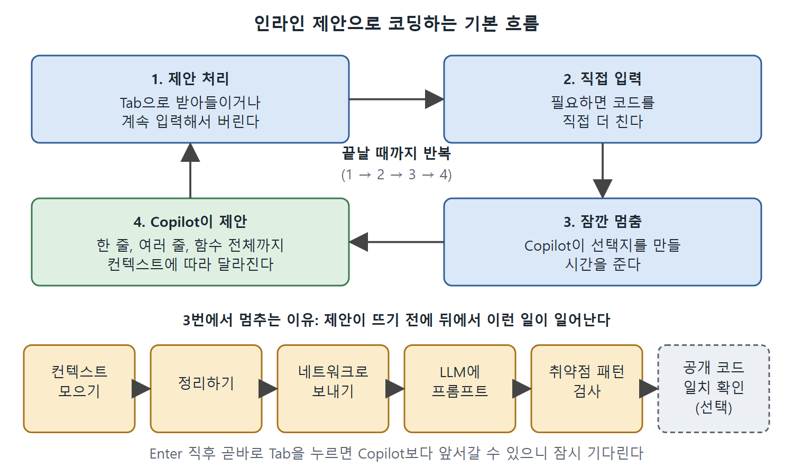

# 인라인 제안 사용법

GitHub Copilot을 쓰는 가장 기본적인 방법은 에디터에서 코드를 치다가 떠오르는 인라인 제안(코드를 치는 자리에 바로 뜨는 추천 코드)을 받는 것이다. 이 문서는 인라인 제안이 어떻게 보이고, 어떻게 받아들이거나 넘기고, 왜 매번 결과가 달라지는지를 설명한다.

책은 예시 IDE로 VS Code와 GitHub Codespaces를 쓴다. Copilot은 VS Code 말고도 JetBrains IDE, Eclipse, NeoVim 등에서 쓸 수 있지만 화면과 조작법은 조금씩 다를 수 있다. 다른 IDE를 쓴다면 해당 IDE 문서를 함께 보는 것이 좋다.

---

## 1. Copilot과 대화하는 두 가지 방식

IDE 안에서 Copilot과 소통하는 길은 크게 두 가지다. 책은 이 둘을 편의상 이렇게 부른다.

| 방식 | 어디서 쓰나 | 특징 | 다루는 곳 |
|---|---|---|---|
| 인라인 모드 | 에디터, 컨텍스트 메뉴, 관련 컨트롤 | 코드를 치면서 바로 제안을 받는 빠른 방식 | 이 장(2장) |
| 채팅 인터페이스 | Copilot에 포함된 별도 채팅 창 | 선택지와 피드백이 더 다양하고, 에이전트 모드와 고급 편집 모드로 들어가는 입구 | 3장과 4장 |

대부분의 사용자는 에디터에서 코드를 치다가 Copilot을 처음 만난다. 이때 설치된 Copilot 확장(IDE에 붙이는 부가 기능)이 컨텍스트(문맥)를 모으고, 원격 구성요소와 연결해 제안을 가져온다. 이 흐름은 1장에서 큰 그림으로 설명했고, 이 장에서는 좀 더 가까이서 본다.

### 단축키 표기법

Copilot의 기능은 대개 보조키(Command, Ctrl, Option) 한 개에 글자나 숫자, 기호를 더한 단축키로 부른다. 보조키는 운영체제와 키보드에 따라 다르다. 그래서 책은 `Meta-<글자>`로 표기한다. 예를 들어 Option-I 대신 `Meta-I`라고 쓴다. 내 환경에 맞는 단축키 목록은 Copilot 문서에서 확인한다.

---

## 2. 첫 제안 받아 보기

소수(prime number)를 다루는 파이썬 파일을 만든다고 하자. `prime.py`라는 파일을 만들면 가장 먼저 눈에 띄는 것은 `Meta-I`로 Copilot 채팅을 인라인으로 부르라는 안내 문구다. Copilot이 켜져 있고 채팅이 활성화되어 있으면 파일을 편집할 때마다 이 안내가 나타난다. 이 기능은 3장에서 설명하니 지금은 무시하고 코드를 계속 입력하면 된다.

숫자가 소수인지 확인하는 함수를 만들려고 이렇게 입력한다.

```python
def is_prime
```

여기까지 치면 Copilot이 가능한 완성 코드를 제안하기 시작한다. 제안된 글자는 고스트 텍스트(ghost text)로 보인다. 아직 받아들이지 않은 제안은 평소의 진한 글자 대신 기울어지고 흐린 글자로 표시된다는 뜻이다.

### 제안 옆에 뜨는 막대

제안 글자의 위쪽 오른편에는 회색 막대가 뜬다. 인라인 제안이 나올 때마다 나타나며, 여기에 제안을 받아들이거나 넘기는 컨트롤이 모여 있다.

| 막대의 요소 | 하는 일 |
|---|---|
| `< 1/2 >` | 제안이 2개 생겼고 지금 1번을 보고 있다는 표시. `<`와 `>`를 누르거나 대응하는 키로 제안을 돌려 본다 |
| Tab 키 | 제안 전체를 받아들인다 |
| 단어 단위 수락 키 | 한 번에 한 단어씩만 받아들인다. 막대와 문서에 키 조합이 적혀 있다 |
| 더 보기(More Actions) 메뉴 (점 세 개) | 추가 동작을 모은 메뉴 |

막대의 글자는 해당 키보드 단축키와 옵션을 알려 주는 일종의 메모 역할도 한다. 즉 단축키를 외우지 못해도 막대를 보면 된다.

---

## 3. 제안 고르기와 받아들이기

`< 1/2 >`가 보인다면 두 번째 제안을 보려고 `>`를 누른다. 어느 쪽이든 마음에 드는 제안에서 Tab 키를 누르면 받아들여진다. 둘 다 마음에 들지 않으면 그냥 계속 입력하면 된다. 그러면 제안이 사라진다.

책의 예시에서 1번과 2번의 차이는 빈 공백 정도로 아주 작았다. 그래도 Copilot은 이를 별개의 두 선택지로 보여 준다. 어느 쪽을 골라도 쓸 만한 함수 본문이 자동으로 만들어진 모습이었다.

1번을 받아들이면 전체 제안 글자가 파일에 들어간다. 이때부터는 고스트 텍스트가 아니고 직접 친 글자와 똑같은 모양이 된다.

> 책의 예시 화면과 내 화면의 제안은 다를 수 있다. 생성형 AI라서 같은 컨텍스트라도 매번 다른 제안이 나올 수 있다. IDE가 다르면 화면과 컨트롤도 다르다.

---

## 4. 코딩할 때의 기본 작업 흐름

몇 번 써 보면 인터페이스가 예측 가능하고 도움이 된다고 느끼게 된다. 코드를 치는 동안의 전형적인 흐름은 다음과 같다.

1. Copilot의 제안을 받아들이거나 버린다.
2. 필요하면 코드를 직접 더 친다.
3. 필요하면 잠깐 멈춰서 Copilot이 선택지를 만들 시간을 준다.
4. Copilot이 제안을 내놓는다.
5. 끝날 때까지 1~4를 반복한다.



그림은 제안 처리, 직접 입력, 잠깐 멈춤, 제안 받기의 네 단계가 끝날 때까지 돌아가는 모습과, 멈추는 동안 Copilot 뒤에서 일어나는 처리 순서를 보여 준다.

제안의 완성도와 맞는 정도는 편차가 크다. 가진 컨텍스트에 따라 주석 한 줄, 코드 한 줄, 여러 줄짜리 완성 해법까지 제안 범위가 달라진다. 함수 정의 전체가 한 번에 오기도 하고, 한두 줄만 오기도 한다. 위의 흐름은 첫 제안이 완성본이든, 줄 단위 제안을 여러 번 주고받든 똑같다.

### 왜 가끔 멈춰야 하나

위 3단계의 "잠깐 멈춤"은 이유가 있다. 제안이 화면에 뜨기까지 뒤에서는 많은 일이 벌어진다. 1장에서 본 것처럼 Copilot은 컨텍스트를 모으고, 정리하고, 네트워크로 보내고, LLM에 프롬프트를 던지고, 취약점 패턴이 있는지 검사하고, 선택적으로 공개 코드와 일치하는지 확인한 뒤 결과를 내놓는다.

이 과정은 놀랄 만큼 빠르다. 하지만 가끔 Enter를 친 뒤 결과가 돌아오기까지 잠깐 걸린다. Enter를 누르고 곧바로 Tab을 누르는 습관이 있다면 Copilot보다 앞서갈 수 있다. 그럴 때는 잠시 기다렸다가 다음 줄을 받아들이면 된다. 또 출력에 빈 줄이 하나 섞여 나올 때도 있다.

---

## 5. 이 간단한 예에서 알 수 있는 것

| 관찰 | 의미 |
|---|---|
| 함수 정의가 문맥에 맞게 제안되었다 | 파일 이름과 입력한 함수 이름만으로도 Copilot이 의도를 짐작했다 |
| 두 선택지가 기술적으로 큰 차이 없이 다르게 표시되었다 | 사소한 차이도 별개의 제안으로 나올 수 있다 |
| 제안의 근거는 파일 이름과 함수 이름이었다 | 컨텍스트가 매우 적어도 제안은 나온다 |
| 같은 연습을 반복해도 같은 결과가 보장되지 않는다 | 생성형 AI는 똑같은 컨텍스트에서도 다른 결과를 낼 수 있고, 제안이 하나뿐일 수도 있다 |

읽는 법: 제안을 한 번에 믿지 말고, 완성도와 맞는 정도를 매번 확인한 뒤 받아들인다. 인라인 제안이 대부분 충분히 쓸 만하지만, 가끔은 선택지가 더 필요하다. 그 방법이 다음 문서(추가 제안 보기)의 주제다.

<br>
<br>
<br>

[Learning GitHub Copilot](../)
