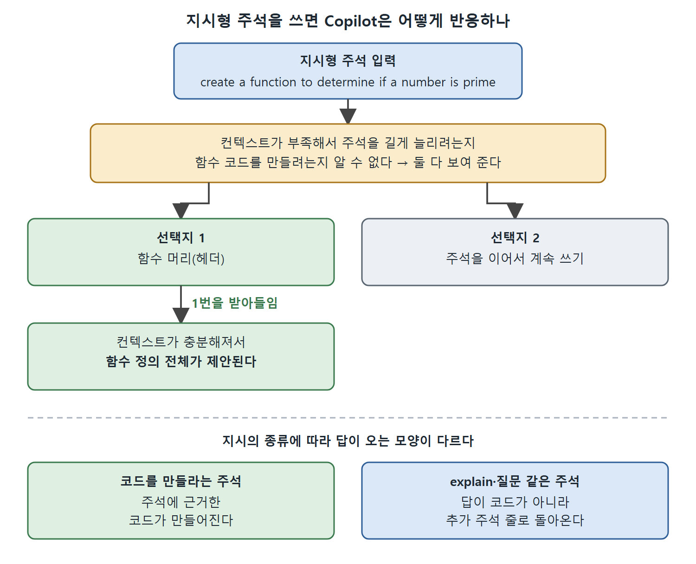

# 주석으로 Copilot 다루기

주석은 코드를 설명하는 글이지만 Copilot에게는 중요한 컨텍스트이자 지시문이 된다. 이 문서는 주석이 컨텍스트로 작동하는 방식, 주석을 명령처럼 쓰는 방식, 코드 설명을 요청하는 방식, 주석으로 질문하는 방식을 순서대로 설명한다.

---

## 1. 주석은 컨텍스트가 된다

새 파일의 유일한 줄로 이런 주석 하나만 입력해 보자.

```python
# a function to determine if a number is prime or not
```

Copilot은 이 주석을 보고 코드 완성을 제안할 수 있다(원서 그림 2-7). 그 제안을 받아들이면 함수 본문의 나머지 코드가 이어서 제안된다(그림 2-8). 즉 주석 한 줄만으로도 함수의 머리부터 몸통까지 끌어낼 수 있다.

여기까지는 Copilot이 주석에서 수동적으로 컨텍스트를 읽어 가는 경우다. 다음부터는 주석으로 능동적으로 지시하는 방법이다.

---

## 2. 지시형 주석

지시형 주석은 설명하려고 쓰는 것이 아니라 Copilot에게 할 일을 시키려고 쓰는 주석이다. 말투를 명령에 가깝게 쓰면 된다. 앞에서 `def is_prime`으로 시작했다면, 이번에는 원하는 것을 주석으로 먼저 적는다.

```python
# create a function to determine if a number is prime
```

컨텍스트에 따라서는 주석을 마저 완성해 주는 제안이 먼저 나온다(그림 2-9). 제안이 의도와 맞을 수도 있고 아닐 수도 있다. 한 줄만으로도 함수 코드 제안이 시작된다(그림 2-10).

### 선택지가 두 가지로 나뉘는 이유

제안된 함수 이름은 앞서와 같지만 선택지 구성이 다르다. 한 줄이 아니라 여러 가지 완성이 나온다.

| 선택지 | 내용 |
|---|---|
| 첫 번째 | 함수 머리(헤더) |
| 두 번째 | 주석을 이어서 계속 쓰는 것(그림 2-11) |

이유는 Copilot이 컨텍스트가 부족해서 주석을 길게 늘리려는지 함수 코드를 만들려는지 알 수 없기 때문이다. 그래서 둘 다 보여 준다. 첫 번째 선택지를 받아들이면 컨텍스트가 충분해져서 함수 정의 전체가 제안된다(그림 2-12).



그림은 컨텍스트가 부족한 지시형 주석에서 두 선택지가 나오는 이유와, 1번을 받아들이면 함수 전체가 제안되는 흐름, 지시 종류별 답의 모양을 보여 준다.

> 생성형 AI라서 책의 화면과 내 화면의 제안은 같은 예제라도 다를 수 있다.

---

## 3. 코드 설명을 주석으로 요청하기

기존 코드의 설명도 주석으로 요청할 수 있다.

```python
# explain the code above
```

지금까지 만든 예제에 이 주석을 달면 Copilot은 코드가 어떻게 동작하는지 짧은 주석 줄로 답한다. 책의 예시(그림 2-13)에서는 지시 주석 뒤에 11~13행의 주석 세 줄이 만들어졌다.

더 자세한 설명이 필요하면 이렇게 쓴다.

```python
# explain the code above line-by-line
```

결과는 훨씬 상세하다(그림 2-14).

### 지시의 종류에 따라 결과가 다르다

| 지시의 종류 | 결과 |
|---|---|
| 코드를 만들라는 주석 | 주석에 근거한 코드가 만들어진다 |
| 코드가 아닌 지시(예: explain) | 결과가 추가 주석으로 돌아온다 |

읽는 법: 설명 요청의 답이 코드로 오지 않고 주석 줄로 온다는 점만 기억하면 된다.

---

## 4. 주석으로 질문하기

지시 대신 질문을 던질 수도 있다.

```python
# What does the code above do?
```

Copilot이 주석 형태로 답한다(그림 2-15). 질문임을 더 형식을 갖춰 표시하려면 주석 기호 뒤에 `q:`를 붙인다. 필수는 아니다. `q:`를 쓰면 Copilot은 `a:`로 시작하는 답을 돌려준다.

### 지금도 쓸 만한가

예전에는 Copilot Chat이 요금제에 포함되기 전이라서, 주석 질문이 채팅 같은 답을 얻는 방법이었다. 지금은 인라인 채팅이나 메인 채팅 창이 대체로 더 낫다. 그래도 코드 안에 짧은 답을 남겨 두고 싶을 때는 여전히 쓸모가 있다.

---

## 5. 주석 활용 정리

| 방식 | 예 | Copilot의 반응 |
|---|---|---|
| 설명형 주석(컨텍스트) | `# a function to determine if a number is prime or not` | 주석을 보고 코드 완성을 제안한다 |
| 지시형 주석 | `# create a function to determine if a number is prime` | 주석 완성 또는 함수 머리, 이어서 함수 전체를 제안한다 |
| 설명 요청 | `# explain the code above` | 짧은 주석으로 설명한다 |
| 상세 설명 요청 | `# explain the code above line-by-line` | 줄 단위의 상세한 주석을 단다 |
| 질문 | `# What does the code above do?` | 주석으로 답한다 (`q:` 사용 시 `a:`로 답) |

이렇게 주석만으로도 꽤 많은 일을 시킬 수 있다. 다음 문서에서는 편집 중이 아니라 IDE 메뉴로 Copilot을 쓰는 방법을 본다.

<br>
<br>
<br>

[Learning GitHub Copilot](../)
