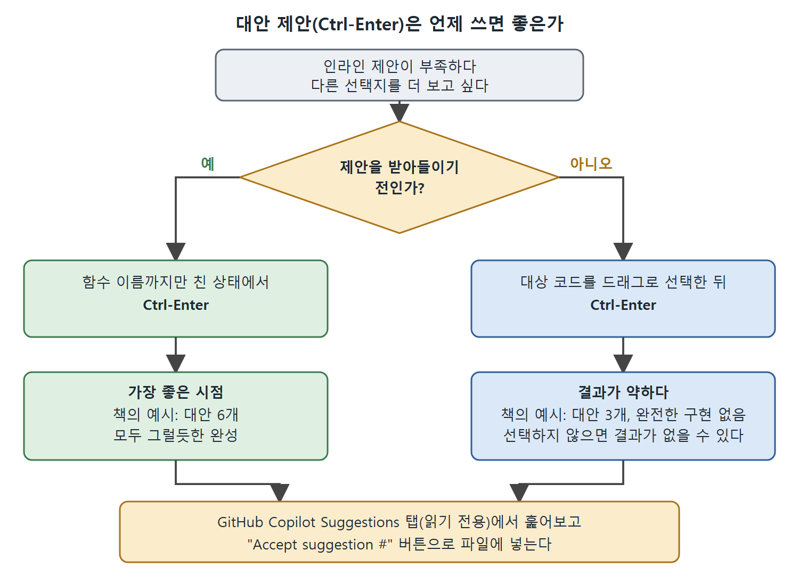

# 추가 제안 보기

인라인 제안이 마음에 들지 않거나 다른 선택지를 더 보고 싶을 때, Copilot은 대안 코드 완성을 따로 모아 보여 주는 기능을 제공한다. 이 문서는 그 기능을 여는 방법, 언제 쓰면 좋은지, 이미 써 놓은 코드에 쓰면 왜 결과가 약해지는지를 정리한다.

---

## 1. Ctrl-Enter로 대안 목록 열기

처음 나온 제안이 부족하면 Copilot에게 다른 제안을 더 만들어 달라고 할 수 있다. 더 많은 대안 코드 완성을 모아 보려면 `Ctrl-Enter` 키 조합을 쓴다.

이 기능에는 감수해야 할 점이 있다.

| 얻는 것 | 감수할 점 |
|---|---|
| 더 많은 완성 선택지 | 바로 뜨는 인라인 제안보다 만들고 보여 주는 데 시간이 더 걸린다 |
| 다양한 구현 후보 | 대안이 부분 구현이거나 주석 모음일 수 있어 덜 쓸모 있을 때가 있다 |

읽는 법: 속도가 필요하면 인라인 제안을 쓰고, 선택지가 더 필요할 때만 `Ctrl-Enter`를 쓴다.

---

## 2. 가장 좋은 시점은 제안을 받아들이기 전

이 기능은 인라인 제안 중 하나를 받아들이기 전에 쓰는 것이 가장 효과적이다. 함수 이름까지만 쳤고 아직 아무 제안도 받아들이지 않은 상태로 돌아가 보자. 이때 `Ctrl-Enter`를 누르면 Copilot이 별도의 패널에 대안 완성들을 만들어 보여 준다(원서 그림 2-5).

책의 예시에서는 여섯 가지 대안이 나왔다. 모두 그럴듯한 완성이었고 일부 구현은 서로 거의 비슷했다.

### 패널 사용법

- 패널 이름은 GitHub Copilot Suggestions 탭이다. 읽기 전용이다.
- 목록을 스크롤하면서 대안 완성을 훑어본다.
- 마음에 드는 것이 있으면 그 아래의 "Accept suggestion #" 버튼을 눌러 파일에 넣는다. 여기서 `#`는 제안 번호다.

---

## 3. 이미 쓴 코드에 쓰면 결과가 달라진다

이미 완성한 코드에서 대안을 받으려 하면 결과가 훨씬 더 들쭉날쭉하다. 이 경우에는 Copilot이 대상으로 삼을 코드를 반드시 드래그해서 선택해야 한다. 선택하지 않으면 결과가 하나도 나오지 않을 수 있다.

원서 그림 2-6은 기존 코드에서 시작해 얻은 대안들이다. 제안 탭에 대안이 3개뿐이고, 어느 것도 완전한 구현이 아니었다. 그래서 얻을 수 있는 교훈은 분명하다. 컨텍스트가 거의 없을 때가 오히려 대안 제안을 받기 가장 좋은 때이니, 코드를 추가하기 전에 대안을 요청하는 편이 낫다.

그림은 제안을 받아들이기 전인지에 따라 Ctrl-Enter의 결과가 어떻게 달라지는지, 그리고 어느 쪽이든 Suggestions 탭에서 골라 넣는다는 점을 보여 준다.

| 상황 | 결과 | 책의 예시 |
|---|---|---|
| 함수 이름만 친 상태, 제안 수락 전 | 그럴듯한 완성이 여러 개 | 대안 6개, 모두 쓸 만함 |
| 이미 작성한 코드를 선택해 요청 | 적고 불완전한 대안 | 대안 3개, 완전한 구현 없음 |
| 코드를 선택하지 않고 요청 | 결과가 없을 수 있음 | 해당 없음 |

---

## 4. 요약

| 항목 | 내용 |
|---|---|
| 단축키 | `Ctrl-Enter` |
| 보이는 곳 | 별도 패널(GitHub Copilot Suggestions 탭), 읽기 전용 |
| 수락 방법 | "Accept suggestion #" 버튼 |
| 최적 시점 | 인라인 제안을 받아들이기 전 |
| 기존 코드에 쓸 때 | 대상 코드를 반드시 선택한다 |
| 단점 | 느리고, 부분 구현이나 주석만 나올 수 있다 |

Copilot은 실제 코드뿐 아니라 주석 같은 관련 요소도 보고 제안을 만든다는 것이 1장의 내용이었다. 다음 문서에서는 이 점을 이용해, 주석으로 Copilot의 동작을 이끄는 방법을 본다.

 
 
 

[Learning GitHub Copilot](../)
