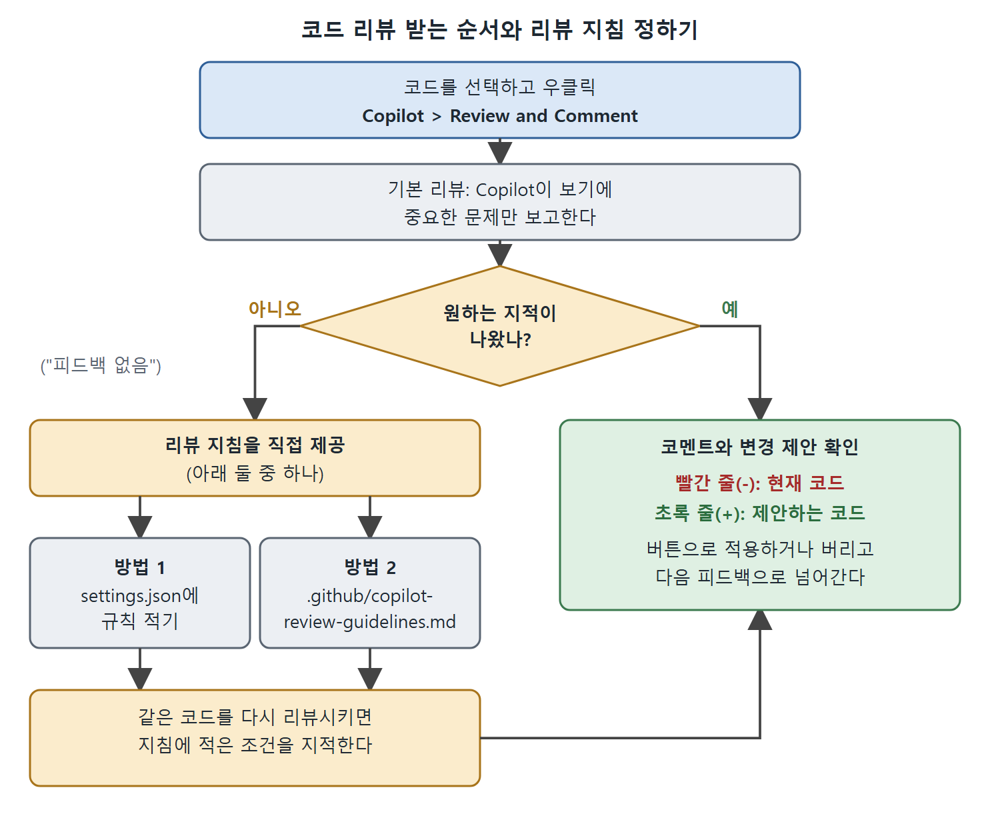

# 코드 리뷰와 커밋 메시지

Copilot은 내 코드의 리뷰어 역할도 한다. GitHub에서는 풀 리퀘스트(PR)에 Copilot을 리뷰어로 추가할 수 있고(9장), IDE에서는 로컬 코드를 리뷰받고 인라인으로 피드백을 받을 수 있다. 푸시하기 전에 문제를 잡을 때 특히 유용하다. 이 문서는 기본 리뷰, 사용자 정의 리뷰 지침, 커밋 메시지 자동 생성을 정리한다.

---

## 1. 기본 리뷰 사용하기

간단한 점(Point) 클래스를 구현한 다음 코드가 있다고 하자.

```python
class Point:
    def __init__(self, x, y, z=0): self.x = x; self.y = y
    def distance(self, other): return (self.x - other.x)**2 + \
    (self.y - other.y)**2 + (self.z - other.z)**2**0.5
p1 = Point(1, 2); p2 = Point(4, 6, 0)
print(p1.distance(p2))
```

파이썬에 익숙하면 문제 몇 가지가 보일 것이다. Copilot에게 리뷰를 맡기려면 에디터에서 코드를 선택하고 우클릭한 다음 Copilot > Review and Comment를 고른다(그림 2-21).

### 결과 읽기

Copilot이 처리를 마치고 문제나 개선 제안(문서화 추가 같은 사소한 것까지)이 있으면, 코멘트와 변경 제안을 코드 옆에 인라인으로 보여 준다(그림 2-22). 리뷰 대화상자의 구성은 다음과 같다.

| 요소 | 역할 |
|---|---|
| 화살표 컨트롤 | 다른 리뷰 코멘트로 이동 |
| 채팅에서 보기 컨트롤 | 피드백을 채팅에서 본다 |
| 닫기, 접기 컨트롤 | 대화상자를 닫거나 접는다 |
| 빨간색 줄(마이너스 부호) | 현재 코드 |
| 초록색 줄(플러스 부호) | 제안하는 코드 |
| 아래쪽 버튼 | 변경을 적용하거나 버린 뒤 다음 피드백으로 넘어간다 |

읽는 법: 빨강은 지울 코드, 초록은 새로 넣을 코드다. 버튼으로 하나씩 결정하면 다음 피드백으로 넘어간다.

---

## 2. 사용자 정의 리뷰 지침

기본적으로 Copilot은 자기가 보기에 중요한 문제만 보고한다. 그래서 다른 리뷰어라면 지적할 법한 것(모범 사례나 스타일 규칙 위반 등)이 있어도 "피드백 없음"이라고 답하는 일이 흔하다(그림 2-23). 더 자세한 피드백이 필요하면 리뷰 지침을 직접 제공할 수 있다. 방법은 두 가지다.

### 방법 1. settings.json에 직접 적기

`settings.json`의 `github.copilot.chat.codeReview.instructions` 아래에 지침을 추가한다고 설명하지만, 원문의 예시 코드는 키 이름이 `github.copilot.chat.reviewSelection.instructions`로 되어 있다.

```json
"github.copilot.chat.reviewSelection.instructions": [
    {
        "text": "Ensure all functions have proper docstrings"
    }
]
```

사용자 설정 파일에 규칙을 넣고 같은 코드를 다시 리뷰시키면, 이번에는 설정에 적은 조건을 지적한다(그림 2-24).

### 방법 2. 파일로 두기

| 방식 | 내용 |
|---|---|
| 기본 경로 파일 | 규칙(최대 5개 더)을 마크다운으로 적어 `.github/copilot-review-guidelines.md`로 저장하면 Copilot이 자동으로 찾아서 쓴다 |
| 다른 파일 지정 | 원하는 파일을 만들고 `settings.json`에서 `file` 키로 가리킨다 |

다른 파일을 가리키는 설정은 이렇다.

```json
"github.copilot.chat.reviewSelection.instructions": [
    {
        "file": "./docs/review-guide.md"
    }
]
```

이 설정은 코드베이스의 `docs` 디렉터리에 `review-guide.md`가 있다고 가정한다. 파일 내용은 다음 한 줄이다.

```markdown
- Ensure all functions have proper docstrings.
```

---

## 3. 리뷰 방식 선택 기준



그림은 기본 리뷰에서 원하는 지적이 나오지 않을 때 두 가지 방법 중 하나로 지침을 주고 다시 리뷰시키는 순서를 보여 준다.

| 상황 | 추천 방식 |
|---|---|
| 일단 한번 문제만 훑고 싶다 | 기본 리뷰(Review and Comment) |
| 팀 규칙이나 스타일을 확인시키고 싶다 | `settings.json`의 `text` 규칙 |
| 규칙이 여러 개고 문서로 관리하고 싶다 | `.github/copilot-review-guidelines.md` |
| 파일 위치를 직접 정하고 싶다 | `file:` 키로 다른 파일 지정 |

---

## 4. 커밋 메시지 자동 생성

리뷰가 끝나고 변경을 커밋할 때도 Copilot이 도와준다. 소스 제어 패널에서 커밋 메시지를 직접 쓰는 대신, 변경 내용에 맞는 메시지를 Copilot에게 제안받을 수 있다. 커밋 메시지 입력란 끝의 스파클 아이콘을 클릭하면 된다(그림 2-25).

커밋 메시지 생성에도 사용자 정의 지침을 설정할 수 있다. 방법은 VS Code 문서를 참고한다고 되어 있다.

이렇게 코드 작성, 리뷰, 커밋까지 IDE 안에서 이어진다. 다음 문서에서는 이런 동작을 켜고 끄는 설정을 본다.

<br>
<br>
<br>

[Learning GitHub Copilot](../)
