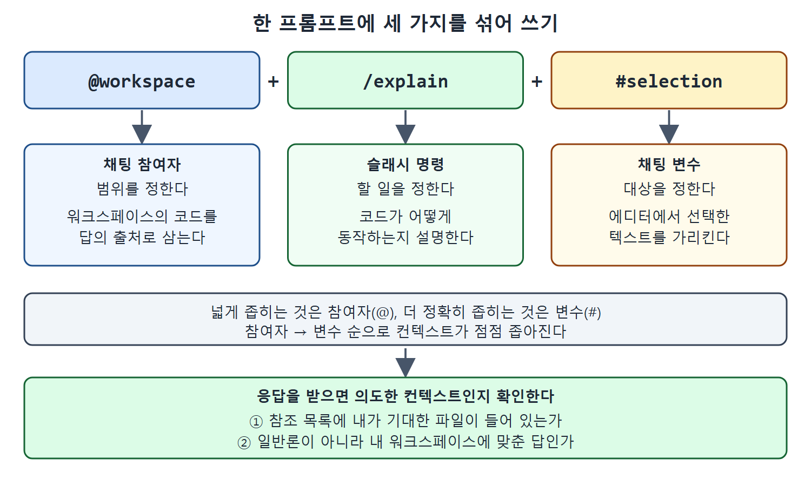

# 채팅 변수와 조합하기

채팅 참여자가 질문의 큰 범위를 정한다면, 채팅 변수(`#`으로 붙이는 정보)는 프롬프트 글 안에서 컨텍스트를 한 겹 더 좁혀 준다. 특정 파일, 에디터에서 선택한 코드, Git 저장소의 변경, 터미널 명령 등을 이름으로 가리킬 수 있다.

이 문서는 채팅 변수의 목록과 사용법, 파일 경로를 쓸 때의 주의점, 참여자, 슬래시 명령, 변수를 섞어 쓰는 방법, 그리고 Copilot이 의도한 컨텍스트를 보고 있는지 확인하는 요령을 정리한다.

---

## 1. 채팅 변수란

채팅 변수는 프롬프트 안에서 `#` 기호로 표시한다. 예를 들어 `#terminalSelection`은 활성 터미널에서 선택한 내용을 끌어온다. 아래 목록은 책을 쓸 당시 쓸 수 있던 변수이며, 최신 내용은 VS Code 문서를 보라고 책은 안내한다. 설명 열은 프로젝트에서 어떤 내용이 프롬프트의 컨텍스트로 더해지는지를 보여 준다.

### 1.1 변수 목록

| 채팅 변수 | 설명 |
| --- | --- |
| `#changes` | 소스 컨트롤 변경 목록 |
| `#codebase` | 워크스페이스에서 찾은 관련 내용 |
| `#fetch` | URL을 주면 그 웹 페이지의 내용 |
| `#file` | 워크스페이스에서 고르거나 지정한 파일 |
| `#<filename>` | `#` 뒤에 입력한 글자와 맞는 파일 목록을 띄워 고르게 한다 |
| `#folder` | 지정한 폴더와 그 안의 모든 파일 |
| `#problems` | 문제(Problems) 패널의 워크스페이스 이슈와 문제. 디버깅이나 코드 수정 컨텍스트로 유용하다 |
| `#searchResults` | 워크스페이스 안에서 한 검색의 결과 |
| `#selection` | 에디터에서 현재 선택한 텍스트. `<filename:lines>` 형태로 추가된다 |
| `#sym` | 현재 심볼 |
| `#<symbol>` | `#` 뒤에 입력한 글자와 맞는 심볼 목록을 띄워 고르게 한다 |
| `#terminalLastCommand` | 활성 터미널에서 마지막으로 실행한 명령 |
| `#terminalSelection` | 활성 터미널에서 선택한 내용 |
| `#testFailure` | 테스트 실패 정보를 더해, 테스트를 진단하고 고치게 돕는다 |
| `#usages` | Find All References, Find Implementation, Go to Definition을 합친 것 |
| `#vscodeAPI` | VS Code 확장 개발에 관한 질문에 답하도록 VS Code API를 더한다 |

### 1.2 용도별로 묶어 보기

목록이 길어서 쓰임새로 묶으면 고르기 쉽다. 이 묶음은 이해를 위해 정리한 분류다.

| 하고 싶은 일 | 쓸 변수 |
| --- | --- |
| 코드 범위를 정한다 | `#codebase`, `#file`, `#folder`, `#selection`, `#sym`, `#usages` |
| 변경과 문제를 알려 준다 | `#changes`, `#problems`, `#testFailure` |
| 터미널 내용을 알려 준다 | `#terminalLastCommand`, `#terminalSelection` |
| 바깥 정보를 가져온다 | `#fetch`, `#searchResults`, `#vscodeAPI` |

## 2. 변수 부르기

프롬프트에서 `#`만 입력하면 Copilot이 쓸 수 있는 변수 목록을 띄운다. 거기서 파일 같은 항목을 골라 넣는다. 목록에 나온 파일은 파일 이름만 선택해도 된다.

### 2.1 경로를 쓸 때의 주의

파일 이름을 목록에서 고르지 않고 프롬프트에 직접 입력한다면, 프로젝트 루트부터의 상대 경로를 포함해야 한다.

```text
What does the #file:controllers/suite_test.go do?
```

| 방법 | 경로 표기 |
| --- | --- |
| 팝업 목록에서 파일 선택 | 파일 이름만 선택하면 된다 |
| 프롬프트에 직접 입력 | 프로젝트 루트 기준 상대 경로를 포함한다 |

---

## 3. 참여자, 슬래시 명령, 변수를 함께 쓰기

세 가지는 한 프롬프트에 섞어 쓸 수 있다. 책의 예에서는 에디터에서 선택한 부분을 설명해 달라고 요청했다. Copilot이 `@workspace` 참여자를 자동으로 채워서 프롬프트가 다음 모양이 되었다.

```text
@workspace /explain #selection
```



그림은 `@workspace /explain #selection`이 범위(참여자), 할 일(슬래시 명령), 대상(채팅 변수)으로 나뉘는 모습과, 응답을 받은 뒤 의도한 컨텍스트인지 확인하는 두 가지 점검을 보여 준다.

| 부분 | 종류 | 역할 |
| --- | --- | --- |
| `@workspace` | 채팅 참여자 | 워크스페이스를 범위로 삼는다 |
| `/explain` | 슬래시 명령 | 설명을 요청한다 |
| `#selection` | 채팅 변수 | 선택한 텍스트를 대상으로 삼는다 |

사용된 참조를 보면, Copilot은 선택 영역과 응답에 필요한 같은 파일의 다른 부분에 집중했다. 그리고 요청대로 더 좁은 컨텍스트인 선택한 텍스트에 대한 설명을 만들었다.

## 4. 의도한 컨텍스트가 맞는지 확인하기

Copilot이 내가 의도한 컨텍스트를 고려하게 만드는 일은 때로 까다롭다. 열쇠는 응답을 보고 아래 두 가지를 확인하는 것이다.

| 확인할 점 | 의미 |
| --- | --- |
| Copilot이 내가 기대한 참조를 썼는가 | 참조 목록에서 확인한다 |
| 응답이 일반적인 조언인가, 워크스페이스의 구조나 내용에 맞춘 답인가 | 일반론이면 컨텍스트가 빗나갔다는 신호다 |

이 두 가지를 보면 Copilot이 의도한 내용을 겨냥하고 있는지, 아니면 이 장에서 소개한 방법(참여자, 변수, 컨텍스트 추가)으로 더 정확히 안내해야 하는지 금방 알 수 있다.

<br>
<br>
<br>

[Learning GitHub Copilot](../)
