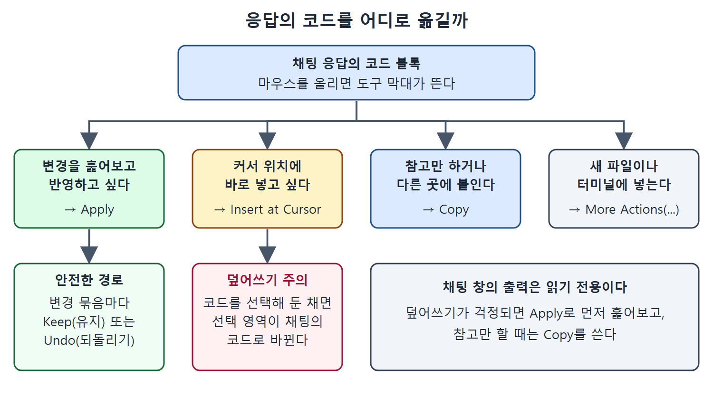

# 채팅 화면 열기와 응답 읽기

Copilot을 IDE에 설치하면 Copilot Chat이 함께 들어온다. 인라인 제안이 지금 작성 중인 코드에 맞춰 짧고 빠르게 코드를 얹어 준다면, 채팅은 동료와 얘기하듯 코딩 문제를 자유롭게 묻고 답하는 창구다. 한번 써 보면 채팅 없이 Copilot을 쓰는 게 상상이 안 될 정도라고 책은 말한다.

이 문서는 채팅 창이 어디에 있고, 모드가 어떻게 나뉘며, 응답에서 무엇을 읽어야 하는지, 응답의 코드를 에디터로 옮기는 방법은 무엇인지를 정리한다. 설명은 VS Code 기준이다. GitHub 웹에서 쓰는 채팅은 책의 9장에서 따로 다룬다.

---

## 1. 채팅 창은 어디에 있나

Copilot Chat의 기본 화면은 에디터 오른쪽에 붙는 별도 창(pane)이다. 에디터와 분리되어 있어서 입력, 출력, 대화 기록을 넉넉한 공간에서 볼 수 있다.

창이 안 보이면 IDE 상단 줄의 Copilot 아이콘을 눌러서 연다. 이 메뉴에는 채팅 창을 여는 항목이 맨 위에 있고, 그 아래에 인라인 채팅(Editor Inline Chat)과 Quick Chat을 여는 항목이 있다. 두 가지는 [인라인 채팅과 Quick Chat, 터미널 채팅](%EC%9D%B8%EB%9D%BC%EC%9D%B8%20%EC%B1%84%ED%8C%85%EA%B3%BC%20Quick%20Chat%2C%20%ED%84%B0%EB%AF%B8%EB%84%90%20%EC%B1%84%ED%8C%85.md)에서 설명한다.

새 대화를 시작하면 "Copilot is powered by AI, so mistakes are possible. Review output carefully before use."라는 경고가 뜬다. 이 경고는 채팅에만 해당하지 않는다. 1장에서 말했듯 Copilot이 내놓는 모든 결과는 사람이 검토하고 써야 한다.

## 2. 채팅의 세 가지 모드

채팅 창은 대화만 하는 곳이 아니라 더 강한 기능으로 가는 입구이기도 하다. 창에서 모드를 바꿔 가며 쓴다.

| 모드 | 하는 일 | 다루는 곳 |
| --- | --- | --- |
| Ask 모드 | 기본값. 대화하듯 묻고 답한다 | 이 장 |
| Edit 모드 (Copilot Edits) | 여러 파일에 걸친 고급 편집 | 4장 |
| Agent 모드 | 스스로 작업을 이어 가는 자율 개발 기능 | 4장 |

이 장은 Ask 모드만 다룬다. Edit와 Agent 모드의 쓰임새는 다음 장으로 넘긴다는 뜻이다.

## 3. 첫 질문 해 보기

2장에서 만든 `is_prime` 함수를 선택하고 채팅 입력창(Ask Copilot)에 이렇게 물어 보자.

```text
How does this code work?
```

응답은 문장으로 풀어 쓴 설명이다. 파이썬을 몰라도 읽고 이해할 수 있고, 설명을 뒷받침하는 코드 조각이 함께 나온다. 책에서는 대략 이런 순서로 설명했다.

1. `n <= 1`이면 소수가 아니므로 바로 `False`를 돌려준다.
2. 2부터 `int(n**0.5) + 1` 직전까지 나눠 본다. 제곱근까지만 확인하면 충분하기 때문이다.
3. 나누어떨어지는 수가 하나라도 있으면 `False`, 끝까지 없으면 `True`를 돌려준다.

여기에 "핵심 포인트"와 입력 7, 9로 돌려 본 예까지 붙는다. 7은 2, 3으로 안 나누어지니 `True`, 9는 3으로 나누어지니 `False`다. 제곱근까지만 도는 최적화가 1부터 `n-1`까지 전부 확인하는 방식보다 반복 횟수를 줄인다는 설명도 들어 있다.

생성형 AI라서 같은 프롬프트에도 답이 매번 조금씩 달라질 수 있다는 점은 기억해 둔다.

활용 범위는 내가 쓴 코드를 설명받는 데서 끝나지 않는다. 내가 쓰지 않았고 아직 이해하지 못한 코드, 익숙하지 않은 언어로 짠 코드, 복잡한 알고리즘을 설명받는 데 특히 유용하다. 설명 결과를 의사 코드(pseudocode)로 삼아 다음 개선 작업의 출발점으로 쓸 수도 있다.

## 4. 응답에서 볼 것

응답에는 본문 말고도 눈여겨볼 요소가 있다.

| 요소 | 위치 | 의미 |
| --- | --- | --- |
| "Used 1 reference" | GitHub Copilot 제목 바로 아래 | 응답을 만들 때 참고한 프로젝트 내용(참조)의 개수 |
| 참조 목록 | 위 줄을 펼치면 나온다 | 실제로 고려한 파일, 의존성, 설정, 비파일 항목 |
| 본문 | 참조 아래 | Markdown 형식의 설명과 코드 |
| "Current file" 표시 | 입력창 위쪽 | 기본 컨텍스트로 잡힌 현재 파일 |

참조(reference)는 Copilot이 응답에 쓸 만하다고 판단한 프로젝트의 내용이다. 보통은 에디터에서 활성화된 파일이지만 다른 파일, 의존성, 사용자 지정 설정, 파일이 아닌 내용도 들어갈 수 있다. 예를 들어 터미널을 언급하는 프롬프트라면 명령어가 참조가 될 수 있다. 책의 예에서는 열려 있던 `prime.py` 하나가 참조였고, 이것이 기본 컨텍스트다. 컨텍스트를 직접 조절하는 방법은 [프롬프트 입력창 활용하기](%ED%94%84%EB%A1%AC%ED%94%84%ED%8A%B8%20%EC%9E%85%EB%A0%A5%EC%B0%BD%20%ED%99%9C%EC%9A%A9%ED%95%98%EA%B8%B0.md)에서 다룬다.

표를 읽는 법은 간단하다. 응답을 받으면 먼저 참조 목록부터 펼쳐서 Copilot이 내가 의도한 파일을 보고 답했는지 확인한다.

## 5. 대화 이어 가기

채팅의 장점은 앞의 답을 바탕으로 꼬리 질문을 이어 갈 수 있다는 점이다. 예를 들어 같은 코드에 대해 더 효율적인 구현이 있는지 물으면 Copilot이 최적화한 버전을 설명과 함께 코드로 보여 준다. 글과 코드가 함께 오기 때문에 동료와 나누는 대화와 비슷한 흐름이 만들어진다.

## 6. 응답의 코드를 에디터로 옮기기

채팅 창의 출력은 읽기 전용이다. 대신 코드 블록 위에 마우스를 올리면 작은 도구 막대가 뜨고, 코드를 에디터로 옮기는 여러 방법을 고를 수 있다. 왼쪽부터 다음과 같다.

| 아이콘 기능 | 동작 | 비고 |
| --- | --- | --- |
| Apply | 현재 활성 파일에 변경을 적용해 검토하게 한다 | 바로 보임 |
| Insert at Cursor | 활성 파일의 커서 위치에 텍스트를 넣는다 | 바로 보임 |
| Copy | 클립보드로 복사한다 | 바로 보임 |
| 새 파일에 삽입 | 새 파일을 만들어 넣는다 | More Actions(...) 안에 있음 |
| 터미널에 삽입 | 터미널에 넣는다 | More Actions(...) 안에 있음 |

마지막 두 개는 기본 상태에서 `...`에 마우스를 올리고 More Actions를 거쳐야 보인다. 아이콘 하나를 우클릭하면 막대에 보일 아이콘을 고르는 메뉴가 나오는데, 모든 항목에 체크하면 `...`를 거치지 않고 전부 한 번에 쓸 수 있다.

Apply는 조금 설명이 필요하다. 누르면 Copilot이 에디터의 파일에 제안된 변경을 인라인으로 보여 주고, 변경 묶음마다 Keep(유지)과 Undo(되돌리기)를 고르게 한다. 확인 후 반영하는 안전한 경로다.

Insert at Cursor는 주의가 필요하다. 에디터에서 코드를 선택해 둔 상태라면 그 선택 영역을 채팅의 코드로 바꿔 쓴다. 이전 `is_prime` 구현을 선택한 채로 이 기능을 쓰면 기존 구현이 채팅에서 나온 코드로 덮어써진다.

정리하면 덮어쓰기가 걱정될 때는 Apply로 변경을 먼저 훑어보고, 그냥 참고만 할 때는 Copy를 쓰면 된다.



그림은 코드 블록의 도구 막대에서 하고 싶은 일에 따라 Apply, Insert at Cursor, Copy, More Actions 중 무엇을 고르는지, 그리고 Apply의 Keep/Undo와 Insert at Cursor의 덮어쓰기 주의점을 보여 준다.

<br>
<br>
<br>

[Learning GitHub Copilot](../)
