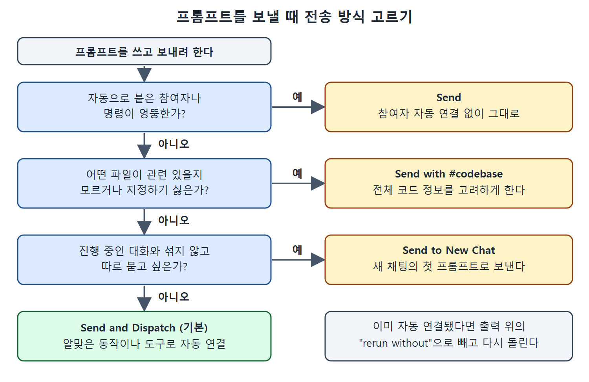

# 프롬프트 입력창 활용하기

채팅 입력창은 글을 적는 칸이 전부가 아니다. 컨텍스트 추가, 채팅 참여자 선택, 전송 방식 선택, 모델 선택, 모드 선택 컨트롤이 모두 이 입력창에 붙어 있다. 이 컨트롤을 알면 같은 질문도 훨씬 정확한 범위에서 던질 수 있다.

이 문서는 입력창의 컨트롤을 하나씩 짚고, 특히 컨텍스트 추가, 전송 옵션 네 가지, 모델 선택을 자세히 설명한다.

---

## 1. 입력창 컨트롤 한눈에 보기

| 컨트롤 | 하는 일 |
| --- | --- |
| Add Context (클립 아이콘) | 컨텍스트 요소를 추가한다 |
| `@` | 프롬프트를 처리할 채팅 참여자를 고른다 |
| Send 버튼(오른쪽 화살표) | 프롬프트를 제출하는 방식을 고른다 |
| 모델 선택 | Copilot이 뒤에서 쓸 AI 모델을 고른다 |
| 모드 선택 | Ask, Edit, Agent 중 어느 모드로 쓸지 고른다 |

모드 선택은 4장에서 다루므로 여기서는 나머지를 설명한다.

## 2. 컨텍스트 요소 추가하기

여기서 컨텍스트는 Copilot이 질문을 이해하고 답을 만들 때 참고할 수 있는 프로젝트 안의 요소다. 가장 단순한 경우는 에디터에서 열려 있는 파일이다. 그 파일이 현재 컨텍스트로 쓰이며 입력창 위에 "prime.py Current file"처럼 표시된다.

이 파일을 컨텍스트에서 빼려면 다른 파일을 활성화하거나, 눈 모양 아이콘을 눌러 그 파일을 컨텍스트에서 취소한다.

다른 종류의 요소를 직접 넣으려면 클립 아이콘(Add Context)을 누른다. 선택할 수 있는 항목은 아래와 같다.

| 분류 | 예 |
| --- | --- |
| 에디터 내용 | 현재 에디터의 내용 |
| 파일 | 프로젝트의 개별 파일 |
| 심볼 | 함수, 변수 등 |
| 터미널 | 터미널의 텍스트 |
| 화면 | 스크린샷 |
| 검색 | 웹 페이지 등 다른 내용 검색, 함수·변수·심볼의 사용처 찾기 |

목록에서는 스크롤하거나 검색창에 글자를 입력해 항목을 찾는다. 프로젝트 파일도 이렇게 찾을 수 있고, 목록 맨 아래로 내리면 최근에 연 파일이 보인다. 원하는 컨텍스트를 다 추가한 뒤 프롬프트를 적어 제출하면, Copilot은 응답을 준비하면서 추가된 항목들을 살핀다. 여러 종류의 컨텍스트를 함께 붙여 프롬프트를 실행하는 것도 가능하다.

### 워크스페이스 인덱스

컨텍스트와 관련해서 기억할 것이 하나 더 있다. GitHub는 워크스페이스 인덱스를 자동으로 만든다. 프로젝트에서 관련 코드를 빠르고 정확하게 찾기 위한 색인이다. 이 인덱스 덕분에 코드베이스의 더 넓은 범위를 검색해서 질문에 답할 수 있다.

## 3. 채팅 참여자 고르기

`@`를 누르면 채팅 참여자(@로 부르는 도우미)를 부를 수 있다. 참여자는 프롬프트가 적용될 범위를 정한다. 워크스페이스 전체, 터미널, VS Code 같은 범위다. `@workspace`, `@terminal` 같은 기본 참여자가 IDE에 내장되어 있고, GitHub Copilot 확장을 설치하면 확장이 참여자를 더 추가하기도 한다. 확장은 Docker 같은 다른 도구나 API를 IDE의 채팅 창에 끌어오는 맞춤 통합이다. 자세한 내용은 [슬래시 명령과 채팅 참여자](%EC%8A%AC%EB%9E%98%EC%8B%9C%20%EB%AA%85%EB%A0%B9%EA%B3%BC%20%EC%B1%84%ED%8C%85%20%EC%B0%B8%EC%97%AC%EC%9E%90.md)와 책의 10장에 있다.

---

## 4. 전송 옵션 네 가지

입력창 오른쪽의 화살표가 Send 버튼이다. 눌렀을 때의 기본 동작이 있고, 옆의 드롭다운에서 다른 방식도 고를 수 있다. 네 가지 모두 프롬프트를 Copilot에 보내지만 차이가 있다.

| 옵션 | 동작 | 이럴 때 쓴다 |
| --- | --- | --- |
| Send and Dispatch (기본) | 프롬프트를 적절한 동작이나 도구(채팅 참여자 등)로 자동 연결해서 보낸다 | 평소 대부분의 경우 |
| Send | 참여자 자동 연결 없이 질문 그대로 보낸다 | 자동으로 붙은 참여자가 엉뚱할 때 |
| Send with #codebase | `#codebase` 변수를 붙여, 전체 코드에 대해 알고 있는 정보를 고려하게 한다 | 어떤 파일이 관련 있을지 모르거나 일일이 지정하기 싫을 때 |
| Send to New Chat | 방금 쓴 프롬프트를 새 채팅의 첫 프롬프트로 열어 보낸다 | 진행 중인 대화와 섞지 않고 따로 묻고 싶을 때 |

그림은 자동 연결이 엉뚱한지, 관련 파일을 모르는지, 대화를 따로 하고 싶은지 차례로 물어 Send, Send with #codebase, Send to New Chat, 기본 Send and Dispatch 중 하나를 고르는 흐름을 보여 준다.

### 4.1 Send and Dispatch와 "rerun without"

기본 동작에서는 Copilot Chat이 가능하면 프롬프트에 맞는 동작이나 도구로 질문을 보낸다. 이렇게 연결되면 출력 맨 위에 "rerun without" 링크가 뜰 수 있다.

책의 예에서는 프롬프트가 "Create test cases"뿐이었는데, Copilot이 `@workspace` 참여자와 `/tests` 슬래시 명령을 스스로 붙였다. 이때 "rerun without" 링크를 누르면 `/tests` 없이 질문을 다시 돌린다. 자동으로 고른 동작이 내 의도와 다르면 이 링크로 참여자를 빼고 질문을 다시 보낼 수 있다.

### 4.2 Send

드롭다운에서 Send를 고르면 위의 "rerun without"을 누른 것과 같은 방식으로 동작한다. 같은 "Create test cases"를 보내도 참여자와 명령이 자동으로 붙지 않는다.

### 4.3 Send with #codebase

`#codebase`는 채팅 변수다(자세한 내용은 [채팅 변수와 조합하기](%EC%B1%84%ED%8C%85%20%EB%B3%80%EC%88%98%EC%99%80%20%EC%A1%B0%ED%95%A9%ED%95%98%EA%B8%B0.md)). 요점은 Copilot이 가진 전체 코드 정보를 모두 고려하게 하라는 지시다. 테스트 생성 예라면 이미 있는 테스트가 있는지 판단하게 하거나, 프로젝트 전체에 걸쳐 더 폭넓은 테스트를 제안하게 할 수 있다.

### 4.4 Send to New Chat

이름 그대로다. 특정 질문이나 작업을 진행 중인 대화에서 떼어 내서 명확하게 집중하고 싶을 때 쓴다.

## 5. 모델 고르기

입력창에는 Copilot이 뒤에서 쓸 LLM을 고르는 옵션이 있다. 작업에 더 잘 맞는 모델을 골라 쓸 수 있는 유연성을 주기 위한 것이다. 책이 쓰일 때는 드롭다운에서 선택 가능한 모델이 많았고 신규 모델은 한동안 preview로 표시되었다. 다른 모델을 쓰려면 "Enable access for all clients"를 요청받을 수도 있다.

드롭다운 맨 아래의 Manage Models 링크에서는 다른 모델에 접근하는 데 필요한 정보, 예를 들어 사용자 지정 모델 ID나 API 키를 입력한다.

| 모델 관련 항목 | 설명 |
| --- | --- |
| 모델 드롭다운 | 사용할 LLM을 선택한다 |
| preview 표시 | 새로 나온 모델에 한동안 붙는다 |
| Enable access for all clients | 다른 모델을 쓸 때 요청될 수 있는 접근 허용 |
| Manage Models | 사용자 지정 모델 ID, API 키 같은 접근 정보를 입력한다 |

 
 
 

[Learning GitHub Copilot](../)
