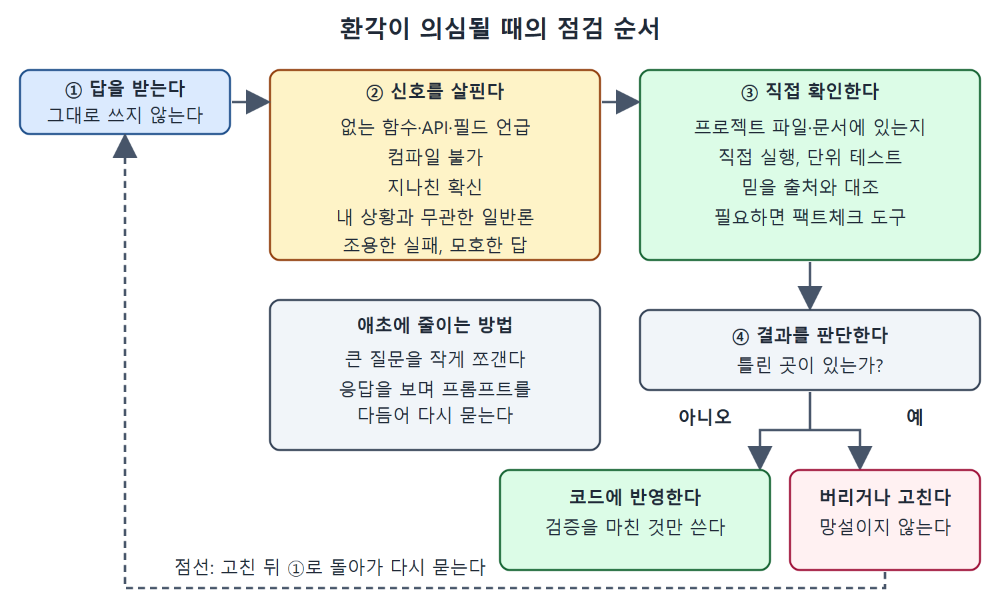

# 환각과 잘못된 답 다루기

문맥을 아무리 충분히 주어도 Copilot 뒤의 AI 모델은 환각(그럴듯하지만 틀린 답)을 내거나 잘못된 답을 줄 수 있다. 채팅에서 이를 가려내려면 비판적인 눈과 체계적인 점검 습관이 필요하다.

이 문서는 환각이 무엇인지, 어떤 신호로 알아차리는지, 의심될 때 어떻게 대처하고 애초에 어떻게 줄이는지를 정리한다.

---

## 1. 환각이란

환각은 Copilot이 그럴듯하게 들리지만 틀렸거나, 근거가 없거나, 완전히 지어낸 코드, 설명, 사실을 내놓는 현상이다. 첫눈에는 맞아 보여도 꼼꼼히 보면 실패하는 결과가 나오기도 한다. Copilot이 코드베이스에 대한 세부 내용을 지어내거나 요구사항을 잘못 해석해서 생기는 경우가 있다.

## 2. 환각의 신호

| 신호 | 설명 |
| --- | --- |
| 없는 대상을 언급 | 존재하지 않는 함수, API, 필드를 가리킨다 |
| 컴파일 불가 | 코드가 컴파일되지 않거나 프로젝트 내용과 맞지 않는다 |
| 과도한 확신 | 지나치게 자신 있는 설명을 내놓는다 |
| 지나치게 일반적 | 내 컨텍스트와 무관해 보이는 일반론이다 |
| 조용한 실패나 모호한 답 | Copilot이 근거 있는 답을 내놓느라 고전한다는 위험 신호다 |

표에서 아래쪽 두 항목은 겉으로는 티가 덜 나서 놓치기 쉽다. 답이 길고 자신만만해도 내 프로젝트의 실제 내용이 반영되지 않았다면 의심한다.

## 3. 확인하는 방법

답을 기술적으로 정확한지, 코드베이스와 일관되는지 신중히 살핀다. 모르는 함수나 필드를 제안했다면 프로젝트 파일이나 문서에서 실제로 있는지 확인한다. 생성된 코드를 시험하는 일이 결정적이다. 직접 실행하고, 단위 테스트를 추가하고, 기존 코드와 잘 맞물리는지 본다. Copilot으로 테스트하는 방법은 5장에서 다룬다.

## 4. 의심될 때의 대처

| 대처 | 내용 |
| --- | --- |
| 전부 검증 | AI가 만든 내용은 쓰기 전에 모두 검증한다 |
| 교차 확인 | 믿을 만한 문서나 신뢰할 출처와 Copilot의 제안을 대조한다 |
| 외부 검증 | 더 검증이 필요하면 외부 데이터베이스나 웹 출처에 비추어 확인해 주는 팩트체크 도구나 플러그인을 쓴다 |

## 5. 애초에 줄이는 전략

| 전략 | 이유 |
| --- | --- |
| 복잡한 프롬프트를 작고 다루기 쉬운 질문으로 쪼갠다 | 모호함을 줄이고 Copilot이 구체적인 작업에 집중하게 한다 |
| 응답을 보며 프롬프트를 반복해서 다듬는다 | 어긋난 부분을 바로잡는다 |
| 미심쩍은 출력은 망설이지 말고 버리거나 고친다 | 틀린 내용이 코드에 섞이지 않게 한다 |

그림은 답을 받은 뒤 신호를 살피고, 직접 확인하고, 틀린 곳이 있는지 판단해 반영하거나 버리고 고쳐 다시 묻는 순서를 보여 준다.

## 6. 태도

Copilot은 틀릴 리 없는 권위자가 아니라 도움이 되는 조수로 대한다. 꼼꼼한 검토, 테스트, 외부 검증을 함께 쓰면 환각이 미치는 영향을 줄이고 코드와 문서의 품질과 신뢰성을 지킬 수 있다.

 
 
 

[Learning GitHub Copilot](../)
