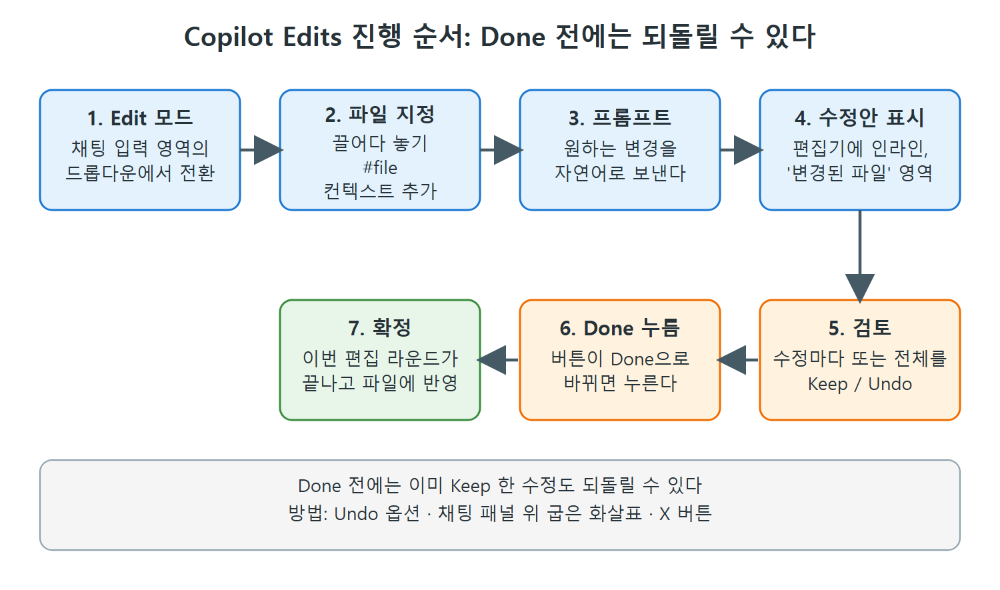

# Copilot Edits로 여러 파일 한꺼번에 고치기

Copilot Edits는 자연어 프롬프트 하나로 내가 고른 여러 파일을 한꺼번에 수정하는 기능이다. AI가 해 주는 일괄 편집이라고 생각하면 쉽다. 간단한 리팩터링부터 기존 코드 일부에 기능을 붙이는 큰 변경까지 쓸 수 있다.

이 문서는 Edit 모드로 전환하는 법, 대상 파일을 지정하는 세 가지 방법, 결과를 검토하고 되돌리는 방법, #codebase 변수를 쓰는 요령을 정리한다. 장 전체에서 쓰는 계산기 예제 코드도 여기서 소개한다.

---

## 1. Edit 모드로 전환

Copilot Edits는 Copilot Chat 안의 별도 모드다. 채팅 입력 영역 아래쪽에 기본값인 Ask 옆의 드롭다운 화살표를 눌러 나오는 메뉴에서 Edit 모드로 바꾼다.

Edit 모드에서는 수정할 파일을 고르고, 필요한 컨텍스트와 함께 프롬프트를 쓴다. 그러면 Copilot이 여러 파일에 걸친 수정안을 제안하고, 나는 받아들이거나 거절한다.

---

## 2. 장 전체에서 쓰는 예제: 계산기

원서는 이 장의 이후 내용 전부에 같은 프로젝트를 쓴다. 파이썬을 몰라도 이해하는 데 문제없다고 저자가 말한다. 프로젝트 구성은 다음과 같다.

| 파일 | 내용 |
|---|---|
| README.md | 계산기 소개. 덧셈, 뺄셈, 곱셈, 나눗셈을 지원하고, `test_calculator.py`로 단위 테스트를 돌려 확인하라는 안내 |
| calculator.py | `add`, `subtract`, `multiply`, `divide` 함수. `divide`는 b가 0이면 ValueError를 발생시킨다 |
| test_calculator.py | unittest 기반 테스트. 네 함수에 대한 기본 케이스와, 0으로 나눌 때 ValueError가 나는지 확인하는 테스트 |
| .gitignore, LICENSE | 표준 파일 |

핵심만 보면 나눗셈 함수는 이렇게 생겼다.

```python
def divide(a, b):
    if b == 0:
        raise ValueError("Cannot divide by zero")
    return a / b
```

이 코드를 Edit 모드로 개선해 보자. 한 번에 세 가지 작업을 프롬프트로 준다.

1. `divide` 함수가 0으로 나누기를 더 부드럽게 처리하도록 리팩터링한다.
2. calculator.py의 모든 함수에 타입 힌트를 추가한다.
3. test_calculator.py에 경계 사례(edge case)용 단위 테스트를 더 쓴다.

---

## 3. 대상 파일 지정하기

Edits를 시작하려면 Copilot이 작업할 파일을 컨텍스트에 넣어야 한다. 이 예에서는 두 개의 파이썬 파일이면 된다. 방법은 세 가지다.

| 방법 | 사용법 | 특징 |
|---|---|---|
| 끌어다 놓기 | 파일 목록에서 파일을 골라 채팅 입력 영역으로 드래그 | 가장 쉬운 방법 |
| `#file` 채팅 변수 | 프롬프트에 `#file`로 파일을 붙임 | 프롬프트 안에서 바로 지정 |
| 컨텍스트 추가(Add Context) 컨트롤 | 목록에서 파일 선택 | 메뉴로 고르고 싶을 때 |

어느 방법이든 결과는 같다. 입력 영역에 파일이 컨텍스트로 붙고, 그 아래에 프롬프트가 놓인 상태가 된다.

---

## 4. 결과 검토: Keep, Undo, Done

프롬프트를 보내면 Copilot이 선택된 파일에 대해 처리하고 필요한 수정안을 낸다. 수정안은 편집기에 인라인으로 표시된다. 채팅 영역에는 새로 "변경된 파일(files changed)" 영역이 생기는데, 여기서 두 가지 방식으로 검토할 수 있다.

- 수정마다 하나씩 보고 Keep(유지) 또는 Undo(되돌리기)를 고른다.
- "변경된 파일" 영역에서 전체 수정을 한 번에 Keep 또는 Undo 한다.

대기 중인 수정이 있는 파일은 파일 목록과, 편집기에 열려 있으면 그 탭에 네모 안에 점이 있는 표시가 붙는다. 무엇을 유지하고 무엇을 되돌릴지 정리하면 영역의 Keep/Undo 버튼이 Done 버튼으로 바뀐다. Done을 누르면 이번 편집 라운드가 끝난다.

중요한 점은 Done을 누르기 전에는 마음을 바꿀 수 있다는 것이다. 이미 일부 또는 전체를 Keep 했더라도 되돌릴 수 있다.

| 되돌리는 방법 | 위치 |
|---|---|
| Undo 옵션 | 입력 영역 위 "변경된 파일" 영역 |
| 왼쪽으로 굽은 화살표 | 채팅 패널 맨 위 |
| X 버튼 | 채팅 대화 위쪽에 마우스를 올리면 나타남 |



그림은 Edit 모드로 들어가서 변경이 확정될 때까지의 순서를 보여 준다. 5번 검토까지는 언제든 되돌릴 수 있고, 6번 Done을 눌러야 변경이 파일에 확정된다.

변경을 파일에 확정하려면 Done을 누른다. 예제에서는 이렇게 됐다.

- calculator.py에 타입 힌트(`float` 인자와 반환)가 들어갔고, `typing`의 `Optional`을 가져왔다.
- `divide`는 b가 0이면 예외 대신 `None`을 반환하고, 반환형은 `Optional[float]`이 됐다.
- 테스트에는 0으로 나누기가 `None`이 되는지, 그리고 덧셈, 뺄셈, 곱셈, 나눗셈의 음수 케이스를 확인하는 테스트가 추가됐다.

```python
def divide(a: float, b: float) -> Optional[float]:
    if b == 0:
        return None
    return a / b
```

여기서 눈여겨볼 점은 "부드럽게 처리"라는 모호한 지시를 Copilot이 예외 대신 `None` 반환으로 해석했다는 것이다. 지시가 모호하면 해석도 Copilot 몫이 되므로, 결과를 직접 검토하는 단계가 중요하다.

---

## 5. #codebase로 파일 고르기를 맡기기

파일을 하나씩 고르는 대신 프롬프트에 `#codebase` 채팅 변수(3장에서 다룬 것)를 넣으면 Copilot이 수정할 적절한 파일을 스스로 고르게 시도한다. 예를 들어 이렇게 쓴다.

```
Add functional documentation in #codebase
```

이 프롬프트에서 Copilot은 문서를 추가할 대상으로 README.md를 골랐다. 별도의 문서 파일을 만드는 편이 나을 수도 있지만, 요점은 가능한 파일 중 가장 적합한 것을 골라냈다는 것이다.

---

## 6. 잘 쓰는 요령

예제는 단순하지만 같은 방식으로 훨씬 큰 규모, 복잡한 변경에도 쓸 수 있다. 원리는 같다.

- 바꿀 파일을 구체적으로 지정할수록 좋다.
- 프롬프트가 지시적일수록 좋다.
- AI 제안은 기대와 다르거나 틀릴 수 있다. 그래서 편집기에서 제안을 검토하는 단계가 매우 중요하다.
- 기대한 결과가 나오지 않으면 프롬프트를 고쳐서 다시 시도한다.

Edits의 한계도 분명하다. 어떤 내용을 고쳐야 하는지 내가 모를 때가 있고, 변경을 검토용으로 올려놓기까지 수작업이 많이 드는 것도 부담이다. 이런 이유로 Copilot에는 더 자율적으로 단순하거나 복잡한 변경을 맡길 수 있는 또 다른 모드가 있다. 다음 문서의 에이전트 모드다.

<br>
<br>
<br>

[Learning GitHub Copilot](../)
