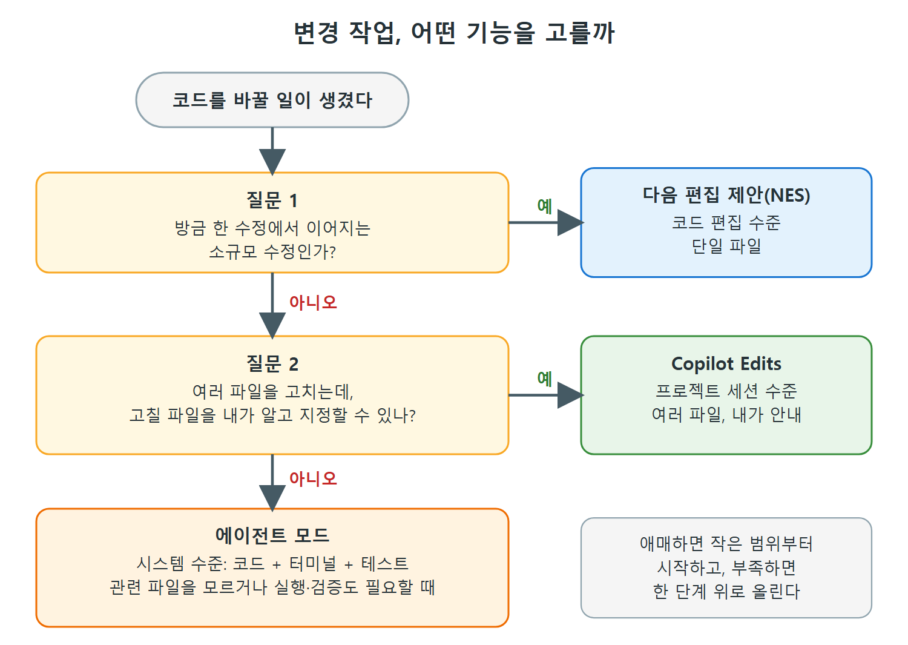

# NES, Edits, 에이전트 모드 비교와 선택

앞의 세 문서에서 변경을 만드는 세 가지 방법을 봤다. 다음 편집 제안(NES), Copilot Edits, 에이전트 모드다. 변경할 일이 한정돼 있을 때 어느 것을 쓸지 헷갈리기 쉬워서, 원서는 비교표를 한 장 준다.

이 문서는 그 표를 한국어로 다시 구성하고, 범위(scope) 기준으로 세 기능을 구분하는 법과 선택 기준을 정리한다.

---

## 1. 한눈에 비교

원서 Table 4-1(고급 코딩 기능 비교)의 내용을 풀어 쓰면 다음과 같다.

| 기능 | 설명 | 언제 쓰나 |
|---|---|---|
| 다음 편집 제안(NES) | 수동으로 고친 뒤 이어질 코드 수정을 예측한다 | 단순한 리팩터링, 기존 코드 편집, 소규모 수정 중 일관성 유지 |
| Copilot Edits | 자연어 프롬프트와 반복 검토로 여러 파일을 편집하는 세션 | 여러 파일을 함께 맞춰 고칠 때, 중간 규모 리팩터링 작업 |
| Copilot 에이전트 모드 | 스스로 잘못을 고쳐 가며 여러 단계의 코딩 작업을 실행하는 자율 AI 에이전트 | 복잡한 프로젝트 작업, 끝에서 끝까지 기능 구현, 이슈 해결의 첫 시도, 코드용 인터페이스 추가 |

읽는 법: 오른쪽으로 갈수록 맡기는 범위와 자율성이 커진다. 반대로 말하면 왼쪽일수록 내가 직접 통제하는 정도가 크다.

---

## 2. 범위로 구분하기

원서 결론은 범위 관점의 간단한 구분을 준다.

| 기능 | 작동 수준 | 대상 |
|---|---|---|
| NES | 코드 편집 수준 | 단일 파일 |
| Copilot Edits | 프로젝트 세션 수준 | 여러 파일 |
| 에이전트 모드 | 시스템 수준 | 코드 + 터미널 + 테스트 |

---

## 3. 상황별 선택

- 빠른 인라인 수정에는 NES가 즉각적인 제안을 준다.
- 내가 안내하는 여러 파일 변경에는 Copilot Edits가 좋다.
- 코드 수정과 생성, 검증, 실행을 포함한 개발 전 과정 작업은 에이전트 모드가 맡는다.

그림은 위 범위 구분을 질문 두 개로 줄여 선택 순서로 만든 것이다. 작은 범위의 기능부터 확인하고, 해당하지 않으면 한 단계 위로 올라간다.

| 이런 상황이라면 | 고를 기능 | 이유 |
|---|---|---|
| 클래스에 필드를 추가했는데 다른 곳도 고쳐야 한다 | NES | 방금 수정에서 이어지는 다음 자리를 바로 짚어 준다 |
| 어느 파일을 고칠지 내가 이미 알고, 여러 파일에 같은 방향의 수정을 하고 싶다 | Copilot Edits | 파일을 지정하고 검토하며 통제하기 좋다 |
| 어떤 파일이 관련됐는지 모르거나, 명령 실행과 테스트까지 필요하다 | 에이전트 모드 | 컨텍스트 파악, 명령 실행, 점검 반복을 알아서 한다 |
| 화면 이미지를 보고 같은 모양의 UI를 만들고 싶다 | 에이전트 모드 + Copilot Vision | 계산기 웹 인터페이스 예제가 이 조합이었다 |

---

## 4. 공통 안전장치

세 기능 모두 개발자의 통제권이 유지된다. Keep/Undo 메커니즘이 있고 변경을 되돌릴 수 있다. NES는 Tab과 Escape로 하나씩 처리하고, Edits와 에이전트 모드는 Done을 누르기 전까지 되돌릴 수 있다.

| 비교 항목 | NES | Copilot Edits | 에이전트 모드 |
|---|---|---|---|
| 파일 지정 | 열려 있는 파일 중심 | 내가 지정(또는 `#codebase`) | Copilot이 스스로 판단 |
| 수락 방식 | Tab / Escape | Keep / Undo / Done | Keep / Undo / Done |
| 터미널 명령 | 원서에 언급 없음 | 원서에 언급 없음 | 제안 또는 실행 |
| 소요 시간 | 즉각적인 제안 | 에이전트 모드보다 짧음 | Edit나 Ask보다 보통 더 걸림 |

표의 "소요 시간"과 "터미널 명령"은 이 장 본문의 서술을 정리한 것이다. 선택이 애매하면 작은 범위부터 시작해서, 부족하다고 느낄 때 다음 단계로 올라가면 된다.

 
 
 

[Learning GitHub Copilot](../)
