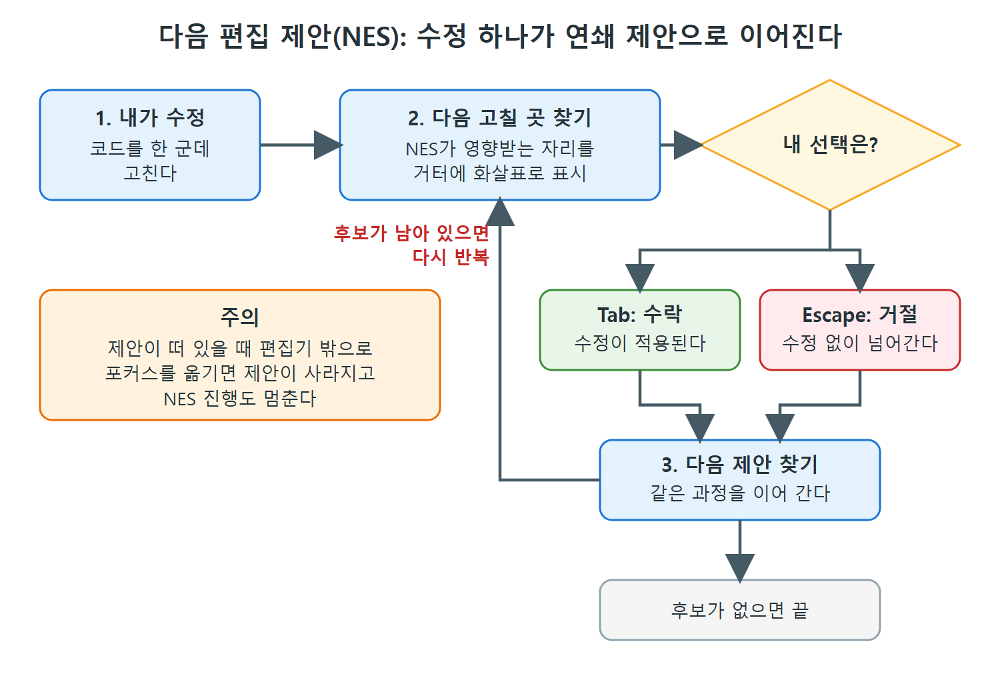

# 다음 편집 제안과 이름 바꾸기

코드를 리팩터링하다 보면 같은 변경을 해야 할 자리를 찾느라 파일을 이리저리 뒤지게 된다. 다음 편집 제안(Next Edit Suggestions, NES)은 방금 한 수정을 보고 "다음으로 고칠 곳은 여기"라고 미리 짚어 주는 기능이다.

이 문서는 NES를 켜는 방법, 제안이 화면에 뜨는 방식, 받아들이거나 거절하는 키, 한계, 그리고 함께 쓰기 좋은 F2 이름 바꾸기 제안까지 정리한다.

---

## 1. NES가 하는 일

NES는 지금 진행 중인 수정, 오타, 논리 오류를 바탕으로 다음 편집을 예측해서 제안한다. 제안의 크기는 기호 하나부터 여러 줄까지 다양하다. 리팩터링 상황에서는 내가 한 수정을 분석해 논리상 바뀌어야 할 다음 자리를 찾고, 그다음 자리, 또 그다음 자리로 이어 간다.

기존 인라인 제안이 "커서가 있는 곳에서 이어 쓸 코드"를 내놓는다면, NES는 "커서에서 떨어진 다른 곳의 수정"까지 내다본다는 점이 다르다.

| 구분 | 인라인 제안 | 다음 편집 제안(NES) |
|---|---|---|
| 기준 | 커서 위치 앞뒤의 코드 | 방금 한 수정과 그 영향 범위 |
| 제안 위치 | 커서가 있는 곳 | 코드의 다른 위치일 수 있음 |
| 쓰임새 | 새 코드 작성 | 리팩터링, 오타·논리 오류 교정 |

표에서 보듯 NES는 "쓰는 중"이 아니라 "고치는 중"에 쓰는 도구다.

---

## 2. 켜는 방법

책이 쓰인 시점 기준으로 VS Code에서 켜는 방법은 두 가지다.

- 상태 표시줄의 Copilot 컨트롤을 눌러 나오는 팝업 대화상자에서 켠다.
- VS Code 설정에 직접 아래 키를 넣는다.

```
github.copilot.nextEditSuggestions.enabled=true
```

켜 두면, 편집을 하고 나서 NES가 코드를 살펴보고 함께 바뀌어야 할 부분을 예상한다. 제안이 있으면 편집기의 거터(gutter)에 화살표가 나타난다. 거터는 줄 번호 왼쪽의 빈 띠 모양 공간이다.

---

## 3. 예제로 보는 흐름

예제는 2차원 점을 나타내는 파이썬 클래스 `Point`다. `__init__`에서 x, y를 저장하고, `distance` 메서드로 다른 점까지의 거리를 계산하며, 아래에 사용 예가 붙어 있다.

이 클래스를 3차원 점으로 바꾸려고 `__init__`에 z 값을 추가했다고 하자. NES가 켜져 있으면 Copilot은 새 z 좌표를 처리하려면 어디를 더 고쳐야 하는지 찾는다. 이 경우 `__init__` 안에 z를 저장하는 대입문이 필요하다고 판단하고, 코드 수정안을 만들어 거터 화살표로 표시한다.

진행 순서는 다음과 같다.

1. 코드를 한 군데 수정한다.
2. NES가 다음에 고칠 곳을 찾아 거터에 화살표를 띄운다.
3. Tab으로 받아들이거나 Escape로 거절한다.
4. 처리가 끝나면 NES가 그다음 제안을 찾아 같은 과정을 반복한다. 고칠 만한 후보가 남아 있는 동안 계속된다.



그림은 위 네 단계를 하나의 순환으로 그린 것이다. 수락이든 거절이든 다음 제안으로 넘어가며, 고칠 후보가 없어질 때까지 이어진다. 제안이 떠 있을 때 편집기 밖으로 포커스를 옮기면 흐름이 멈춘다.

화살표에 마우스를 올리면 NES 옵션이 담긴 안내 팝업이 뜬다. 대부분은 이 옵션이 필요 없고 Tab과 Escape만 쓰면 충분하다.

| 동작 | 키 | 결과 |
|---|---|---|
| 제안 수락 | Tab | 제안한 수정이 코드에 적용되고 다음 제안으로 넘어간다 |
| 제안 거절 | Escape | 수정 없이 다음 제안으로 넘어간다 |
| 옵션 보기 | 거터 화살표에 마우스 올리기 | 확장 옵션 팝업이 열린다 |

수락이든 거절이든 처리를 하면 흐름이 이어지므로, 연달아 Tab만 눌러도 관련 수정을 따라갈 수 있다. 다만 눌러 보기 전에 무엇이 바뀌는지 읽는 습관은 필요하다.

> 주의: 대기 중인 NES 제안(거터에 화살표가 보이는 상태)이 있을 때 편집기에서 다른 곳으로 포커스를 옮기면 그 제안이 사라지고 NES 진행도 멈춘다. 흐름을 이어 가려면 편집기에 포커스를 둔 채 처리해야 한다.

---

## 4. 이름 바꾸기 제안 (F2)

리팩터링 이야기가 나온 김에, Copilot은 이름 바꾸기도 도와준다. 기호를 선택하고 F2를 누르면 Copilot이 대체 이름 후보를 담은 대화상자를 띄운다. 책에서는 앞의 `Point` 클래스로 예를 들었다.

새 이름을 고르면 Copilot이 선택한 기호에 적용한다. 다른 메서드나 함수에 같은 이름이 남아 있으면 NES가 그 자리를 잡아 줄 수 있다. 즉 F2로 이름을 바꾸고, 나머지 흔적은 NES가 따라가며 정리하는 조합이다.

---

## 5. 오타와 논리 오류도 잡는다

NES는 의도한 리팩터링뿐 아니라 따로 생긴 문제도 짚는다. 예를 들어 `distance` 함수를 직접 고치다가 제곱(지수 연산자) 자리에 곱셈 연산자를 잘못 썼다고 하자. NES가 켜져 있으면 Copilot이 이를 알아채고 바로잡는 수정을 제안한다.

| 상황 | NES의 반응 |
|---|---|
| 의도한 리팩터링(예: 2D에서 3D로 확장) | 이어서 고칠 다음 자리를 연속해서 제안 |
| 오타 | 바른 표기로 고치는 제안 |
| 논리 오류(곱셈과 제곱 혼동 등) | 올바른 연산으로 고치는 제안 |
| 심볼 이름 변경 | 다른 함수에 남은 이전 이름을 찾는 제안 |

---

## 6. 한계: 여러 파일은 열려 있어야 한다

NES는 여러 파일에 걸친 변경도 잡을 수 있지만, 책에서는 편집기에서 열려 있는 파일에 한정되는 것으로 보인다고 했다. 한꺼번에 여러 파일을 고치거나 여러 파일에 걸친 기능을 자동으로 추가해야 한다면, 다음 문서에서 다룰 Copilot Edits를 쓰는 편이 낫다.

<br>
<br>
<br>

[Learning GitHub Copilot](../)
