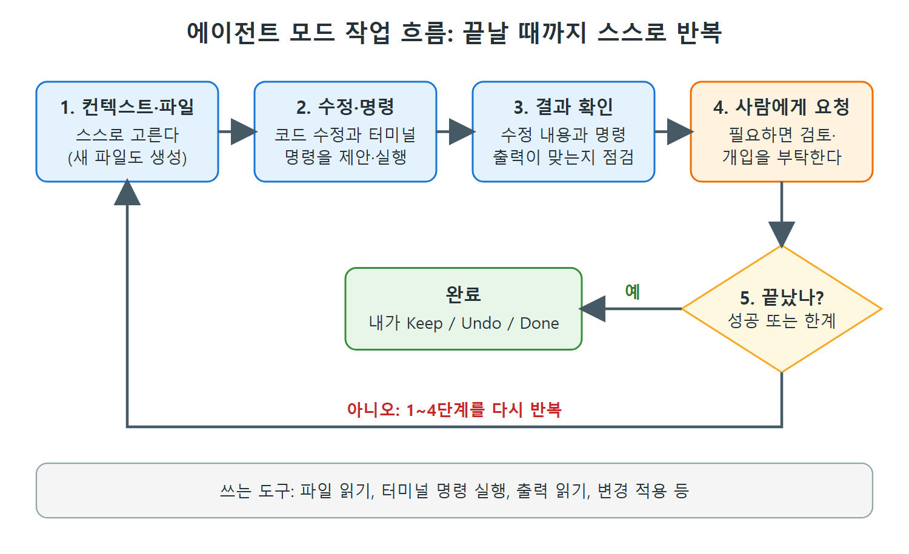

# 에이전트 모드로 알아서 고치게 하기

에이전트 모드는 Copilot에게 작업을 맡기면 필요한 파일을 스스로 찾고, 코드를 고치고, 터미널 명령까지 돌려 보며 끝까지 밀고 가는 모드다. Edits가 내가 파일을 골라 주는 방식이라면, 에이전트 모드는 "무엇을 고쳐야 하는지"부터 Copilot이 판단한다.

이 문서는 에이전트가 무엇인지, 작업 흐름은 어떤지, 도구 아이콘과 MCP는 무엇인지, 계산기 예제로 직접 돌려 보면 어떤 모습인지, 그리고 시간과 요금제 측면의 주의점을 정리한다.

---

## 1. AI 에이전트란

AI 용어로 에이전트는 환경에서 입력을 모으고, 판단을 내리고, 도구를 써서 목표를 향해 스스로 행동하는 소프트웨어다. 기반이 되는 AI 모델이 두뇌 역할을 해서, 자연어나 코드를 해석하고 계획과 결정을 만든다. GitHub Copilot의 에이전트 모드는 말하자면 나만의 코딩 에이전트다.

---

## 2. 작업 흐름

에이전트 모드에서 Copilot은 프롬프트 하나 이상을 작업으로 받아, 작업마다 아래 흐름으로 자율적으로 움직인다.

| 단계 | 하는 일 | 비고 |
|---|---|---|
| 1 | 필요한 컨텍스트와 수정할 파일을 스스로 정한다 | 필요하면 새 파일도 만든다 |
| 2 | 코드 수정과 터미널 명령을 제안한다 | 예: 의존성 설치, 테스트 실행 명령을 제안하거나 직접 실행 |
| 3 | 코드 수정과 명령 출력이 맞는지 확인한다 | 자체 점검 |
| 4 | 필요하면 사람의 검토나 개입을 요청한다 | |
| 5 | 작업이 성공했다고 판단하거나, 더는 혼자 못 갈 때까지 1~4를 반복한다 | 반복이 핵심 |

그림은 위 표의 다섯 단계를 순환 구조로 그린 것이다. 5단계에서 끝났다고 판단하면 사람이 Keep/Undo/Done으로 검토하고, 아니면 1~4단계를 다시 돈다.

에이전트는 GitHub가 정의한 도구 모음을 쓴다. 파일 읽기, 터미널 명령 실행, 출력 읽기, 제안한 변경 적용 등이 그 예이고, 도구 목록은 새 도구가 생기면 갱신된다.

에이전트가 컨텍스트를 대체로 잘 찾지만, 특정 파일을 직접 지정하고 싶다면 평소 방법(`#file` 채팅 변수, 컨텍스트 추가 컨트롤 등)을 그대로 쓸 수 있다.

스스로 판단하고, 작업이 끝날 때까지 반복한다는 점이 에이전트 모드의 핵심이다. 내가 파일을 고르고 지시한 범위 안에서만 고치는 Copilot Edits와 가장 크게 다른 부분이다.

---

## 3. 에이전트 모드로 전환

Edits로 들어갈 때와 같은 방법이다. 채팅 패널의 텍스트 입력 영역에서 아래쪽 화살표를 누르고 목록에서 Agent를 고른다.

### 도구 아이콘과 MCP

에이전트 모드에서는 입력 영역 왼쪽 위에 도구 모양 아이콘이 보인다. 이를 누르면 확장, 일부 기본 제공 도구, 그리고 Model Context Protocol(MCP) 인터페이스를 다룰 수 있다.

MCP는 AI 애플리케이션과 연결하기 위한 개방형 표준이다. USB-C 포트처럼, AI 모델이 외부 도구, 데이터 소스, 여러 환경에 접근하는 보편적 방법을 제공한다. Copilot Chat에 또 하나의 확장 수단이 되는 셈이다. 책은 MCP의 자세한 설명은 범위 밖이라며 Copilot 문서를 참고하라고 한다.

---

## 4. 계산기 예제로 해 보기

에이전트 모드는 Edits보다 강력하고 자율적이라서 더 큰 변경을 요청할 수 있다. 여기서는 소개 차원에서 비교적 간단한 요청 세 가지를 준다.

| 번호 | 프롬프트 내용 |
|---|---|
| 1 | calculator.py의 모든 함수에 로깅 추가 |
| 2 | 계산기 애플리케이션용 CLI를 만들고 기대대로 동작하는지 검증 |
| 3 | 모든 함수에 독스트링(docstring)으로 문서 생성 |

Edits 때와 다른 점이 있다. 파일을 컨텍스트로 지정하지 않았다. 에이전트 모드에서는 Copilot이 어떤 작업이 필요하고 어떤 파일을 바꿔야 하는지 스스로 알아낸다. 프롬프트에 따라 코드 수정을 검토용으로 적용하고, 터미널 명령을 제안하고, 새 파일도 만든다. 진행하다 문제나 바라는 변경이 보이면 프롬프트를 더 주면 되고, Copilot이 반복해서 해결한다.

### 진행 과정

1. 프롬프트를 제출하면 Copilot이 분석해서 계획을 세운다.
2. 계획과 변경 대상이 정해지면 기존 코드에 인라인으로 수정을 적용한다.
3. Edit 모드처럼 끝나면 수정안이 편집기에 인라인으로 표시된다. 수정마다 Keep/Undo 하거나, "변경된 파일" 영역에서 전체를 한 번에 Keep/Undo 한다.
4. 대기 중인 파일에는 네모 안에 점이 있는 표시가 목록과 편집기 탭에 붙는다.
5. 검토를 마치면 Keep/Undo 버튼이 Done으로 바뀌고, Done을 누르면 이번 라운드가 끝나며 변경이 파일에 확정된다.

Done을 누르기 전에는 Edits와 똑같이 되돌릴 수 있다(Undo 옵션, 채팅 패널 위의 왼쪽 굽은 화살표, 대화 위에 마우스를 올려 나오는 X). 원하는 만큼 반복해도 된다.

> 알아 둘 점: 아직 검토하지 않은 제안 변경도 코드를 실행할 때는 반영된다. 눈에 잘 띄지 않지만, 검토 전 상태의 코드가 실행된다는 뜻이다.

> 시간: 에이전트 모드는 많은 작업을 하고 코드가 괜찮게 동작하거나 더 못 갈 때까지 반복하므로, Edit나 Ask 모드보다 보통 시간이 더 걸리고 때로는 훨씬 더 걸린다.

### 터미널 명령 검증

예제에서는 에이전트에게 CLI가 제대로 동작하는지 검증하라고 했기 때문에, 터미널에서 돌릴 명령을 제안했다. 각 명령을 실행하려면 터미널로 복사하거나 보내서 Enter를 누르기만 하면 됐다. 에이전트는 대부분 출력이 기대와 같음을 확인해 CLI가 정상이라고 결론을 냈다. 다만 add 함수의 출력은 어떤 이유에선지 파싱하지 못했는데, 실제로는 다른 것들과 함께 잘 동작하고 있었다.

이는 에이전트의 검증도 완벽하지 않다는 예다. 자체 판단에 "못 읽었다"가 섞여 있으면 사람이 눈으로 확인해야 한다.

---

## 5. 요금제와 확장성

| 주제 | 내용 |
|---|---|
| Copilot Free 요금제 | 월 상호작용 횟수가 제한된다. 에이전트 모드는 상호작용을 많이 쓰므로 사용 패턴에 따라 월 할당량의 상당 부분을 소모할 수 있다 |
| 앞으로의 방향 | 에이전트 기능은 Copilot과 GitHub 전반으로 더 널리 퍼질 것으로 예상된다 |

에이전트 모드는 적절한 프롬프트와 검토가 있다면 변경 작업의 여러 영역에서 도움이 된다. 다음 문서에서는 에이전트 모드와 이미지 해석 기능을 함께 쓰는 예를 본다.

 
 
 

[Learning GitHub Copilot](../)
