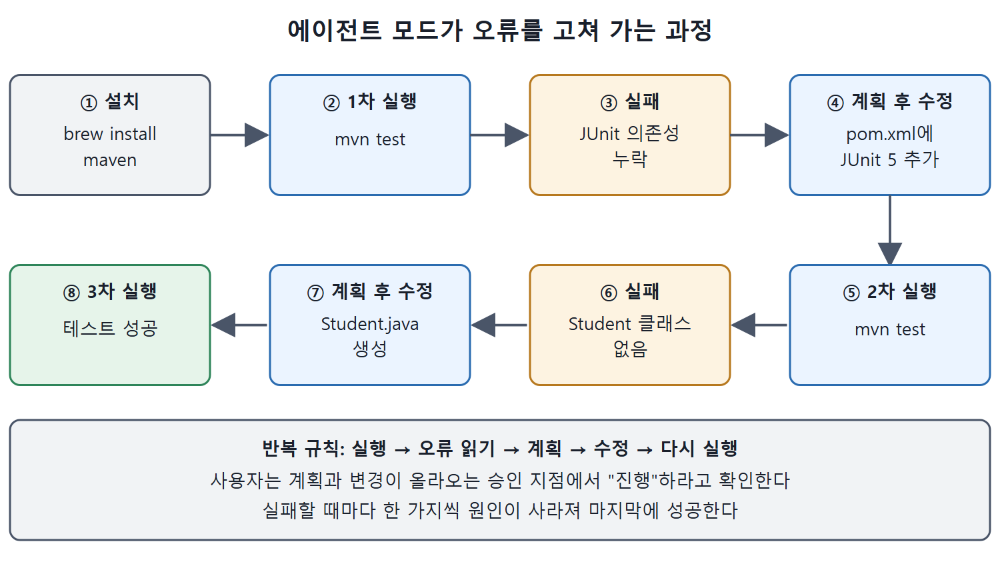

# 에이전트 모드로 테스트 돌리기

TDD 예제에서 테스트 클래스는 만들어졌지만 구현 클래스가 없어 테스트가 실패한 상태다. 이제 Copilot의 에이전트 모드(agent mode)에 의존성 설치, 테스트 실행, 오류 수정, 구현 클래스 생성을 한꺼번에 맡긴다. 에이전트는 실행하다 난 오류를 스스로 읽고 다음 할 일을 계획해 고쳐 나간다.

이 문서는 그 과정을 순서대로 따라가고, 에이전트가 무엇을 바꿨는지 표로 정리한다. 마지막에는 프롬프트 반복의 중요성을 짚는다.

---

## 1. 모드 전환과 프롬프트

채팅 화면에서 에이전트 모드로 바꾼 뒤, Copilot이 해 주었으면 하는 일을 프롬프트로 적는다.

```text
Install any needed dependencies for testing with mvn and then run
tests
```

필수는 아니지만 코드가 에디터에 열려 있다면 그것을 핵심 참조로 지정할 수 있다.

```text
Referencing #editor, create a student class.
```

## 2. 에이전트가 한 일 순서대로

| 순서 | 에이전트의 행동 | 결과 |
|---|---|---|
| 1 | Maven 설치 명령 `brew install maven`을 제안하고, 진행하라고 하면 터미널에서 실행 | Maven 설치 |
| 2 | `mvn test` 실행 | 컴파일 실패 |
| 3 | 오류 원인을 분석하고 다음 계획(I will now)을 적음 | JUnit 의존성 누락 등 파악 |
| 4 | pom.xml에 JUnit 5 의존성 추가 후 재실행 | 이번엔 `Student` 클래스가 없어서 실패 |
| 5 | `Student` 클래스의 위치와 컴파일 상태를 확인하겠다고 계획 | 올바른 내용과 위치로 Student.java 생성 |
| 6 | 테스트 다시 실행 | 성공 |

처음 `mvn test` 실패에서 Copilot이 짚은 문제는 세 가지였다.

| 문제 | 원인 |
|---|---|
| JUnit 의존성 누락 | `org.junit.jupiter.api` 패키지를 찾지 못한다. pom.xml에 JUnit 5(Jupiter) 의존성이 없다 |
| Student 클래스를 못 찾음 | 패키지 구조가 틀렸거나 컴파일되지 않았을 수 있다 |
| 애노테이션 인식 불가 | `@BeforeEach`, `@Test`가 인식되지 않는데 역시 JUnit 의존성과 관련 있다 |

에이전트는 JUnit 5 의존성 추가, Student 클래스가 제대로 컴파일되고 접근 가능한지 확인, 문제 해결 후 테스트 재실행을 계획으로 내놓았다. 사용자가 진행하라고 하면 이를 실행한다.

pom.xml에 추가된 의존성은 다음과 같다.

```xml
<dependency>
    <groupId>org.junit.jupiter</groupId>
    <artifactId>junit-jupiter</artifactId>
    <version>5.10.0</version>
    <scope>test</scope>
</dependency>
```

이후 테스트는 다시 실패한다. 이번에는 `Student` 구현 클래스가 아직 없어서 테스트 실행 중에 찾지 못했기 때문이다. 에이전트는 `Student` 클래스의 위치와 컴파일 상태를 확인하고 다시 돌리겠다고 계획했고, 사용자가 검토하고 진행하라고 하자 올바른 내용과 위치로 새 `Student.java`를 만들고 테스트를 다시 실행했다. 이번에는 필요한 변경이 모두 끝나서 성공했다.



에이전트가 설치 후 실행, 실패 분석, 수정, 재실행을 되풀이하며 JUnit 의존성 누락과 Student 클래스 부재를 차례로 해결해 3차 실행에서 성공하는 과정을 보여 준다.

## 3. 성공 화면에서 읽을 것

성공했을 때 화면은 네 부분으로 나뉘어 있었다.

| 위치 | 보이는 것 |
|---|---|
| 왼쪽 위 | 승인을 기다리는 새 내용의 `Student.java` |
| 왼쪽 아래 | 빌드와 테스트 실행이 성공한 터미널 출력 |
| 오른쪽 위 | 테스트가 모두 통과했고, Student 클래스가 구현되었고, 프로젝트가 기대대로 동작한다는 에이전트의 판단 |
| 오른쪽 아래 | 에이전트가 pom.xml과 Student.java를 고쳤다는 "변경된 파일" 영역 |

에이전트 없이도 여러 번 나눠 직접 개별 작업을 하면 같은 결과를 얻을 수 있다. 하지만 에이전트의 능력을 쓸 수 있다면 시간과 노력을 아낄 수 있다.

## 4. 그다음 할 일

변경 사항을 검토하고, 수정된 파일을 작업 공간에 저장하고, 필요하면 다른 기능을 더하면 된다. 테스트 흐름의 다단계 작업은 에이전트를 쓰든 안 쓰든 이렇게 단계별로 접근할 수 있다.

| 접근 | 특징 |
|---|---|
| 에이전트 모드 | 오류를 읽고 스스로 계획해 고치며, 승인 지점에서만 사용자가 확인한다 |
| 단계별 수동 진행 | 의존성 설치, 구현, 테스트 실행을 하나씩 나눠 요청한다 |

늘 그렇듯 프롬프트, 작업 공간 파일, 에디터 등으로 컨텍스트와 방향을 더 많이 줄수록 좋은 내용과 제안이 나올 가능성이 커진다. 기대한 결과가 아니라면 원하는 결과가 나올 때까지 프롬프트나 질문을 바꿔 반복하는 것을 두려워하지 않는다.

<br>
<br>
<br>

[Learning GitHub Copilot](../)
