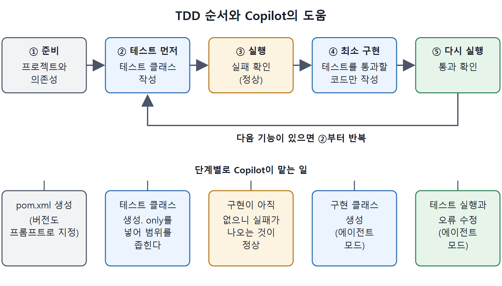

# 테스트 먼저 쓰기 TDD

테스트 주도 개발(TDD)은 실제 코드를 쓰기 전에 테스트 케이스부터 쓰는 개발 방식이다. 많은 프로젝트와 팀에서 모범 사례이거나 필수 요건으로 여긴다. Copilot으로 TDD용 테스트를 먼저 만들고, 그 테스트를 통과하는 구현을 뒤에 만들 수 있다.

이 문서는 대학 학생 기록을 관리하는 코드의 테스트 클래스를 만드는 예제를 따라간다. 테스트 프레임워크로는 Mockito를 쓴다. pom.xml 만들기, 프롬프트를 좁히는 요령, 첫 테스트가 실패하는 상태까지를 다룬다. 이어지는 구현 단계는 에이전트 모드 문서에서 이어진다.

TDD를 처음 접하거나 더 알고 싶다면 웹에 자료가 많다. 비교적 짧지만 알찬 글로는 testdriven.io 사이트의 글이 소개되어 있다.

---

## 1. TDD 흐름과 Copilot의 역할

| 단계 | 할 일 | Copilot의 도움 |
|---|---|---|
| 1 | 프로젝트와 의존성 준비 | pom.xml 생성 |
| 2 | 테스트 먼저 작성 | 테스트 클래스 생성 |
| 3 | 테스트 실행해 실패 확인 | 구현이 없어서 실패하는 것이 정상 |
| 4 | 테스트를 통과시킬 최소 구현 작성 | 구현 클래스 생성(에이전트 모드) |
| 5 | 다시 실행해 통과 확인 | 테스트 실행과 오류 수정 |

TDD의 순서는 "실패하는 테스트, 최소 구현, 통과"다. Copilot은 두 번째와 네 번째 단계의 코드를 모두 초안으로 만들어 준다.



준비, 테스트 작성, 실패 확인, 최소 구현, 통과 확인의 순서로 진행하고, 다음 기능이 있으면 테스트 작성 단계로 돌아가 반복하는 모습을 보여 준다.

## 2. Mockito란

Mockito는 Java 애플리케이션에서 의존성을 관리하고, 다른 구성 요소와의 외부 상호작용을 그 구성 요소의 구현이나 존재 없이 흉내 내게 해 주는 프레임워크다. 이런 흉내 내기를 목킹(mocking)이라고 한다. 앞서 통합 테스트에서 Copilot이 목을 쓰게 하는 방법을 보았다.

## 3. pom.xml 만들기

빈 프로젝트 `students`에서 시작한다. Copilot에게 Java 프로젝트의 pom.xml을 만들게 하고 원하는 의존성 버전을 지정한다.

```text
add a pom.xml file with a mockito dependency version 3.3.3, and
compiler source and target version 1.8
```

이 프롬프트를 보내면 Copilot이 의도를 파악해서 필요하면 구조를 만드는 `/new` 단축 명령을 실행한다. 그다음 pom.xml 코드를 만들고, 내용을 볼 수 있는 링크와 파일을 만드는 버튼을 준다.

## 4. 테스트 클래스 요청하기

테스트 코드는 출력이 많고 별도 파일로 두고 싶을 수 있으므로, 별도의 채팅 화면에서 진행한다. Mockito 의존성을 알도록 pom.xml 내용을 참조하게 한다.

```text
Referencing #file:pom.xml, create a StudentTest class for
students enrolled at a university and add tests
```

대개 `#file:pom.xml`을 따로 적지 않아도 된다. 파일을 저장해서 작업 공간에 넣었다면 Copilot이 기본적으로 `@workspace` 에이전트를 쓰고, 거기서 Mockito 정보를 집어 온다. 자동으로 만들어지는 색인도 그 파일을 안다. 다만 에디터에서 만든 파일은 먼저 저장하고 작업 공간에 추가해 두어야 Copilot이 컨텍스트로 자동으로 가져온다. 이것을 습관으로 삼는 것이 좋다.

## 5. 첫 결과는 과했다

Copilot은 `University`를 목으로 만들고 `Student`를 쓰는 테스트 클래스를 내놓았다. 핵심 구조는 이렇다.

```java
class StudentTest {
    private University university;
    private Student student;
    @BeforeEach
    void setUp() {
        university = Mockito.mock(University.class);
        student = new Student("John Doe", "12345");
    }
    // testEnrollStudent, testGetStudentDetails
}
```

두 테스트는 각각 학생 등록(`testEnrollStudent`)과 ID로 조회한 학생 정보(`testGetStudentDetails`)를 확인한다. Copilot은 이 테스트가 돌아가려면 `Student`와 `University` 클래스가 구현되어 있어야 한다고 덧붙였다.

좋은 출발점이지만 단순한 Student 클래스의 테스트만 원했다면 등록 같은 요소가 들어 있어 과하다. 불필요한 것을 없애려면 프롬프트를 더 구체적으로 바꾼다.

## 6. 프롬프트를 좁히기

```text
Referencing #file:pom.xml, create only a StudentTest class for a
student enrolled at a university. A student will have personal
attributes such as a first and last name, a phone number, an
address, and a contact email.
```

여기서 `only`가 중요하다. 이 단어가 없으면 Copilot이 구현 클래스까지 만들어 버릴 수 있다.

| 비교 | 첫 프롬프트 | 수정한 프롬프트 |
|---|---|---|
| 범위 | 대학에 등록한 학생들 | 대학에 등록한 학생 한 명 |
| `only` | 없음 | 있음(테스트 클래스만) |
| 속성 설명 | 없음 | 이름, 성, 전화번호, 주소, 이메일 |
| 결과 | 등록 같은 부가 요소가 섞임 | Student 속성과 수정 기능 위주 |

수정한 결과의 테스트는 네 가지다.

| 테스트 | 확인 내용 |
|---|---|
| `testStudentAttributes` | 이름, 성, 전화번호, 주소, 이메일이 올바르게 초기화되는지 |
| `testUpdatePhoneNumber` | 전화번호를 바꾼 뒤 변경값이 반영되는지 |
| `testUpdateAddress` | 주소를 바꾼 뒤 변경값이 반영되는지 |
| `testUpdateEmail` | 이메일을 바꾼 뒤 변경값이 반영되는지 |

이 테스트는 적절한 getter와 setter가 있는 `Student` 클래스가 있다고 가정한다. 생성자는 이름, 성, 전화번호, 주소, 이메일 순서로 값을 받는다.

## 7. 저장하고 실패 확인하기

이제 원하던 출발점에 가까워서 작업 공간의 `src/test/java/com/example/StudentTest.java`에 저장한다. 이 테스트를 실행하면 `Student` 클래스의 구현이 아직 없어서 실패한다. TDD에서는 이것이 정상이다.

다음은 TDD 방식대로 이 테스트를 통과시킬 최소 코드를 만들 차례다. Copilot이 있으니 구현도 맡기고 테스트를 돌릴 수 있다. 단계별로 하나씩 할 수도 있고, 4장에서 본 에이전트 모드를 쓸 수도 있다. 에이전트 모드로 이어 가는 과정은 다음 문서에서 본다.

<br>
<br>
<br>

[Learning GitHub Copilot](../)
