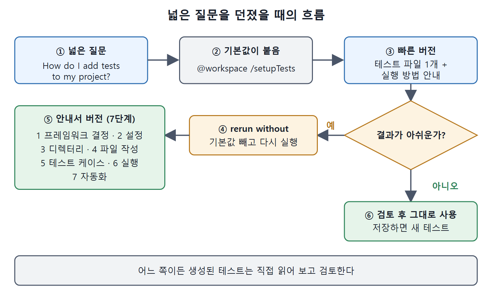

# 테스트 방법 물어보기

처음 쓰는 언어나 프레임워크에서는 코드를 짜는 것보다 테스트를 어떻게 붙일지가 더 막막할 때가 많다. 이 문서는 Copilot에게 "내 프로젝트에 테스트를 어떻게 추가하나"라고 가장 넓게 물어봤을 때 어떤 일이 벌어지는지 다룬다. 기본으로 붙는 채팅 참여자와 슬래시 명령을 피하는 방법도 함께 정리한다.

생성형 AI가 만든 테스트는 내용, 적합성, 정확도가 매번 다르다. 어떤 컨텍스트(문맥)를 주었는지, 어느 화면에서 물었는지, 프롬프트를 어떻게 썼는지에 따라 결과가 달라진다. 그래서 만들어진 테스트는 반드시 읽어 보고, 마음에 안 들면 직접 고치거나 프롬프트를 바꿔서 다시 시도해야 한다.

---

## 1. 새 언어로 옮길 때의 막막함

소프트웨어 개발자에게 새 언어나 프레임워크를 빨리 익히는 일은 늘 있는 일이다. 평소 쓰던 언어라면 테스트 작성이 익숙하겠지만, 다른 환경으로 옮기면 배울 것이 한꺼번에 늘어난다. 앞에서 코드를 다른 언어로 옮기는 방법을 Copilot에게 물을 수 있다고 했는데, 테스트도 똑같이 물어볼 수 있다.

예제는 Go로 쓴 Kubernetes Operator 프로젝트다. Go를 처음 접해서 방금 만든 코드를 어떻게 테스트해야 할지 모르는 상황을 가정한다. 포럼을 뒤지거나 동료에게 묻는 대신 Copilot에게 이렇게 물으면 된다.

```text
How do I add tests to my project?
```

이때 프로젝트 파일이 에디터에 열려 있어야 결과가 좋다. 열린 파일이 없으면 Copilot은 프로젝트 내용 대신 해당 프로젝트 유형에 맞는 일반론을 들려주는 쪽으로 물러난다.

| 질문 방식 | 예시 | 언제 쓰나 |
|---|---|---|
| 넓은 질문 | `How do I add tests to my project?` | 테스트가 하나도 없을 때 |
| 파일 이름 지정 | `How do I test the code in #file:prime.py?` | 특정 파일만 테스트할 때 |
| 채팅 변수 사용 | `#file` 같은 채팅 변수(#으로 붙이는 정보) | 대상을 정확히 가리킬 때 |
| 컨텍스트 추가 | 3장에서 다룬 방식으로 항목을 컨텍스트에 추가 | 여러 파일을 함께 볼 때 |

표를 보면 모두 "무엇을 테스트할지"를 Copilot에게 얼마나 정확히 알려 주느냐의 차이다. 범위를 좁힐수록 일반론이 줄고 내 코드에 맞는 답이 나온다.

## 2. 기본값으로 붙는 /setupTests

넓은 질문을 던지면 Copilot은 먼저 프로젝트를 분석한다. 질문이 일반적이라서, 기본값인 `@workspace /setupTests`로 예제 테스트를 만드는 방법을 알려 준다. 응답에는 제안 요약과 함께 변경을 적용하는 버튼들이 붙는다. 같은 응답 안에 설명과 테스트를 돌리는 터미널 명령도 들어 있다.

Apply Changes 버튼을 누르면 테스트 파일이 실제로 만들어지고, 테스트 실행 방법까지 안내된다. 질문 한 번으로 여기까지 나오는 것은 꽤 인상적이다.

다만 `/setupTests`의 목적은 테스트 코드와 관련 변경을 큰 틀에서 한 번에 세팅하는 것이다. 글을 쓴 시점에 이 기능은 아직 실험 단계라서, 상황에 따라 쓸모가 들쭉날쭉하다. 기본으로 `@workspace` 채팅 참여자(@로 부르는 도우미)가 붙는 것도 항상 최선은 아니다. 처음 테스트를 만들 때는 기본값을 쓰지 않는 편이 나을 수 있다.

예제에서 기본값 없이 다시 실행(rerun without)하자, 훨씬 포괄적인 절차가 나왔다.

| 순서 | 단계 |
|---|---|
| 1 | 테스트 프레임워크 결정 |
| 2 | 테스트 프레임워크 설정 |
| 3 | 테스트 디렉터리 만들기 |
| 4 | 테스트 파일 작성 |
| 5 | 테스트 케이스 작성 |
| 6 | 테스트 실행 |
| 7 | 테스트 자동화 |

각 단계에는 더 자세한 설명과 예제 코드가 함께 붙는다. 기본값 결과가 파일 하나를 만들어 주는 "빠른 버전"이라면, 이쪽은 처음부터 끝까지 안내하는 "안내서 버전"이다.



넓은 질문을 하면 기본값 `@workspace /setupTests`가 붙어 빠른 버전이 나오고, 결과가 아쉬우면 "rerun without"으로 7단계 안내서 버전을 받는 흐름을 보여 준다.

## 3. 기본 참여자와 슬래시 명령 피하는 법

입력창에 기본값이 미리 채워질 때, 그것을 피하는 방법은 크게 세 가지다. `/setupTests`뿐 아니라 다른 기본 명령이 붙을 때도 같은 방법을 쓴다.

| 방법 | 하는 법 | 특징 |
|---|---|---|
| 직접 지우기 | 미리 채워진 참여자와 명령을 프롬프트에서 지운다 | 가장 단순하다 |
| rerun without | 기본값으로 실행한 뒤 채팅 결과 위쪽의 "rerun without"을 누른다 | 먼저 결과를 보고 결정할 수 있다 |
| 전송 옵션 선택 | 전송 버튼 옆의 작은 화살표에서 전송 방식을 고른다 | 한 번에 끝난다 |
| 설정으로 끄기 | VS Code 설정에서 `setupTests`를 검색해 끈다 | 영구적으로 적용된다 |

전송 옵션은 3장에서 다룬 것과 같다. 보통 Send나 Send to @workspace를 고르면 더 적절한 응답을 받는다. "rerun without" 링크는 응답 맨 위, Workspace 줄 끝에 있다. 정리하면 기본값은 편하지만 결과가 아쉬우면 언제든 한 단계 풀어서 다시 돌릴 수 있다.

## 4. SQL 테스트 예제

덜 익숙한 영역으로 SQL 코드 테스트를 해 본다. 저자가 교육용으로 쓰는 큰 SQL 파일이 있다. 대학의 교과과정, 시간표, 교수진 등을 담은 테이블을 만들어 데이터베이스를 채우는 문장들이다.

이 파일을 에디터에 열고 테스트 방법을 물으면, Copilot은 단계별 계획을 세우고 그 계획을 구현한 새 파일을 만든다. 새 파일에는 테스트용 데이터베이스에서 쓸 수 있는 SQL 명령이 들어 있고, 테스트는 10가지다. 이 파일을 검토하고 저장하면 새 테스트가 된다. 이때 Copilot은 빠른 출력을 위해 `/tests`를 쓴다. 빠른 버전이 싫으면 앞서 본 "rerun without" 방법으로 단축 명령 없이 다시 실행하면 된다.

이 방식은 Python뿐 아니라 어떤 언어에서도 동작한다.

## 5. 생성된 테스트를 믿어도 되는가

아직 테스트 생성 논의 초반이지만 기억해 둘 점이 있다. 생성된 테스트도 다른 생성 결과와 똑같이 검토해야 한다. AI가 만든 테스트에는 다음 문제가 섞일 수 있다.

| 문제 | 뜻 |
|---|---|
| 거짓 양성(false positive) | 실제로는 틀렸는데 통과로 나오는 테스트 |
| 중복 검증 | 같은 내용을 확인하는 assert가 반복됨 |
| 잘못된 논리 | 코드를 잘못 이해해서 엉뚱한 기대값을 적음 |

다행히 테스트 코드는 대체로 읽기 쉬워서 빠르게 훑어 확인하기 좋다. 여기까지는 맨 처음부터 테스트를 시작하는 경우였다. 더 흔한 경우는 이미 아는 언어로 개발하면서 단위 테스트의 틀(boilerplate)만 Copilot에게 맡기고 싶은 경우이며, 이는 다음 문서에서 다룬다.

<br>
<br>
<br>

[Learning GitHub Copilot](../)
