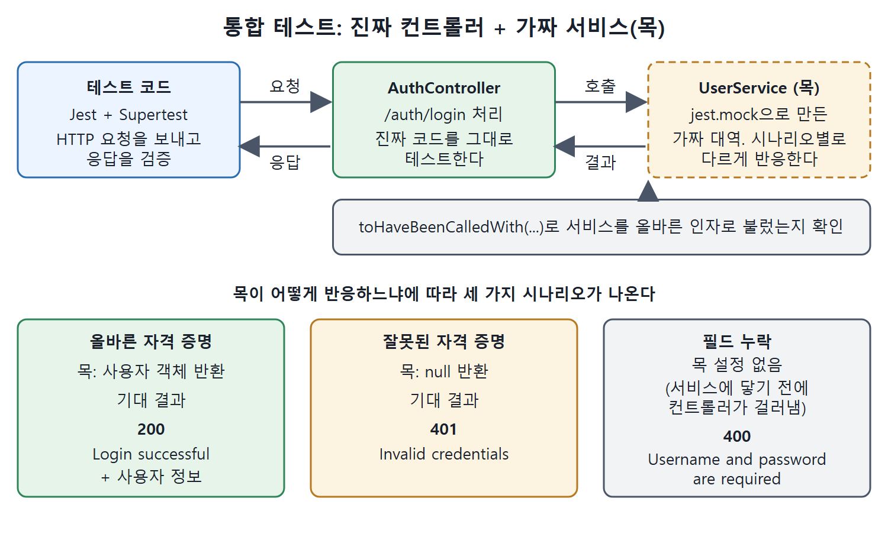

# 통합 테스트 만들기

단위 테스트가 함수 하나를 따로 떼어 검사한다면, 통합 테스트(integration test)는 여러 구성 요소가 함께 움직일 때 제대로 맞물리는지 본다. Copilot은 기본 명령으로는 단위 테스트를 주로 만들기 때문에, 통합 테스트를 얻으려면 프롬프트에서 "구성 요소 사이의 상호작용"을 분명히 말해 줘야 한다.

이 문서는 통합 테스트를 잘 만들게 하는 세 가지 요령, 프롬프트 템플릿, Express 앱 로그인 예제를 정리한다.

---

## 1. 성공하는 프롬프트의 세 가지 요령

서비스, 모듈, 외부 시스템이 어떻게 협력하는지를 강조하는 분명한 지시가 필요하다.

| 요령 | 설명 | 왜 필요한가 |
|---|---|---|
| 구체적인 프롬프트 | 코드 자체가 아니라 구성 요소 사이의 상호작용에 대한 통합 테스트를 쓰라고 요청한다 | 그냥 "테스트를 만들어 줘"라고 하면 단위 테스트로 흐르기 쉽다 |
| 외부 의존성은 목(mock)으로 | 데이터베이스나 API 같은 외부 서비스를 흉내 내라고 지시한다 | 실제 구현 없이도 기능을 검증할 수 있다 |
| 상호작용 검증 요청 | 메서드가 호출되는지, 구성 요소 사이 데이터가 기대대로 흐르는지, 예상한 부수 효과가 일어나는지 확인하라고 한다 | 통합 테스트의 핵심이 연결 지점이기 때문이다 |

목(mock)은 진짜 대신 쓰는 가짜 대역이다. 세 요령이 합쳐지면 "A와 B가 맞물리는 모습을, 바깥 시스템 없이 확인하는" 테스트가 된다.

## 2. 프롬프트 템플릿

범용 템플릿은 다음과 같다. `<>` 안은 상황에 맞게 바꾼다.

```text
Write integration tests for the <method/function> in the <class>.
Use mocks to simulate the <external service> and verify that it
works correctly when <condition>.
```

## 3. 예제 상황: Express 앱의 로그인

Express 애플리케이션에 모듈이 두 개 있다고 하자.

| 모듈 | 역할 |
|---|---|
| UserService | 사용자 데이터를 다룬다 |
| AuthController | 로그인 요청을 받아 UserService에 넘긴다 |

AuthController가 UserService, 그리고 HTTP 계층과 제대로 상호작용하는지 확인하는 통합 테스트를 만들고 싶다. 프롬프트는 이렇다.

```text
Write integration tests for the login endpoint in the
AuthController. Mock the UserService to simulate user lookup and
password verification, and verify that the controller returns the
correct HTTP status codes and messages
```

## 4. Copilot이 만든 테스트 읽기

Copilot은 Jest를 쓰고 UserService를 목으로 만든 예제를 내놓았다. 앞부분의 준비 코드는 이렇다.

```javascript
const request = require('supertest');
const express = require('express');
const AuthController = require('../controllers/AuthController');
const UserService = require('../services/UserService');
jest.mock('../services/UserService'); // Mock the UserService
const app = express();
app.use(express.json());
app.use('/auth', AuthController);
```

각 테스트 뒤에는 `jest.clearAllMocks()`로 목을 초기화한다. 테스트 케이스는 셋이다.

| 케이스 | 목의 설정 | 요청 | 기대 결과 |
|---|---|---|---|
| 올바른 자격 증명 | `UserService.authenticate`가 사용자 객체를 반환 | `/auth/login`에 user1 / password1 | 상태 200, 'Login successful' 메시지와 사용자 정보 |
| 잘못된 자격 증명 | `authenticate`가 null을 반환 | user1 / wrongpassword | 상태 401, 'Invalid credentials' |
| 필드 누락 | 설정 없음 | username만 전송(비밀번호 없음) | 상태 400, 'Username and password are required' |

앞의 두 케이스는 `expect(UserService.authenticate).toHaveBeenCalledWith(...)`로 컨트롤러가 서비스를 올바른 인자로 불렀는지도 확인한다. 이 줄이 바로 "상호작용 검증"에 해당한다. 세 번째 케이스는 요청이 서비스에 닿기 전에 컨트롤러가 걸러 내는 경우다.



진짜 AuthController는 그대로 두고 UserService만 가짜 대역(목)으로 바꿔, 목의 반응에 따라 200, 401, 400 응답이 나오는 구조를 보여 준다.

Copilot은 핵심을 이렇게 정리했다.

| 항목 | 내용 |
|---|---|
| UserService 목 | `jest.mock('../services/UserService')`로 모듈을 목으로 바꾸고, `UserService.authenticate`가 시나리오별로 다르게 반응하게 한다 |
| 테스트 케이스 | 유효한 자격 증명, 잘못된 자격 증명, 필수 필드 누락 |
| Supertest | Express 앱에 HTTP 요청을 보내 응답을 검증하는 데 쓴다 |
| 구성 | `AuthController`를 테스트 앱의 `/auth` 경로에 붙인다 |

실행은 다음 명령이다.

```bash
npx jest
```

## 5. 그대로 쓰지 말고 손봐서 쓴다

이 코드는 그대로 돌아간다는 보장이 없고, 의도대로 동작하도록 통합 테스트 코드를 조금 더 손봐야 할 수 있다. 그래도 튼튼한 출발점이 된다.

어떤 테스트를 만들든 프로젝트 사정이나 지켜야 할 테스트 지침에 맞추고 싶을 수 있다. 다음 문서에서 Copilot에 사용자 지정 테스트 지침을 설정하는 법을 본다.

<br>
<br>
<br>

[Learning GitHub Copilot](../)
