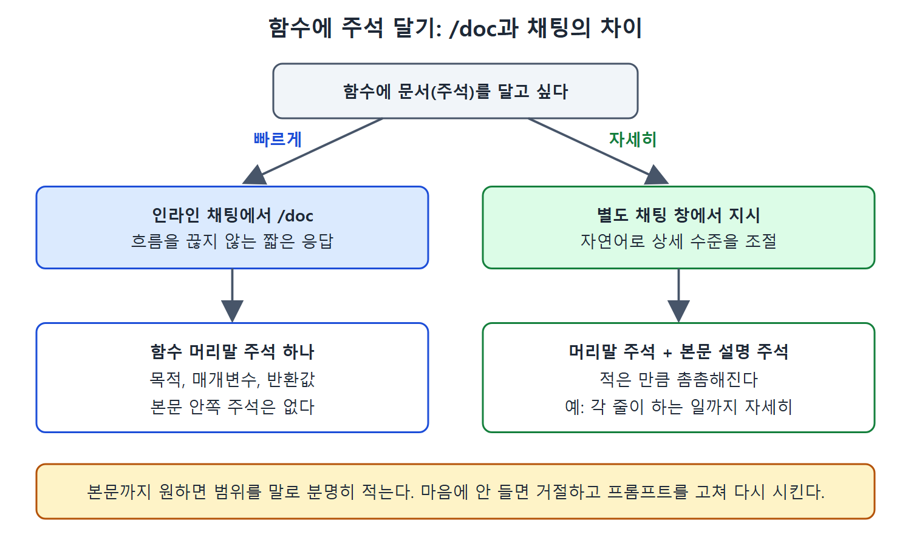

# 인라인과 채팅으로 문서화

코드에 문서를 남기는 일은 누구나 중요하다고 알지만 코딩보다 우선순위가 밀리기 쉽다. Copilot은 이 지루한 작업을 대신 맡아 줄 수 있다. 다만 편집기 안에서 쓰는 방법과 채팅 창에서 쓰는 방법은 결과물의 분량이 꽤 다르다.

이 문서는 Go로 작성한 Kubernetes 서비스 생성 함수 `newServiceForPod`를 예로 들어, /doc 명령과 채팅 프롬프트가 각각 어떤 문서를 만들어 주는지, 그리고 둘을 어떻게 섞어 쓰면 좋은지 정리한다.

---

## 1. 왜 문서화에 Copilot을 쓰는가

코드 안의 문서는 코드를 이해하기 쉽게 하고, 리뷰하기 쉽게 하고, 오래 유지보수하게 해 준다. 결국 코드와 그 코드로 만든 제품의 품질을 좌우한다. 그런데 문서를 쓰는 일은 코드를 짜는 재미에 비해 번거롭게 느껴져서 자꾸 미뤄진다.

Copilot은 문서화를 크게 두 갈래로 도와준다.

| 갈래 | 내용 |
|---|---|
| 기본 문서화 | 함수 머리말 주석, 본문 중간 주석을 달아 준다 |
| 확장 문서화 | Swagger 같은 프레임워크용 문서, API 개발자 문서, 기능 문서를 만들어 준다 |

이 문서는 앞쪽의 기본 문서화를 다룬다. 확장 문서화는 다음 문서에서 다룬다. 한 가지 흔한 오해가 있다. 많은 개발자가 "Copilot이 주석을 달아 준다"는 것까지는 알지만, 정확히 어떻게 시켜야 원하는 만큼 달리는지는 헷갈려 한다. 단축 명령은 편하지만 할 수 있는 일이 제한적이기 때문이다.

## 2. 인라인으로 문서 만들기: /doc

예제 함수는 커스텀 리소스(RoarApp)를 받아 NodePort 타입의 Kubernetes Service 객체를 돌려준다. 안에서 하는 일은 대략 이렇다.

- 다음 포트 번호(`nextPort`)를 문자열로 바꿔 서비스 이름 뒤에 붙인다.
- `app` 레이블 맵을 만들어 셀렉터로 쓴다.
- 포트 8089, 대상 포트 8080, 노드 포트 `nextPort`를 지정한다.

이 함수에 가장 빠르게 문서를 붙이는 길은 인라인 채팅을 열고 /doc 슬래시 명령을 쓰는 것이다. 원서는 인라인 채팅을 여는 단축키를 Meta-I라고 적었다. 운영체제마다 Meta 키가 다르므로 환경에 맞게 읽으면 된다.

결과는 보통 함수 위에 붙는 주석 블록 하나다. 함수의 목적, 매개변수(`cr`은 RoarApp 인스턴스를 가리키는 포인터), 반환값(레이블, 포트, 네임스페이스가 설정된 `corev1.Service` 포인터)이 정리된다.

```go
// newServiceForPod creates a new Kubernetes Service resource ...
// Parameters:
//   - cr: A pointer to a RoarApp custom resource instance.
// Returns:
//   - A pointer to a corev1.Service object ...
```

이 결과는 함수의 목적, 매개변수, 반환값을 알려 준다는 점에서 쓸 만하다. 하지만 함수 본문 안쪽에는 주석이 하나도 달리지 않는다.

더 길게 "add doc to my code"처럼 말해도 Copilot은 다시 /doc 명령으로 처리해서 비슷한 결과를 낸다. 원서 기준으로 이 동작은 어느 채팅 창에서 시켜도 같다. 결국 편집기 안에서는 간단한 머리말 주석만 기대하는 것이 맞다.

## 3. 주석에서 문서 만들기

주석을 먼저 써 두고 그것을 바탕으로 문서를 만들게 할 수도 있다. 이때는 "create documentation" 같은 표현을 써야 Copilot이 반응한다. 하지만 결과가 더 단순하고, 문서를 만들려고 내가 먼저 주석을 써야 하니 실익이 크지 않다.

편집기 안에서의 Copilot은 흐름을 끊지 않는 짧고 빠른 응답을 목표로 한다. 쉽게 받아들이거나 버릴 수 있어야 하기 때문이다. 더 풍부한 답이 필요하면 별도의 채팅 창을 쓰는 것이 정석이고, 문서화도 마찬가지다.

## 4. 채팅으로 문서 만들기

같은 코드에서 별도 채팅 창에 같은 지시(코드에 문서를 추가해 달라)를 주면 훨씬 자세한 결과가 나온다. 머리말 주석은 /doc 결과와 거의 같지만, 본문 곳곳에 설명 주석이 추가된다.

- 다음 포트를 문자열로 바꾸는 줄: 서비스 이름에 쓰려고 변환한다는 설명이 붙는다.
- 레이블을 만드는 부분: RoarApp 인스턴스와 서비스를 연결하기 위한 것이라는 설명이 붙는다.
- 반환 객체를 만드는 부분: 새 Service 객체를 만들어 돌려준다는 설명이 붙는다.

채팅은 자연어를 이해하므로 원하는 수준을 말로 조절할 수 있다. 프롬프트를 점점 구체적으로 만들면 결과가 이렇게 달라진다.

| 프롬프트 취지 | 결과의 특징 |
|---|---|
| 코드에 문서를 추가해 줘 | 머리말 주석 + 본문 곳곳의 설명 주석 |
| 함수를 누구나 이해하도록 자세히 주석 달아 줘 | 위와 비슷하나 문구가 바뀌고, 큰 단락마다 쓰임새와 관리 방식 설명이 늘며, 이해가 어려운 식별자 뒤에 줄 끝 주석이 붙는다 |
| 함수 본문의 각 줄이 무엇을 하는지 누구나 쉽게 알 수 있도록 자세히 주석 달아 줘 | 여러 요소에 더 세밀한 주석이 붙는다 |
| 함수 머리말과 본문을 모두, 전체와 각 줄이 무엇을 하는지 누구나 알 수 있게 자세히 문서화해 줘 | 위의 효과를 한 번에 얻는다 |

표의 마지막 행이 실전에서 가장 쓰기 편하다. 지시를 한 번에 합쳐도 잘 동작한다는 것이 원서의 평가다. 읽는 법은 간단하다. 원하는 상세 수준을 프롬프트에 직접 적을수록 주석이 촘촘해진다.



이 그림은 같은 함수에 주석을 달 때 인라인 /doc은 머리말 주석만, 별도 채팅은 본문 설명 주석까지 만들어 준다는 차이를 흐름으로 보여 준다.

## 5. 주석과 문서는 같은 말로 써도 된다

위 프롬프트에서는 "문서화"가 아니라 "주석을 달아 줘"라고 썼다. 코드 안의 문서는 곧 주석이므로 두 말을 섞어 써도 된다. 다만 엄밀히 "문서를 만들어 줘"라고 하면 Copilot이 함수 시작 부분에만 주석 블록을 쓰고 끝내는 쪽으로 기울 수 있다. 본문까지 원하면 "본문의 각 줄"처럼 범위를 분명히 말하는 편이 안전하다.

## 6. 정리

- 가장 빠른 길은 인라인 채팅의 /doc이지만, 결과는 대체로 머리말 주석뿐이다.
- 본문 주석까지 필요하면 별도 채팅 창에서 자세히 달라고 시킨다.
- 마음에 들지 않으면 변경을 거절하고 프롬프트를 고쳐 다시 시킨다.

<br>
<br>
<br>

[Learning GitHub Copilot](../)
