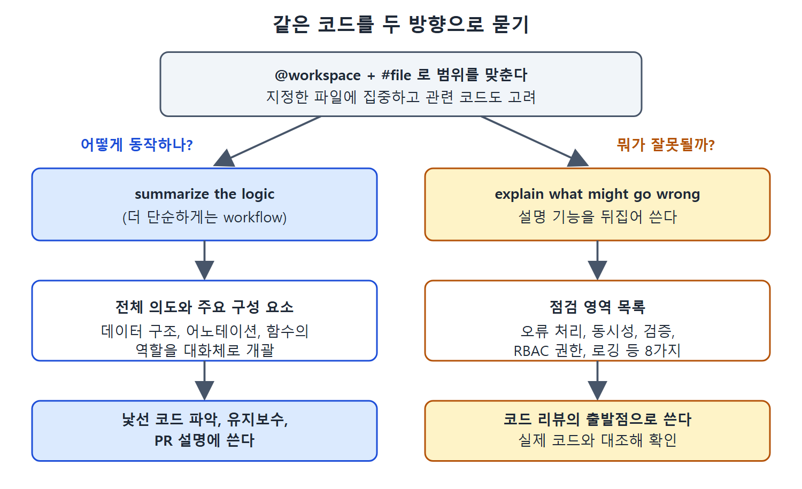

# 코드 로직 설명과 문제점 찾기

언어나 파일 이름 같은 낱개 질문을 넘어서면, Copilot에게 코드 전체의 흐름을 설명시키거나 반대로 잘못될 수 있는 곳을 찾게 할 수 있다. 이 문서는 두 가지 사용법과, 그때 @workspace와 #file을 어떻게 섞어 쓰는지 정리한다.

---

## 1. 코드 로직 요약시키기

로직을 요약해 달라는 요청은 다음과 같은 때 쓸모가 있다.

- 물려받았거나 유지보수해야 하는 코드를 빨리 파악할 때
- 새 언어나 프레임워크로 쓰인 코드를 배울 때
- 코드를 읽고 이해한 내용이 맞는지 확인할 때
- 코드 리뷰나 풀 리퀘스트(PR)에서 코드가 어떻게 동작하는지 다른 설명이 필요할 때

목표는 언어에 매이지 않는 방식으로 전체 로직과 주요 구성 요소를 개괄시키는 것이다. 다른 개발자와 이야기하듯 대화체 설명을 원한다. 프롬프트는 상황에 따라 달라도 되지만, 계속 써 온 컨트롤러 파일로는 이렇게 쓴다.

```text
@workspace: summarize the logic in #file:controllers/roarapp_controller.go
```

Copilot은 먼저 코드의 전체 의도를 설명했는데, 쿠버네티스 클러스터에서 커스텀 리소스의 상태를 조정(reconcile)한다는 내용이었다. 이어 파일 속 핵심 구성 요소와 각각의 역할을 정리했다. 여기에는 데이터 구조, 어노테이션, 함수가 포함된다.

더 단순한 답을 원하면 logic을 workflow로 바꾼다.

```text
@workspace: summarize the workflow in #file:controllers/roarapp_controller.go
```

응답은 조금 더 단순하지만 여러 구성 요소에 대한 비슷한 정보를 준다.

## 2. 잘못될 수 있는 곳 찾기

설명 기능을 뒤집어 쓰는 방법이다. 코드가 어떻게 동작하는지 묻는 대신 어떤 문제가 생길 수 있는지 묻는다. 내가 쓴 코드, 조사 중인 코드, 물려받은 코드 모두에 쓸 수 있다.

```text
@workspace: explain what might go wrong with the code in #file:controllers/roarapp_controller.go
```

Copilot은 살펴볼 영역을 자세히 나열했다.

| 영역 | 뜻 |
|---|---|
| 오류 처리(Error handling) | 실패를 제대로 다루는지 |
| 리소스 충돌(Resource conflicts) | 같은 리소스를 동시에 건드리는 문제 |
| 다시 큐에 넣기 로직(Requeue logic) | 작업을 다시 큐에 넣는 방식 |
| 리소스 정리(Resource cleanup) | 쓰고 난 리소스를 치우는지 |
| 동시성 문제(Concurrency issues) | 동시 실행에서 생기는 문제 |
| 로깅(Logging) | 필요한 기록을 남기는지 |
| 검증(Validation) | 입력을 확인하는지 |
| RBAC 권한(RBAC permissions) | 역할 기반 접근 권한 설정 |

이 표는 사실상 코드 리뷰의 점검표 구실을 한다. 약점을 평가하고, 취약한 부분이 다뤄졌는지 확인하고 싶을 때 쓰기 좋다. 원서도 이것이 Copilot에게 코드 리뷰를 시키는 쉬운 방법이라고 소개한다.

## 3. @workspace와 #file을 함께 쓰는 이유

프롬프트에 #selection이나 #file 같은 변수를 넣으면 Copilot이 살펴볼 컨텍스트(문맥)를 좁힐 수 있다. 하지만 경우에 따라 @workspace도 함께 써야 한다. 그래야 이 코드에 영향을 줄 수 있는 관련 부분까지 보고 전체 그림을 고려한다.

| 쓰는 것 | 효과 |
|---|---|
| #file만 | 지정한 파일에 초점을 맞춘다 |
| @workspace + #file | 지정한 파일에 초점을 두면서 관련 코드까지 고려한다 |

읽는 법: 한 파일의 로직이 다른 파일과 얽혀 있을수록 @workspace를 함께 붙이는 편이 낫다.



이 그림은 @workspace와 #file로 범위를 맞춘 같은 코드에 대해 동작을 묻는 방향과 잘못될 곳을 묻는 방향이 각각 어떤 결과와 쓰임으로 이어지는지 보여 준다.

## 4. 정리

- 로직 요약은 "logic"이나 "workflow"를 넣어 시킨다.
- 약점 찾기는 "what might go wrong"으로 시킨다.
- 두 경우 모두 @workspace와 #file을 같이 써서 범위와 맥락을 맞춘다.
- 약점 점검 결과는 리뷰의 출발점일 뿐이므로 실제 코드와 대조해 확인한다.

<br>
<br>
<br>

[Learning GitHub Copilot](../)
