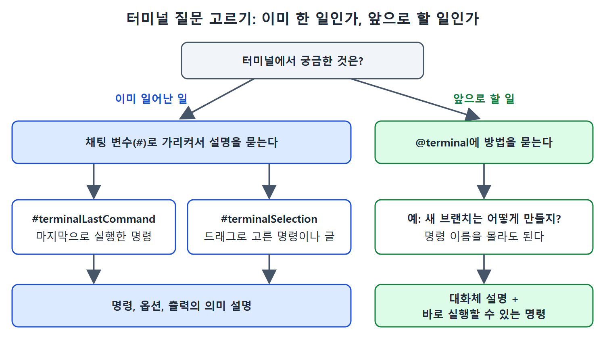

# 터미널 설명

Copilot은 코드뿐 아니라 터미널에서 일어난 일도 설명해 준다. 이미 실행한 명령과 그 출력을 해석해 주기도 하고, 아직 모르는 작업을 터미널에서 어떻게 하는지 명령까지 알려 주기도 한다. 이 문서는 이를 위한 채팅 변수와 참여자를 정리한다.

---

## 1. 터미널을 가리키는 방법

| 도구 | 역할 |
|---|---|
| #terminalLastCommand | 마지막으로 실행한 명령을 가리킨다 |
| #terminalSelection | 터미널에서 선택한 텍스트를 가리킨다 |
| @terminal | 터미널 관련 질문을 받는 채팅 참여자(@로 부르는 도우미) |

읽는 법: #으로 시작하는 것은 "무엇을" 설명할지 정하는 채팅 변수이고, @terminal은 터미널 전문 도우미를 부르는 이름이다.

## 2. 마지막 명령 설명받기

예를 들어 codespace에서 `ps -aux`를 가장 마지막으로 실행했다고 하자. 출력에는 USER, PID, %CPU, %MEM, VSZ, RSS, TTY, STAT, START, TIME, COMMAND 열이 있고, `/sbin/docker-init`, `sleep infinity`, `sshd`, `/bin/sh` 같은 프로세스가 보인다.

이 명령이 정확히 무엇을 하는지 알고 싶으면 이렇게 묻는다.

```text
explain #terminalLastCommand
```

Copilot은 마지막 명령을 알아내서 명령 자체, 옵션, 출력을 설명한다.

## 3. 선택한 내용 설명받기

이전에 `git status`를 실행했다면 그 부분을 드래그로 선택하고 이렇게 묻는다.

```text
explain the commands in #terminalSelection
```

명령이 아니어도 된다. 터미널에 보이는 어떤 글이든 선택하면 된다. 예를 들어 `git status` 출력에서 "Your branch is up to date with 'origin/main'." 문장을 선택했다고 하자. 변수가 이미 선택한 내용을 가리키므로 프롬프트를 더 짧게 줄일 수 있다.

```text
explain #terminalSelection
```

그러면 그 문장이 무슨 뜻인지 설명해 준다.

| 상황 | 프롬프트 |
|---|---|
| 마지막으로 실행한 명령이 궁금함 | explain #terminalLastCommand |
| 선택한 명령이 궁금함 | explain the commands in #terminalSelection |
| 선택한 출력 문구가 궁금함 | explain #terminalSelection |

## 4. 터미널에서 하는 방법 묻기

설명의 방향을 바꿔서, 할 일을 알려 주고 방법을 묻는 용도로도 쓸 수 있다. @terminal 컨텍스트를 붙이면 된다.

```text
@terminal How do I create a new branch for my GitHub repository?
```

Copilot은 대화체로 과정을 설명하고, 터미널에서 바로 실행할 수 있는 실제 명령도 함께 준다. 명령줄을 언급하는 프롬프트로도 비슷한 결과가 나온다. 예를 들면 "How can I create a new branch in my GitHub repository using the command line?"이다.

명령 이름을 모를 때도 같은 기법이 통한다.

```text
@terminal how do I see the list of running processes?
```

이 질문에는 터미널에서 쓸 수 있는 여러 방법이 나온다.

## 5. 두 용도 비교

| 구분 | 설명 받기 | 방법 묻기 |
|---|---|---|
| 이미 일어난 일인가 | 그렇다(실행한 명령, 출력) | 아니다(앞으로 할 일) |
| 쓰는 도구 | #terminalLastCommand, #terminalSelection | @terminal |
| 결과 | 명령, 옵션, 출력의 의미 | 대화체 설명과 실행할 명령 |



이 그림은 이미 일어난 일이면 #terminalLastCommand나 #terminalSelection으로 가리키고, 앞으로 할 일이면 @terminal에 묻는 선택 흐름을 보여 준다.

## 6. 정리

- 이미 실행한 명령은 변수로 가리켜 의미를 묻는다.
- 할 일을 모를 때는 @terminal로 방법과 명령을 묻는다.

<br>
<br>
<br>

[Learning GitHub Copilot](../)
