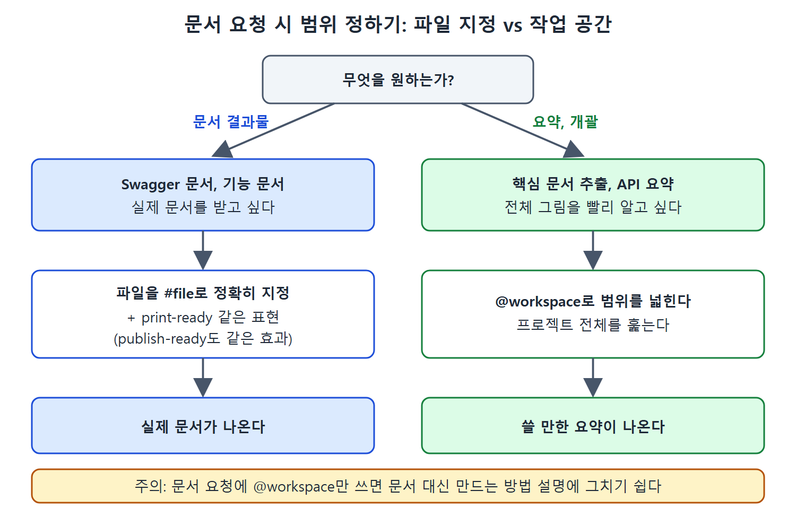

# 프레임워크와 API 문서 만들기

Copilot은 주석을 다는 데서 한 걸음 더 나아가, 언어별 문서화 도구에 맞는 주석을 쓰고, API 문서와 기능 문서까지 만들어 준다. 이 문서는 Javadoc 같은 프레임워크 호환 문서, Swagger 문서, 외부 사용자용 기능 문서를 만드는 방법과 함정을 정리한다.

핵심은 하나로 모인다. 어떤 파일을 대상으로 하는지 정확히 짚어 줄수록 문서가 실제로 나온다. 작업 공간 전체를 가리키면 문서가 아니라 문서 만드는 방법을 설명하는 쪽으로 빠지기 쉽다.

---

## 1. 프레임워크 호환 문서

프로그래밍 언어마다 표준 문서화 도구가 있다. Copilot은 코드의 언어에 표준 도구가 있다고 알아보면 그 도구가 처리할 수 있는 형식으로 주석을 만든다. 개발 환경이나 다른 도구와 연동하기 좋아서 일반 주석보다 선호되는 경우가 많다.

| 언어 | 문서화 도구 |
|---|---|
| C# | XMLDoc |
| Python | pydoc |
| JavaScript | JSDoc |
| Java | Javadoc |

예로 `com.demo.util` 패키지의 `ToJSON` 클래스를 들 수 있다. `toJSONArray(ResultSet rs)` 메서드 하나로, 데이터베이스 조회 결과를 JSON 배열로 바꾸는 코드다. 채팅에서 "document this class"라고 시키면 다음과 같은 결과가 나온다.

- 가져오기(import) 줄마다 어떤 용도인지 설명하는 한 줄 주석
- 클래스 위에 `/** ... */` 형태의 설명 블록
- 메서드 위에 `@param`, `@return`, `@throws`를 갖춘 블록
- 본문 안의 변수 옆에 붙는 줄 끝 주석

여기서 `/**`와 `@param`, `@return`, `@throws` 같은 부분이 Javadoc이 HTML 문서를 만들 때 쓰는 서식이다. 즉 Copilot이 쓴 주석에서 곧바로 Javadoc HTML 문서를 뽑아낼 수 있다.

```java
/**
 * Converts a given ResultSet into a JSONArray.
 * @param rs The ResultSet to be converted.
 * @return JSONArray containing the data from the ResultSet.
 * @throws Exception If there is an error during the conversion
 */
```

생성된 주석 중에는 ESAPI 가져오기에 "보안용이지만 이 코드 조각에서는 쓰이지 않는다"는 설명이, `temp` 변수에 "임시 문자열이며 이 조각에서는 쓰이지 않는다"는 설명이 붙은 곳이 있다.

## 2. API 문서: Swagger

프로젝트가 Swagger 같은 API 문서화 프레임워크를 쓰도록 설정돼 있으면, Copilot에게 해당 Swagger 문서를 만들게 할 수 있다. 원서의 예는 회사 직원 명부를 관리하는 Java 애플리케이션이다. 이미 Swagger가 설정돼 있고, 컨트롤러 파일이 `EmployeeController.java`다.

프롬프트는 이렇게 쓴다.

```text
create print-ready Swagger documentation for the APIS in #file:EmployeeController.java
```

여기서 두 가지가 중요하다.

| 요소 | 역할 |
|---|---|
| print-ready | 코드 주석을 다시 쓰는 것이 아니라 실제 문서 형식을 만들게 한다. publish-ready, publishable도 같은 효과가 있다 |
| #file 변수 | 문서를 만들 대상 파일을 정확히 지정한다. 파일이 여러 개면 여러 번 쓴다 |

만약 "@workspace create Swagger documentation for the APIs"처럼 작업 공간 전체를 가리키면, Copilot은 보통 문서를 내놓는 대신 프로젝트에서 Swagger 문서를 만드는 방법을 설명한다. 문서 결과물을 원한다면 파일을 콕 집어야 한다.

## 3. 기능 문서

Copilot은 외부 사용자를 겨냥한 기능 문서(functional documentation)도 쓴다. 같은 컨트롤러 코드로 이렇게 시킨다.

```text
create functional documentation explaining the various public APIs in #file:EmployeeController.java
```

결과는 읽기 쉬운 산문 형식이면서 API 구조에 필요한 세부 정보를 갖춘다. Copilot은 작업에 앞서 따를 단계도 먼저 늘어놓는데, 공개 API 찾기, 메서드 시그니처, 엔드포인트 매핑 같은 항목이다.

같은 주의가 여기에도 적용된다. 특정 파일을 지정해서 시켜야 하고, 작업 공간 전체에 대고 시키지 않는다. 다만 요약 수준의 일반 질문은 @workspace로도 잘 된다. 예를 들어 "@workspace what are the API's parameters and what does it return?"라고 물으면 쓸 만한 요약이 나온다.

## 4. 어떤 프롬프트가 어떤 결과를 내는가

| 하고 싶은 일 | 프롬프트 형태 | 주의 |
|---|---|---|
| 클래스를 Javadoc 형식으로 문서화 | document this class | 언어에 표준 도구가 있으면 자동으로 호환 형식 |
| Swagger 문서 출력 | create print-ready Swagger documentation ... #file:... | print-ready와 #file 둘 다 필요 |
| 외부 사용자용 기능 문서 | create functional documentation ... #file:... | 파일 지정이 핵심 |
| API 매개변수와 반환값 요약 | @workspace what are the API's parameters ... | 일반 질문은 작업 공간 범위도 괜찮음 |

읽는 법: 문서를 "만들어 내라"는 요청은 파일 범위를 좁히고, 질문형 요약은 작업 공간 범위로 넓혀도 된다.



이 그림은 실제 문서를 원하면 #file과 print-ready 표현을 쓰고, 요약이 목적이면 @workspace로 범위를 넓히는 선택 순서를 보여 준다.

## 5. 사용 시 알아 둘 점

- 외부에 공유할 문서는 Copilot이 만든 초안을 반드시 검토한 뒤에 쓴다. 원서도 "검토 후" 공유 가능하다는 전제를 둔다.
- 생성된 문서의 전체 목록은 원서 저장소에서 볼 수 있다. 이 노트는 구조와 요령만 정리한다.

<br>
<br>
<br>

[Learning GitHub Copilot](../)
