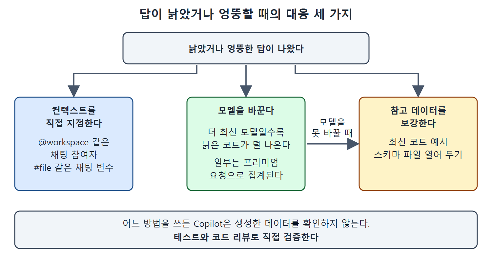

# 엉뚱한 컨텍스트와 빠진 컨텍스트

Copilot이 의도와 다른 내용을 근거로 답하거나, 근거가 될 내용을 아예 못 찾는 일이 있다. 앞의 경우를 엉뚱한(misplaced) 컨텍스트, 뒤의 경우를 빠진(missing) 컨텍스트라 부를 수 있다. 둘 다 컨텍스트가 어긋나서 생기는 일이다.

이 문서는 두 경우의 실제 사례와 그때 Copilot이 어떻게 반응하는지를 정리한다.

---

## 1. 엉뚱한 컨텍스트

IDE의 채팅 인터페이스로 Copilot과 대화할 때는 대개 에디터에 활성화된 파일이 있고, 그 일부를 선택해 둔 경우도 있다. 이때 "이걸 어떻게 테스트하지?" 같은 열린 질문은 그 파일이나 선택 영역을 가리킨다고 Copilot이 가정한다. 그게 의도라면 문제없다. 하지만 다른 파일이나 같은 파일의 다른 부분에 대해 묻고 싶었다면 답이 원하는 것과 달라진다.

### 파이썬 파일이 선택된 상태에서 Go를 물으면

한 프로젝트에 여러 언어나 프레임워크가 섞여 있고, 선택된 컨텍스트가 프롬프트와 맞지 않는 상황을 생각해 보자. 책의 예시 프로젝트에는 파이썬 파일(fibonacci.py)과 Go 파일(prime.go)이 있다. 파이썬 파일을 선택해 컨텍스트로 쓰는 상태에서 "How do I test the Go code here?"라고 물었다.

Copilot은 컨텍스트와 프롬프트가 맞지 않는다는 점을 먼저 짚었다. 그런 다음 활성 파일에 맞춰 파이썬 테스트 방법을 알려 주었다. 질문의 글자 그대로가 아니라 열려 있는 파일에 무게를 둔 것이다.

## 2. 빠진 컨텍스트

반대로 컨텍스트가 전혀 암시되지 않는 경우도 있다. 워크스페이스에 열린 파일이 없고 프롬프트에도 단서가 없으면 Copilot은 보통 일반적인 답을 준다.

예를 들어 쿠버네티스 오퍼레이터를 구현한 Go 코드가 워크스페이스에 있는데, 열린 파일도 선택 영역도 없는 상태에서 채팅에 "How can I test the Go code here?"라고 물었다고 하자. 컨텍스트가 지정되지 않았으므로 Copilot은 컨텍스트를 선택하라고 안내하거나, 질문에 대한 일반론으로 답한다. 이 사례에서는 Go 코드를 일반적으로 어떻게 테스트하는지를 알려 주었다.

코드베이스에서 임포트(import)가 어디에 쓰이는지 찾는 질문처럼 다른 종류의 질문에서도 같은 현상이 나타난다. 우리 코드가 아니라 일반적인 방법론이 돌아오는 것이다.

핵심은 이렇다. 암묵적 컨텍스트(열린 파일)도, 명시적 컨텍스트(프롬프트에 넣은 참조)도 충분하지 않으면 Copilot은 일반적인 답으로 돌아간다.

## 3. 두 경우 비교

| 상황 | 활성 파일 | 프롬프트 | Copilot의 반응 |
| --- | --- | --- | --- |
| 엉뚱한 컨텍스트 | fibonacci.py 선택 | "How do I test the Go code here?" | 불일치를 알리고 파이썬 테스트 방법을 안내 |
| 빠진 컨텍스트 | 열린 파일과 선택 영역 없음 | "How can I test the Go code here?" | 컨텍스트를 선택하라고 안내하거나 Go 테스트 일반론으로 답함 |
| 빠진 컨텍스트(다른 질문) | 열린 파일과 선택 영역 없음 | 임포트가 쓰이는 곳을 묻는 질문 | 프로젝트가 아닌 일반적인 방법을 안내 |

읽는 법은 이렇다. 답이 엉뚱하다면 Copilot의 능력을 탓하기 전에 현재 열린 파일과 선택 영역, 그리고 프롬프트에 가리킨 대상이 맞는지 먼저 확인한다.

## 4. 어떻게 대처할까

Copilot을 어느 정도 써 보면 이런 문제를 만나게 된다. 영향의 크기는 상황에 따라 다르다. 다행히 사용자가 쓸 수 있는 전략이 있고, 다음 문서들에서 차례로 소개한다.

- 무엇을 컨텍스트로 쓸지 Copilot에게 직접 알려 준다.
- 모델을 바꾼다.
- Copilot이 참고할 수 있는 데이터를 보강한다.

컨텍스트 직접 지정, 모델 교체, 참고 데이터 보강이라는 세 갈래 대응을 보여 준다. 모델을 바꿀 수 없을 때는 참고 데이터 보강으로 넘어가며, 어느 경우든 테스트와 코드 리뷰로 직접 검증해야 한다.

 
 
 

[Learning GitHub Copilot](../)
