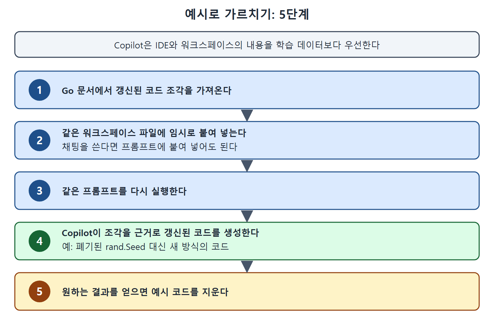

# 예시로 가르치기

모델이 폐기된 코드를 내놓는데 모델을 바꿀 수도 없다면, 원하는 방식의 코드를 직접 보여 주면 된다. Copilot은 현재 IDE와 워크스페이스에 있는 내용을 학습 데이터보다 우선한다. 이 성질을 이용해 최신 코드 조각을 컨텍스트로 넣어 주는 방법이 예시로 가르치기다.

이 문서는 Go의 rand.Seed 사례를 이어서, 대체 코드를 예시로 보여 주고 결과를 얻은 뒤 정리하는 흐름을 설명한다.

---

## 1. 절차

폐기된 방법으로 난수 시드 함수가 만들어진 상황(그림 7-15)에서, 폐기를 대체하는 코드를 쓰게 하려면 예시로 가르치면 된다.

1. Go 문서에서 갱신된 코드 조각을 가져온다.
2. 같은 워크스페이스 파일에 임시로 붙여 넣는다. 채팅 인터페이스를 쓴다면 프롬프트에 붙여 넣어도 된다.
3. 같은 프롬프트를 다시 실행한다.
4. Copilot이 넣어 준 코드 조각을 근거로 갱신된 코드를 생성한다.
5. 원하는 결과를 얻으면 예시 코드를 지운다.

갱신된 코드 조각을 임시로 넣고 같은 프롬프트를 다시 실행한 뒤, 결과를 얻으면 예시를 지우는 다섯 단계를 순서대로 보여 준다.

아주 단순한 예라서 이 경우 Copilot은 코드를 거의 그대로 가져다 썼다. 그래도 필요한 결과를 얻었다는 점이 중요하다.

## 2. 예시를 어디에 둘까

| 방법 | 언제 쓰나 |
| --- | --- |
| IDE에서 열려 있는 다른 파일에 둔다 | 별도 내용을 참고하게 하는 데 이것으로 충분할 때가 있다 |
| 작업 중인 파일에 직접 넣는다 | 다른 파일로 부족할 때. 코드 생성이 맞게 된 뒤 지운다 |
| Copilot 채팅 프롬프트에 붙여 넣는다 | 예시의 범위가 채팅에 맞을 때 |

다른 파일로 충분하면 그대로 두고, 부족할 때만 작업 중인 파일에 직접 넣으면 된다. 직접 넣은 내용은 결과가 맞게 나온 뒤 지운다.

## 3. 이 방법의 의미

여기까지는 Copilot이 이미 만든 내용의 문제를 처리하는 방법이었다. 비슷한 전략을 Copilot이 결과를 만들기 전에 써서 처음부터 더 좋은 결과를 얻을 수도 있다. 이 부분은 다음 문서에서 SQL 예시로 다룬다.

 
 
 

[Learning GitHub Copilot](../)
