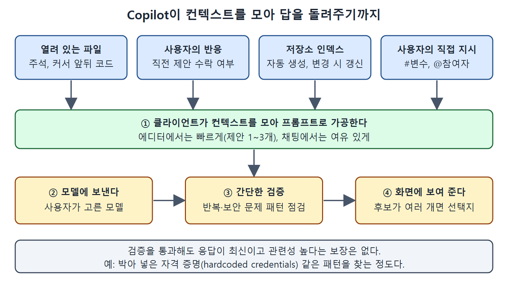

# 컨텍스트는 어디서 오나

GitHub Copilot의 답이 쓸 만한지는 Copilot이 어떤 컨텍스트(문맥)를 받았는지에 크게 좌우된다. 아무리 AI가 좋아도 때로는 방향을 잡아 줘야 하고, 어떤 파일을 보게 할지, 코드베이스에 맞는 정보를 더 줄지, 오래된 코드를 내놓는 건 아닌지 살펴야 한다.

이 문서는 그 출발점으로, Copilot이 컨텍스트를 어디서 모으고 어떻게 프롬프트로 만들어 모델에 보내는지 정리한다. 에디터에서 인라인 제안을 받을 때와 채팅을 쓸 때 방식이 어떻게 다른지도 비교한다.

---

## 1. 컨텍스트의 출처

IDE 안에서 Copilot은 지금 작업 중인 환경에서 컨텍스트를 가져온다. 워크스페이스에 있는 파일과 그 파일에 딸린 내용이 기본 재료다. 여기에 더해 사용자가 방금 전 제안을 받아들였는지 같은, 더 동적인 상호작용도 참고한다. 저장소 인덱스를 자동으로 만들어 두기 때문에 프로젝트 전체에 대한 이해도 얻는다. 필요하면 사용자가 다른 내용을 컨텍스트로 넣으라고 직접 지시할 수도 있다.

| 컨텍스트 출처 | 구체적인 내용 |
| --- | --- |
| 열려 있는 파일 | 파일 이름, 파일 안의 주석, 커서 앞뒤의 코드 |
| 사용자의 반응 | 직전 코드 제안을 수락했는지 여부 |
| 저장소 인덱스 | Copilot이 자동으로 만들어 두는 저장소 색인으로, 변경이 생기면 갱신된다 |
| 사용자의 직접 지시 | 채팅 변수, 채팅 참여자로 다른 내용을 가리키는 것 |

표를 보면 Copilot은 "지금 눈앞에 있는 것"을 가장 먼저 본다. 파일을 열어 두었다는 것은 중요한 파일이라는 신호이기 때문이다.

## 2. 인라인 제안은 빠르게

에디터에서 코드를 쓰는 동안 받는 인라인 제안(inline suggestion)은 속도가 생명이다. 그래서 Copilot은 열려 있는 파일에 초점을 맞춘다. 사용자가 바로 접근할 수 있는 파일일수록 중요할 것이라고 보기 때문이다. 이 모드에서는 응답을 빠르게 만들기 위해 여러 전략을 함께 쓴다.

- 클라이언트(인터페이스에 설치된 확장)는 모델에 제안을 아주 적게, 한 개에서 세 개 정도만 요청한다.
- 결과를 적극적으로 캐시해 두고, 사용자가 계속 타이핑하면 그에 맞춰 제안을 조정한다.
- 줄 중간에서 타이핑하는 경우에는 요청을 보내지 않는다. 커서 오른쪽에 공백이 있을 때만 예외다.
- 요청을 보낸 뒤에는 변경 사항을 반영해 인덱스를 갱신한다.

또 프롬프트를 조립한 다음 모델을 부를 가치가 있는지 점수를 매긴다. 이 판단에는 이전 제안에 대한 사용자 반응 같은 요소가 들어간다. 이렇게 하면 같은 내용이 반복되는 프롬프트나 이미 코드에 있는 내용을 다시 요청하는 일을 걸러 낼 수 있다.

## 3. 채팅은 여유 있게, 직접 가리키게

채팅 인터페이스에서는 위의 전략 대부분이 필요 없다. 응답에 쓸 수 있는 시간이 더 길어서 클라이언트가 코드 완성(completion) 후보를 더 많이 요청할 수 있다. 컨텍스트도 사용자가 훨씬 적극적으로 지정할 수 있다. 3장 등에서 본 채팅 변수(#으로 붙이는 정보)와 채팅 참여자(@로 부르는 도우미)가 그 수단이다.

| 구분 | 인라인 제안 | 채팅 |
| --- | --- | --- |
| 우선순위 | 속도 | 여유 있는 응답과 폭넓은 컨텍스트 |
| 모델에 요청하는 후보 수 | 1~3개 | 더 많이 요청 가능 |
| 캐시와 요청 억제 | 적극적으로 사용 | 대부분 필요 없음 |
| 컨텍스트 지정 | 열린 파일이 중심 | 채팅 변수와 채팅 참여자로 직접 지정 |

읽는 법은 간단하다. 에디터에서는 Copilot이 알아서 추측하고, 채팅에서는 사용자가 가리킬 수 있다. 그래서 답이 엇나갈 때는 채팅으로 옮겨 컨텍스트를 명시하는 것이 하나의 해법이 된다.

## 4. 프롬프트가 만들어져 돌아오기까지

어디에서 작업하든 큰 흐름은 같다. 클라이언트가 컨텍스트를 모으고, 프롬프트로 가공하고, 사용자가 고른 모델에 보낸다. 모델이 응답을 돌려주면 간단한 검증을 거쳐 요청한 만큼의 응답을 만들고 화면에 보여 준다. IDE에서 코드 완성 후보가 여러 개라면 선택지가 여러 개 나타날 수 있다.

네 가지 컨텍스트 출처가 클라이언트에서 프롬프트로 가공된 뒤, 모델과 간단한 검증을 거쳐 화면에 표시되는 순서를 보여 준다. 검증을 통과해도 응답이 최신이라는 보장은 없다.

여기서 말하는 간단한 검증은 응답에서 반복되는 패턴이나 보안 문제로 이어질 만한 패턴을 찾는 것이다. 예를 들어 코드에 박아 넣은 자격 증명(hardcoded credentials)이 있다. 유용한 점검이지만 이것만으로 응답이 최신이고 관련성 높다고 보장되지는 않는다. 다음 문서에서 그 이유가 되는 요인들을 살펴본다.

 
 
 

[Learning GitHub Copilot](../)
