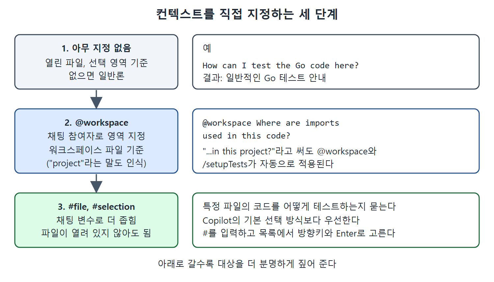

# 컨텍스트를 직접 지정하기

Copilot의 답이 정확하거나 최신이 아닐 때 쓸 수 있는 첫 번째 전략은 무엇을 컨텍스트로 쓸지 직접 말해 주는 것이다. 에디터에서 직접 작업할 때는 활성 파일 기준이 대체로 맞다. 하지만 채팅에서는 프로젝트의 다른 부분에 초점을 맞추게 하거나 "X는 어디에 쓰이나?" 같은 범용 질문에 답하게 하고 싶을 때가 많다.

이 문서는 채팅 참여자와 채팅 변수로 컨텍스트를 지정하는 방법을 책의 예시를 따라 정리한다. 이 기능은 3장에서 자세히 다뤘고, 여기서는 이 상황에서 어떻게 쓰는지에 초점을 맞춘다.

---

## 1. 채팅 참여자로 영역 정하기

채팅 참여자(@로 부르는 도우미)는 Copilot이 다루게 될 여러 영역에 대한 지식을 갖고 있다. 워크스페이스 전체, 터미널, VS Code가 그 영역이다. 질문에 참여자를 붙이면 Copilot은 그 영역을 컨텍스트로 삼는다.

앞서 프로젝트를 보면서 "Where are imports used in this code?"라고 물었더니, 우리 프로젝트가 아닌 Go 프로젝트에서 임포트를 찾는 일반 단계가 돌아왔다. "How can I test the Go code here?"도 마찬가지로 스스로 알아내는 방법을 일반론으로 알려 주었다. 하지만 프롬프트에 @workspace 참여자를 명시해 "@workspace Where are imports used in this code?"라고 물으면, Copilot은 워크스페이스에 있는 파일에서 정보를 가져와 답한다. 원래 의도에 맞는 결과다.

## 2. @workspace는 암묵적으로도 붙는다

프롬프트의 특정 단어나 구절이 Copilot으로 하여금 프롬프트에 @workspace를 붙이게 하기도 한다. 예를 들어 앞의 테스트 질문을 "How can I test the Go code in this project?"로 바꾸면, project라는 말만으로 더 큰 범위를 뜻한다고 이해한다. 그러면 프롬프트를 @workspace와 단축 명령인 /setupTests로 자동 실행한다.

| 입력 | 결과 |
| --- | --- |
| "How can I test the Go code here?" | 일반적인 Go 테스트 안내 |
| "@workspace Where are imports used in this code?" | 워크스페이스 파일 기준의 답 |
| "How can I test the Go code in this project?" | project라는 말을 근거로 @workspace와 /setupTests를 자동으로 적용 |

표의 핵심은 "here"처럼 막연한 말 대신 "project"처럼 범위를 짚는 말을 쓰거나, @workspace를 직접 붙이면 답의 기준이 바뀐다는 것이다.

## 3. 채팅 변수로 더 좁히기

내용을 더 구체적으로 좁혀야 하면 프롬프트에 #file이나 #selection 같은 채팅 변수(#으로 붙이는 정보)를 넣어 컨텍스트를 지정한다. 예를 들어 #file 채팅 변수로 프로젝트의 특정 파일 코드를 어떻게 테스트하는지 묻는 것이다.

여기서 주목할 점은 #file을 쓰면 그 파일이 에디터에서 열려 있거나 활성 상태일 필요가 없다는 것이다. 그래서 프로젝트 안의 관련 내용으로 Copilot을 이끄는 수단이 된다. 이는 어떤 내용을 쓸지 정하는 Copilot의 기본 방식보다 우선한다.

> 주의: 채팅 변수와 인자를 그냥 직접 입력하면 항상 동작하지는 않는다. 확실한 방법은 #를 입력하기 시작한 뒤, 뜨는 목록에서 방향키로 이동하고 Enter로 선택하는 것이다. 의도한 파일은 반드시 그 목록에서 골라야 한다.

아무 지정이 없는 질문, @workspace를 붙인 질문, #file 같은 채팅 변수를 쓴 질문이 각각 어떤 범위를 기준으로 답하는지 비교한 그림이다. 아래로 갈수록 대상이 더 분명해진다.

## 4. 지정해도 남는 한계

컨텍스트를 직접 지정해도 Copilot이 낡은 코드나 정보로 답하는 일이 있을 수 있다. 모델이 언제 학습되었는지에 달린 문제다. 응답이 원하는 만큼 관련성이 있거나 충실하지 않을 수도 있다. 다행히 Copilot은 고를 수 있는 모델이 여러 개라서 간단한 해결책이 있을 수 있다. 다음 문서에서 다룬다.

 
 
 

[Learning GitHub Copilot](../)
