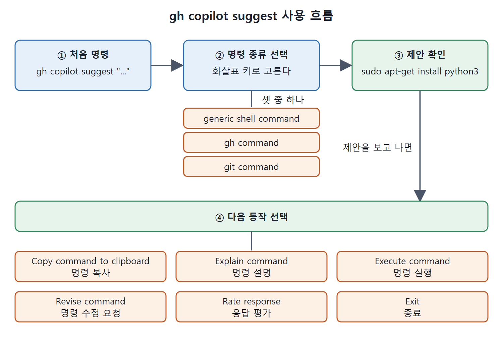

# GitHub CLI와 Copilot

에디터의 채팅이나 코드 완성만큼 흔하지는 않지만, GitHub 명령줄(GitHub CLI, `gh`)에서도 Copilot을 쓸 수 있다. 명령을 이해하고 알맞은 명령을 얻는 데 도움을 준다. 책을 쓰던 시점에는 하위 명령이 네 개였고, 기능이 제한적이지만 앞으로 늘어날 것으로 기대된다.

이 문서는 사전 준비, 명령 목록, 그리고 `explain`과 `suggest`의 실제 흐름을 정리한다.

---

## 1. 사전 준비

GitHub CLI에서 Copilot을 쓰려면 먼저 아래 세 가지가 갖춰져야 한다.

| 준비 | 방법 |
| --- | --- |
| GitHub CLI 설치 | GitHub CLI 애플리케이션을 설치한다 |
| GitHub 인증 | `gh auth` 명령 등으로 GitHub에 인증한다 |
| Copilot 확장 설치 | `gh extension install github/gh-copilot` 명령으로 GitHub CLI에 Copilot 확장을 설치한다 |

세 단계를 거치면 Copilot 명령을 쓸 수 있다. 마지막 단계가 빠지면 `gh copilot`이라는 명령 자체가 없으므로 먼저 확인한다.

## 2. 명령 목록

원서의 Table 8-1을 정리하면 다음과 같다.

| 명령 | 기능 |
| --- | --- |
| `alias` | 편의를 위한 셸별 별칭(alias) 생성 |
| `config` | 옵션 설정 |
| `explain` | 명령 설명 |
| `suggest` | 명령 제안 |

원서는 이 가운데 `explain`과 `suggest`를 예로 들어 보여 준다. 아래에서 두 명령을 차례로 따라가 본다.

## 3. explain: 명령 설명받기

Unix 명령 하나를 설명받아 보자. 다음처럼 호출한다.

```bash
gh copilot explain "ps -aux"
```

처음에 환영 메시지와 버전(책의 예는 `version 1.1.0 (2025-02-10)`)이 나온다. AI가 만든 것이라 놀라운 결과나 실수가 있을 수 있으니 생성된 코드와 제안을 확인하고 피드백을 보내라는 안내도 나온다. 이어서 설명이 나온다.

| 구성 요소 | 설명 |
| --- | --- |
| `ps` | 실행 중인 프로세스 정보를 보여 준다 |
| `-aux` | 아래 세 플래그를 합친 것이다 |
| `-a` | 모든 프로세스의 정보를 보여 준다 |
| `-u` | 프로세스의 상세 정보를 보여 준다 |
| `-x` | 제어 터미널이 없는 프로세스도 포함한다 |

복잡해 보이는 플래그 묶음을 낱개로 풀어 읽을 수 있게 해 준다.

## 4. suggest: 명령 제안받기

`suggest`는 하고 싶은 일을 말하면 명령을 제안한다. 예를 들어 `gh copilot suggest "install python"`을 실행하면, Copilot이 가장 알맞은 답을 주기 위해 추가 질문을 던질 수 있다.

가장 먼저 어떤 종류의 명령이 필요한지 묻는다. 화살표 키로 이동하거나 입력해서 걸러 낸다.

| 선택지 | 뜻 |
| --- | --- |
| generic shell command | 일반 셸 명령 |
| gh command | GitHub CLI 명령 |
| git command | Git 명령 |

책의 예에서는 일반 셸 명령을 고르자 다음 제안이 나왔다.

```text
Suggestion:
  sudo apt-get install python3
```

그 뒤에 다음 동작을 고르는 메뉴가 나온다.

| 동작 | 뜻 |
| --- | --- |
| Copy command to clipboard | 명령을 클립보드에 복사 |
| Explain command | 명령 설명 |
| Execute command | 명령 실행 |
| Revise command | 명령 수정 요청 |
| Rate response | 응답 평가 |
| Exit | 종료 |

책에서는 Explain command를 골랐고, 설명은 이렇게 나왔다. `sudo`는 상승된 권한으로 명령을 실행해 시스템 파일을 바꿀 수 있게 한다. `apt-get`은 Debian 계열 시스템의 패키지 관리 명령이다. `install`은 패키지를 설치하겠다는 하위 명령이다. `python3`은 설치할 패키지로 Python 3 인터프리터를 제공한다.

## 5. 흐름 정리

처음 명령 뒤에 Copilot과 여러 번의 후속 상호작용이 이어졌다는 점에 주목한다. 먼저 명령의 컨텍스트(일반 셸, GitHub CLI, Git)를 고르고, 셸 명령을 고르면 제안이 나오고, 제안에 대해 복사, 설명, 실행 등을 선택한다. 설명을 고르면 앞의 `explain` 예와 비슷한 설명이 나온다.

- 처음 명령: `gh copilot suggest "..."`
- 명령 종류 선택: 일반 셸, gh, git 중 선택
- 제안 확인
- 다음 동작 선택: 복사, 설명, 실행, 수정, 평가, 종료



처음 명령에서 시작해 명령 종류 선택, 제안 확인, 다음 동작 선택의 네 단계로 이어지는 흐름을 보여 준다. 마지막 단계에서 고를 수 있는 여섯 가지 동작도 함께 나타냈다.

## 6. 정리

- GitHub CLI에서 Copilot을 쓰려면 설치, 인증, 확장 설치가 필요하다.
- `explain`은 명령을 풀어 주고 `suggest`는 하고 싶은 일에 맞는 명령을 제안한다.
- 제안 뒤에 복사, 설명, 실행, 수정 같은 후속 동작을 고를 수 있다.
- 기능은 아직 제한적이며 앞으로 늘어날 것으로 예상된다.

<br>
<br>
<br>

[Learning GitHub Copilot](../)
