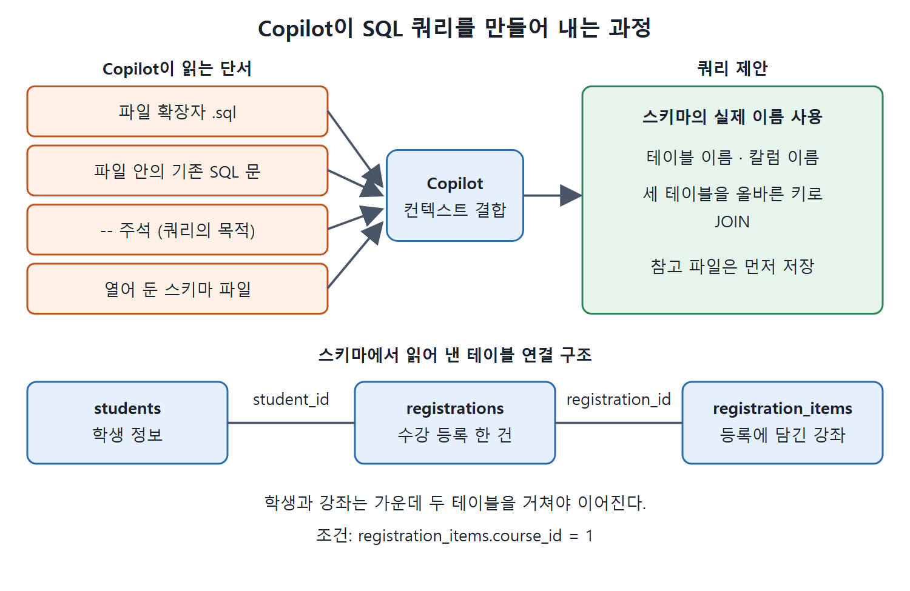

# SQL 질의와 스키마 작성

SQL은 흔히 말하는 범용 프로그래밍 언어와는 결이 다르지만, GitHub Copilot은 SQL도 JavaScript나 Python처럼 다룬다. Copilot이 쓰는 모델은 학습한 언어라면 무엇이든 코드 완성과 답변에 쓸 수 있기 때문이다. 이 문서는 SQL 중에서도 질의(쿼리)와 테이블 정의를 Copilot에게 맡기는 방법을 정리한다.

예제는 7장에서 쓴 대학 수강 등록 시스템이다. 스키마 파일을 에디터에 열어 두는 것만으로 Copilot이 테이블 이름과 칼럼 이름을 정확히 가져다 쓰는 과정을 따라간다.

---

## 1. Copilot이 SQL이라는 것을 아는 방법

Copilot은 지금 열려 있는 로컬 내용에서 컨텍스트(문맥)를 얻는다. 그래서 편집 중인 파일의 확장자가 `.sql`이거나 파일 안에 SQL 문이 들어 있으면 "SQL을 만들어야 한다"는 것을 스스로 알아챈다. 여기에 주석으로 원하는 바를 적어 주면 방향이 더 분명해진다.

| 단서 | Copilot이 읽어 내는 것 |
| --- | --- |
| 파일 확장자 `.sql` | 이 파일은 SQL을 쓰는 곳이다 |
| 파일 안의 기존 SQL 문 | 이 파일에서는 SQL을 이어 써야 한다 |
| `--` 주석 | 지금 만들 쿼리의 목적 |
| 워크스페이스에 열어 둔 스키마 파일 | 실제 테이블 이름, 칼럼 이름, 관계 |

특히 스키마 파일을 열어 두면 Copilot이 임의로 만든 이름이 아니라 스키마에 있는 실제 이름으로 쿼리를 쓴다.



네 가지 단서가 Copilot의 컨텍스트로 합쳐져 쿼리 제안이 나오는 과정이다. 아래쪽은 뒤의 예제에서 Copilot이 스키마로부터 읽어 내는 `students`, `registrations`, `registration_items`의 연결 구조를 나타낸다.

## 2. 예제 스키마

7장의 "Adding Context to Make Code More Relevant"에서 쓴 것과 같은 설정을 그대로 쓴다. 대학의 학생과 강좌 등록을 다루는 SQL 파일에 테이블이 여러 개 정의되어 있다. 이 장에서 쓰는 핵심 테이블은 다음과 같다.

| 테이블 | 주요 칼럼 | 설명 |
| --- | --- | --- |
| `courses.students` | `student_id`(기본 키), `first_name`, `last_name`, `phone`, `email`, `city`, `state`, `zip_code` | 학생 정보 |
| `courses.registrations` | `registration_id`(기본 키), `student_id`, `registration_status`, `registration_date`, `required_date`, `completion_date`, `location_id`, `staff_id` | 수강 등록 한 건 |
| `courses.registration_items` | `registration_id`, `item_id`(둘이 합쳐 기본 키), `course_id`, `quantity`, `class_hours`, `lab_hours` | 등록에 담긴 강좌 항목 |

`registrations`의 `registration_status` 칼럼은 `tinyint`이고, 주석에 값의 뜻이 적혀 있다. 1은 Pending(대기), 2는 Enrolled(수강 중), 3은 Rejected(거절), 4는 Completed(수료)이다. `student_id`와 `location_id`는 외래 키로 `ON DELETE CASCADE ON UPDATE CASCADE`가 걸려 있고, `staff_id`는 `ON DELETE NO ACTION ON UPDATE NO ACTION`이다. `registration_items`의 `lab_hours`는 기본값이 0이다.

표를 보면 학생과 강좌는 `registrations`와 `registration_items`를 거쳐야 이어진다. 이 연결 구조를 Copilot이 파일에서 읽어 내기 때문에 아래의 조인이 맞게 나온다.

## 3. 주석 프롬프트로 조회 쿼리 만들기

스키마 파일을 열어 둔 채 쿼리를 쓰는 파일에서 주석을 한 줄 적으면 된다.

```sql
-- define a select statement to get all students enrolled in a course
```

Copilot은 스키마에 맞는 쿼리를 제안한다.

```sql
SELECT students.first_name, students.last_name, students.email,
 students.phone, students.city, students.state, students.zip_code
FROM courses.students
JOIN courses.registrations
ON students.student_id = registrations.student_id
JOIN courses.registration_items
ON registrations.registration_id = registration_items.registration_id
WHERE registration_items.course_id = 1;
```

테이블 이름과 칼럼 이름이 스키마와 같고, 세 테이블을 올바른 키로 조인했다. 스키마 파일을 열어 두기만 했는데 Copilot이 그 내용을 끌어다 더 나은 쿼리를 만든 것이다. 강좌 번호가 `1`로 박혀 있는 점은 예제용이므로 실제로는 매개변수로 바꿔 쓰면 된다.

저장 안 한 새 파일은 Copilot이 컨텍스트로 보지 못할 수 있다. Copilot이 참고하길 바라는 파일은 먼저 프로젝트에 저장해 둔다.

## 4. 새 테이블 정의 만들기

조회뿐 아니라 새 테이블도 만들 수 있다. 같은 컨텍스트에서 수업별 출석을 담을 테이블을 요청해 보자.

```sql
-- define a table for student attendance to capture attendance by class
```

Copilot은 완전한 테이블 정의를 돌려준다.

```sql
CREATE TABLE courses.attendance (
    attendance_id INT IDENTITY (1, 1) PRIMARY KEY,
    registration_id INT NOT NULL,
    attendance_date DATE NOT NULL,
    attendance_status tinyint NOT NULL,
    -- Attendance status: 1 = Present; 2 = Absent; 3 = Late; 4 = Excused
    FOREIGN KEY (registration_id) REFERENCES courses.registrations
(registration_id) ON DELETE CASCADE ON UPDATE CASCADE
);
```

이 정의는 기존 `courses.registrations` 정의와 형식이 닮았다. 기본 키를 `INT IDENTITY (1, 1) PRIMARY KEY`로 만들고, 상태 값은 `tinyint`에 주석으로 의미를 적고, 외래 키에 `ON DELETE CASCADE ON UPDATE CASCADE`를 붙이는 방식이 같다. 두 테이블 모두 상태 값을 1부터 4까지 쓰는 점도 일관된다.

| 항목 | `registrations` | `attendance` |
| --- | --- | --- |
| 기본 키 | `registration_id INT IDENTITY (1, 1) PRIMARY KEY` | `attendance_id INT IDENTITY (1, 1) PRIMARY KEY` |
| 상태 칼럼 | `registration_status tinyint NOT NULL` | `attendance_status tinyint NOT NULL` |
| 상태 값 | 1 Pending, 2 Enrolled, 3 Rejected, 4 Completed | 1 Present, 2 Absent, 3 Late, 4 Excused |
| 외래 키 동작 | `ON DELETE CASCADE ON UPDATE CASCADE` 등 | `ON DELETE CASCADE ON UPDATE CASCADE` |

기존 스키마의 습관(이름 규칙, 상태 값 방식, 키 정의)을 새 테이블이 이어받는다는 점이 핵심이다. 그래서 따로 규칙을 설명하지 않아도 스키마가 한결같이 유지된다.

## 5. 정리

- SQL 파일의 확장자, 기존 SQL 문, 주석이 Copilot에게 "SQL을 써야 한다"는 단서가 된다.
- 스키마 파일을 워크스페이스에 열어 두면 쿼리와 테이블 정의가 실제 이름과 관계에 맞게 나온다.
- 참고할 파일은 미리 저장해 둔다.
- 새 테이블도 기존 스키마의 형식을 따라 만들어 준다.

<br>
<br>
<br>

[Learning GitHub Copilot](../)
