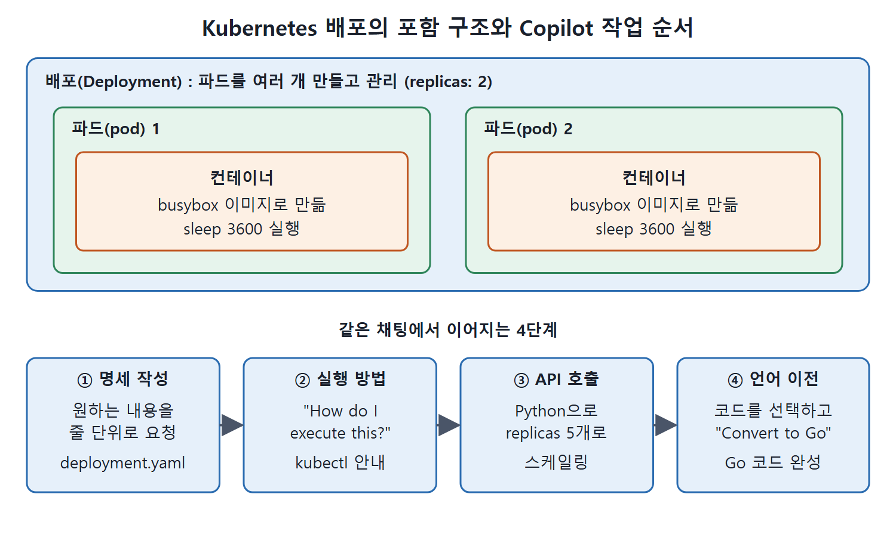

# YAML과 Kubernetes

Kubernetes 같은 프레임워크는 "무엇을 어떻게 하라"가 아니라 "이런 상태가 되면 좋겠다"를 적는 선언형 방식으로 동작하고, 그 내용은 대개 YAML 파일에 쓴다. 순서가 정해진 형식이라서 Copilot은 일반 프로그래밍 언어처럼 코드 완성을 제안하고 질문에도 답해 준다.

이 문서는 Kubernetes 배포(Deployment) 명세를 Copilot으로 만들고, 실행 방법을 묻고, Python과 Go 코드로 바꾸는 흐름을 따라간다.

---

## 1. 왜 AI의 도움이 필요한가

YAML은 많은 애플리케이션에서 중요한 형식이지만 문법과 들여쓰기 규칙이 엄격해서 다루기 까다롭다. Kubernetes 자체도 어려운 점이 여럿 있다.

- 원하는 오브젝트를 YAML로 정의하는 방법을 배우고 기억해야 한다.
- 모든 기본 오브젝트는 공통 속성이 있지만, 오브젝트마다 고유한 명세(spec)가 따로 있다.
- 서비스나 제품 규모로 키우면 어려움이 더 커진다.
- 오류나 잘못된 형식이 하나만 있어도 앱이 동작하지 않을 수 있다.

실수 하나가 치명적이므로 AI가 거드는 효과가 크다.

## 2. 기본 용어

배포 명세를 만들기 전에 필요한 용어를 정리한다.

| 용어 | 뜻 |
| --- | --- |
| 컨테이너 | 이미지를 바탕으로, 앱이 실행되는 독립된 환경 |
| 파드(pod) | 하나 이상의 컨테이너를 감싸는 단위 |
| 배포(Deployment) | 파드 여러 개를 만들고 관리하는 Kubernetes 오브젝트 |
| 클러스터 | Kubernetes를 돌리는 여러 대 기계의 모음 |
| kubectl | Kubernetes 명령줄 도구(CLI) |

관계는 배포가 파드를 관리하고, 파드가 컨테이너를 담고, 컨테이너가 이미지로 만들어진다는 포함 구조이다. 이 정도만 알면 Copilot에게 요청할 수 있다.



위쪽은 배포가 파드를, 파드가 컨테이너를 담는 포함 구조이고, 아래쪽은 이 문서에서 같은 채팅으로 이어서 요청하는 네 단계(명세 작성, 실행 방법, API 호출, 언어 이전)이다.

## 3. 배포 명세 만들기

채팅에 원하는 내용을 줄 단위로 적는다.

```text
write spec for deployment in Kubernetes with 2 replicas and image
from busybox
add command to run in containers: sleep 3600
add label app: myapp
add label type: front-end
```

잠시 후 Copilot이 다음과 비슷한 YAML을 제안한다.

```yaml
apiVersion: apps/v1
kind: Deployment
metadata:
  name: myapp-deployment
  labels:
    app: myapp
    type: front-end
spec:
  replicas: 2
  selector:
    matchLabels:
      app: myapp
```

이어지는 파드 템플릿 부분에는 같은 라벨이 다시 들어가고, 컨테이너 정의가 붙는다.

```yaml
  template:
    metadata:
      labels:
        app: myapp
        type: front-end
    spec:
      containers:
      - name: busybox-container
        image: busybox
        command: ["sleep", "3600"]
```

위 두 조각을 이어 붙이면 하나의 `deployment.yaml`이 된다. 코드블록 길이 때문에 둘로 나누어 적었다.

Kubernetes를 몰라도 이 문법이 유효하고 우리가 기대한 배포 명세와 같다는 점을 알 수 있다. 필요했던 것은 어떤 오브젝트를 넣을지 정도뿐이었다. 이 파일은 `deployment.yaml`로 저장하고 다음 단계로 넘어간다.

| 요청에 적은 것 | 명세에서 대응하는 곳 |
| --- | --- |
| 2 replicas | `spec.replicas: 2` |
| image from busybox | `image: busybox` |
| command: sleep 3600 | `command: ["sleep", "3600"]` |
| label app: myapp, type: front-end | `metadata.labels`와 파드 템플릿의 `labels` |

## 4. 실행 방법 물어보기

명세를 만들었으니 언젠가 실행해야 한다. 방법이 막막하면 채팅에 "How do I execute this?"라고 물으면 된다. Copilot은 앞서 만든 `deployment.yaml` 파일을 참조해서, 이것을 Kubernetes 클러스터에 넣고 배포가 실행 중인지 확인하는 방법을 안내한다. 이때 Kubernetes CLI인 `kubectl`을 쓴다(원서 Figure 8-1).

## 5. Kubernetes API를 Python으로 호출하기

나중에 CLI 대신 Kubernetes API로 이 배포를 관리해야 할 수도 있다. 거기에 Python을 쓰고 컨테이너 인스턴스 수를 바꾸는(스케일링) 기능이 필요하다고 하자. 이것도 채팅에 자연어로 묻는다.

```text
How do I call the K8s API for scaling a deployment to 5 replicas with Python?
```

Copilot은 먼저 Kubernetes Python 클라이언트 라이브러리를 쓰면 된다고 알려 주고 해당 Python 코드를 내놓는다(Figure 8-2). 코드를 실행하는 데 필요한 단계에 대한 설명도 함께 준다(Figure 8-3). 제안된 코드는 에디터에서 새 파일로 저장해 원하는 대로 고치고 테스트하면 된다.

## 6. Go로 바꾸기

Kubernetes에서는 Go가 더 흔한 언어다. 앞의 Python 코드를 Go로 옮기고 싶다면 Python 코드를 선택해 참조 상태로 둔 뒤 "Convert to Go"라고 하면 끝이다. Copilot은 채팅에 같은 일을 하는 Go 코드를 만들어 준다(Figure 8-4). Python 때와 마찬가지로 설명과 실행 단계도 함께 제공한다(Figure 8-5).

| 단계 | 요청 | 얻는 것 |
| --- | --- | --- |
| 명세 작성 | 배포 명세를 줄 단위로 요청 | `deployment.yaml` |
| 실행 방법 | "How do I execute this?" | `kubectl`로 적용하고 확인하는 안내 |
| API로 스케일링 | Python으로 5개 replicas 호출 방법 | Python 클라이언트 라이브러리 코드와 실행 단계 |
| 언어 이전 | 코드를 선택하고 "Convert to Go" | 같은 기능의 Go 코드와 실행 단계 |

## 7. 정리

- YAML 같은 선언형 형식도 Copilot은 일반 코드처럼 만들어 준다.
- 원하는 상태를 자연어로 적으면 문법에 맞는 명세가 나온다.
- 실행 방법, API 호출 코드, 다른 언어로의 변환까지 같은 채팅에서 이어서 요청할 수 있다.
- 복잡한 프레임워크의 설정과 연동 작업을 크게 단순하게 만든다.

<br>
<br>
<br>

[Learning GitHub Copilot](../)
