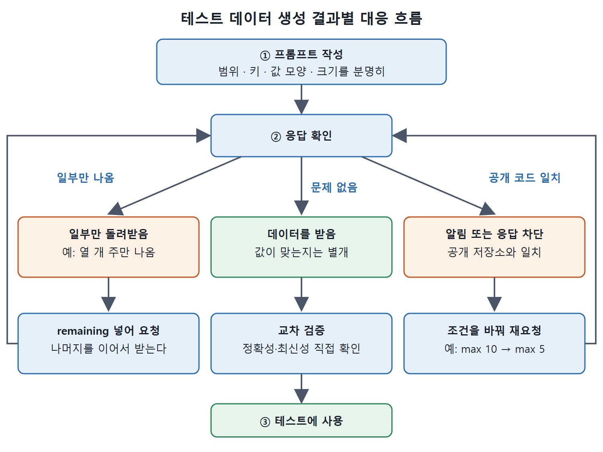

# 테스트 데이터 생성

정규식을 시험하거나 코드의 다른 부분을 간단히 테스트하려면 데이터가 필요하다. 이런 데이터를 직접 찾거나 만드는 것은 반복적인 밑작업이다. Copilot은 이런 보일러플레이트(매번 되풀이되는 틀) 작업, 즉 코딩 방식을 검증하거나 코딩 후 테스트하는 데 쓸 데이터와 데이터 매핑을 만들어 준다.

이 문서는 데이터 생성 프롬프트를 쓰는 법과, 생성된 데이터를 쓸 때 부딪히는 세 가지 문제를 정리한다.

---

## 1. 프롬프트를 분명하게 쓴다

방식은 앞서와 같다. 잘 정의된 프롬프트를 주면 원하는 결과가 나온다. 어떤 주(state)의 지역 번호를 찾는 함수를 검증할 테스트 데이터가 필요하다고 하자. 다음과 같이 요청한다.

```text
Create a mapping of all 50 states to area codes where the key is the state
abbreviation and the value is an array of codes with max 10.
```

키가 무엇이고 값이 무엇인지 구체적으로 적었다는 점에 주목한다. Copilot은 요청한 데이터를 돌려준다(Figure 8-6). 요청에서 정해 줘야 하는 항목은 아래와 같다.

| 프롬프트에 담을 것 | 예제에서의 표현 |
| --- | --- |
| 데이터의 범위 | all 50 states |
| 키 | 주 약어 (state abbreviation) |
| 값의 모양 | 지역 번호 배열 (array of codes) |
| 크기 제한 | max 10 |

## 2. 데이터가 맞는지는 직접 확인한다

가끔 Copilot이 생성 데이터의 정확성에 관한 면책 문구를 붙인다. 이 예에서는 지역 번호가 자리 표시용(placeholder)이며 각 주의 실제 지역 번호라고 보장하지 않는다는 내용이다.

7장에서도 짚었던 점이다. Copilot은 학습한 데이터만 바탕으로 일한다. 밖에 나가서 반환 값이 맞는지, 최신인지 확인하지 않는다. 정확하고 시의성 있는 데이터가 필요하면 반드시 교차 검증해야 한다. Copilot이 준 값이 현재 기준으로 맞다고 가정해서는 안 된다.

## 3. 자주 만나는 두 가지 문제

데이터 생성을 요청하면 앞의 문제 외에 두 가지를 더 만날 수 있다.



응답을 확인한 뒤 일부만 나왔으면 `remaining`을 넣어 다시 요청하고, 공개 코드와 일치해 막혔으면 조건을 바꿔 다시 요청한다. 문제가 없어 보여도 교차 검증을 거친 뒤에 테스트에 쓴다.

| 문제 | 원인 | 대응 |
| --- | --- | --- |
| 데이터가 일부만 나온다 | 프롬프트와 요청한 양에 따라 일부만 돌려준다 | 프롬프트에 remaining(나머지)을 넣어 이어서 요청한다 |
| 공개 코드와 일치한다는 알림이 뜬다 | 생성 데이터가 공개 저장소의 데이터와 같다 | 요청 방식을 바꿔 다른 데이터를 만들게 한다 |

### 3.1. 일부만 나오는 경우

프롬프트에서 "all 50"을 빼고 "Create a mapping of states to area codes where the key is the state abbreviation and the value is an array of codes with max 10"이라고만 하면, 몇 건만 돌려줄 수 있다. 책의 예에는 CA, NY, TX, FL, IL, PA, OH, GA, NC, MI 열 개 주가 나왔다.

```python
state_area_codes = {
    "CA": [213, 310, 415, 510, 530, 559, 619, 626, 650, 661],
    "NY": [212, 315, 347, 516, 518, 585, 607, 631, 646, 716],
    "TX": [210, 214, 254, 281, 325, 346, 361, 409, 430, 432],
    # ... FL, IL, PA, OH, GA, NC, MI
}
```

시작하기에는 충분하지만 완전한 세트는 아니다. 이럴 때는 다음처럼 나머지를 요청한다.

```text
Create a mapping of the remaining states to area codes where the key is the
state abbreviation and the value is an array of area codes with max 10.
```

`remaining`이라는 단어를 넣어서 Copilot이 중단한 곳에서 이어 가도록 알려 주는 것이다.

### 3.2. 공개 코드와 일치하는 경우

생성 데이터가 공개 저장소의 데이터와 일치한다는 알림이 올 수 있다. 공개 코드와 일치하는 생성 코드를 막는 설정을 켜 두었다면 Copilot의 응답 전체가 차단된다.

이런 종류의 데이터는 대체로 독점적일 가능성이 낮다. 라이선스 위반 우려가 없다면 프롬프트를 바꿔 다른 차원으로 생성하게 하면 보통 해결된다. 요청 양만 바꿔도 되는 경우가 있다. 예를 들어 max 값을 10에서 5로 줄여 "...array of area codes with max 5"라고 요청한다.

## 4. 정리

- 데이터 생성도 프롬프트가 좌우한다. 범위, 키, 값 모양, 크기를 분명히 적는다.
- 생성된 값은 학습 데이터 기반이라 정확성과 최신성을 보장하지 않으므로 교차 검증한다.
- 일부만 나오면 `remaining`을 넣어 이어서 요청한다.
- 공개 코드 일치로 차단되면 요청 양 같은 조건을 바꿔 다시 시도한다.

<br>
<br>
<br>

[Learning GitHub Copilot](../)
