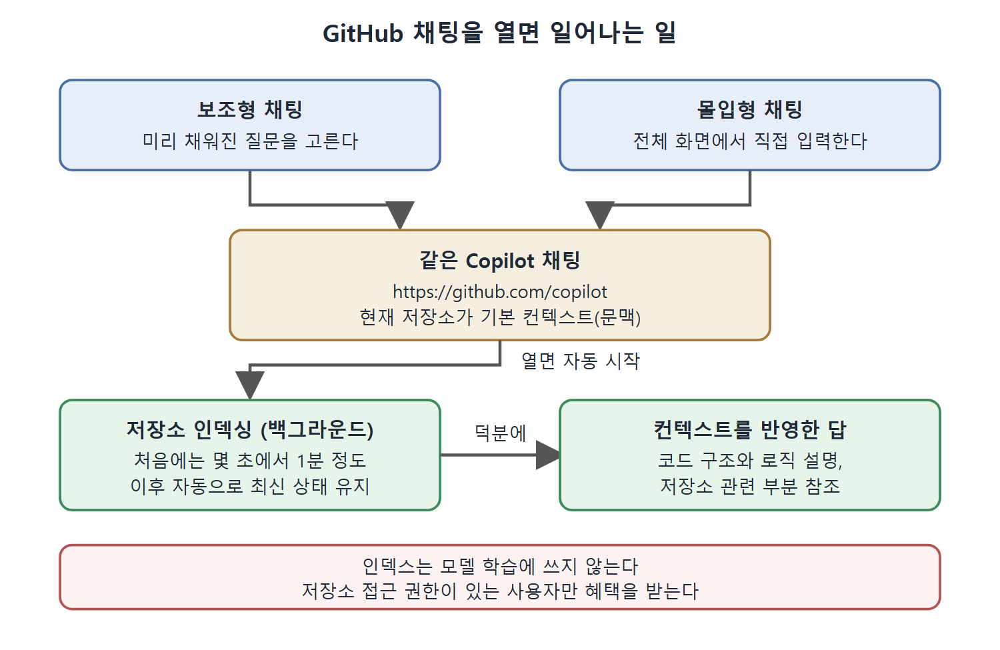

# GitHub 채팅과 저장소 인덱싱

IDE에서 쓰던 Copilot 채팅은 GitHub 웹에도 들어와 있다. 저장소 화면에서 바로 열 수 있고, 지금 보고 있는 저장소를 컨텍스트(문맥)로 잡은 채 대화가 시작된다. 새 프로젝트에 합류했거나 남이 만든 코드를 넘겨받을 때, 코드를 내려받기 전에 구조부터 파악하는 용도로 쓰기 좋다.

이 문서는 GitHub 웹에서 채팅을 여는 위치, 두 가지 채팅 화면(보조형과 몰입형), 채팅 창의 컨트롤과 메뉴, 그리고 채팅을 열 때 뒤에서 일어나는 저장소 인덱싱을 정리한다. 책의 화면 설명은 집필 시점 기준이라 GitHub 화면은 나중에 바뀔 수 있다.

---

## 1. 채팅을 여는 위치

GitHub에는 저장소와 상관없이 쓰는 일반 채팅이 `https://github.com/copilot`에 있다. 저장소의 Code 페이지에는 맨 윗줄 컨트롤 영역에 Copilot 아이콘이 따로 있다.

이 아이콘은 누르는 자리에 따라 동작이 다르다.

| 누르는 곳 | 결과 |
|---|---|
| Copilot 아이콘 자체 | 해당 프로젝트를 컨텍스트로 잡은 몰입형(전체 화면) 채팅이 열린다 |
| 아이콘 옆 드롭다운 화살표 | 선택지 메뉴가 열리고, 그중 Assistive 항목이 보조형 채팅을 연다 |
| 보조형 화면에서 오른쪽 위 사각형 아이콘 | 보조형 화면에서 몰입형 화면으로 넘어간다 |

보조형이든 몰입형이든 결국 `https://github.com/copilot`가 열리고, 현재 저장소가 기본 컨텍스트로 잡힌다는 점은 같다. 표를 보면 아이콘을 어디서 누르든 같은 채팅 기능에 닿는다는 것을 알 수 있다. 다른 점은 화면 크기와 모양뿐이다.

## 2. 보조형 채팅: 미리 채워진 질문

Assistive 항목을 고르면 채팅 창이 열리고, 선택한 저장소에 대해 물어볼 만한 질문이 미리 채워져 있다. 직접 입력하지 않고 질문 하나를 고르면 된다.

여기서 눈여겨볼 점은 질문을 고르면 훨씬 긴 프롬프트가 대신 입력된다는 것이다. 사용자가 "이 저장소에 대해 알려 줘"라는 질문을 고르면 Copilot에는 다음과 같은 취지의 준비된 프롬프트가 전달된다.

- 저장소의 목적을 설명하고, README가 있으면 요약한다.
- 구현 코드가 있다면 쓰인 기능과 기술을 자세히 분석하고, 없다면 저장소 내용물을 분석한다.
- 문단마다 굵은 제목을 붙이고, 간결하고 대화체로 쓴다.
- 컨텍스트 정보를 그대로 나열하지 않고, 반복 없이 요약해서 쓴다.

짧은 질문이 이렇게 정교한 프롬프트로 바뀌기 때문에, 직접 쓸 때보다 형식이 잘 잡힌 답을 얻는다.

책의 예에서는 쿠버네티스 오퍼레이터(Operator)를 만드는 기초 예제 저장소를 대상으로 했고, 답은 크게 두 부분이었다.

| 답의 제목 | 담긴 내용 |
|---|---|
| 저장소의 목적 | 표준 도구로 쿠버네티스 오퍼레이터를 만드는 법을 익히는 학습 자료다. README에는 설치와 실행, 클러스터 배포, 테스트, API 정의 수정 방법이 있고, 리소스를 원하는 상태로 맞춰 주는 Operator 패턴을 따른다 |
| 기능과 사용 기술 | Go로 작성했고 Kubebuilder로 컨트롤러를 만든다. 사용자 정의 리소스(CRD)를 다루며 클러스터 상태를 원하는 설정에 맞춘다. 빌드, 배포, 제거용 Makefile 대상도 있다 |

이런 답은 프로젝트에 새로 합류하는 사람이나 코드 관리를 넘겨받는 사람에게 특히 유용하다. 저장소에 관한 첫 질문의 답이 곧 온보딩 문서 역할을 한다.

### 열려 있는 항목에 따라 달라지는 질문

새 보조형 채팅은 지금 열려 있는 GitHub 항목에 맞는 질문으로 채워진다. 예를 들어 이슈를 보다가 새 채팅을 열면 "Summarize this issue", "What are the next steps?" 같은 질문이 보인다. 이것도 선택하면 더 긴 프롬프트로 바뀌어서 더 좋은 정보를 끌어낸다.

| 열려 있는 항목 | 미리 채워지는 질문의 성격 |
|---|---|
| 저장소 | 저장소의 목적, 기능, 사용 기술을 묻는 질문 |
| 이슈 | 이슈 요약, 다음 단계 제안 |

이 표에서 읽을 점은 채팅이 항목 종류를 알아본다는 것이다. 어떤 화면에서 열었는지가 곧 컨텍스트가 된다. 책이 든 예시는 저장소와 이슈 두 가지이고, 이슈의 경우 위의 두 질문이 나타난다.

## 3. 몰입형 채팅

몰입형은 전체 화면 채팅이다. 모양은 IDE의 채팅 창과 비슷하고 저장소가 기본 컨텍스트다. 텍스트를 입력하는 영역의 컨트롤도 IDE 채팅과 거의 같다. 다만 제출 화살표 버튼 옆에 추가 선택지가 없다. IDE에서는 채팅 참여자 같은 대상에게 질문을 보낼 수 있지만, GitHub 웹 채팅에는 채팅 참여자 등이 없어서 보낼 대상을 고를 이유가 없기 때문이다.

## 4. 채팅 창의 컨트롤

몰입형 화면에서 주로 보이는 컨트롤을 정리하면 다음과 같다. 일부는 몰입형일 때만 보일 수 있다.

| 위치 | 모양 | 기능 |
|---|---|---|
| 왼쪽 위 | 줄과 오른쪽 화살표가 든 사각형 | 이전 대화 목록을 열고 대화 사이를 전환한다 |
| 그 오른쪽 | 연필이 든 사각형 | 새 대화를 연다 |
| 맨 오른쪽 | Open Workbench | 책을 쓰던 시점에는 이 기능이 무엇인지 설명한 문서가 사실상 없었다 |
| 첫 프롬프트를 보낸 뒤 나타남 | Share 버튼 | 대화를 공유한다 |
| Share 오른쪽 | 점 세 개 Menu | 고급 기능 메뉴를 연다 |

대화마다 따로 기록이 남고, 왼쪽 위 컨트롤로 목록에서 골라 이어 갈 수 있다. Open Workbench는 설명이 없었으므로 이 문서도 용도를 추측하지 않는다.

### 대화 공유하기

Share 버튼은 프롬프트를 한 번 보낸 뒤에 나타난다. 짝 코딩이나 문제 해결을 함께 할 때, 또는 PR에 Copilot의 통찰을 덧붙이고 싶을 때 대화를 공유하는 용도다.

1. 오른쪽 위의 Share를 누르고, 뜨는 대화상자에서 Share를 한 번 더 누른다. 이렇게 하면 현재 대화와 이후 메시지가 공유된다.
2. Share 옆 드롭다운 화살표에서 공유 링크를 복사해 상대에게 보낸다.
3. 필요하면 같은 자리에서 공유를 취소(unshare)한다.

### Menu 항목

점 세 개 Menu에서는 다음 기능을 쓸 수 있다.

| 항목 | 하는 일 |
|---|---|
| Conversation | 현재 대화의 이름 변경, 삭제, 공유 |
| Personal instructions | 응답 방식(언어, 어조, 코딩 스타일)을 지정한다. 예를 들어 "Always answer in Python"이나 "Be concise"처럼 쓴다. 저장소나 조직 단위 설정보다 우선하고, GitHub에서 하는 모든 내 Copilot 채팅에 적용된다 |
| System prompt | GitHub의 Copilot에 설정된 시스템 프롬프트 문장을 보여 준다 |
| Manage shared conversations | 내가 공유한 대화 목록을 보고, 각각 링크를 얻거나 공유를 취소한다 |
| Give feedback | 피드백을 보낸다 |
| Settings | 내 Copilot 개인 설정 화면으로 이동한다 |

Personal instructions는 GitHub 웹 채팅에 대한 개인 단위 설정이다. 저장소나 조직의 설정과 충돌하면 개인 설정이 이긴다는 점을 기억해 두면 된다.

## 5. 채팅이 시작하는 저장소 인덱싱

채팅 화면은 AI와 저장소 이야기를 나누는 통로이면서, 그 저장소의 인덱싱을 시작시키는 방아쇠이기도 하다. IDE에서 인덱스를 만들어 쓰는 것과 같은 개념이지만 GitHub 쪽 저장소에는 별도의 인덱스가 만들어진다. 목적은 같다. Copilot이 저장소를 더 깊고 풍부하게 이해하도록 돕는 것이다.

저장소를 선택한 상태로 Copilot Chat을 열면 백그라운드에서 인덱싱이 자동으로 시작된다. 사용자가 따로 할 일은 없다. 이 덕분에 코드 구조나 로직을 설명하거나 저장소의 관련 부분을 참조하는 식으로 컨텍스트를 반영한 답을 받는다.

보조형과 몰입형은 입구만 다르고 같은 채팅으로 이어지며, 채팅을 열면 저장소 인덱싱이 자동으로 시작되어 컨텍스트를 반영한 답으로 이어지는 흐름을 보여 준다.

| 특성 | 내용 |
|---|---|
| 자동 시작 | 저장소 컨텍스트로 채팅을 열면 저절로 시작된다 |
| 속도 | 처음 인덱싱은 보통 몇 초에서 1분 정도이고, 큰 저장소도 마찬가지다 |
| 지속 갱신 | 한 번 인덱싱되면 자동으로 최신 상태를 유지한다. 보통 새 대화를 시작한 뒤 몇 초 안에 반영된다 |
| 개수 제한 | 인덱싱할 수 있는 저장소 수에 제한이 없다. 무료 요금제를 포함해 모든 구독 수준에 적용된다 |
| 모델 학습 | 인덱싱된 데이터는 모델 학습에 쓰지 않고, 저장소 코드에 관한 질문에 더 잘 답하는 용도로만 쓴다 |
| 접근 제어 | 저장소에 접근 권한이 있는 사용자만 그 인덱스를 통한 컨텍스트 혜택을 받는다 |

이 표에서 보안과 관련해 중요한 것은 마지막 두 줄이다. 코드가 학습에 쓰이지 않고, 권한 없는 사람은 인덱스 혜택을 받지 못한다.

## 6. 정리해서 기억할 것

- 채팅과 인덱싱은 새 프로젝트에 적응하거나 책임을 넘겨받을 때 가장 큰 도움이 된다.
- 하지만 변경과 수정을 다루는 작업에서는 채팅 말고도 Copilot을 쓸 방법이 더 있다. 다음 문서에서 코드 스캔 경고를 고치는 흐름으로 이어서 본다.

 
 
 

[Learning GitHub Copilot](../)
