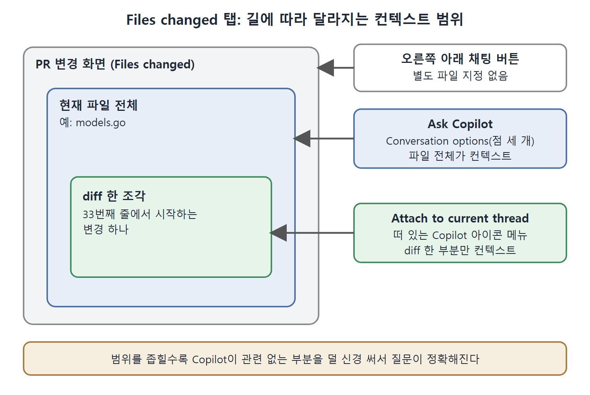

# PR 변경 내용 탐색

PR 요약만으로는 부족하고 특정 변경을 더 깊이 들여다보고 싶을 때가 있다. 그럴 때도 Copilot을 쓸 수 있다. PR의 Files changed 탭에는 Copilot으로 들어가는 길이 여러 개 있고, 길마다 채팅에 붙는 컨텍스트(문맥)의 범위가 다르다. 파일 전체를 붙일지, 변경된 한 조각만 붙일지가 갈린다.

이 문서는 Files changed 탭에서 Copilot을 여는 세 가지 방법과 보조 메뉴, 그리고 각각 어떤 컨텍스트가 붙는지를 비교해서 정리한다.

---

## 1. 변경을 보러 가는 길

앞에서 본 PR의 요약 설명에는 두 브랜치 사이의 변경으로 가는 링크가 들어 있다. 이 링크를 눌러도 되고, 바로 Files changed 탭으로 가서 차이(diff)를 봐도 된다.

## 2. Files changed 탭의 Copilot 진입점

이 탭에는 Copilot을 여는 링크가 두 개 있고, 파일 차이 화면에는 가끔 숨어 있는 세 번째가 있다.

| 진입점 | 위치 | 동작 | 붙는 컨텍스트 |
|---|---|---|---|
| 일반 채팅 버튼 | 오른쪽 아래 | 표준 Copilot Chat 화면을 연다 | 별도 파일 지정 없음 |
| Ask Copilot | 위쪽, "Review changes" 버튼 옆 | 현재 파일을 채팅 컨텍스트에 자동으로 붙이고 대화창을 연다 | 현재 파일 전체 |
| 떠 있는 Copilot 아이콘의 Attach to current thread | 선택한 diff 시작 부근 | 이 diff를 현재 대화의 컨텍스트로 붙인다 | 그 diff 한 부분 |
| 같은 아이콘의 Explain | 위와 같음 | Copilot의 설명(explain) 기능과 비슷하게 변경을 설명한다 | 원문에 명시 없음 |

이 표에서 구분할 핵심은 Ask Copilot은 파일 단위이고 Attach to current thread는 diff 단위라는 점이다. 범위를 좁히면 Copilot이 관련 없는 부분을 신경 쓰지 않으므로 질문이 더 정확해진다.

일반 채팅 버튼, Ask Copilot, Attach to current thread가 각각 어느 범위를 컨텍스트로 붙이는지 겹친 상자로 나타낸 그림이다. 안쪽 상자일수록 범위가 좁다.

## 3. Ask Copilot으로 파일 단위 질문하기

Ask Copilot을 누르면 현재 파일이 컨텍스트로 붙은 대화창이 열린다. 책의 예시에서는 파일이 `models.go`였고, 이후 이 대화창에서 하는 질문은 이 파일을 기준으로 답해진다.

예를 들어 "Summarize the changes in this file"이라고 물으면, 컨텍스트로 붙은 파일에 관한 변경 정보를 돌려준다.

## 4. 떠 있는 아이콘으로 diff 단위 질문하기

선택한 diff의 시작 부근으로 스크롤하면 작은 Copilot 아이콘이 떠 있고 옆에 드롭다운 화살표가 있다. 가끔 숨어 있어서 놓치기 쉽다. 누르면 두 가지 선택이 나온다.

- Explain: 앞에서 본 Copilot의 explain과 비슷하게 변경을 설명한다.
- Attach to current thread: 이 diff를 Copilot 채팅의 컨텍스트로 지정한다.

Attach to current thread를 고른 뒤 채팅 창을 열면, 파일 전체가 아니라 33번째 줄에서 시작하는 그 변경 하나만 참조하고 있는 것이 보인다. 책의 예시가 그랬다.

## 5. 대화 옵션 메뉴

diff 창 오른쪽 위의 Conversation options(점 세 개)에서도 Copilot 기능에 접근할 수 있다. 여기서 쓰는 두 선택지는 Ask Copilot 버튼처럼 파일을 채팅 컨텍스트에 추가한다.

| 접근 방법 | 파일 전체 컨텍스트 | diff 한 부분 컨텍스트 |
|---|---|---|
| Ask Copilot 버튼 | 예 | 아니오 |
| Conversation options(점 세 개) | 예 | 아니오 |
| Attach to current thread | 아니오 | 예 |

세 가지 방법 가운데 변경 한 조각에만 집중하고 싶으면 Attach to current thread를 쓴다고 정리하면 된다.

## 6. 언제 무엇을 쓸까

| 상황 | 알맞은 방법 |
|---|---|
| PR 전체를 이해하고 싶다 | 오른쪽 아래의 일반 채팅에서 요약 요청 |
| 파일 하나가 어떻게 바뀌었는지 알고 싶다 | Ask Copilot |
| 특정 변경 하나의 의미가 궁금하다 | 떠 있는 아이콘에서 Attach to current thread 또는 Explain |

마지막으로 GitHub 코딩을 돕는 또 다른 요소인 이슈를 Copilot과 함께 다루는 법을 다음 문서에서 본다.

 
 
 

[Learning GitHub Copilot](../)
