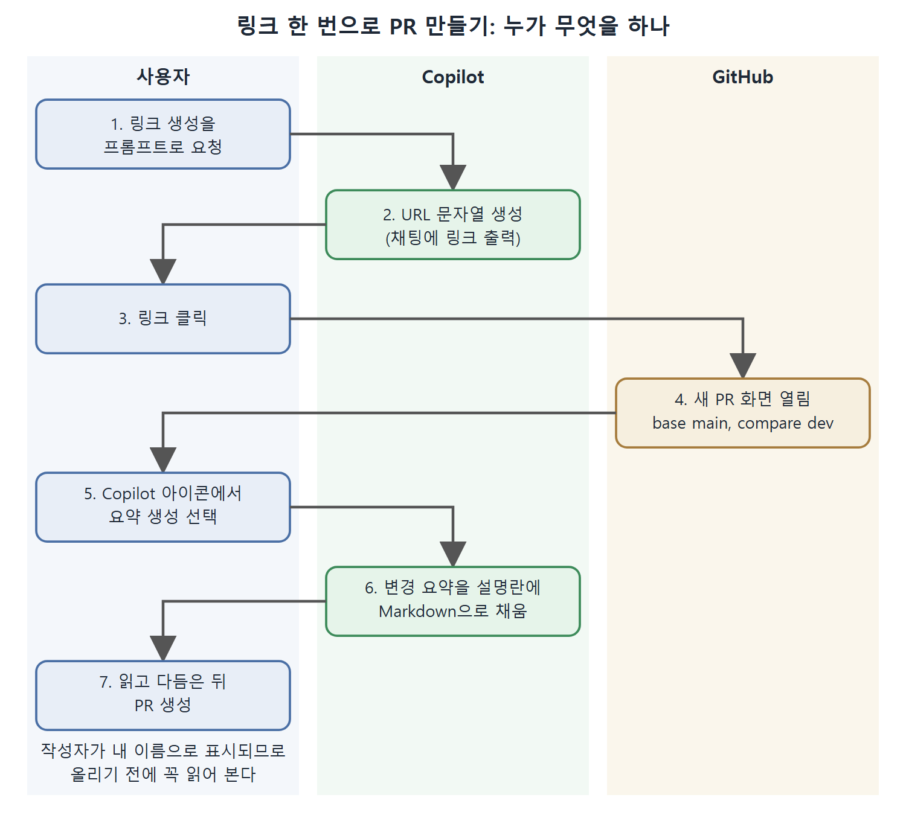

# 링크로 PR 만들기와 요약 생성

PR을 새로 만들려면 메뉴를 따라 여러 단계를 거쳐야 한다. Copilot을 쓰면 이 과정을 클릭 한 번으로 줄일 수 있다. GitHub의 대부분의 화면과 동작은 URL로 바로 열 수 있다는 점을 이용해서, Copilot에게 알맞은 URL을 만들어 달라고 하는 방식이다.

이 문서는 링크 한 번으로 PR 작성 화면을 여는 방법, 변경 내용에서 PR 설명을 자동으로 만드는 방법, 그리고 같은 요령을 다른 작업으로 넓히는 방법을 정리한다.

---

## 1. 상황

같은 저장소에서 세 가지 경고를 모두 고쳐서 dev라는 다른 브랜치에 푸시했다고 하자. 이제 dev를 main에 병합하는 새 PR을 만들고 싶다.

물론 PR 메뉴에서 단계를 밟아 만들 수 있다. Copilot을 쓰면 아래처럼 단순해진다.

## 2. 프롬프트로 링크 받기

Copilot 채팅을 열고 다음 같은 프롬프트를 쓴다.

```text
Create a link to click on to open a new pull request to merge the
dev branch into main.
```

Copilot은 채팅 출력에 링크를 만들어 준다. 책이 강조하는 점은 Copilot이 하는 일이 링크 문자열을 만들어 주는 것뿐이라는 것이다. 같은 URL을 직접 입력해도 똑같이 열린다. 즉 Copilot이 GitHub 내부에서 마법을 부리는 것이 아니라, URL 규칙을 아는 도우미 역할을 한다.

링크를 클릭하면 새 PR 화면이 열리고 base와 compare 항목이 이미 원하는 값으로 채워져 있다. 위 예시라면 병합 대상이 main, 비교 대상이 dev로 잡힌다.

## 3. 변경 내용으로 PR 설명 생성하기

PR 만들기가 쉬워진 데 더해, 변경 내용을 바탕으로 PR 설명(요약)도 Copilot에게 만들게 할 수 있다.

1. PR 설명 입력 영역의 Copilot 아이콘을 클릭한다.
2. 요약을 생성하는 항목을 선택한다.
3. 설명 영역에 변경 요약이 채워진다.

이 기능은 책을 쓸 때 유료 Copilot 요금제에서만 쓸 수 있었다.

생성된 요약은 Markdown 형식이어서 직접 고칠 수 있다. 각 변경에 대한 상세 설명과 바뀐 파일로 가는 링크가 들어간다. 그리고 PR이 만들어진 뒤 보면 이 내용은 AI가 썼지만 작성자가 나로 표시된다. 그래서 올리기 전에 내용을 읽고 다듬는 습관이 필요하다.

| 항목 | 내용 |
|---|---|
| 형식 | Markdown, 직접 편집 가능 |
| 담기는 내용 | 변경별 상세 설명과 변경된 파일 링크 |
| 작성자 표시 | AI가 썼어도 내 이름으로 표시됨 |
| 사용 조건 | 책의 서술 시점에는 유료 요금제에서만 가능 |

표에서 작성자 표시가 특히 중요하다. 이 설명에 대한 책임은 결국 내가 지게 된다.

## 4. 다른 작업에도 같은 방법 쓰기

이 요령은 PR에만 해당하지 않는다. GitHub가 직접 URL을 제공하는 작업이라면 무엇이든 Copilot에게 링크를 만들어 달라고 해서 같은 방식으로 쓸 수 있다.

| 구분 | PR 예시 | 확장해서 쓰는 방법 |
|---|---|---|
| 요청 | 새 PR을 여는 링크 만들기 | 직접 URL이 있는 다른 GitHub 작업의 링크 만들기 |
| Copilot이 하는 일 | URL 문자열 생성 | 동일 |
| 사용자가 하는 일 | 링크 클릭 | 동일 |

## 5. 전체 흐름



사용자, Copilot, GitHub가 각각 어떤 단계를 맡는지 세로 구역으로 나눈 그림이다. Copilot은 링크 문자열과 요약을 만들고, 화면을 여는 것은 GitHub이며, 마지막 확인과 생성은 사용자가 한다.

| 단계 | 하는 일 | 결과 |
|---|---|---|
| 1 | 채팅에서 링크 생성을 요청 | 링크가 채팅 출력에 나옴 |
| 2 | 링크 클릭 | base와 compare가 채워진 새 PR 화면 |
| 3 | Copilot 아이콘에서 요약 생성 선택 | 설명 영역에 Markdown 요약 |
| 4 | 요약 확인과 편집 후 PR 생성 | 변경 설명과 파일 링크가 담긴 PR |

다음 문서에서는 이렇게 만든 PR 안에서 변경을 더 깊이 살펴보는 방법을 본다.

<br>
<br>
<br>

[Learning GitHub Copilot](../)
